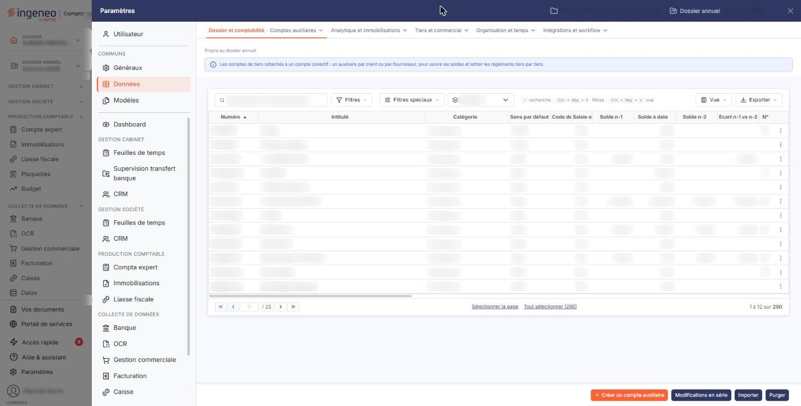
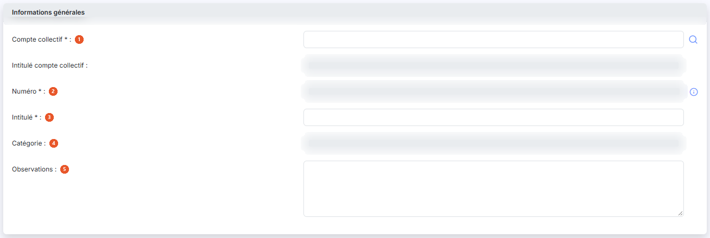
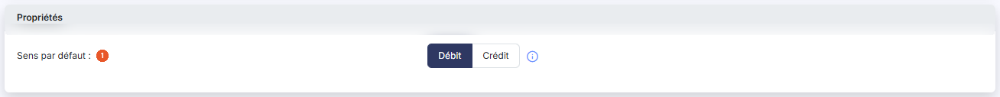
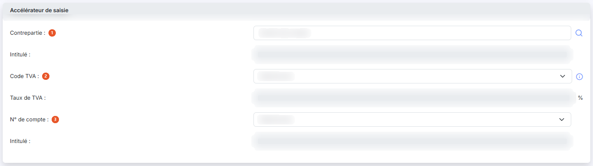
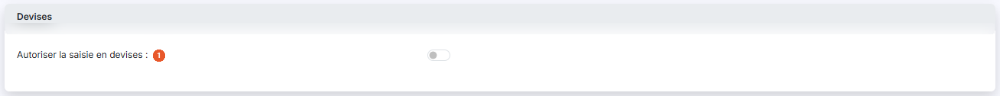
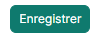

# Comptes auxiliaires


**Où le trouver :** Panneau **Paramètres** › **Données** › **Dossier et comptabilité** › **Comptes auxiliaires**



**En bref** — Cet écran administre les comptes auxiliaires (clients, fournisseurs, salariés, divers), chacun rattaché à un compte collectif qui détermine sa catégorie.

* Pour créer un tiers : bouton \[Créer un compte auxiliaire], choisissez le « Compte collectif », saisissez « Numéro » et « Intitulé », puis bouton \[Enregistrer].
* Pour compléter l'identification d'un tiers : saisissez son « N° de Siren », puis bouton \[Lire Siren].
* Pour reprendre des comptes depuis un fichier : bouton \[Importer], selon un modèle d'import.


Cette option permet d'administrer les comptes auxiliaires du dossier annuel en cours. Un compte auxiliaire est toujours rattaché à un compte collectif du plan comptable, qui détermine sa catégorie.

<figure><figcaption>
Écran « Comptes auxiliaires » de la nouvelle interface
</figcaption></figure>

La suppression d'un compte n'est possible qu'à la condition qu'aucune écriture n'ait été passée sur l'exercice pour le compte concerné.

## Zone de filtres

| Champ            | Ce qu'il faut savoir                                                                                                         |
| ---------------- | ---------------------------------------------------------------------------------------------------------------------------- |
| **N° de compte** | Saisissez tout ou partie d'un numéro ; le logiciel retient tous les comptes qui contiennent la suite de caractères indiquée. |
| **Catégorie**    | Cette liste vous permet de ne retenir qu'une catégorie de comptes. Le choix « Tous » n'écarte aucun compte.                  |

Un troisième critère, présenté sans libellé sous la forme de deux boutons, restreint la liste selon l'activité des comptes : « Tous les comptes », proposé par défaut, ou « Comptes mouvementés ».

La liste présente aussi une barre de recherche, bouton **\[Filtres]**, bouton **\[Vue]** et bouton **\[Exporter]**. Leur fonctionnement, commun à toutes les listes, est décrit dans la page commune « Les listes ».

## Liste des comptes auxiliaires

Les colonnes de cette liste vous appartiennent : le choix des colonnes affichées se fait par le bouton **\[Vue]**. Outre le « Numéro », l'« Intitulé » et la « Catégorie », vous pouvez y afficher le « Sens par défaut », les informations de devise, les soldes de l'exercice et des exercices précédents, les informations d'identification du tiers — « N° de tva intracommunautaire », « N° de siren », « Capital », « Code Naf », « Code DGFIP », « Code juridique usuel » —, le caractère « Soumis TVA autoliquidée », les trois champs de l'accélérateur de saisie, la gestion des échéances, l'unité de quantité et le « Mode de règlement ».

Sur chaque ligne, vous disposez de trois commandes : « Modifier », « Supprimer » et « Dupliquer ». En bas de la liste, le pagineur vous permet de vous déplacer de page en page ; le nombre total de pages est affiché à sa droite.

## Rubrique « Informations générales »

<figure><figcaption>
Rubrique « Informations générales »
</figcaption></figure>

| Champ                            | Ce qu'il faut savoir                                                                                                                                                                                                                                                                                                                                                                                                                                             |
| -------------------------------- | ---------------------------------------------------------------------------------------------------------------------------------------------------------------------------------------------------------------------------------------------------------------------------------------------------------------------------------------------------------------------------------------------------------------------------------------------------------------- |
| 1. **Compte collectif**          | C'est lui qui rattache le compte auxiliaire au plan comptable et qui détermine sa catégorie. Son intitulé vous est rappelé juste en dessous, sans être saisissable.                                                                                                                                                                                                                                                                                              |
| 2. **Numéro**                    | Le numéro de compte doit être unique et n'est plus modifiable après création du compte. Un pictogramme d'information rappelle la règle de composition : « Les caractères autorisés sont les lettres majuscules et les chiffres. »                                                                                                                                                                                                                                |
| 3. **Intitulé**                  | Ce champ pourra être automatiquement repris dans les libellés d'écritures et est modifiable à tout moment.                                                                                                                                                                                                                                                                                                                                                       |
| 4. **Catégorie**                 | Elle est déterminée par le compte collectif auquel vous avez rattaché le compte, et n'est donc pas saisissable.                                                                                                                                                                                                                                                                                                                                                  |
| 5. **Observations**              | 
Ce champ libre vous permet de noter ce que vous voulez sur le tiers. La fiche vous rappelle ensuite qui a créé le compte et qui l'a modifié pour la dernière fois, avec les dates correspondantes. Ces informations ne sont pas saisissables, et la seconde ligne n'apparaît que si le compte a effectivement été modifié depuis sa création.
                                                                                                          |
| **N° de TVA intracommunautaire** | Ce numéro, propre à chaque entreprise, est obligatoire sur les factures aussi bien pour l'émetteur que pour le destinataire. Le logiciel s'en sert également pour reconnaître les fournisseurs dans le module « OCR ».                                                                                                                                                                                                                                           |
| **N° de Siren**                  | Le Bouton \[Lire Siren], placé à sa droite, interroge le répertoire des entreprises et complète pour vous les informations d'identification du tiers.                                                                                                                                                                                                                                                                                                            |
| **Forme juridique**              | 
Une loupe vous permet de la rechercher dans la liste des formes juridiques. <strong>Code DGFIP</strong> et <strong>Code juridique usuel :</strong> ils découlent de la forme juridique et ne sont pas saisissables.
                                                                                                                                                                                                                                    |
| **Capital**                      | —                                                                                                                                                                                                                                                                                                                                                                                                                                                                |
| **Code NAF**                     | Une loupe vous permet de rechercher le code ; seul son libellé reste modifiable une fois le code choisi.                                                                                                                                                                                                                                                                                                                                                         |
| **Mode de règlement**            | Il s'agit du mode de règlement par défaut du tiers, qui sera repris en différents lieux du logiciel. Les modes de règlement se paramètrent dans le panneau « Paramètres », rubrique « Données », « Dossier et comptabilité », « Modes de règlement ».                                                                                                                                                                                                            |
| **Soumis à TVA autoliquidée**    | Ce champ n'est proposé que pour un compte de catégorie fournisseur. Il détermine le régime d'autoliquidation applicable aux factures du fournisseur, et sert notamment à générer les écritures correspondantes dans le module « OCR ». Cinq valeurs vous sont proposées : « Non soumis », retenu par défaut, « Acquisitions intracommunautaires de biens », « Prestations de services intracommunautaires », « Importations hors EU » et « Sous-traitance BTP ». |

## Rubrique « Adresses »

Une fiche de compte auxiliaire peut contenir plusieurs adresses. Le Bouton \[Nouveau] de la rubrique ouvre le formulaire d'une adresse ; la liste présente ensuite, pour chacune, son « Intitulé », son « Contact » et son caractère d'« Adresse par défaut ». Tant qu'aucune adresse n'est saisie, la liste affiche « Liste vide ».

L'intitulé est obligatoire : c'est lui qui vous permet de distinguer les adresses entre elles. Lorsque vous désignez une adresse comme adresse par défaut, c'est elle qui sera reprise à la création de toute nouvelle pièce commerciale.

## Rubrique « Propriétés »

<figure><figcaption>
Rubrique « Propriétés »
</figcaption></figure>

**Sens par défaut** : il indique si, lors de la saisie, le curseur se positionnera par défaut sur un montant au débit ou sur un montant au crédit.

## Rubrique « Accélérateur de saisie »

<figure><figcaption>
Rubrique « Accélérateur de saisie »
</figcaption></figure>

Cette fonctionnalité est particulièrement utile pour les écritures récurrentes : elle vous permet de définir une écriture qui sera générée automatiquement lorsque le compte sera saisi sur la première ligne d'un mouvement, et de positionner directement le curseur sur la cellule voulue.

| Champ               | Ce qu'il faut savoir                                                                                                                                  |
| ------------------- | ----------------------------------------------------------------------------------------------------------------------------------------------------- |
| 1. **Contrepartie** | Le compte utilisé pour générer l'écriture. Son intitulé vous est rappelé juste à côté, sans être saisissable.                                         |
| 2. **Code TVA**     | Indiquez un code TVA si vous souhaitez générer automatiquement une ligne de TVA. Le taux correspondant vous est alors rappelé, sans être saisissable. |
| 3. **N° de compte** | Choisissez parmi les comptes de TVA celui qui devra être repris dans l'écriture. Là encore, son intitulé vous est rappelé sans être saisissable.      |

## Rubrique « Prestataire »

Cette rubrique n'est proposée que pour un compte de catégorie fournisseur. Elle porte deux options :

| Champ                                          | Ce qu'il faut savoir                                                                              |
| ---------------------------------------------- | ------------------------------------------------------------------------------------------------- |
| **Prestataire de services au sens de la DAS2** | Répondez « Oui » si les honoraires versés à ce tiers doivent figurer dans votre déclaration DAS2. |
| **Prestataire de services au sens de la TVA**  | À n'activer que pour les prestataires de services qui n'ont pas opté pour la TVA sur les débits.  |

## Rubrique « Coordonnées bancaires »

Vous avez la possibilité de créer autant de banques que nécessaire pour un tiers. Le Bouton \[Nouveau] de la rubrique ouvre le formulaire d'une banque ; la liste présente ensuite, pour chacune, son « Intitulé », son « Iban » et son caractère par défaut. Tant qu'aucune banque n'est saisie, la liste affiche « Liste vide ».

L'intitulé est obligatoire, car c'est lui qui vous permet de différencier les banques entre elles. La banque désignée par défaut est celle que le logiciel vous proposera systématiquement pour ce tiers.

## Rubrique « Devises »

<figure><figcaption>
Rubrique « Devises »
</figcaption></figure>

**Autoriser la saisie en devises** : cette option détermine si les écritures portées sur ce compte peuvent être saisies dans une autre monnaie que celle du dossier.

## Rubrique « Soldes »

Cette rubrique est une restitution : aucun de ses champs n'est saisissable. Elle vous présente le « Solde à date », le « Solde n-1 », l'« Ecart n vs n-1 » et le « Solde n-2 » d'une part, le caractère « Mouvementé en n-1 » et l'« Ecart n-1 vs n-2 » d'autre part.

## Rubrique « Documents »

Cette rubrique vous permet de rattacher des documents au tiers. La liste présente, pour chacun, sa « Description », le « Nom du fichier », sa « Date » et l'intervenant qui l'a créé. Tant qu'aucun document n'est rattaché, la liste affiche « Liste vide ».

Trois boutons vous permettent de choisir la provenance du document : le Bouton \[Nouveau doc depuis mon poste] pour un fichier de votre ordinateur, le Bouton \[Nouveau doc depuis la GED] pour un document déjà classé dans la GED, et le Bouton \[Nouveau doc depuis l'OCR] pour une pièce traitée par l'OCR.

## Bouton \[Créer un compte auxiliaire]

<figure><figcaption>
Bouton [Créer un compte auxiliaire]
</figcaption></figure>

Il ouvre une fiche vierge de compte auxiliaire, sensiblement plus courte que celle d'un compte existant : seules les rubriques « Informations générales », « Propriétés », « Accélérateur de saisie » et « Devises » vous sont présentées.

Dans la rubrique « Informations générales », vous ne renseignez alors que le « Compte collectif », le « Numéro » — obligatoire et saisissable à ce moment seulement — l'« Intitulé » et les « Observations » ; la « Catégorie » vous est rappelée sans être saisissable. Les informations d'identification du tiers — numéro de TVA intracommunautaire, numéro de Siren, forme juridique, codes, capital, code NAF, mode de règlement et régime d'autoliquidation — ne vous sont proposées qu'une fois le compte enregistré.

Il en va de même des rubriques « Adresses », « Coordonnées bancaires », « Soldes » et « Documents », qui n'apparaissent qu'à la réouverture de la fiche.

Selon le paramétrage de votre dossier et la catégorie du compte, la fiche peut présenter des rubriques supplémentaires. Certains boutons peuvent également ne pas vous être proposés : leur affichage dépend des droits attachés à votre profil.

## Autres vues de l'écran

<figure><figcaption>
Bouton [Enregistrer]
</figcaption></figure>
