# Configuration


**Où le trouver :** Panneau **Paramètres** › **Caisse** › **Configuration**



**En bref** — Cet écran rassemble les règles comptables du dossier annuel : racines du plan comptable, régime de TVA, comptabilisation des déclarations, lettrage, affectation du résultat et extournes de clôture.

* Pour pré-remplir les comptes : bouton \[Charger les valeurs par défaut], repérez les numéros en gris et en italique (comptes absents du plan comptable), puis bouton \[Enregistrer].
* Pour déclarer le régime de TVA : activez « La société est-elle soumise à la TVA ? », choisissez le « Régime de TVA », la périodicité et l'« Exigibilité TVA », puis bouton \[Enregistrer].


Cette option rassemble les règles de gestion comptables du dossier annuel : les racines du plan comptable, le régime de TVA et la comptabilisation des déclarations, le lettrage, l'affectation du résultat et les extournes de clôture.

<figure>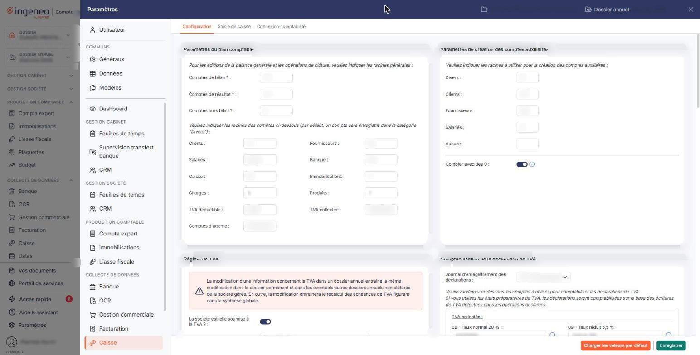<figcaption>
Écran « Configuration » de la nouvelle interface
</figcaption></figure>

C'est l'écran de paramétrage général de la comptabilité, et il est présenté ici sans restriction : vous y voyez l'ensemble des rubriques comptables du dossier, y compris celles qui ne servent pas directement à la tenue de votre caisse.

Il s'ouvre depuis le panneau Paramètres : choisissez la rubrique « Caisse » de la colonne de gauche (section « Collecte de données »), puis l'onglet « Configuration » en tête du panneau. Les deux autres onglets de la rubrique, « Saisie de caisse » et « Connexion comptabilité », sont décrits dans leurs propres pages.

L'écran se compose de huit rubriques, sans onglet propre, présentées sur deux colonnes. Les champs suivis d'un astérisque sont obligatoires.

## Rubrique « Paramètres du plan comptable »

<figure>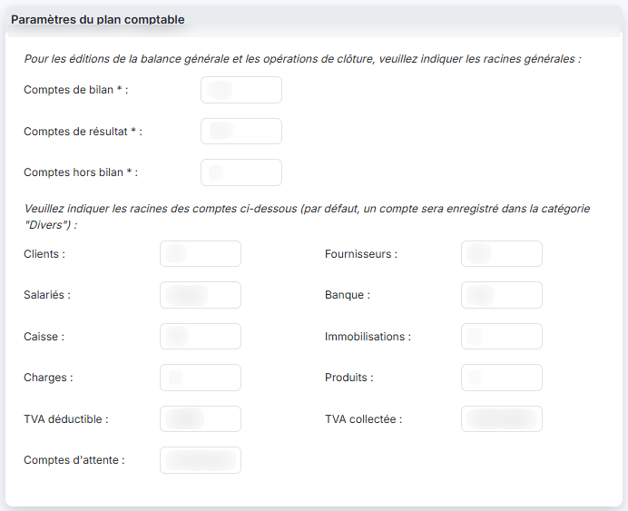<figcaption>
Rubrique « Paramètres du plan comptable »
</figcaption></figure>

Le fait de paramétrer des racines par nature de compte facilite les recherches ainsi que les propositions que peut vous faire le logiciel à chaque fois qu'un compte comptable est demandé.

La rubrique commence par les trois racines générales, introduites par la phrase « Pour les éditions de la balance générale et les opérations de clôture, veuillez indiquer les racines générales : ». Elles sont ici **obligatoires** : **Comptes de bilan \* :**, **Comptes de résultat \* :** et **Comptes hors bilan \* :**.

Viennent ensuite, sur deux colonnes, les racines par nature de compte, introduites par la phrase « Veuillez indiquer les racines des comptes ci-dessous (par défaut, un compte sera enregistré dans la catégorie "Divers") : ». Elles se lisent dans cet ordre : **Clients :** et **Fournisseurs :**, **Salariés :**, **Banque :** et **Caisse :**, **Immobilisations :**, **Charges :** et **Produits :**, **TVA déductible :** et **TVA collectée :**, **Comptes d'attente :**.

Ces racines sont les **mêmes** que celles de l'onglet « Connexion comptabilité » de la même rubrique « Caisse » : les deux écrans donnent accès au même paramétrage, et ce que vous saisissez ici se retrouve là-bas. Le rôle de chaque racine est détaillé dans la page de « Connexion comptabilité ».

## Rubrique « Paramètres de création des comptes auxiliaires »

<figure>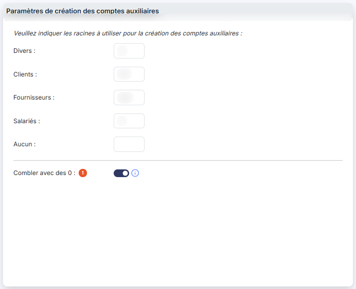<figcaption>
Rubrique « Paramètres de création des comptes auxiliaires »
</figcaption></figure>

Introduite par la phrase « Veuillez indiquer les racines à utiliser pour la création des comptes auxiliaires : », cette rubrique vous permet d'indiquer, pour chaque nature de compte auxiliaire, la racine qui sera proposée lors de la création du compte.

Les cinq zones sont présentées sur deux colonnes, dans cet ordre : **Divers :** et **Clients :**, puis **Fournisseurs :** et **Salariés :**, puis **Aucun :**. Tant qu'une zone est vide, elle affiche en gris et en italique la lettre attendue — « D », « C », « F » ou « S » — ce qui vous aide à repérer la nature concernée.

**Combler avec des 0** : activez l'interrupteur pour que le logiciel complète avec des zéros les numéros de comptes auxiliaires plus courts que la longueur paramétrée. Cette longueur est celle du champ « Nombre de caractères des numéros de compte comptable » de l'écran « Multimodules » (panneau Paramètres, rubrique « Généraux », onglet « Configuration »). L'option ne touche pas aux codes auxiliaires.

## Rubrique « Régime de TVA »

<figure>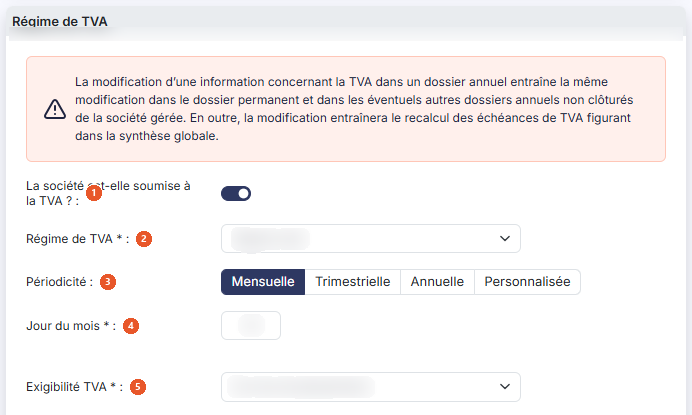<figcaption>
Rubrique « Régime de TVA »
</figcaption></figure>

Un avertissement en rouge ouvre cette rubrique : « La modification d'une information concernant la TVA dans un dossier annuel entraîne la même modification dans le dossier permanent et dans les éventuels autres dossiers annuels non clôturés de la société gérée. En outre, la modification entraînera le recalcul des échéances de TVA figurant dans la synthèse globale. » Lisez-le avant toute modification : la portée de ce changement dépasse le dossier annuel sur lequel vous êtes positionné.

| Champ                                                              | Ce qu'il faut savoir                                                                                                                                                                                                                                                                                                                                                                                                                                                                                                                                                                                                       |
| ------------------------------------------------------------------ | -------------------------------------------------------------------------------------------------------------------------------------------------------------------------------------------------------------------------------------------------------------------------------------------------------------------------------------------------------------------------------------------------------------------------------------------------------------------------------------------------------------------------------------------------------------------------------------------------------------------------- |
| 1. **La société est-elle soumise à la TVA ?**                      | 
C'est la question qui commande toute la rubrique, et même la rubrique suivante. Si vous activez l'interrupteur, vous devez renseigner :
                                                                                                                                                                                                                                                                                                                                                                                                                                                                          |
| 
2. <strong>Régime de TVA</strong> <em>Obligatoire</em>
   | Le choix est obligatoire. La liste propose « Franchise de TVA », « Mini réel », « Régime réel », « Régime réel agricole », « Régime simplifié », « Régime simplifié agricole », « Taxe générale sur la consommation » et « TVA groupe ». Tant que vous n'avez rien choisi, elle affiche « Sélectionnez ». Ce régime commande le formulaire présenté dans la rubrique suivante.                                                                                                                                                                                                                                             |
| 3. **Périodicité**                                                 | Quatre choix mutuellement exclusifs, présentés côte à côte : « Mensuelle », « Trimestrielle », « Annuelle » et « Personnalisée ». Le champ qui suit dépend de celui que vous retenez.                                                                                                                                                                                                                                                                                                                                                                                                                                      |
| 
4. <strong>Jour du mois</strong> <em>Obligatoire</em>
    | 
Le jour du mois auquel l'échéance est attendue. Il est obligatoire, et n'est présenté que pour les périodicités « Mensuelle » et « Trimestrielle ». Avec la périodicité « Annuelle », il cède la place à la mention « La date correspond au deuxième jour ouvré après le 1er mai. » : vous n'avez alors aucune date à saisir. Avec la périodicité « Personnalisée », il cède la place à un tableau de deux colonnes, « N° échéance » et « Jour », dans lequel vous déclarez vous-même chacune des échéances attendues. Il est suivi de deux boutons, décrits plus bas, qui ajoutent et retirent une échéance.
 |
| 
5. <strong>Exigibilité TVA</strong> <em>Obligatoire</em>
 | Le choix est obligatoire. La liste propose « Sur les encaissements », « Sur les débits » et « Mixte ». Tant que vous n'avez rien choisi, elle affiche « Sélectionnez ».                                                                                                                                                                                                                                                                                                                                                                                                                                                    |


Remarque : si vous choisissez le régime « Franchise de TVA », la périodicité, le jour du mois et l'exigibilité disparaissent tous les trois, la franchise ne donnant pas lieu à déclaration périodique.


Si vous le désactivez, toute la partie déclarative disparaît — le régime, la périodicité, le jour du mois, l'exigibilité, ainsi que la rubrique entière « Comptabilisation de la déclaration de TVA » — et **deux questions apparaissent**, que vous ne verrez pas autrement :

| Champ                                                        | Ce qu'il faut savoir                                                                                                                                                                              |
| ------------------------------------------------------------ | ------------------------------------------------------------------------------------------------------------------------------------------------------------------------------------------------- |
| **La société est-elle soumise à la taxe sur les salaires ?** | À renseigner pour une société non assujettie à la TVA.                                                                                                                                            |
| **La société est-elle soumise à la TVS ?**                   | Activez l'interrupteur si la société est redevable de la taxe sur les véhicules de société. Ce choix conditionne la création de l'échéance correspondante dans la synthèse de votre portefeuille. |

## Rubrique « Comptabilisation de la déclaration de TVA »

<figure>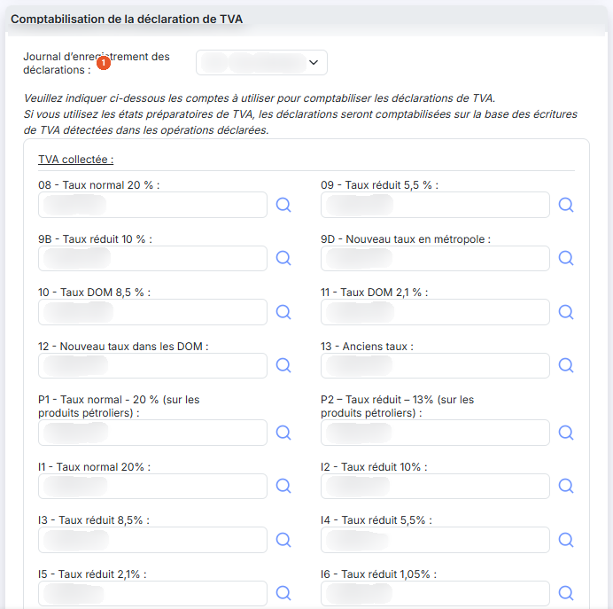<figcaption>
Rubrique « Comptabilisation de la déclaration de TVA »
</figcaption></figure>

<figure>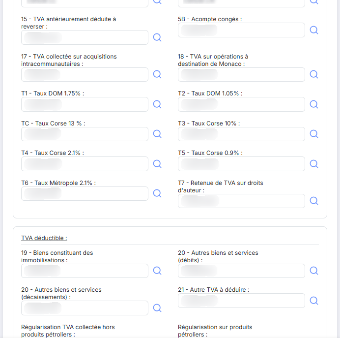<figcaption>
Rubrique « Comptabilisation de la déclaration de TVA »
</figcaption></figure>

<figure><figcaption>
Rubrique « Comptabilisation de la déclaration de TVA »
</figcaption></figure>

<figure>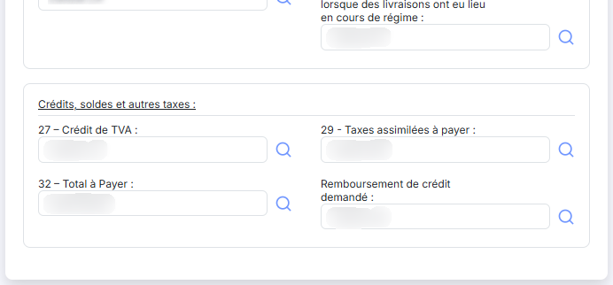<figcaption>
Rubrique « Comptabilisation de la déclaration de TVA »
</figcaption></figure>

Cette rubrique n'est présentée que si la société est soumise à la TVA. Deux phrases l'introduisent : « Veuillez indiquer ci-dessous les comptes à utiliser pour comptabiliser les déclarations de TVA. » et « Si vous utilisez les états préparatoires de TVA, les déclarations seront comptabilisées sur la base des écritures de TVA détectées dans les opérations déclarées. »

**Journal d'enregistrement des déclarations** : le journal dans lequel les déclarations seront comptabilisées. La liste reprend les journaux de votre dossier : son contenu varie donc d'un dossier à l'autre.

Le reste de la rubrique est une table de correspondance : chaque ligne reprend une case du formulaire de déclaration — son numéro et son libellé, tels qu'ils figurent sur le formulaire — et vous y indiquez le numéro de compte à utiliser. Tant qu'une zone est vide, elle affiche en gris le repère de la case concernée. Une loupe, à droite de chaque zone, vous permet de rechercher le compte dans votre plan comptable.

**Le formulaire présenté dépend du régime de TVA que vous avez choisi.** Le logiciel en connaît quatre, et chacun a ses propres cases : le formulaire 3310CA3 pour les régimes « Mini réel », « Régime réel » et « Régime réel agricole », le formulaire 3517CA12 pour le « Régime simplifié », le formulaire 3517BCA12A pour le « Régime simplifié agricole », et le formulaire de la taxe générale sur la consommation pour le régime du même nom. Les régimes « Franchise de TVA » et « TVA groupe » ne présentent aucun formulaire, non plus que l'absence de choix.

Les trois formulaires de TVA regroupent leurs cases sous les sous-titres « TVA collectée : », « TVA déductible : » et « Crédits, soldes et autres taxes : ». Le formulaire de la taxe générale sur la consommation emploie les sous-titres « TGC collectée : », « TGC déductible : » et « Crédit et TGC à payer : ».

## Rubrique « Archivage des déclarations de TVA »

<figure>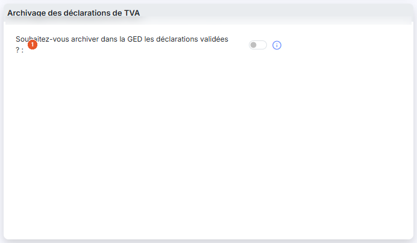<figcaption>
Rubrique « Archivage des déclarations de TVA »
</figcaption></figure>

| Champ                                                                          | Ce qu'il faut savoir                                                                                                                                                                                                                                                                                                                                                                                                                             |
| ------------------------------------------------------------------------------ | ------------------------------------------------------------------------------------------------------------------------------------------------------------------------------------------------------------------------------------------------------------------------------------------------------------------------------------------------------------------------------------------------------------------------------------------------ |
| 1. **Souhaitez-vous archiver dans la GED les déclarations validées ?**         | 
Si vous activez l'interrupteur, chaque déclaration de TVA télétransmise sera enregistrée dans la GED. Un répertoire y sera automatiquement créé, pour chaque dossier annuel, lors de la télétransmission d'une déclaration dans le dossier annuel. Un pictogramme d'information, à droite de l'interrupteur, rappelle ce comportement. Activer l'interrupteur fait apparaître une seconde question, que vous ne verrez pas autrement :
 |
| **Souhaitez-vous une arborescence avec années puis les déclarations de TVA ?** | Si vous l'activez, un répertoire sera créé par année civile, avec un sous-répertoire contenant toutes les déclarations de TVA. Si vous le désactivez, un répertoire sera créé pour les déclarations de TVA, avec des sous-répertoires par année civile.                                                                                                                                                                                          |

## Rubrique « Lettrage - Ecritures d'ajustement »

<figure>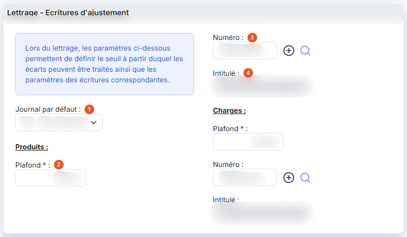<figcaption>
Rubrique « Lettrage - Ecritures d'ajustement »
</figcaption></figure>

Cette rubrique vous permet de définir les plafonds de génération des écritures d'ajustement lors des lettrages, ainsi que le compte de contrepartie de ces écritures.

| Champ                                                      | Ce qu'il faut savoir                                                                                                                                                                                                                        |
| ---------------------------------------------------------- | ------------------------------------------------------------------------------------------------------------------------------------------------------------------------------------------------------------------------------------------- |
| 1. **Journal par défaut**                                  | 
Le journal dans lequel les écritures d'ajustement seront déversées. Viennent ensuite deux sous-blocs identiques, l'un sous le sous-titre « Produits : », l'autre sous le sous-titre « Charges : ». Chacun comporte trois champs :
 |
| 
2. <strong>Plafond</strong> <em>Obligatoire</em>
 | Le montant en deçà duquel une écriture d'ajustement peut être générée. Il est obligatoire.                                                                                                                                                  |
| 3. **Numéro**                                              | Le compte de contrepartie de l'écriture d'ajustement. À sa droite, un bouton en forme de signe plus vous permet de créer le compte sans quitter l'écran, et une loupe de rechercher un compte existant.                                     |
| 4. **Intitulé**                                            | L'intitulé de ce compte. Il n'est **pas saisissable** : il se remplit à partir du numéro que vous avez indiqué.                                                                                                                             |

## Rubrique « Affectation du résultat »

<figure>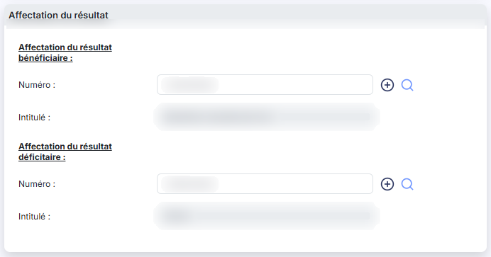<figcaption>
Rubrique « Affectation du résultat »
</figcaption></figure>

Cette rubrique vous permet de définir dans quel compte sera généré le résultat de l'exercice, lors de l'édition des états financiers comme lors de la clôture et de la réouverture des exercices.

Deux sous-blocs, sous les sous-titres « Affectation du résultat bénéficiaire : » et « Affectation du résultat déficitaire : », comportent chacun un champ **Numéro :** et un champ **Intitulé :**. Un bouton en forme de signe plus et une loupe accompagnent chaque numéro ; comme dans la rubrique précédente, l'intitulé n'est pas saisissable et se remplit à partir du numéro. Aucun de ces champs n'est obligatoire.

## Rubrique « Extournes lors de la clôture »

<figure>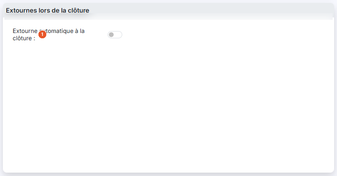<figcaption>
Rubrique « Extournes lors de la clôture »
</figcaption></figure>

| Champ                                    | Ce qu'il faut savoir                                                                                                                                                                                                                          |
| ---------------------------------------- | --------------------------------------------------------------------------------------------------------------------------------------------------------------------------------------------------------------------------------------------- |
| 1. **Extourne automatique à la clôture** | Si vous avez saisi des écritures de provision dans un journal, activez l'interrupteur pour en faire l'extourne automatique au premier jour du nouvel exercice. Un champ apparaît alors :                                                      |
| **Journal**                              | Le journal où se trouvent vos écritures de provision. Son pictogramme d'information précise que seules les écritures de ce journal datées du dernier jour de l'exercice seront automatiquement extournées au premier jour du nouvel exercice. |

## Bouton \[Nouvelle ligne]

Il n'apparaît que sous le tableau des échéances de TVA, lui-même présenté pour la seule périodicité « Personnalisée ». Il ajoute une échéance au tableau.

## Bouton \[Supprimer ligne]

Il figure à droite du précédent, dans les mêmes conditions, et retire la dernière échéance du tableau ; elle ne retire rien s'il ne reste qu'une seule échéance.

## Bouton \[Enregistrer]

<figure><figcaption>
Bouton [Enregistrer]
</figcaption></figure>

Il enregistre l'ensemble des paramètres de l'écran.

## Bouton \[Charger les valeurs par défaut]

<figure><figcaption>
Bouton [Charger les valeurs par défaut]
</figcaption></figure>

Son infobulle, qui s'affiche au survol du bouton, l'annonce ainsi : ce bouton charge les valeurs prévues et vérifie que les comptes existent bien dans le plan comptable ; si ce n'est pas le cas, le numéro de compte est affiché en gris et en italique.

Retenez ce signal : c'est le seul. Aucun message ne vous avertit qu'un compte proposé par défaut n'existe pas dans votre plan comptable. Pour utiliser un compte ainsi grisé, créez-le d'abord dans le plan comptable.
