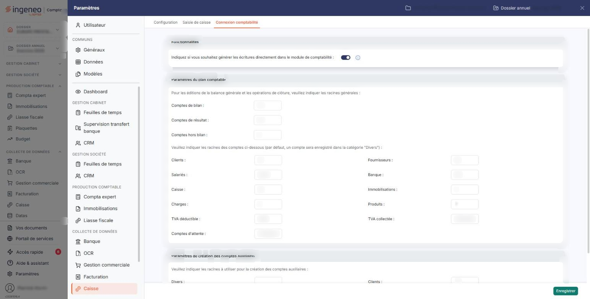
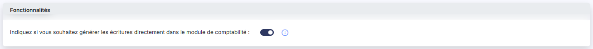
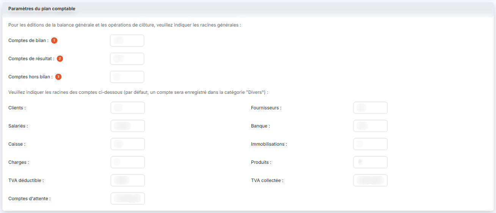
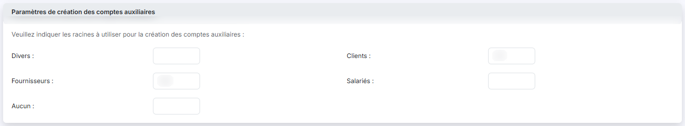

# Connexion comptabilité


**Où le trouver :** Panneau **Paramètres** › **Caisse** › **Connexion comptabilité**



**En bref** — Cet écran indique où sont générées les écritures de caisse et fixe les racines de comptes que le logiciel utilise pour reconnaître et proposer les comptes comptables.

* Pour générer les écritures directement en comptabilité : activez l'interrupteur de la rubrique « Fonctionnalités », puis bouton \[Enregistrer].
* Pour les exporter plutôt vers un autre logiciel : désactivez cet interrupteur, puis bouton \[Enregistrer] ; les écritures iront dans l'option « Ecritures ».


Cette option rassemble les paramétrages nécessaires à la génération des écritures : la destination de ces écritures, et les racines de comptes que le logiciel utilise pour reconnaître et proposer les comptes comptables.

<figure><figcaption>
Écran « Connexion comptabilité » de la nouvelle interface
</figcaption></figure>

Il s'ouvre depuis le panneau Paramètres : choisissez la rubrique « Caisse » de la colonne de gauche, puis l'onglet « Connexion comptabilité » en tête du panneau.

L'écran se compose de trois rubriques, sans onglet propre ni liste. Il présente directement les valeurs en vigueur pour le dossier annuel sur lequel vous êtes positionné ; vous les modifiez puis vous les enregistrez.

Aucun champ n'est signalé comme obligatoire.

## Rubrique « Fonctionnalités »

<figure><figcaption>
Rubrique « Fonctionnalités »
</figcaption></figure>

**Indiquez si vous souhaitez générer les écritures directement dans le module de comptabilité :** activez l'interrupteur pour que les écritures soient générées automatiquement dans le journal idoine de la comptabilité dès qu'une journée de caisse est validée. Désactivez-le pour que les écritures soient déposées dans l'option « Ecritures » du module, où vous pourrez ensuite les exporter vers un autre logiciel.

Un pictogramme d'information à droite de l'interrupteur rappelle ces deux comportements.

Quelle que soit votre réponse, l'écran continue de présenter les mêmes rubriques et les mêmes champs : ce choix ne masque rien.

## Rubrique « Paramètres du plan comptable »

<figure><figcaption>
Rubrique « Paramètres du plan comptable »
</figcaption></figure>

Le fait de paramétrer des racines par nature de compte facilite les recherches ainsi que les propositions que peut vous faire le logiciel à chaque fois qu'un compte comptable est demandé.

La rubrique commence par les trois racines générales, introduites par la phrase « Pour les éditions de la balance générale et les opérations de clôture, veuillez indiquer les racines générales : » :

| Champ                      | Ce qu'il faut savoir                                                        |
| -------------------------- | --------------------------------------------------------------------------- |
| 1. **Comptes de bilan**    | La racine des comptes qui figurent au bilan.                                |
| 2. **Comptes de résultat** | La racine des comptes qui figurent au compte de résultat.                   |
| 3. **Comptes hors bilan**  | La racine des comptes qui ne figurent ni au bilan ni au compte de résultat. |

Viennent ensuite les racines par nature de compte, introduites par la phrase « Veuillez indiquer les racines des comptes ci-dessous (par défaut, un compte sera enregistré dans la catégorie "Divers") : ». Elles sont présentées sur deux colonnes ; l'ordre d'affichage est le suivant :

* **Clients** : et **Fournisseurs :**
* **Salariés**
* **Banque** : et **Caisse :**
* **Immobilisations**
* **Charges** : et **Produits :**
* **TVA déductible** : et **TVA collectée :**
* **Comptes d'attente**

Chacune de ces zones se saisit librement. Un compte dont la racine ne correspond à aucune de ces natures est rangé dans la catégorie « Divers ».

Ces racines sont les **mêmes** que celles de l'onglet « Configuration » (page « Paramètres généraux ») de la même rubrique « Caisse » : les deux écrans donnent accès au même paramétrage, et ce que vous saisissez ici se retrouve là-bas. Seule différence : sur cet écran, les trois racines générales ne sont pas obligatoires.

## Rubrique « Paramètres de création des comptes auxiliaires »

<figure><figcaption>
Rubrique « Paramètres de création des comptes auxiliaires »
</figcaption></figure>

Introduite par la phrase « Veuillez indiquer les racines à utiliser pour la création des comptes auxiliaires : », cette rubrique vous permet d'indiquer, pour chaque nature de compte auxiliaire, la racine qui sera proposée lors de la création du compte.

Les cinq zones sont présentées sur deux colonnes, dans cet ordre : **Divers :** et **Clients :**, puis **Fournisseurs :** et **Salariés :**, puis **Aucun :**. Elles aussi sont partagées avec l'onglet « Configuration » (page « Paramètres généraux »). En revanche, l'option « Combler avec des 0 » que vous trouvez là-bas ne figure pas sur cet écran.

## Bouton \[Enregistrer]

<figure><figcaption>
Bouton [Enregistrer]
</figcaption></figure>

Il enregistre l'ensemble des paramètres de l'écran. C'est le seul bouton de cet écran : il n'y a ni retour, ni annulation, ni impression. Pour abandonner vos modifications, quittez l'écran sans enregistrer.
