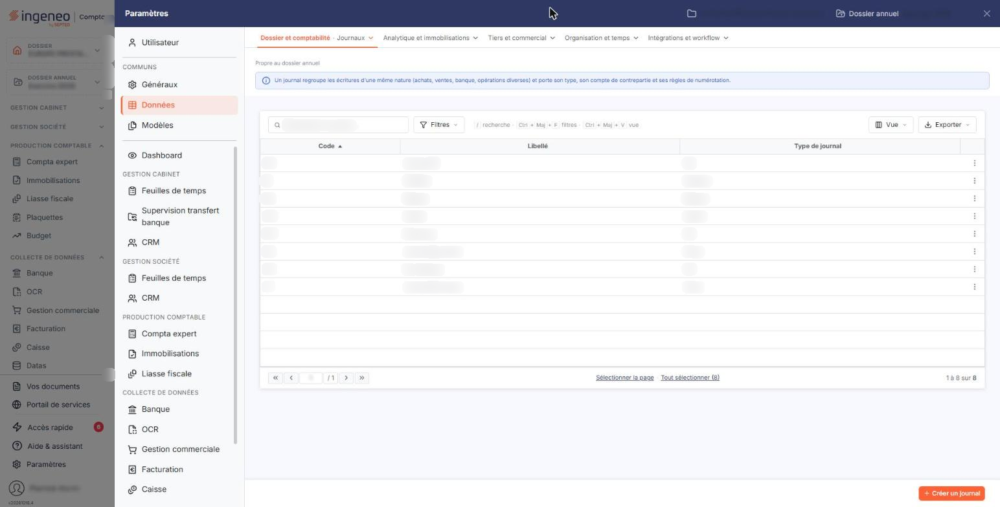
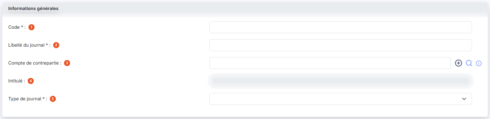
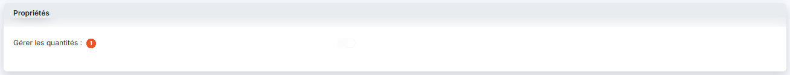
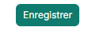

# Journaux


**Où le trouver :** Panneau **Paramètres** › **Données** › **Dossier et comptabilité** › **Journaux**



**En bref** — Cet écran vous permet de créer et de gérer les journaux d'enregistrement des écritures, dont le journal de caisse, avec leur type et leur compte de contrepartie.

* Pour créer un journal : bouton \[Créer un journal], renseignez « Code », « Libellé du journal » et « Type de journal », puis bouton \[Enregistrer].
* Pour supprimer des journaux : sélectionnez-les, puis bouton \[Supprimer] ; leurs écritures de l'exercice sont supprimées avec eux.


Cette option vous permet d'administrer les journaux utilisés pour l'enregistrement des écritures. Vous pouvez créer autant de journaux que nécessaire.

<figure><figcaption>
Écran « Journaux » de la nouvelle interface
</figcaption></figure>

La création d'un journal entraîne la création d'une subdivision de ce journal pour chaque mois du dossier annuel sur lequel vous êtes positionné.


Remarque : il est possible de supprimer un journal, mais cette opération entraîne la suppression de toutes les écritures qui y ont été saisies pour l'exercice en cours.


L'écran ne comporte pas de zone de filtres : il est constitué de la seule liste des journaux, avec trois colonnes — « Code », « Libellé » et « Type de journal ». Chacune est triable par un clic sur son en-tête.

Sur chaque ligne, vous disposez de trois pictogrammes : modifier le journal, le supprimer, le dupliquer.

En bas de la liste, le pagineur vous permet de vous déplacer d'une, de dix ou de cent pages, ou d'aller directement à la première ou à la dernière ; le décompte des journaux est affiché à sa droite.

## Barre de la liste

La liste présente aussi une barre de recherche, bouton **\[Filtres]**, bouton **\[Vue]** et bouton **\[Exporter]**. Leur fonctionnement, commun à toutes les listes — dont le choix des colonnes affichées —, est décrit dans la page commune « Les listes ».

## Rubrique « Informations générales »

<figure><figcaption>
Rubrique « Informations générales »
</figcaption></figure>

| Champ                         | Ce qu'il faut savoir                                                                                                                                                                                                                                                                                                                                                                                                                       |
| ----------------------------- | ------------------------------------------------------------------------------------------------------------------------------------------------------------------------------------------------------------------------------------------------------------------------------------------------------------------------------------------------------------------------------------------------------------------------------------------ |
| 1. **Code**                   | Chaque journal doit avoir un code unique. Une fois le journal créé, son code n'est plus modifiable : le champ apparaît alors grisé.                                                                                                                                                                                                                                                                                                        |
| 2. **Libellé du journal**     | Il désigne le journal partout où il est présenté à l'utilisateur, et reste modifiable à tout moment.                                                                                                                                                                                                                                                                                                                                       |
| 3. **Compte de contrepartie** | Il s'agit du compte utilisé pour solder l'écriture en saisie ; il est facultatif. Par exemple, pour un journal de banque, vous pouvez indiquer le compte de racine 512000. Trois commandes accompagnent ce champ : un pictogramme « Plus » vert, qui vous permet de créer le compte sans quitter la fiche, une loupe, qui ouvre une fenêtre de recherche parmi vos comptes, et un pictogramme d'information qui rappelle le rôle du champ. |
| 4. **Intitulé**               | L'intitulé du compte de contrepartie que vous avez indiqué. Il n'est pas saisissable : le logiciel le reprend du plan comptable.                                                                                                                                                                                                                                                                                                           |
| 5. **Type de journal**        | Il indique la nature des opérations enregistrées dans le journal. Le choix est obligatoire ; la liste propose « Achat », « Vente », « OD », « Banque », « Caisse », « Reprise de balance », « Divers » et « A-nouveaux ».                                                                                                                                                                                                                  |

Vous pouvez rencontrer, dans la colonne « Type de journal » de la liste, la valeur « Situation », portée par des journaux créés antérieurement : elle n'est pas proposée à la création d'un nouveau journal.

## Rubrique « Propriétés »

<figure><figcaption>
Rubrique « Propriétés »
</figcaption></figure>

**Gérer les quantités** : cette option vous permet de saisir des quantités sur les lignes d'écritures du journal. Elle n'est modifiable que si vous avez activé la gestion des quantités dans le panneau « Paramètres », rubrique « Généraux », onglet « Configuration » ; à défaut, l'interrupteur reste grisé, désactivé.

## Bouton \[Créer un journal]

<figure><figcaption>
Bouton [Créer un journal]
</figcaption></figure>

Il ouvre une fiche vierge. Les deux rubriques et les mêmes champs vous y sont présentés, avec trois différences : le « Code » est saisissable et obligatoire, le « Libellé du journal » est obligatoire, et le « Type de journal » est positionné sur une valeur vide qu'il vous appartient de renseigner.

## Bouton \[Supprimer]

Il supprime les journaux que vous avez sélectionnés dans la liste. Vous pouvez aussi supprimer un journal isolé par le pictogramme de suppression de sa ligne.

## Bouton \[Enregistrer]

<figure><figcaption>
Bouton [Enregistrer]
</figcaption></figure>

Il enregistre la fiche et vous ramène à la liste des journaux.

## Bouton \[Retour]

Il vous ramène à la liste des journaux sans enregistrer les modifications que vous auriez faites dans la fiche.
