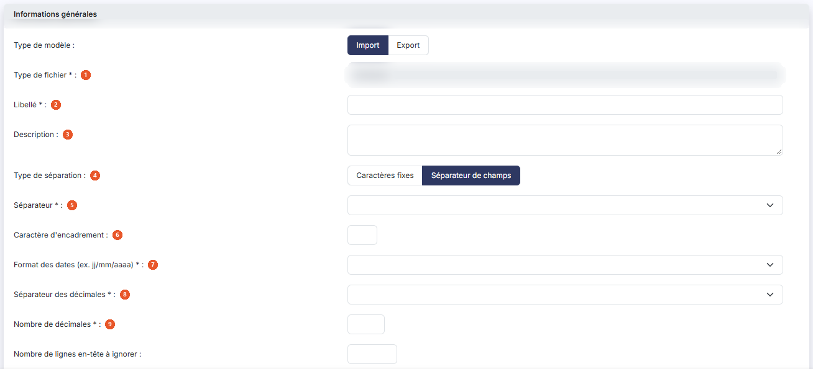
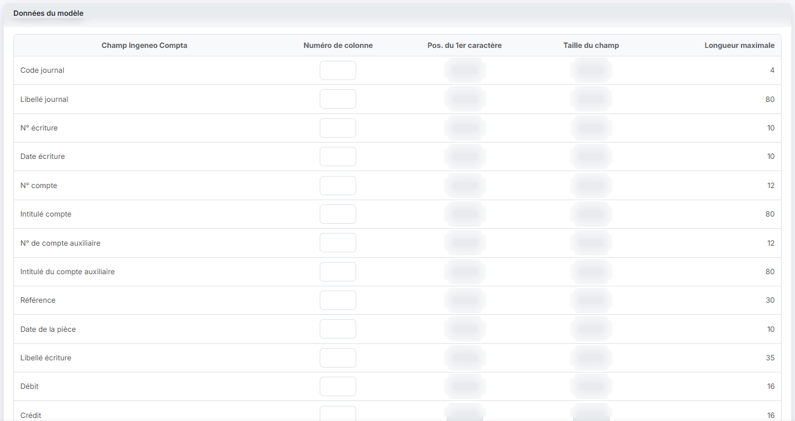
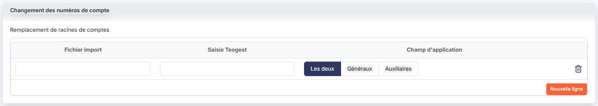
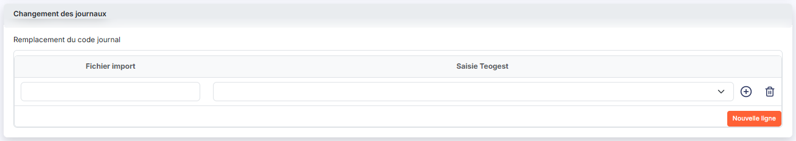

# Modèles d'export


**Où le trouver :** Panneau **Paramètres**



**En bref** — Cet écran gère les modèles d'export du brouillard d'écritures : chacun décrit la forme du fichier produit lorsque vous exportez les écritures de la caisse.

* Pour construire votre modèle : dupliquez un modèle existant, ou bouton \[Créer un modèle], indiquez la place de chaque champ, puis bouton \[Enregistrer].
* Pour récupérer les modèles fournis par Ingeneo Compta : bouton \[Charger les nouveaux modèles].


Cette option vous permet de gérer les modèles d'export fournis par Ingeneo Compta, et de créer les vôtres. Un modèle d'export décrit la forme du fichier à produire : la façon dont les champs y sont séparés, le format des dates et des montants, et la place de chaque champ dans le fichier.

<figure><figcaption>
Écran « Modèles d'export » de la nouvelle interface
</figcaption></figure>

Depuis le module « Caisse », les modèles portent sur un seul type de données, le brouillard d'écritures.

Les modèles que vous définissez ici vous sont proposés lorsque vous exportez des écritures depuis l'option « Ecritures » du même module.

L'écran ne comporte pas de zone de filtres : il est constitué de la seule liste des modèles, avec quatre colonnes — « Libellé », « Fichier », « Description » et « Modifiable ». Chacune est triable par un clic sur son en-tête ; la liste est présentée par défaut dans l'ordre croissant des libellés. Deux colonnes ne sont pas affichées au départ, « Modèle éditeur » et « Dernière modification », mais vous pouvez les faire apparaître.

La colonne « Modifiable » vous indique si vous pouvez retoucher le modèle.

Sur chaque ligne, vous disposez de trois pictogrammes, dont l'infobulle vous rappelle le rôle : « Modifier », « Supprimer » et « Dupliquer ». La duplication est le moyen le plus simple de construire votre propre modèle à partir d'un modèle existant.


Attention : la liste peut aussi contenir des modèles dont le libellé commence par « Import ». Ne les ouvrez pas depuis cet écran : ils y sont présentés comme des modèles d'export, sans que rien ne vous le signale.


En bas de la liste, le pagineur vous permet de vous déplacer d'une, de dix ou de cent pages, ou d'aller directement à la première ou à la dernière ; le décompte des modèles est affiché à sa droite.

## Barre de la liste

La liste présente aussi une barre de recherche, bouton **\[Filtres]** et bouton **\[Vue]**, grâce auquel vous faites apparaître les colonnes « Modèle éditeur » et « Dernière modification ». Leur fonctionnement, commun à toutes les listes, est décrit dans la page commune « Les listes ».

## Rubrique « Informations générales »

<figure><figcaption>
Rubrique « Informations générales »
</figcaption></figure>

<figure><figcaption>
Rubrique « Informations générales »
</figcaption></figure>

| Champ                                                              | Ce qu'il faut savoir                                                                                                                                                                                                                                                                                                                                                                                                                                                                                                                                                                                                                                                                                                                                              |
| ------------------------------------------------------------------ | ----------------------------------------------------------------------------------------------------------------------------------------------------------------------------------------------------------------------------------------------------------------------------------------------------------------------------------------------------------------------------------------------------------------------------------------------------------------------------------------------------------------------------------------------------------------------------------------------------------------------------------------------------------------------------------------------------------------------------------------------------------------- |
| 1. **Type de fichier**                                             | Il décrit la nature des données exportées, et donc les champs que le fichier pourra contenir. Depuis le module « Caisse », le sélecteur ne propose qu'une valeur, « Brouillard d'écritures ».                                                                                                                                                                                                                                                                                                                                                                                                                                                                                                                                                                     |
| 2. **Libellé**                                                     | Il désigne le modèle dans la liste et partout où celui-ci vous est proposé.                                                                                                                                                                                                                                                                                                                                                                                                                                                                                                                                                                                                                                                                                       |
| 3. **Description**                                                 | Cette zone de texte accepte plusieurs lignes ; profitez-en pour rappeler à quoi sert le modèle et pour quel destinataire il a été construit.                                                                                                                                                                                                                                                                                                                                                                                                                                                                                                                                                                                                                      |
| 4. **Type de séparation**                                          | 
Les enregistrements du fichier produit peuvent être construits de deux façons, et vous choisissez l'une ou l'autre par ces deux boutons : • « Caractères fixes » : chaque champ occupe toujours la même position sur chaque ligne — par exemple la date du caractère 1 au caractère 10, le numéro de compte du 11 au 22 — quelle que soit la taille effective du contenu, les caractères inutilisés étant remplis par des espaces ; • « Séparateur de champs » : les champs ont une longueur variable, il n'y a plus d'espaces inutilisés, mais chacun doit être séparé du suivant par un caractère facilement identifiable. Votre choix commande la suite de l'écran : deux champs et deux colonnes du tableau changent, comme indiqué plus bas.
 |
| 5. **Séparateur**                                                  | Demandé uniquement en « Séparateur de champs ». Le sélecteur propose les caractères les plus courants — « Point », « Virgule », « Point-virgule », « Tabulation », « Tiret », « Sous-tiret » — et le choix « Autre », qui fait apparaître à sa droite une zone où vous saisissez le caractère de votre choix.                                                                                                                                                                                                                                                                                                                                                                                                                                                     |
| 6. **Caractère d'encadrement**                                     | Demandé uniquement en « Séparateur de champs ». Il vous permet d'ajouter, en plus du séparateur, un caractère qui marque le début et la fin de chaque champ — des guillemets, par exemple.                                                                                                                                                                                                                                                                                                                                                                                                                                                                                                                                                                        |
| 7. **Format des dates (ex. jj/mm/aaaa)**                           | Choisissez dans le sélecteur le format sous lequel les dates devront figurer dans le fichier : les combinaisons de jour, de mois et d'année sur deux ou quatre chiffres vous sont proposées, séparées par une barre oblique, un point, un tiret, ou accolées.                                                                                                                                                                                                                                                                                                                                                                                                                                                                                                     |
| 8. **Séparateur des décimales**                                    | Le sélecteur propose « Virgule », « Point » et « Rien ».                                                                                                                                                                                                                                                                                                                                                                                                                                                                                                                                                                                                                                                                                                          |
| 9. **Nombre de décimales**                                         | —                                                                                                                                                                                                                                                                                                                                                                                                                                                                                                                                                                                                                                                                                                                                                                 |
| **Ignorer les données vides**                                      | Interrupteur.                                                                                                                                                                                                                                                                                                                                                                                                                                                                                                                                                                                                                                                                                                                                                     |
| **Afficher un en-tête**                                            | Sur « Oui », le fichier produit comporte une première ligne contenant, dans le même ordre, les libellés de tous les champs exportés.                                                                                                                                                                                                                                                                                                                                                                                                                                                                                                                                                                                                                              |
| **Supprimer les caractères '0' terminaux des comptes auxiliaires** | Interrupteur.                                                                                                                                                                                                                                                                                                                                                                                                                                                                                                                                                                                                                                                                                                                                                     |

## Rubrique « Gestion des comptes auxiliaires et collectifs »

<figure><figcaption>
Rubrique « Gestion des comptes auxiliaires et collectifs »
</figcaption></figure>

Le logiciel vous rappelle en tête de rubrique qu'il gère les comptes auxiliaires dans un fichier distinct des comptes généraux, et que dans une écriture concernant un tiers il gère à la fois le numéro de compte général — le compte collectif — et le numéro de compte auxiliaire.

**Les écritures exportées sont-elles gérées de la même manière ?** : laissez l'interrupteur sur « Oui » si le fichier attendu distingue lui aussi les deux comptes. Sur « Non », les deux lignes « N° de compte auxiliaire » et « Intitulé du compte auxiliaire » disparaissent du tableau de la rubrique suivante :

## Rubrique « Données du modèle »

<figure><figcaption>
Rubrique « Données du modèle »
</figcaption></figure>

C'est ici que vous finissez votre modèle, en indiquant la place de chaque champ. Le tableau présente une ligne par champ exportable et cinq colonnes :

* « Champ Ingeneo Compta » : le nom du champ, que vous ne saisissez pas ;
* « Numéro de colonne » : le rang du champ dans les lignes du fichier. Cette colonne ne se saisit qu'en « Séparateur de champs » ;
* « Pos. du 1er caractère » et « Taille du champ » : la position du premier caractère du champ et sa longueur, en nombre de caractères. Ces deux colonnes ne se saisissent qu'en « Caractères fixes » ;
* « Longueur maximale » : la taille que le logiciel gère pour ce champ. Vous ne la saisissez pas.

Un champ que vous ne renseignez pas ne figure pas dans le fichier produit : vous ne remplissez donc que les lignes qui vous intéressent.

Les champs qui vous sont proposés vont du code et du libellé du journal au numéro et à la date de l'écriture, aux comptes général et auxiliaire et à leurs intitulés, à la référence, à la date de la pièce, au libellé de l'écriture, au débit et au crédit, à la lettre et à la date de lettrage, à la date de validation, au montant en devise et à la devise, aux deux quantités et à leurs codes, à la date d'échéance, au taux de TVA, à la date d'export et à la référence des pièces jointes. En renseignant cette dernière ligne, vous indiquez que votre export devra comprendre les pièces jointes aux écritures.

## Bouton \[Créer un modèle]

<figure><figcaption>
Bouton [Créer un modèle]
</figcaption></figure>

Il ouvre une fiche vierge. Les trois rubriques, les mêmes champs et le même tableau vous y sont présentés. Les champs sont vides, les sélecteurs positionnés sur leur entrée vide, le « Type de séparation » sur « Séparateur de champs », les trois interrupteurs de la première rubrique sur « Non », et celui de la gestion des comptes auxiliaires sur « Oui ».

## Bouton \[Charger les nouveaux modèles]

<figure><figcaption>
Bouton [Charger les nouveaux modèles]
</figcaption></figure>

Il vous permet de récupérer dans votre fichier les modèles fournis par Ingeneo Compta qui n'y figurent pas encore, ou dont une nouvelle version est disponible.

## Bouton \[Supprimer]

Il supprime les modèles que vous avez sélectionnés dans la liste. Vous pouvez aussi supprimer un modèle isolé par le pictogramme de suppression de sa ligne.

## Bouton \[Enregistrer]

<figure><figcaption>
Bouton [Enregistrer]
</figcaption></figure>

Il enregistre le modèle et vous ramène à la liste des modèles.

## Bouton \[Retour]

Il vous ramène à la liste des modèles sans enregistrer les modifications que vous auriez faites dans la fiche.

## Autres vues de l'écran

<figure><figcaption>
Changement des numéros de compte
</figcaption></figure>

<figure><figcaption>
Changement des journaux
</figcaption></figure>
