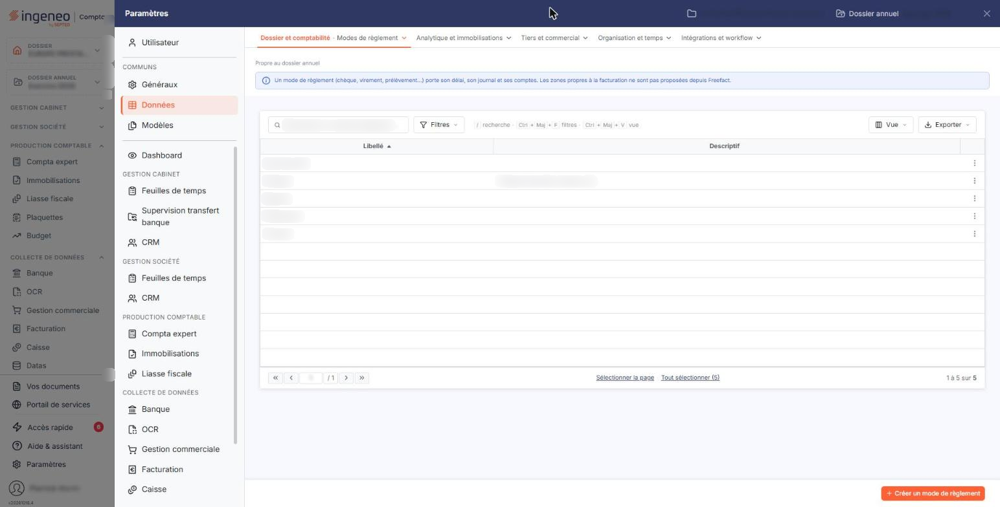
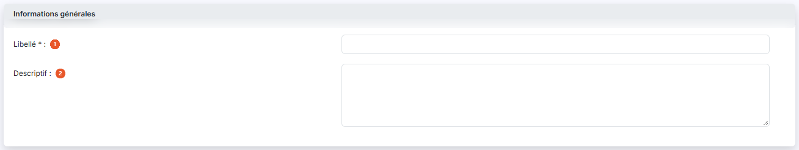
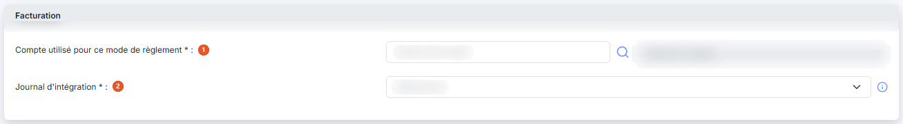
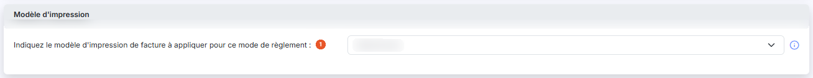
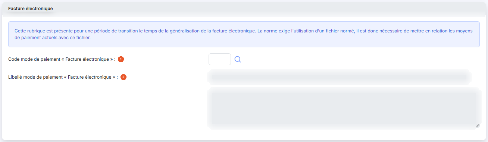
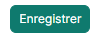

# Modes de règlement


**Où le trouver :** Panneau **Paramètres** › **Données** › **Dossier et comptabilité** › **Modes de règlement**



**En bref** — Cet écran définit les modes de règlement (espèces, chèques, carte bancaire…) associés ensuite aux pièces comptables et commerciales, et utilisés par la saisie de caisse.

* Pour créer un mode de règlement : bouton \[Créer un mode de règlement], saisissez le « Libellé », puis bouton \[Enregistrer].
* Pour recopier des modes de règlement vers d'autres sociétés gérées : sélectionnez-les, puis bouton \[Exporter].


Cette option vous permet de définir les modes de règlement — espèces, chèques, carte bancaire, virement, prélèvement — qui pourront ensuite être associés aux pièces comptables et commerciales.

<figure><figcaption>
Écran « Modes de règlement » de la nouvelle interface
</figcaption></figure>

Ce fichier est partagé avec les autres modules du logiciel : toute modification faite ici est donc immédiatement visible dans les autres modules.


Remarque : un mode de règlement ne peut pas être supprimé s'il est utilisé, par exemple dans une fiche client, dans une pièce commerciale, dans un compte, ou dans le paramétrage de la saisie de caisse.


L'écran ne comporte pas de zone de filtres : il est constitué de la seule liste des modes de règlement, avec deux colonnes — « Libellé » et « Descriptif ». L'une et l'autre sont triables par un clic sur leur en-tête.

Sur chaque ligne, vous disposez de deux pictogrammes, dont l'infobulle vous rappelle le rôle : « Modifier » et « Supprimer ».

En bas de la liste, le pagineur vous permet de vous déplacer d'une, de dix ou de cent pages, ou d'aller directement à la première ou à la dernière ; le décompte des modes de règlement est affiché à sa droite.

## Barre de la liste

La liste présente aussi une barre de recherche, bouton **\[Filtres]** et bouton **\[Vue]**. Leur fonctionnement, commun à toutes les listes — dont le choix des colonnes affichées —, est décrit dans la page commune « Les listes ».

## Rubrique « Informations générales »

<figure><figcaption>
Rubrique « Informations générales »
</figcaption></figure>

| Champ             | Ce qu'il faut savoir                                                                                                                                             |
| ----------------- | ---------------------------------------------------------------------------------------------------------------------------------------------------------------- |
| 1. **Libellé**    | Il désigne le mode de règlement partout où celui-ci vous est présenté ; il doit être unique.                                                                     |
| 2. **Descriptif** | Cette zone de texte accepte plusieurs lignes et vous permet de préciser ce que recouvre le mode de règlement — par exemple « Chèques bancaires, postaux, etc. ». |

## Rubrique « Facturation »

<figure><figcaption>
Rubrique « Facturation »
</figcaption></figure>

Cette rubrique n'est présentée que si vous avez accès au module Facturation ou au module Gestion commerciale ; ces deux informations ne sont utiles que si vous gérez les règlements dans le module de facturation.

| Champ                                           | Ce qu'il faut savoir                                                                                                                                                                                                                                                                                  |
| ----------------------------------------------- | ----------------------------------------------------------------------------------------------------------------------------------------------------------------------------------------------------------------------------------------------------------------------------------------------------- |
| 1. **Compte utilisé pour ce mode de règlement** | C'est le compte dans lequel les écritures de règlement seront générées pour ce mode de règlement. Saisissez le numéro de compte, ou recherchez-le par la loupe ; l'intitulé du compte s'affiche à droite, en lecture seule.                                                                           |
| 2. **Journal d'intégration**                    | C'est le journal dans lequel ces écritures de règlement seront générées. Le sélecteur propose les journaux du dossier annuel sous la forme « code - libellé ». Un pictogramme d'information rappelle le rôle du champ : le journal utilisé pour comptabiliser les règlements issus de la facturation. |

## Rubrique « Modèle d'impression »

<figure><figcaption>
Rubrique « Modèle d'impression »
</figcaption></figure>

**Indiquez le modèle d'impression de facture à appliquer pour ce mode de règlement** : facultatif. Le sélecteur propose les modèles d'impression de facture paramétrés pour la société.

Un pictogramme d'information en précise l'intérêt : vous pouvez ainsi avoir un modèle d'impression par mode de règlement. Pour les clients en prélèvement automatique, par exemple, vous pouvez affecter un modèle qui contient toutes les informations propres à ce type de paiement. Si vous avez par ailleurs indiqué un modèle d'impression de facture par défaut, c'est le modèle du mode de règlement qui s'appliquera en priorité.

## Rubrique « Facture électronique »

<figure><figcaption>
Rubrique « Facture électronique »
</figcaption></figure>

Le logiciel vous rappelle en tête de rubrique que celle-ci est présente pour une période de transition, le temps de la généralisation de la facture électronique : la norme exige l'utilisation d'un fichier normé, il est donc nécessaire de mettre en relation vos moyens de paiement actuels avec ce fichier.

| Champ                                                    | Ce qu'il faut savoir                                                                                                                                                                                                                                                    |
| -------------------------------------------------------- | ----------------------------------------------------------------------------------------------------------------------------------------------------------------------------------------------------------------------------------------------------------------------- |
| 1. **Code mode de paiement « Facture électronique »**    | Indiquez ici le code du moyen de paiement normé qui correspond à ce mode de règlement, ou recherchez-le par la loupe.                                                                                                                                                   |
| 2. **Libellé mode de paiement « Facture électronique »** | Il s'agit du libellé du moyen de paiement normé que vous avez retenu. Vous ne pouvez pas le saisir : le logiciel le reprend du code, et le champ apparaît grisé. Une seconde zone, grisée elle aussi et sans libellé, en présente la suite lorsque ce libellé est long. |

## Bouton \[Créer un mode de règlement]

<figure><figcaption>
Bouton [Créer un mode de règlement]
</figcaption></figure>

Il ouvre une fiche vierge. Les mêmes rubriques et les mêmes champs vous y sont présentés, avec les mêmes caractères obligatoires : seules les valeurs sont vides, les deux sélecteurs étant positionnés sur « Sélectionnez ».

## Bouton \[Exporter]

Il vous permet de recopier les modes de règlement que vous avez sélectionnés dans la liste vers d'autres sociétés gérées, ce qui vous évite de les ressaisir dossier par dossier.

## Bouton \[Supprimer]

Il supprime les modes de règlement que vous avez sélectionnés dans la liste. Vous pouvez aussi supprimer un mode de règlement isolé par le pictogramme de suppression de sa ligne.

## Bouton \[Enregistrer]

<figure><figcaption>
Bouton [Enregistrer]
</figcaption></figure>

Il enregistre la fiche et vous ramène à la liste des modes de règlement.

## Bouton \[Retour]

Il vous ramène à la liste des modes de règlement sans enregistrer les modifications que vous auriez faites dans la fiche.
