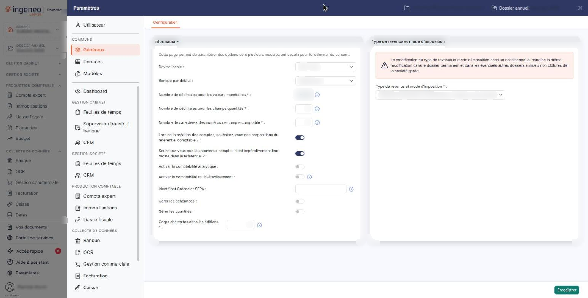
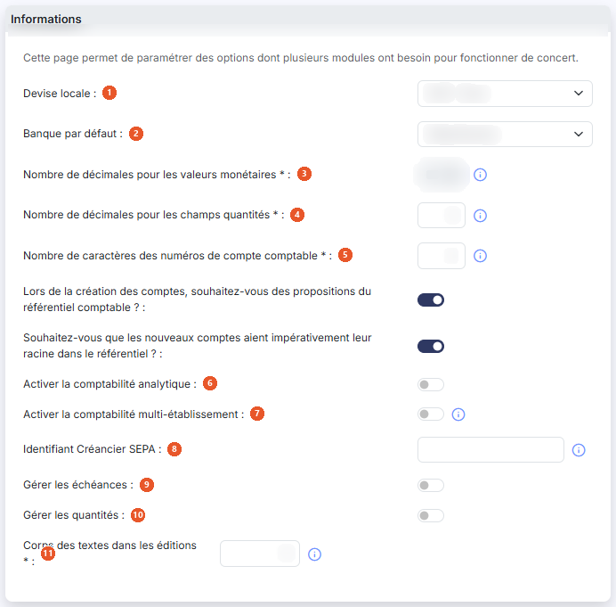
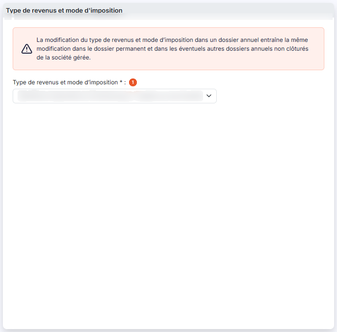

# Multimodules


**Où le trouver :** Panneau **Paramètres** › **Généraux** › **Configuration**



**En bref** — Cet écran regroupe les paramètres partagés par plusieurs modules : décimales, longueur des numéros de compte, échéances, analytique, quantités, devise, banque par défaut et type de revenus.

* Pour modifier un paramètre commun : changez la valeur, puis bouton \[Enregistrer] ; elle s'applique aussitôt aux autres modules.
* Pour abandonner vos modifications : quittez l'écran sans utiliser le bouton \[Enregistrer].


Cette option est ainsi nommée parce qu'elle regroupe des paramètres dont plusieurs modules ont besoin pour fonctionner de concert. L'écran l'annonce lui-même par la phrase « Cette page permet de paramétrer des options dont plusieurs modules ont besoin pour fonctionner de concert. »

<figure><figcaption>
Écran « Multimodules » de la nouvelle interface
</figcaption></figure>

Une valeur modifiée ici est donc prise en compte immédiatement dans les autres modules du dossier : ce que vous changez depuis la Caisse vaut aussi, par exemple, pour la comptabilité ou la facturation.

L'écran se compose de deux rubriques, sans onglet ni liste. Les champs suivis d'un astérisque sont obligatoires.

## Rubrique « Paramètres - Informations relevant de plusieurs modules »

<figure><figcaption>
Rubrique « Paramètres - Informations relevant de plusieurs modules »
</figcaption></figure>

| Champ                                                                                                   | Ce qu'il faut savoir                                                                                                                                                                                                                                                                                                                                                                                                                                                                                                                                                                                                                                                                                                                                                                                                                                                                                                                                                                                                                |
| ------------------------------------------------------------------------------------------------------- | ----------------------------------------------------------------------------------------------------------------------------------------------------------------------------------------------------------------------------------------------------------------------------------------------------------------------------------------------------------------------------------------------------------------------------------------------------------------------------------------------------------------------------------------------------------------------------------------------------------------------------------------------------------------------------------------------------------------------------------------------------------------------------------------------------------------------------------------------------------------------------------------------------------------------------------------------------------------------------------------------------------------------------------- |
| 1. **Devise locale**                                                                                    | La devise de tenue de votre comptabilité. La liste propose les devises du référentiel, sous la forme du code international suivi du libellé, par exemple « EUR - Euro ». Tant que vous n'avez rien choisi, elle affiche « Sélectionnez ».                                                                                                                                                                                                                                                                                                                                                                                                                                                                                                                                                                                                                                                                                                                                                                                           |
| 2. **Banque par défaut**                                                                                | Indiquez celle de vos banques qui sera proposée par défaut chaque fois que nécessaire. La liste ne propose que les banques déclarées pour la société : son contenu varie donc d'un dossier à l'autre, et se limite à « Sélectionnez » si vous n'en avez encore déclaré aucune.                                                                                                                                                                                                                                                                                                                                                                                                                                                                                                                                                                                                                                                                                                                                                      |
| 
3. <strong>Nombre de décimales pour les valeurs monétaires</strong> <em>Obligatoire</em>
      | 
Ce paramètre détermine avec combien de décimales sont saisies et affichées toutes les valeurs monétaires de vos modules Ingeneo Compta. Il peut prendre les valeurs 0, 1, 2, 3 et 4. Bien qu'il soit obligatoire, ce champ n'est <strong>pas saisissable</strong> : il s'affiche en lecture seule. Pour le faire modifier, prenez contact avec le service technique, comme vous y invite son pictogramme d'information.
                                                                                                                                                                                                                                                                                                                                                                                                                                                                                                                                                                                                   |
| 
4. <strong>Nombre de décimales pour les champs quantités</strong> <em>Obligatoire</em>
        | Ce paramètre détermine avec combien de décimales sont saisis et affichés les champs de quantité. Son pictogramme d'information rappelle qu'il va de 0 à 4. Il ne peut plus être réduit dès lors que le dossier annuel contient au moins une écriture, une pièce commerciale ou un règlement : le logiciel refuse alors l'enregistrement.                                                                                                                                                                                                                                                                                                                                                                                                                                                                                                                                                                                                                                                                                            |
| 
5. <strong>Nombre de caractères des numéros de compte comptable</strong> <em>Obligatoire</em>
 | 
Il s'agit du nombre de caractères que doivent comporter tous les comptes de votre plan comptable. La valeur doit être comprise entre 6 et 12 caractères. Afin de conserver les possibilités de comparaison, la modification est effectuée sur le dossier annuel en cours et sur les deux dossiers annuels précédents. <strong>Lors de la création des comptes, souhaitez-vous des propositions du référentiel comptable ? :</strong> activez l'interrupteur pour que le logiciel vous propose, au fur et à mesure des premiers caractères que vous saisissez lors de la création d'un compte général, les comptes du référentiel comptable de l'exercice. Activer l'interrupteur de cette question fait apparaître la question suivante ; le désactiver la fait disparaître. <strong>Souhaitez-vous que les nouveaux comptes aient impérativement leur racine dans le référentiel ? :</strong> activez l'interrupteur pour interdire la création d'un compte dont la racine ne figure pas dans ce même référentiel.
 |
| 6. **Activer la comptabilité analytique**                                                               | Activez l'interrupteur pour accéder aux options analytiques et définir les propriétés analytiques de vos comptes généraux et auxiliaires.                                                                                                                                                                                                                                                                                                                                                                                                                                                                                                                                                                                                                                                                                                                                                                                                                                                                                           |
| 7. **Activer la comptabilité multi-établissement**                                                      | En activant cette option, vous devrez affecter les écritures à un établissement. Les établissements doivent être créés dans le module « Dossier permanent », menu « Social », option « Etablissements ».                                                                                                                                                                                                                                                                                                                                                                                                                                                                                                                                                                                                                                                                                                                                                                                                                            |
| 8. **Identifiant Créancier SEPA**                                                                       | L'Identifiant Créancier SEPA, ou ICS, est obligatoire si vous souhaitez générer des ordres de prélèvements SEPA. Cette information est à récupérer auprès de votre banque ; elle est propre à chaque entreprise qui réalise des prélèvements.                                                                                                                                                                                                                                                                                                                                                                                                                                                                                                                                                                                                                                                                                                                                                                                       |
| 9. **Gérer les échéances**                                                                              | 
Activez l'interrupteur pour pouvoir saisir des échéances sur vos écritures et les exploiter dans vos éditions. Vous désignerez ensuite, dans les paramètres de chaque journal, ceux pour lesquels la saisie d'échéances est admise. Activer l'interrupteur de la question précédente fait apparaître une question supplémentaire :
                                                                                                                                                                                                                                                                                                                                                                                                                                                                                                                                                                                                                                                                                        |
| 10. **Gérer les quantités**                                                                             | Activez l'interrupteur pour pouvoir saisir des quantités sur les lignes de vos écritures. Vous désignerez ensuite, dans les paramètres de chaque journal, ceux pour lesquels la saisie de quantités est admise.                                                                                                                                                                                                                                                                                                                                                                                                                                                                                                                                                                                                                                                                                                                                                                                                                     |
| 
11. <strong>Corps des textes dans les éditions</strong> <em>Obligatoire</em>
                  | Ce paramètre détermine la taille d'affichage des textes standards dans les éditions. Sa valeur doit être comprise entre 8 et 18.                                                                                                                                                                                                                                                                                                                                                                                                                                                                                                                                                                                                                                                                                                                                                                                                                                                                                                    |
| **Renseigner automatiquement les échéances pour les fournisseurs et les clients**                       | 
Comme le rappelle son pictogramme d'information, l'échéance est alors renseignée automatiquement pour les comptes dont les échéances sont gérées. La date ainsi calculée reste modifiable en saisie. Activer l'interrupteur de cette seconde question fait apparaître à son tour deux listes, précédées de la phrase « Pour les comptes dont les paramètres d'échéances ne sont pas définis, les paramètres ci-dessous s'appliquent. » :
                                                                                                                                                                                                                                                                                                                                                                                                                                                                                                                                                                                  |
| **Délai de règlement par défaut des fournisseurs**                                                      | Le délai qui s'applique aux fournisseurs pour lesquels aucun délai propre n'a été défini.                                                                                                                                                                                                                                                                                                                                                                                                                                                                                                                                                                                                                                                                                                                                                                                                                                                                                                                                           |
| **Délai de règlement par défaut des clients**                                                           | 
Le délai qui s'applique aux clients pour lesquels aucun délai propre n'a été défini. Les deux listes proposent les mêmes valeurs : « A date de facture », « Fin de mois », « 30 jours », « 45 Jours », « 30 jours fin de mois », « 30 jours fin décade », « 45 jours fin de mois », « 60 jours », « 60 jours fin décade » et « 90 jours ». Tant que vous n'avez rien choisi, la liste affiche « Sélectionnez ».
                                                                                                                                                                                                                                                                                                                                                                                                                                                                                                                                                                                                           |

## Rubrique « Type de revenus et mode d’imposition »

<figure><figcaption>
Rubrique « Type de revenus et mode d'imposition »
</figcaption></figure>

Un avertissement en rouge ouvre cette rubrique : « La modification du type de revenus et mode d’imposition dans un dossier annuel entraîne la même modification dans le dossier permanent et dans les éventuels autres dossiers annuels non clôturés de la société gérée. » Lisez-le avant toute modification : la portée de ce changement dépasse le dossier annuel sur lequel vous êtes positionné.

**Type de revenus et mode d’imposition** \* : indiquez le régime auquel est soumise la société gérée. Le choix est obligatoire ; la liste propose « Bénéfices Agricoles », « Bénéfices Industriels et Commerciaux / Impôts sur le Revenu », « Bénéfices Industriels et Commerciaux / Impôts sur les Sociétés », « Bénéfices Non Commerciaux », « Non imposable », « Nouvelle-Calédonie », « Revenus Fonciers », « Revenus Fonciers Professionnels » et « Revenus Fonciers professionnels et non professionnels ». Tant que vous n'avez rien choisi, la liste affiche « Sélectionnez ».

Prenez garde aux deux dernières valeurs, qui se ressemblent beaucoup : « Revenus Fonciers Professionnels » ne couvre que les revenus professionnels, tandis que « Revenus Fonciers professionnels et non professionnels » couvre les deux.

## Bouton \[Enregistrer]

<figure><figcaption>
Bouton [Enregistrer]
</figcaption></figure>

Il enregistre l'ensemble des paramètres de l'écran. C'est le seul bouton de cet écran : il n'y a ni retour, ni annulation, ni impression. Pour abandonner vos modifications, quittez l'écran sans enregistrer.
