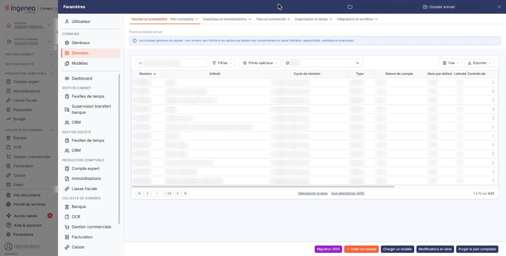
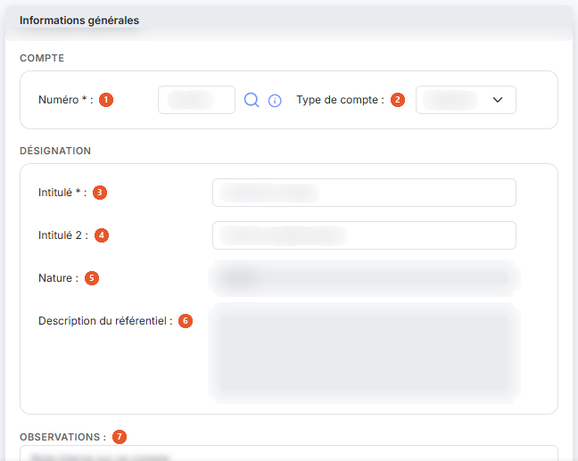
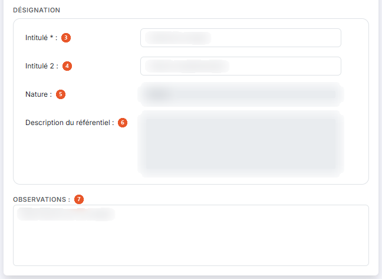
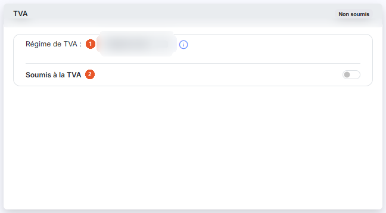
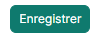
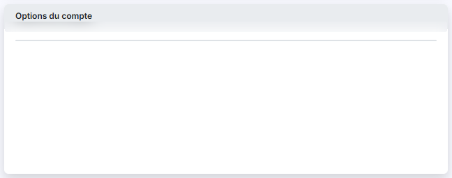

# Plan comptable


**Où le trouver :** Panneau **Paramètres** › **Données** › **Dossier et comptabilité** › **Plan comptable**



**En bref** — Cet écran administre les comptes généraux du plan comptable : création, modification, chargement d'un modèle, import, export et suppression des comptes non mouvementés.

* Pour créer un compte : bouton \[Créer un compte], renseignez « Numéro » et « Intitulé », puis bouton \[Enregistrer].
* Pour partir d'un plan type : bouton \[Charger un modèle] ; vos comptes existants sont conservés.
* Pour modifier plusieurs comptes d'un coup : sélectionnez-les, puis bouton \[Modifications en série].


Cette option permet d'administrer les comptes généraux du plan comptable.

<figure><figcaption>
Écran « Plan comptable » de la nouvelle interface
</figcaption></figure>


Notez que vous avez la possibilité de charger un modèle de plan comptable parmi les modèles fournis par Ingeneo Compta ou ceux éventuellement créés par vous-même dans le module « Administration », menu « Divers », sous-menu « Modèles de plans comptables ». Si vous avez déjà créé des comptes, ils seront conservés lors du chargement du modèle.


La suppression d'un compte n'est possible qu'à la condition qu'aucune écriture n'ait été passée sur l'exercice pour le compte concerné.

## Zone de filtres

Trois critères sont proposés au-dessus de la liste :

| Champ            | Ce qu'il faut savoir                                                                                                                                                        |
| ---------------- | --------------------------------------------------------------------------------------------------------------------------------------------------------------------------- |
| **N° de compte** | Saisissez tout ou partie d'un numéro. Le logiciel retient tous les comptes qui contiennent la suite de caractères indiquée : « 411 » ramène donc aussi le compte 641100000. |
| **Cycle**        | Si vous avez défini des cycles de révision, cette liste vous permet de ne retenir que les comptes rattachés à l'un d'eux. Le choix « Tous » n'écarte aucun compte.          |

Un troisième critère, présenté sans libellé sous la forme de trois boutons, restreint la liste selon l'activité des comptes : « Tous les comptes », proposé par défaut, « Comptes mouvementés » ou « Comptes non mouvementés ».

La liste présente aussi une barre de recherche, bouton **\[Filtres]**, bouton **\[Vue]**. Leur fonctionnement, commun à toutes les listes, est décrit dans la page commune « Les listes ».

## Liste des comptes

Les colonnes de cette liste vous appartiennent : le choix des colonnes affichées se fait par le bouton **\[Vue]**. Vous pouvez notamment afficher le « Numéro » et l'« Intitulé » du compte, son « Cycle de révision », son « Type », sa « Nature de compte », son « Sens par défaut », son caractère « Lettrable », son « Contrôle de cycle », les indicateurs « Analytique », « Période d'effet », « Code devise » et « Saisie en devise », ainsi que les soldes « Solde n-1 », « Solde n-2 » et l'« Ecart n-1 vs n-2 ». La plupart des colonnes sont triables par un clic sur leur en-tête.

Sur chaque ligne, vous disposez de trois commandes : « Modifier », « Supprimer » et « Dupliquer ». En bas de la liste, le pagineur vous permet de vous déplacer de page en page, d'aller directement à la première ou à la dernière, ou de saisir un numéro de page ; le nombre total de pages est affiché à sa droite.

## Rubrique « Informations générales »

<figure><figcaption>
Rubrique « Informations générales »
</figcaption></figure>

<figure><figcaption>
Rubrique « Informations générales »
</figcaption></figure>

| Champ                             | Ce qu'il faut savoir                                                                                                                                                                                                                                                                                                                                                                  |
| --------------------------------- | ------------------------------------------------------------------------------------------------------------------------------------------------------------------------------------------------------------------------------------------------------------------------------------------------------------------------------------------------------------------------------------- |
| 1. **Numéro**                     | Le numéro de compte doit être unique et n'est plus modifiable après création du compte. En création, une loupe vous permet de le rechercher dans le référentiel comptable, et un pictogramme d'information rappelle la règle de composition : « Les caractères autorisés sont les lettres majuscules et les chiffres. Le numéro doit commencer par 3 chiffres. »                      |
| 2. **Type de compte**             | Un compte peut être collectif ou standard. Ce choix n'est plus modifiable après création : la liste apparaît alors grisée.                                                                                                                                                                                                                                                            |
| 3. **Intitulé**                   | Ce champ pourra être automatiquement repris dans les libellés d'écritures et est modifiable à tout moment.                                                                                                                                                                                                                                                                            |
| 4. **Intitulé 2**                 | Il vous permet de compléter la désignation du compte.                                                                                                                                                                                                                                                                                                                                 |
| 5. **Nature**                     | La nature du compte est déterminée par le logiciel et n'est pas saisissable.                                                                                                                                                                                                                                                                                                          |
| 6. **Description du référentiel** | Ce champ n'existe qu'en création. Il n'est pas saisissable et vous restitue la description du compte dans le référentiel comptable.                                                                                                                                                                                                                                                   |
| 7. **Observations**               | 
Ce champ libre vous permet de noter ce que vous voulez sur le compte. Enfin, la fiche vous rappelle qui a créé le compte et qui l'a modifié pour la dernière fois, avec les dates correspondantes. Ces informations ne sont pas saisissables, et n'apparaissent que lorsqu'elles sont connues : un compte jamais modifié depuis sa création n'affiche pas la seconde ligne.
 |
| **Compte collectif**              | Un compte collectif regroupe des comptes auxiliaires qui lui sont rattachés et doivent obligatoirement être renseignés lors de la saisie.                                                                                                                                                                                                                                             |
| **Compte standard**               | Un compte standard admet la saisie sans compte auxiliaire.                                                                                                                                                                                                                                                                                                                            |

## Rubrique « TVA »

<figure><figcaption>
Rubrique « TVA »
</figcaption></figure>

Cette rubrique ne concerne que les comptes standards : elle n'est pas présentée pour un compte collectif.

| Champ                  | Ce qu'il faut savoir                                                                                                                                                                                                                                                     |
| ---------------------- | ------------------------------------------------------------------------------------------------------------------------------------------------------------------------------------------------------------------------------------------------------------------------ |
| 1. **Régime de TVA**   | Il vous est rappelé, sans être saisissable ici. Un pictogramme d'information vous indique où le modifier : « Si vous souhaitez modifier le régime de TVA, veuillez vous rendre dans le menu "Paramètres", sous-option "Paramètres généraux", rubrique "Régime de TVA". » |
| 2. **Soumis à la TVA** | Ce critère permet de définir si le compte est relatif à des opérations soumises à TVA. Si vous répondez « Oui », quatre champs supplémentaires apparaissent.                                                                                                             |
| **Code TVA**           | Choisissez-le parmi les codes que vous avez paramétrés dans le panneau « Paramètres », rubrique « Données », « Dossier et comptabilité », « Codes TVA ».                                                                                                                 |
| **Taux de TVA**        | Le logiciel le reprend du code que vous avez choisi ; il n'est pas saisissable.                                                                                                                                                                                          |
| **N° de compte**       | Choisissez parmi les comptes de TVA celui qui devra être repris dans l'écriture.                                                                                                                                                                                         |
| **Intitulé**           | L'intitulé du compte de TVA que vous venez de choisir. Il n'est pas saisissable.                                                                                                                                                                                         |

## Rubrique « Devises »

**Autoriser la saisie en devises** : cette option détermine si les écritures portées sur ce compte peuvent être saisies dans une autre monnaie que celle du dossier.

## Rubrique « Soldes »

Cette rubrique est une restitution : aucun de ses champs n'est saisissable. Elle vous présente le « Solde à date », le « Solde n-1 », l'« Ecart n vs n-1 » et le « Solde n-2 » d'une part, le caractère « Mouvementé en n-1 » et l'« Ecart n-1 vs n-2 » d'autre part.

Les rubriques « Devises » et « Soldes » ne sont présentées ni pour un compte collectif, ni pendant la création d'un compte : un compte qui n'existe pas encore n'a pas de solde.

## Bouton \[Créer un compte]

<figure><figcaption>
Bouton [Créer un compte]
</figcaption></figure>

Il ouvre une fiche vierge, limitée aux rubriques « Informations générales » et « TVA ».

## Bouton \[Charger un modèle]

<figure><figcaption>
Bouton [Charger un modèle]
</figcaption></figure>

Il permet de charger un modèle de plan comptable parmi ceux qui figurent dans le module « Administration ». Si le plan comptable dans lequel vous chargez un modèle contient déjà des comptes, seuls les comptes n'existant pas encore seront créés. Si les numéros de comptes du modèle sont plus courts que ceux de votre plan comptable, ils seront automatiquement comblés avec des 0.

## Bouton \[Importer]

Il permet d'importer un plan comptable à partir d'un fichier issu d'un autre logiciel. Vous désignez le modèle d'import à appliquer et le fichier à reprendre. Si le logiciel refuse le fichier, c'est que sa structure ne correspond pas à celle décrite dans le modèle : c'est le modèle qu'il faut alors revoir.

## Bouton \[Exporter]

Il permet d'extraire votre plan comptable dans un fichier, selon un modèle d'export que vous désignez. Le fichier généré peut ensuite être enregistré à votre convenance.

## Bouton \[Modifications en série]

<figure><figcaption>
Bouton [Modifications en série]
</figcaption></figure>

Il permet d'opérer simultanément les mêmes modifications à une sélection de comptes : vous désignez d'abord les comptes concernés, puis les paramètres à leur appliquer.

## Bouton \[Auxiliariser]

Il transforme les comptes que vous avez sélectionnés dans la liste en comptes auxiliaires, rattachés à un compte collectif que vous désignez.

## Bouton \[Purger le plan comptable]

<figure><figcaption>
Bouton [Purger le plan comptable]
</figcaption></figure>

Il permet de supprimer tous les comptes pour, par exemple, charger un autre modèle de plan comptable. Seuls les comptes non mouvementés dans l'exercice en cours et non utilisés dans les paramétrages sont supprimés.

## Bouton \[Supprimer]

Il supprime les comptes que vous avez sélectionnés dans la liste, dans la limite rappelée en tête de cette page.

## Bouton \[Enregistrer]

<figure><figcaption>
Bouton [Enregistrer]
</figcaption></figure>

Il enregistre la fiche du compte.

## Bouton \[Retour]

Il vous ramène à la liste des comptes sans enregistrer les modifications que vous auriez faites dans la fiche.

Selon le paramétrage de votre dossier, la fiche d'un compte peut présenter des rubriques supplémentaires. Certains boutons peuvent également ne pas vous être proposés : leur affichage dépend des droits attachés à votre profil.

## Autres vues de l'écran

<figure><figcaption>
Options du compte
</figcaption></figure>
