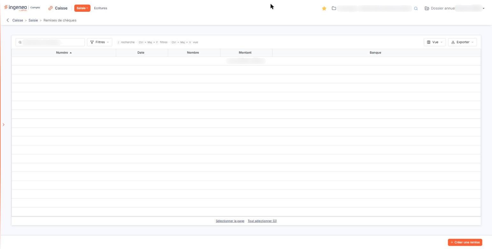
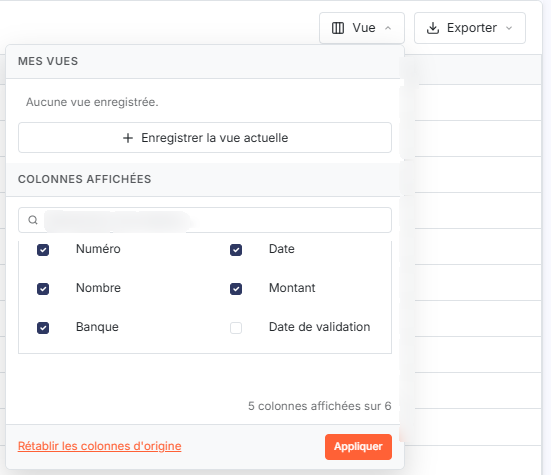
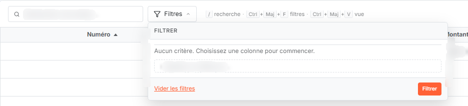
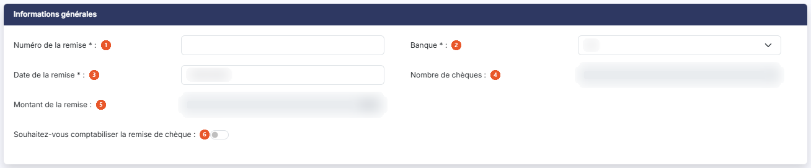
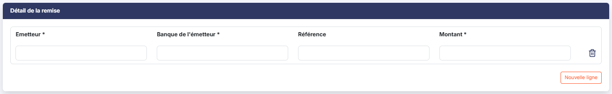

# Remises de chèques


**Où le trouver :** Menu **Saisie › Remises de chèques**



**En bref** — Cet écran vous permet de saisir vos remises de chèques, d'imprimer le bordereau destiné à la banque et, si vous le souhaitez, de comptabiliser la remise.

* Pour saisir une remise : bouton \[Créer une remise], renseignez le numéro, la banque et une ligne par chèque (bouton \[Nouvelle ligne]), puis bouton \[Enregistrer].
* Pour clôturer la remise et, le cas échéant, générer son écriture : bouton \[Valider] ; la fiche n'est ensuite plus modifiable.
* Pour imprimer le bordereau : bouton \[Edition] de la fiche.


Cette option vous permet de saisir vos remises de chèques et d'imprimer le bordereau destiné à la banque.

<figure><figcaption>
Écran « Remises de chèques » de la nouvelle interface
</figcaption></figure>

Vous pouvez aussi demander au logiciel de comptabiliser la remise : dans ce cas, chaque chèque doit être rattaché au compte de son émetteur, et un journal et un compte de remise vous sont demandés.

L'écran est constitué de la liste des remises de chèques, surmontée d'une barre d'outils (une zone de recherche et les Boutons \[Filtres], \[Vue] et \[Exporter]). La liste compte cinq colonnes — « Numéro », « Date », « Nombre », « Montant » et « Banque ». Chacune est triable par un clic sur son en-tête ; la liste est présentée par défaut dans l'ordre croissant des numéros. Une sixième colonne, « Date de validation », n'est pas affichée au départ mais vous pouvez la faire apparaître par le Bouton \[Vue].

Tant qu'aucune remise n'a été saisie, la liste affiche « Aucun élément à afficher. »

Dès qu'une remise existe, un pagineur apparaît en bas de la liste : il vous permet de vous déplacer d'une, de dix ou de cent pages, ou d'aller directement à la première ou à la dernière ; le décompte des remises est affiché à sa droite.

## Barre d'outils de la liste

Au-dessus de la liste, de gauche à droite :

* la zone « Rechercher une remise… » : la saisie devient un critère « \<colonne> Contient \<texte> » (étiquette « Filtres 1 ») qui reste appliqué tant que vous ne l'avez pas retiré ;
* le Bouton \[Filtres] (raccourci Ctrl + Maj + F), décrit en c) ;
* à droite, le Bouton \[Vue] (raccourci Ctrl + Maj + V), décrit en b), et le Bouton \[Exporter], qui propose, sous le titre « La liste affichée - 0 remise » (le décompte suit la liste), « Aperçu » (édition HTML), « Imprimer » (Ctrl + P), « Exporter en Excel », « Exporter en PDF » et « Envoyer la liste par e-mail ».

Sous la liste, « Sélectionner la page » sélectionne toutes les lignes de la page affichée et « Tout sélectionner » étend la sélection à toutes les pages. Il n'y a plus de case à cocher : un clic sur une ligne la sélectionne.

## Bouton \[Vue]

<figure><figcaption>
Bouton [Vue]
</figcaption></figure>

Il remplace l'ancienne fenêtre de personnalisation des colonnes. Il comporte deux zones : « Mes vues » (« Aucune vue enregistrée. » tant que vous n'en avez pas, avec le Bouton \[Enregistrer la vue actuelle]) et « Colonnes affichées ». Cette dernière propose une zone « Rechercher une colonne… » puis une case à cocher par colonne — Numéro, Date, Nombre, Montant et Banque cochées au départ, Date de validation décochée — et rappelle le décompte (« 5 colonnes affichées sur 6 »). C'est ici que vous rendez visible la colonne « Date de validation ».

Utilisez le Bouton \[Rétablir les colonnes d'origine] pour revenir à la présentation d'origine et le Bouton \[Appliquer] pour tenir compte de vos choix.

## Bouton \[Filtres]

<figure><figcaption>
Bouton [Filtres]
</figcaption></figure>

Il vous permet de restreindre la liste. Sous le titre « Filtrer », il affiche « Aucun critère. Choisissez une colonne pour commencer. » tant qu'aucun critère n'est posé. La liste « + Ajouter un critère sur… » reprend les colonnes de la liste : « Numéro », « Date », « Nombre », « Montant », « Banque », puis « Date de validation ».

Utilisez le Bouton \[Filtrer] pour appliquer vos critères et le Bouton \[Vider les filtres] pour les effacer. La mémorisation et le rappel d'un jeu de critères ne sont plus proposés.

## Commandes de ligne de la liste

Chaque remise de la liste présente, en dernière colonne, deux commandes, si votre profil vous en donne le droit :

* « Modifier » : elle ouvre la fiche de la remise ;
* « Supprimer » : elle supprime la remise ; comme dans les autres listes, elle se trouve sous le menu « Autres actions » (trois points).

Ces deux commandes vous sont proposées aussi bien sur une remise en cours de saisie que sur une remise déjà validée.

## Rubrique « Informations générales »

<figure><figcaption>
Rubrique « Informations générales »
</figcaption></figure>

| Champ                                                   | Ce qu'il faut savoir                                                                                                                                                                                                                                                                                                                      |
| ------------------------------------------------------- | ----------------------------------------------------------------------------------------------------------------------------------------------------------------------------------------------------------------------------------------------------------------------------------------------------------------------------------------- |
| 1. **Numéro de la remise**                              | Il permet de différencier vos remises et il doit être numérique. Si vous le laissez vide, le logiciel affiche le message « Champs requis » sous la zone de saisie et encadre celle-ci en rouge ; si vous y portez autre chose qu'un nombre, il affiche « Le numéro de remise doit être un nombre. »                                       |
| 2. **Banque**                                           | Le sélecteur propose les banques de votre fichier ; ses coordonnées seront reprises sur le bordereau. Si le dossier ne compte qu'une seule banque, elle est proposée d'office.                                                                                                                                                            |
| 3. **Date de la remise**                                | Le logiciel propose la date du jour, que vous pouvez modifier, à la main ou par le calendrier, qui s'ouvre au clic dans le champ.                                                                                                                                                                                                         |
| 4. **Nombre de chèques**                                | Le logiciel le calcule d'après le nombre de lignes du détail de la remise. Vous ne pouvez pas le saisir : le champ apparaît grisé.                                                                                                                                                                                                        |
| 5. **Montant de la remise**                             | Le logiciel le calcule d'après les montants saisis dans le détail, et le met à jour dès que vous quittez une zone de montant. Vous ne pouvez pas le saisir non plus.                                                                                                                                                                      |
| 6. **Souhaitez-vous comptabiliser la remise de chèque** | Interrupteur sans texte, désactivé au départ. Désactivé, la remise ne donne lieu à aucune écriture : elle ne sert qu'à produire le bordereau. Activez l'interrupteur pour que la remise soit comptabilisée à sa validation ; le logiciel vous présente alors deux champs supplémentaires, et une colonne s'ajoute au détail de la remise. |
| **Code journal**                                        | Lorsque vous comptabilisez la remise. Le sélecteur ne propose que les journaux de type banque, caisse et opérations diverses.                                                                                                                                                                                                             |
| **Numéro de compte**                                    | Lorsque vous comptabilisez la remise. C'est le compte dans lequel la remise sera enregistrée. Le logiciel le prérenseigne d'après le paramétrage de la banque retenue ; vous pouvez le remplacer, créer un compte par le pictogramme « Créer » (un plus dans un cercle), ou en rechercher un par la loupe (Ctrl + Alt + R).               |

## Rubrique « Détail de la remise »

<figure><figcaption>
Rubrique « Détail de la remise »
</figcaption></figure>

Créez ici autant de lignes qu'il y a de chèques à remettre en banque. Une ligne vide vous est présentée à l'ouverture de la fiche.

| Champ                    | Ce qu'il faut savoir                            |
| ------------------------ | ----------------------------------------------- |
| **Emetteur**             | Il s'agit du nom de l'émetteur du chèque.       |
| **Banque de l'émetteur** | Il s'agit du nom de la banque de l'émetteur.    |
| **Référence**            | —                                               |
| **Montant**              | Il s'agit du montant du chèque de cet émetteur. |

Si vous avez demandé la comptabilisation de la remise, une colonne **Compte de l'émetteur** s'ajoute en tête de chaque ligne : indiquez-y le compte à créditer. Saisissez le numéro de compte, créez-le par le pictogramme « Créer », ou recherchez-le par la loupe.

Le pictogramme en forme de corbeille, en fin de ligne (infobulle « Effacer »), supprime la ligne. Le Bouton \[Nouvelle ligne] placé sous le tableau, à droite, ajoute une ligne : le « Nombre de chèques » de la rubrique précédente est aussitôt recalculé.

Si vous laissez une ligne incomplète, le logiciel affiche le message « Champ requis » sous chacune des cellules obligatoires manquantes et les encadre en rouge.

## Bouton \[Créer une remise]

<figure><figcaption>
Bouton [Créer une remise]
</figcaption></figure>

Placé en bas de l'écran, à droite, hors du contenu de la liste, il ouvre une fiche vierge : le numéro est à saisir, la date du jour est proposée, l'interrupteur de comptabilisation est désactivé et le détail comporte une ligne vide. En bas de la fiche, les boutons sont, de gauche à droite, \[Valider], \[Edition] et \[Enregistrer].

## Bouton \[Enregistrer]

<figure><figcaption>
Bouton [Enregistrer]
</figcaption></figure>

Il enregistre la remise sans la valider : vous pouvez donc la reprendre et la compléter plus tard. Le logiciel vous ramène à la liste, où la remise apparaît.

## Bouton \[Valider]

<figure><figcaption>
Bouton [Valider]
</figcaption></figure>

Il valide la remise, sans vous demander de confirmation, et vous ramène à la liste. La date de validation est alors renseignée. Si vous avez demandé la comptabilisation, c'est à ce moment que le logiciel génère l'écriture de la remise et lui rattache le bordereau.

## Une remise validée

Une fois la remise validée, sa fiche n'est plus modifiable. Le logiciel vous la présente ainsi :

* un champ **Date de validation :** s'ajoute sous l'interrupteur de comptabilisation, en lecture seule ;
* le numéro, la date, le nombre de chèques et le montant de la remise passent en lecture seule ;
* l'interrupteur de comptabilisation est désactivé ;
* dans le détail de la remise, les cellules passent en lecture seule, la corbeille de suppression de ligne et le Bouton \[Nouvelle ligne] disparaissent ;
* en bas de la fiche, il ne reste que le Bouton \[Edition] (le retour à la liste se fait par la flèche décrite en m) : les boutons d'enregistrement et de validation ne vous sont plus proposés.

Depuis la liste, en revanche, la remise validée reste ouvrable par la commande « Modifier » — en consultation — et reste supprimable.

## Bouton \[Edition]

<figure><figcaption>
Bouton [Edition]
</figcaption></figure>

Il imprime le bordereau de remise en banque, en reprenant les coordonnées de la banque de remise et toutes les informations saisies. Le logiciel contrôle d'abord votre saisie : si un champ obligatoire manque, il vous le signale et le bordereau n'est pas produit.

## Bouton \[Supprimer]

Il n'est plus placé sous la liste : il apparaît dans le bandeau de sélection qui s'affiche dès que vous avez sélectionné une ou plusieurs remises d'un clic sur leur ligne, si votre profil vous donne le droit de supprimer des remises. Il supprime les remises sélectionnées.

## Retour à la liste

Dans la fiche, la flèche « Revenir en arrière », à gauche du fil d'Ariane (« Caisse > Saisie > Remises de chèques »), vous ramène à la liste sans enregistrer les modifications que vous auriez faites. Le Bouton \[Retour] existe encore dans la page mais n'est plus affiché.
