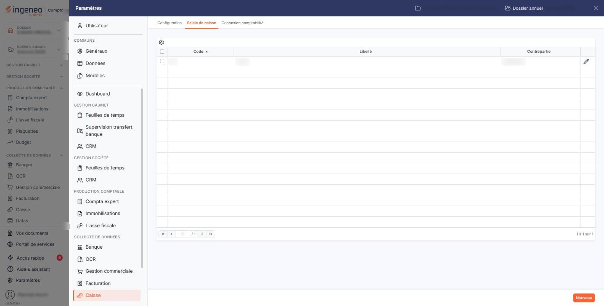
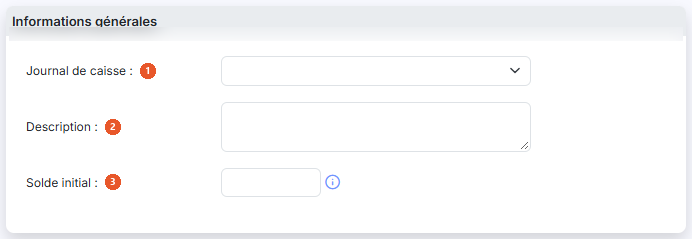
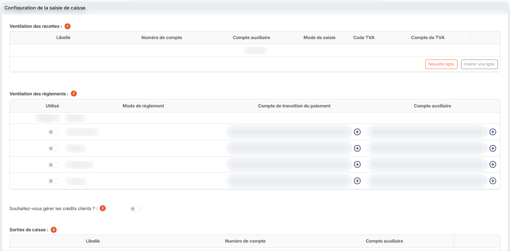
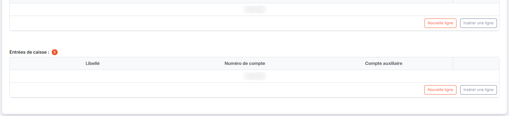
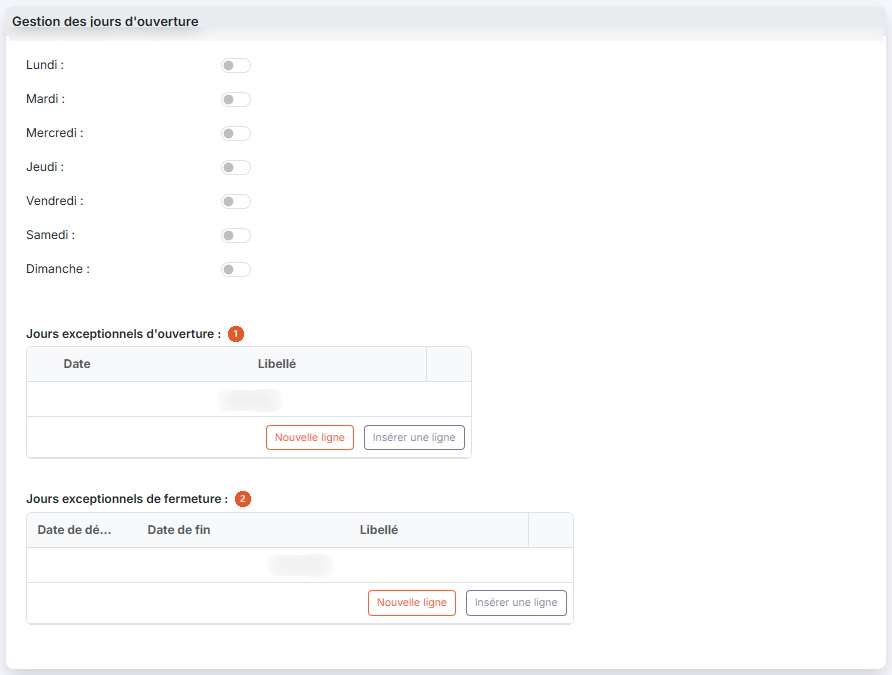
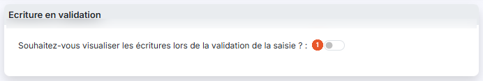
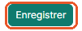

# Saisie de caisse — paramétrage


**Où le trouver :** Menu **Saisie › Saisie de caisse**



**En bref** — Cet écran paramètre, pour chaque journal de caisse, ce que vous saisirez chaque jour : ventilation des recettes, modes de règlement acceptés, entrées et sorties d'espèces, jours d'ouverture.

* Pour paramétrer une nouvelle caisse : bouton \[Nouveau], choisissez le « Journal de caisse », complétez les tableaux, puis bouton \[Enregistrer].
* Pour ajouter un type de vente ou de dépense : bouton \[Nouvelle ligne] sous le tableau concerné, puis bouton \[Enregistrer].
* Pour indiquer les jours à saisir : activez les interrupteurs de Lundi à Dimanche, puis bouton \[Enregistrer].


Cette option vous permet de définir tous les éléments que vous aurez à renseigner lors de la saisie d'une journée de caisse : la ventilation des recettes, les modes de règlement acceptés, les entrées et sorties d'espèces, et les jours d'ouverture.

<figure><figcaption>
Écran « Saisie de caisse » de la nouvelle interface
</figcaption></figure>

Le paramétrage se fait **par journal de caisse**. Si vous disposez de plusieurs points de vente, ouvrez un journal de caisse par point de vente et paramétrez la saisie de chacun d'eux.

Il s'ouvre depuis le panneau Paramètres : choisissez la rubrique « Caisse » de la colonne de gauche, puis l'onglet « Saisie de caisse » en tête du panneau.

L'écran se présente d'abord sous la forme d'une liste de vos paramétrages, depuis laquelle vous ouvrez une fiche pour en créer un ou en modifier un.

## La liste des paramétrages

La liste comporte trois colonnes : « Code » et « Libellé », qui reprennent ceux du journal de caisse, et « Contrepartie », qui reprend le compte de contrepartie de ce journal. Chacune est triable par un clic sur son en-tête, et vous pouvez les déplacer par glisser-déposer. La liste est triée par défaut sur le code, en ordre croissant.

La colonne des commandes est la dernière, à droite. Sur chaque ligne, un pictogramme en forme de crayon, dont l'infobulle indique « Modifier », ouvre la fiche du paramétrage. Il n'y a **aucune commande de suppression**.

En tête de la première colonne, une case à cocher sélectionne toutes les lignes de la page. Au-dessus de la liste, à gauche, un pictogramme « Roue dentée » ouvre la personnalisation des colonnes, qui vous permet de choisir celles que vous souhaitez voir.

En bas de la liste, le pagineur vous permet de vous déplacer d'une, de dix ou de cent pages, ou d'aller directement à la première ou à la dernière ; le décompte des paramétrages est affiché à sa droite. Les boutons de navigation restent inactifs tant qu'il n'y a qu'une seule page. Cette liste ne s'imprime pas et ne s'exporte pas.

## Bouton \[Nouveau]

<figure><figcaption>
Bouton [Nouveau]
</figcaption></figure>

Il ouvre une fiche vierge. La liste « Journal de caisse » de cette fiche ne propose que les journaux de caisse dont la saisie n'a pas encore été paramétrée.


Remarque : si tous vos journaux de caisse sont déjà paramétrés, cette liste est **vide et aucun message ne vous l'indique** ; la fiche ne peut alors pas être enregistrée. Créez au préalable un journal de type caisse dans le panneau Paramètres, rubrique « Données », onglet « Dossier et comptabilité », écran « Journaux », puis revenez ici pour en paramétrer la saisie.


## La fiche : rubrique « Informations générales »

<figure><figcaption>
Rubrique « Informations générales »
</figcaption></figure>

La fiche comporte quatre rubriques et présente exactement les mêmes champs en création et en modification ; seules les valeurs proposées diffèrent. Les champs suivis d'un astérisque sont obligatoires.

| Champ                    | Ce qu'il faut savoir                                                                                                                                                                                             |
| ------------------------ | ---------------------------------------------------------------------------------------------------------------------------------------------------------------------------------------------------------------- |
| 1. **Journal de caisse** | Le journal de caisse auquel s'applique ce paramétrage.                                                                                                                                                           |
| 2. **Description**       | Une zone de saisie libre sur plusieurs lignes, facultative.                                                                                                                                                      |
| 3. **Solde initial**     | C'est le montant du fonds de caisse, repris lors du calcul du premier jour de caisse saisi. Son pictogramme d'information précise qu'il ne peut plus être modifié une fois la première saisie de caisse validée. |

## La fiche : rubrique « Configuration de la saisie de caisse »

<figure><figcaption>
Rubrique « Configuration de la saisie de caisse »
</figcaption></figure>

<figure><figcaption>
Rubrique « Configuration de la saisie de caisse »
</figcaption></figure>

Cette rubrique est la plus longue : elle réunit quatre tableaux et la gestion des crédits clients. Le libellé de chaque tableau est posé à sa gauche.

| Champ                                                                                       | Ce qu'il faut savoir                                                                                                                                                                                                                                                                                                                                                                                                                                                                           |
| ------------------------------------------------------------------------------------------- | ---------------------------------------------------------------------------------------------------------------------------------------------------------------------------------------------------------------------------------------------------------------------------------------------------------------------------------------------------------------------------------------------------------------------------------------------------------------------------------------------- |
| 1. **Ventilation des recettes**                                                             | Indiquez selon quelle répartition les ventes devront être saisies chaque jour de caisse. Le tableau comporte les colonnes « Libellé », « Numéro de compte », « Compte auxiliaire », « Mode de saisie », « Code TVA » et « Compte de TVA ».                                                                                                                                                                                                                                                     |
| 2. **Ventilation des règlements**                                                           | Ce tableau ne s'alimente pas ligne à ligne. Ses lignes sont les **modes de règlement de votre dossier**, et son pictogramme d'information vous invite à cocher ceux que vous utilisez pour enregistrer les paiements des clients et à indiquer leur compte d'enregistrement. Il comporte les colonnes « Utilisé », « Mode de règlement », « Compte de transition du paiement » et « Compte auxiliaire ».                                                                                       |
| 3. **Souhaitez-vous gérer les crédits clients ?**                                           | Activez l'interrupteur pour gérer les crédits, c'est-à-dire les paiements différés que vous accordez à vos clients. Deux champs apparaissent alors :                                                                                                                                                                                                                                                                                                                                           |
| 4. **Sorties de caisse**                                                                    | Si vous effectuez des sorties de caisse pour régler des dépenses, indiquez, pour chaque type de dépense, un « Libellé » qui en donne la nature, un « Numéro de compte » d'enregistrement de la sortie d'espèces — compte de charge, paiement de tiers, etc. — et, le cas échéant, un « Compte auxiliaire ».                                                                                                                                                                                    |
| 5. **Entrées de caisse**                                                                    | Si vous effectuez des entrées de caisse qui ne correspondent pas à des ventes — un apport pour le fonds de caisse, par exemple — indiquez, pour chaque type d'entrée, un « Libellé », un « Numéro de compte » d'enregistrement de l'entrée d'espèces et, le cas échéant, un « Compte auxiliaire ».                                                                                                                                                                                             |
| **Libellé**                                                                                 | C'est ce libellé qui apparaîtra lors de la saisie de caisse.                                                                                                                                                                                                                                                                                                                                                                                                                                   |
| **Numéro de compte**                                                                        | Le compte de vente dans lequel sera enregistré le montant du jour.                                                                                                                                                                                                                                                                                                                                                                                                                             |
| **Compte auxiliaire**                                                                       | Le compte auxiliaire à associer, le cas échéant, au compte de vente.                                                                                                                                                                                                                                                                                                                                                                                                                           |
| **Mode de saisie**                                                                          | Il indique comment le montant sera saisi lors de la saisie de caisse. Trois valeurs sont proposées : « Sans TVA », « HT » et « TTC ».                                                                                                                                                                                                                                                                                                                                                          |
| **Code TVA**                                                                                | Le code portant le taux appliqué à ce type de vente. La liste reprend les codes TVA de votre dossier, tels que vous les avez paramétrés dans le panneau Paramètres, rubrique « Données », onglet « Dossier et comptabilité », écran « Codes TVA » : son contenu varie donc d'un dossier à l'autre.                                                                                                                                                                                             |
| **Compte de TVA**                                                                           | 
Le compte de TVA concerné pour ce code. La liste reprend, elle aussi, les comptes de votre dossier. La dernière cellule de chaque ligne porte une commande de suppression. Les colonnes « Numéro de compte » et « Compte auxiliaire » portent chacune un bouton « Créer » de création rapide de compte ; « Numéro de compte » porte en outre une loupe de recherche dès que la zone est renseignée. Tant qu'aucune ligne n'est saisie, le tableau affiche la mention « Liste vide ».
 |
| **Utilisé**                                                                                 | Activez l'interrupteur pour que le mode de règlement soit proposé lors de la saisie de caisse.                                                                                                                                                                                                                                                                                                                                                                                                 |
| **Compte de transition du paiement**                                                        | Il s'agit du compte sur lequel sera enregistré le règlement, le temps de sa remise en banque — les chèques en portefeuille, par exemple. Le bouton « Créer » vous permet de créer le compte sans quitter la fiche.                                                                                                                                                                                                                                                                             |
| **Compte auxiliaire**                                                                       | 
Le compte auxiliaire à associer, le cas échéant, au compte de transition. La ligne « Espèces » est un cas à part : elle porte la mention « Obligatoire » au lieu d'un interrupteur, et son compte s'affiche en texte non saisissable — il est repris de la contrepartie du journal de caisse.
                                                                                                                                                                                        |
| 
<strong>Compte d'enregistrement des crédits clients</strong> <em>Obligatoire</em>
 | Le compte dans lequel seront enregistrés ces crédits. Il est obligatoire dès lors que vous gérez les crédits clients. Le bouton « Créer » vous permet de créer le compte sans quitter la fiche, et une loupe de rechercher un compte existant.                                                                                                                                                                                                                                                 |
| **Libellé**                                                                                 | L'intitulé de ce compte. Il n'est **pas saisissable** : il se remplit à partir du compte que vous avez indiqué.                                                                                                                                                                                                                                                                                                                                                                                |


Remarque : à l'écran, « Sorties de caisse » est présenté **avant** « Entrées de caisse ».


## La fiche : rubrique « Gestion des jours d'ouverture »

<figure><figcaption>
Rubrique « Gestion des jours d'ouverture »
</figcaption></figure>

Sept interrupteurs, de **Lundi :** à **Dimanche :**, vous permettent d'indiquer les jours de chaque semaine pour lesquels la caisse devra être saisie. En création, les sept sont désactivés.

| Champ                                   | Ce qu'il faut savoir                                                                                                                                                                                                             |
| --------------------------------------- | -------------------------------------------------------------------------------------------------------------------------------------------------------------------------------------------------------------------------------- |
| 1. **Jours exceptionnels d'ouverture**  | Ce tableau vous permet de déclarer les jours théoriquement non travaillés qui le seront, et pour lesquels il faudra donc saisir la caisse. Il comporte les colonnes « Date » et « Libellé ».                                     |
| 2. **Jours exceptionnels de fermeture** | Ce tableau vous permet de déclarer les jours théoriquement travaillés qui ne le seront pas, et pour lesquels il ne faudra donc pas saisir la caisse. Il comporte les colonnes « Date de début », « Date de fin » et « Libellé ». |

Notez la différence entre les deux tableaux : une ouverture exceptionnelle se déclare pour **un seul jour**, une fermeture exceptionnelle pour une **période**.

## La fiche : rubrique « Ecriture en validation »

<figure><figcaption>
Rubrique « Ecriture en validation »
</figcaption></figure>

**Souhaitez-vous visualiser les écritures lors de la validation de la saisie ?** : activez l'interrupteur pour que le logiciel vous présente les écritures qu'il a générées à chaque fois que vous validez une saisie de caisse.

## Bouton \[Nouvelle ligne]

Il ajoute une ligne au tableau sous lequel il figure. Il est présent sous chacun des cinq tableaux qui s'alimentent ligne à ligne : les recettes, les sorties et les entrées de caisse, les jours exceptionnels d'ouverture et de fermeture. Le tableau de ventilation des règlements en est le seul dépourvu, puisque ses lignes sont imposées par vos modes de règlement.

## Bouton \[Insérer une ligne]

Il figure à droite du précédent, sous chacun des mêmes cinq tableaux, et sert également à ajouter une ligne.

## Bouton \[Enregistrer]

<figure><figcaption>
Bouton [Enregistrer]
</figcaption></figure>

Il enregistre la fiche.

## Retour à la liste

Le chevron « Retour », à gauche des onglets du panneau, vous ramène à la liste des paramétrages sans enregistrer les modifications que vous auriez faites dans la fiche.
