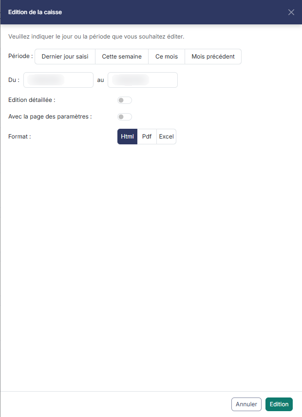
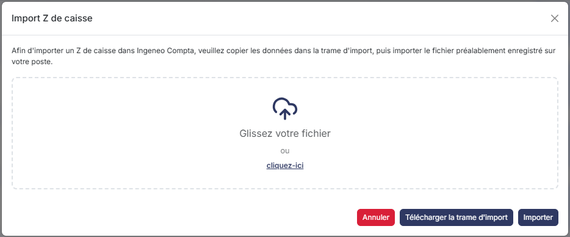
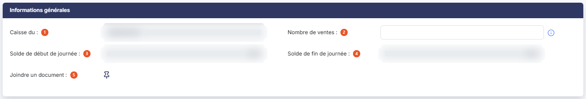
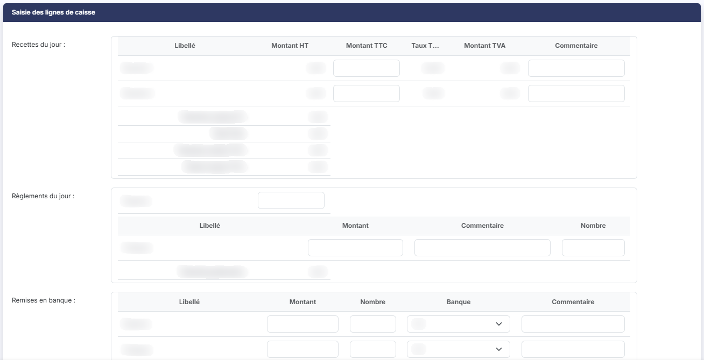
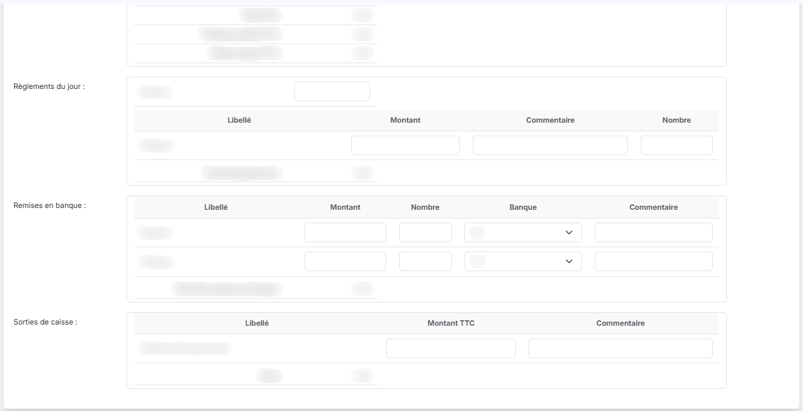

# Saisie de caisse


**Où le trouver :** Menu **Saisie › Saisie de caisse**



**En bref** — Cet écran vous permet d'enregistrer, jour après jour, le Z de caisse : vous choisissez la journée dans un calendrier mensuel, puis vous saisissez ses recettes, règlements, remises en banque et sorties de caisse.

* Pour saisir une journée : cliquez sur son jour dans le calendrier (ou bouton \[Jour à saisir]), renseignez les tableaux, puis bouton \[Enregistrer].
* Pour générer les écritures et figer la journée : bouton \[Valider la caisse].
* Pour reprendre un Z sans le ressaisir : bouton \[Importer un Z de caisse], bouton \[Télécharger la trame d'import], complétez la trame, déposez le fichier, puis bouton \[Importer].


## Choix de la journée de caisse

<figure><figcaption>
Écran « Saisie de caisse » de la nouvelle interface
</figcaption></figure>

<figure><figcaption>
Bouton [Edition]
</figcaption></figure>

<figure><figcaption>
Bouton [Edition]
</figcaption></figure>

<figure><figcaption>
Bouton [Importer un Z de caisse]
</figcaption></figure>

L'écran d'entrée du module se présente sous la forme d'un calendrier mensuel : une colonne par jour de la semaine, du lundi au dimanche (en-têtes abrégés « Lun. », « Mar. », « Mer. », « Jeu. », « Ven. », « Sam. » et « Dim. »), et une ligne par semaine. Le mois affiché est rappelé au-dessus du tableau, par exemple « août 2026 ».

Au-dessus du calendrier, un bandeau résume le mois affiché : « Recettes du mois », « Solde de caisse » et « Jours saisis (jours ouvrés échus) », ce dernier sous la forme d'un nombre de jours saisis rapporté au nombre de jours ouvrés échus, par exemple « 2 / 2 », avec une barre de progression. À droite du bandeau, une pastille orangée rappelle le prochain jour à saisir, par exemple « Jour à saisir : 6 août 2026 ».

Si vous avez paramétré plusieurs caisses pour la même société gérée — par exemple un point de vente par caisse —, une liste déroulante « Journal de caisse » vous permet de choisir celle sur laquelle vous travaillez. Avec une seule caisse, cette liste ne vous est pas proposée.

Chaque cellule porte le numéro du jour, et se clique pour ouvrir la saisie de la journée. Un jour porteur d'une saisie affiche en plus le montant de ses recettes, par exemple « 0,00 € ». Au survol d'un tel jour, un repère « Reprendre » apparaît dans la cellule et une bulle indique la date et l'état de la saisie, par exemple « Saisie en cours ». Un jour de fermeture porte la mention « Fermé ».

Une légende, sous le calendrier, explique l'aspect des cellules : « Saisie validée », « Saisie en cours », « A saisir », « Fermeture (hebdomadaire ou exceptionnelle) » et « Saisie indisponible », puis trois repères : « Jour à saisir » (cadre orangé), « Aujourd'hui » (pastille pleine) et « Jour avec une pièce jointe » (pictogramme en forme d'œil). Les jours des mois voisins, affichés en début et en fin de grille pour compléter les semaines, portent une date grisée.

Quatre commandes vous permettent de vous déplacer, au-dessus du calendrier, à droite du titre du mois :

Les deux chevrons, dont les infobulles sont « Précédent » et « Suivant », affichent le mois précédent et le mois suivant.

Le Bouton \[Aujourd'hui] ramène le calendrier sur le mois en cours.

Le dernier bouton, le Bouton \[Jour à saisir], vous conduit au mois du prochain jour à saisir ; il est grisé tant que le mois affiché est déjà celui de ce jour, dont la date est rappelée dans la pastille du bandeau. C'est aussi sur ce jour que le logiciel se positionne à votre arrivée sur l'écran : le premier jour saisissable qui suit la dernière journée validée, pour vous éviter de faire défiler les mois lorsque vous avez commencé la saisie en cours d'année.

bouton **\[Edition]**

Il ouvre, sur la droite de l'écran, le panneau « Edition de la caisse », qui vous permet d'éditer un jour ou une période. Renseignez les deux champs de date « Du : » et « au », préremplis pour vous, ou utilisez l'un des quatre raccourcis de la ligne « Période : », proposée au-dessus des dates : « Dernier jour saisi », « Cette semaine », « Ce mois » et « Mois précédent ».

Deux options complètent le contenu de l'édition : « Edition détaillée : » et « Avec la page des paramètres : », deux interrupteurs désactivés par défaut. Le champ « Format : » vous laisse le choix entre « Html », proposé par défaut, « Pdf » et « Excel ».

Le Bouton \[Edition] du panneau lance l'édition, le Bouton \[Annuler] referme le panneau sans rien produire.

bouton **\[Importer un Z de caisse]**

Il ouvre la fenêtre « Import Z de caisse », qui vous permet de reprendre les données d'une caisse sans les ressaisir. Le logiciel vous en rappelle le principe : « Afin d'importer un Z de caisse dans Ingeneo Compta, veuillez copier les données dans la trame d'import, puis importer le fichier préalablement enregistré sur votre poste. »

Récupérez donc d'abord la trame par le Bouton \[Télécharger la trame d'import], reportez-y vos données, enregistrez le fichier sur votre poste, désignez-le dans la zone de dépôt (« Glissez votre fichier ou cliquez-ici »), puis lancez la reprise par le Bouton \[Importer]. Le Bouton \[Annuler] referme la fenêtre.

Ce bouton peut ne pas vous être proposé : son affichage dépend des droits attachés à votre profil.

## Saisie des informations de la journée

La fiche d'une journée comporte deux rubriques : « Informations générales » et « Saisie des lignes de caisse ».

## Rubrique « Informations générales »

<figure><figcaption>
Rubrique « Informations générales »
</figcaption></figure>

| Champ                            | Ce qu'il faut savoir                                                                                                                                                                                                                                                                                                                                                                    |
| -------------------------------- | --------------------------------------------------------------------------------------------------------------------------------------------------------------------------------------------------------------------------------------------------------------------------------------------------------------------------------------------------------------------------------------- |
| 1. **Caisse du**                 | La date du jour de caisse en cours de saisie. Elle n'est pas modifiable ici : elle découle du jour que vous avez choisi dans le calendrier.                                                                                                                                                                                                                                             |
| 2. **Nombre de ventes**          | Pour calculer le panier moyen du jour, indiquez le nombre de ventes de la journée. Ce champ prend le focus à l'ouverture de la fiche.                                                                                                                                                                                                                                                   |
| 3. **Solde de début de journée** | Il correspond au solde de fin de journée de la saisie de caisse précédente, et n'est pas modifiable.                                                                                                                                                                                                                                                                                    |
| 4. **Solde de fin de journée**   | Il correspond au solde de début de journée modifié par les mouvements du jour, et n'est pas modifiable.                                                                                                                                                                                                                                                                                 |
| 5. **Joindre un document**       | La commande « Lier un document » vous permet d'attacher un document à la journée — par exemple l'impression du Z de caisse, si vous l'avez numérisée. Le document sera joint à toutes les lignes d'écritures générées par la comptabilisation de la caisse du jour. Une fois un document rattaché, deux commandes s'ajoutent : « Visualiser le document » et « Supprimer le document ». |

## Rubrique « Saisie des lignes de caisse »

<figure><figcaption>
Rubrique « Saisie des lignes de caisse »
</figcaption></figure>

<figure><figcaption>
Rubrique « Saisie des lignes de caisse »
</figcaption></figure>

Cette rubrique se compose de plusieurs petits tableaux, dans cet ordre : « Recettes du jour : », « Règlements du jour : », « Remises en banque : » et « Sorties de caisse : ». Les lignes de ces tableaux ne sont pas saisies ici : ce sont celles que vous avez paramétrées dans le panneau « Paramètres », rubrique « Caisse », onglet « Saisie de caisse ». À chaque saisie, les totaux affichés en pied de tableau sont mis à jour.

### Recettes du jour

Pour chaque type de vente paramétré pour la caisse, vous ne saisissez que deux colonnes :

| Champ           | Ce qu'il faut savoir                                             |
| --------------- | ---------------------------------------------------------------- |
| **Montant TTC** | Il s'agit du chiffre d'affaires total TTC pour le type de vente. |
| **Commentaire** | —                                                                |

Les colonnes « Montant HT », « Taux TVA » et « Montant TVA » ne sont pas saisissables : le logiciel les détermine à partir du code TVA que vous avez indiqué dans le paramétrage de la saisie de caisse.

Quatre totaux sont affichés sous le tableau : « Total des ventes HT : », « Total TVA : », « Total des ventes TTC : » et « Panier moyen TTC : ».

### Règlements du jour

Pour chaque mode de règlement paramétré pour la caisse, vous pouvez indiquer :

| Champ           | Ce qu'il faut savoir                                              |
| --------------- | ----------------------------------------------------------------- |
| **Montant**     | Il s'agit du montant global des paiements effectués avec ce mode. |
| **Commentaire** | —                                                                 |
| **Nombre**      | Il s'agit du nombre de paiements effectués avec ce mode.          |

La ligne des espèces est présentée à part, au-dessus du tableau, et ne comporte qu'un champ de montant.

Le total affiché sous le tableau est intitulé « Total des paiements : ».

### Remises en banque

Ce tableau, dont le remplissage est facultatif, vous permet de saisir par mode de règlement le montant remis en banque :

| Champ           | Ce qu'il faut savoir                                                                                     |
| --------------- | -------------------------------------------------------------------------------------------------------- |
| **Montant**     | Il s'agit du total pour le mode de règlement considéré.                                                  |
| **Nombre**      | Il correspond au nombre d'éléments remis — le nombre de chèques, par exemple.                            |
| **Banque**      | Si vous avez plusieurs banques, choisissez dans la liste celle dans laquelle vous allez faire la remise. |
| **Commentaire** | —                                                                                                        |

Le total affiché sous le tableau est intitulé « Total des remises en banque : ».

### Sorties de caisse

Ce tableau, dont le remplissage est facultatif, vous permet de saisir les règlements que vous avez effectués avec la caisse, par type de dépense :

| Champ           | Ce qu'il faut savoir                                                      |
| --------------- | ------------------------------------------------------------------------- |
| **Montant TTC** | Il s'agit du montant total des sorties pour le type de dépense considéré. |
| **Commentaire** | —                                                                         |

Le total affiché sous le tableau est intitulé « Total : ».

### Tableaux qui ne s'affichent pas dans tous les dossiers

Trois autres tableaux peuvent s'ajouter à la rubrique.

« Crédits clients accordés » et « Crédits clients remboursés » n'apparaissent que si vous avez activé la gestion des crédits clients dans le paramétrage de la caisse. Contrairement aux précédents, leurs lignes ne sont pas paramétrées : vous les ajoutez une à une par le Bouton \[Nouvelle ligne] du tableau. Pour chacune, vous indiquez un descriptif, un montant, et éventuellement le client concerné s'il est répertorié par un compte auxiliaire.

« Autres entrées de caisse » ne s'affiche que si vous avez paramétré au moins un type d'entrée.

bouton **\[Enregistrer]**

Il sauvegarde les informations saisies et vous ramène au calendrier.

bouton **\[Valider la caisse]**

La validation a pour effet de générer les écritures comptables et de rendre impossible la modification de la journée validée.

Selon la réponse que vous avez donnée à la question « Souhaitez-vous visualiser les écritures lors de la validation de la saisie ? » du panneau « Paramètres » (rubrique « Caisse », onglet « Saisie de caisse »), le logiciel vous présente les écritures avant de les enregistrer, ou les enregistre directement.

Sur une journée déjà validée, un bouton de dévalidation vous est proposé à la place, si vous en avez le droit.

bouton **\[Vider la saisie]**

Il remet à blanc toutes les saisies de la journée en cours et vous repositionne sur le calendrier.

bouton **\[Editer la caisse du jour]**

Il permet d'imprimer toutes les informations saisies pour la caisse du jour.

**Revenir au calendrier**

La flèche « Revenir en arrière », à gauche du fil d'Ariane, vous ramène au calendrier sans sauvegarder les éventuelles modifications faites dans la journée de caisse.

Les boutons de cette fiche peuvent ne pas tous vous être proposés : leur affichage dépend des droits attachés à votre profil et de l'état de la journée.
