# Acceptation et maintien de la mission


**En bref** — Cette feuille formalise, sous forme de questionnaire commenté, l'examen conduit avant d'accepter ou de reconduire une mission : connaissance du client, risques, faisabilité et lutte contre le blanchiment.

* Pour reprendre l'exercice précédent : bouton \[Importer les valeurs n - 1].
* Pour conserver votre travail : bouton \[Enregistrer] ; pour terminer, bouton \[Valider].


Cette page décrit la feuille de travail **Acceptation et maintien de la mission**, qui s'ouvre depuis l'écran Révision (voir « Avant d'ouvrir la feuille »). Vous y formalisez, sous forme de questionnaire commenté, l'examen que le cabinet conduit avant d'accepter une mission ou de la reconduire : prise de connaissance du client, risques, besoins, faisabilité, obligations en matière de lutte contre le blanchiment, puis la décision de l'expert-comptable.

<figure>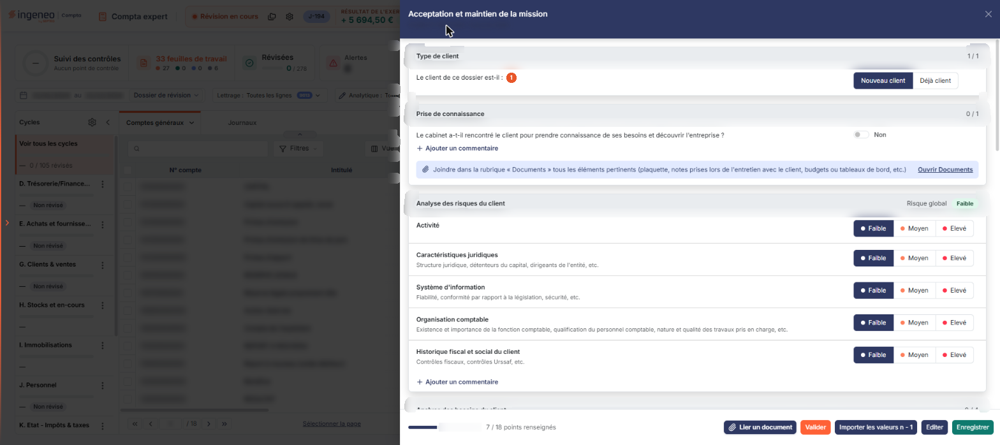<figcaption>
Écran « Acceptation et maintien de la mission » de la nouvelle interface
</figcaption></figure>

C'est une **feuille rédactionnelle**. Le logiciel en propose trois, et elles se distinguent des feuilles de calcul par leur contenu, non par leur fonctionnement : une feuille rédactionnelle recueille votre **jugement** — des questions à réponse fermée et des zones de commentaire — alors qu'une feuille de calcul recompose des **chiffres** repris de la comptabilité et peut aboutir à une écriture. Sur cette feuille-ci, aucun montant n'est calculé, rien n'est repris de la comptabilité et aucune écriture n'est générée : tout ce que vous y voyez est saisi par vous, à deux exceptions près que le logiciel met à jour seul — la pastille « Risque global » du bandeau de l'analyse des risques, qui reflète les cinq cotations, et le décompte « points renseignés » du pied.

## Avant d'ouvrir la feuille

Une feuille de travail appartient à un **dossier de révision**, et non au dossier annuel. Tant qu'aucun dossier de révision n'a été créé sur le dossier annuel en cours, l'écran ne s'affiche pas : le logiciel le remplace par le message **Veuillez créer un dossier de révision afin de pouvoir utiliser cette fonctionnalité.** Créez-le au préalable depuis le menu « Révision ».

L'en-tête du panneau de la feuille ne rappelle nulle part à quel dossier de révision il travaille (il ne porte que la société et l'exercice). Si votre dossier annuel comporte plusieurs dossiers de révision, rien dans le panneau ne vous dit lequel est servi.

La feuille n'est pas un élément que vous créez. Pour l'ouvrir, dans l'écran Révision, cliquez sur la carte « N feuilles de travail » du bandeau : la liste des feuilles s'ouvre dans un tiroir à droite. Repérez la ligne « Acceptation et maintien de la mission » (le champ « Rechercher une feuille… » la retrouve) et cliquez sur le crayon de la ligne : la feuille s'ouvre dans un panneau, dont l'en-tête indique son titre, puis la société et l'exercice, avec une croix de fermeture. Elle arrive **immédiatement en saisie** — il n'y a ni bouton **\[Modifier]**, ni mode consultation. Le logiciel crée la feuille en base dès votre première ouverture, sans que vous ayez à l'enregistrer.

## Comment se lit une question

Les douze questions de la feuille sont bâties à l'identique : l'intitulé de la question, à sa droite un interrupteur de réponse suivi de son état, **Non** (interrupteur désactivé) ou **Oui** (interrupteur activé), et dessous un lien **« + Ajouter un commentaire »** qui déplie une zone **Commentaires :** libre, sur plusieurs lignes, où vous justifiez votre réponse. La zone se replie quand vous cliquez en dehors (« Cliquez en dehors pour replier. »).

Une question à laquelle vous n'avez pas répondu est sur **Non** et sa zone de commentaire est repliée. La réponse est strictement binaire : contrairement à la feuille « Lutte anti-blanchiment », il n'existe ici ni troisième valeur « N / A », ni groupe « Impact : ».

Aucune question n'est signalée comme obligatoire : la feuille ne porte ni astérisque, ni encadré rouge, ni infobulle.

Les rubriques sont présentées les unes sous les autres, dans l'ordre ci-dessous, chacune sous un bandeau gris dont le titre est suivi, à droite, d'un compteur « n / n » de points renseignés (le bandeau de l'analyse des risques porte à la place « Risque global » et une pastille). Le panneau n'a aucun onglet : les paires et triplets de boutons que vous y voyez (Nouveau client / Déjà client, Faible / Moyen / Elevé, décision finale) sont des boutons-bascule, le choix retenu est en bleu foncé ; ils retiennent un choix et ne changent pas de page. Un décompte d'ensemble, « 7 / 18 points renseignés » à la lecture du 26/10/2026, s'affiche avec une barre de progression à gauche du pied.

## Rubrique « Type de client »

<figure>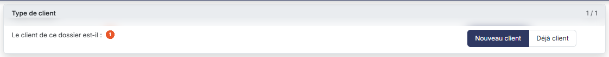<figcaption>
Rubrique « Rubrique « Type de client » »
</figcaption></figure>

**Le client de ce dossier est-il** : boutons-bascule à deux choix, **Nouveau client** ou **Déjà client**. Sur une feuille pas encore enregistrée, le logiciel propose **Nouveau client** lorsque le dossier annuel n'a pas de dossier annuel précédent, et **Déjà client** dans le cas contraire. Cette rubrique ne comporte pas de commentaire.

C'est le pivot de la feuille : votre réponse commande l'apparition d'une rubrique entière et change le libellé de la décision finale. Voyez plus bas « Ce que le type de client change à l'écran ».

## Rubrique « Prise de connaissance »

<figure>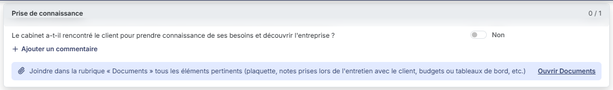<figcaption>
Rubrique « Rubrique « Prise de connaissance » »
</figcaption></figure>

Une seule question : **Le cabinet a-t-il rencontré le client pour prendre connaissance de ses besoins et découvrir l'entreprise ?**, avec son lien **Ajouter un commentaire**.

Dessous, le logiciel affiche, dans un encadré, une mention d'accompagnement, que vous ne pouvez pas modifier : **Joindre dans la rubrique « Documents » tous les éléments pertinents (plaquette, notes prises lors de l'entretien avec le client, budgets ou tableaux de bord, etc.)**, suivie, à droite, d'un lien **Ouvrir Documents**.

## Rubrique « Analyse des risques du client »

<figure>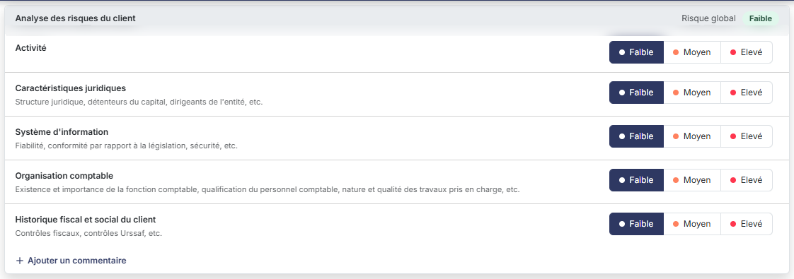<figcaption>
Rubrique « Rubrique « Analyse des risques du client » »
</figcaption></figure>

Cinq lignes de cotation, chacune avec des boutons-bascule à trois choix **Faible** / **Moyen** / **Elevé** :

* **Activité**
* **Caractéristiques juridiques**, sous-titre « Structure juridique, détenteurs du capital, dirigeants de l'entité, etc. »
* **Système d'information**, sous-titre « Fiabilité, conformité par rapport à la législation, sécurité, etc. »
* **Organisation comptable**, sous-titre « Existence et importance de la fonction comptable, qualification du personnel comptable, nature et qualité des travaux pris en charge, etc. »
* **Historique fiscal et social du client**, sous-titre « Contrôles fiscaux, contrôles Urssaf, etc. »

Ces cinq lignes ne sont pas des questions ✔ / ✖ : ce sont les seuls contrôles à trois valeurs de la feuille. **Il n'existe aucune valeur « non renseigné »** : sur une feuille vierge, le logiciel affiche déjà **Faible** partout. Une cotation « Faible » que vous lisez à l'écran ne signifie donc pas nécessairement qu'elle a été appréciée — pensez à passer les cinq lignes en revue.

La rubrique se termine par **un seul** lien **Ajouter un commentaire**, qui déplie une zone **Commentaires :** commune aux cinq lignes.

Le bandeau de la rubrique affiche à droite « **Risque global** » suivi d'une pastille, « Faible » (verte) tant que les cinq lignes sont sur Faible. Cette pastille se met à jour avec vos cotations : en passant la ligne « Activité » sur Moyen, elle est passée à « Moyen » (essai local, remis sur Faible, rien enregistré). La règle qui combine les cinq lignes n'a pas été établie.

## Rubrique « Analyse des besoins du client »

<figure>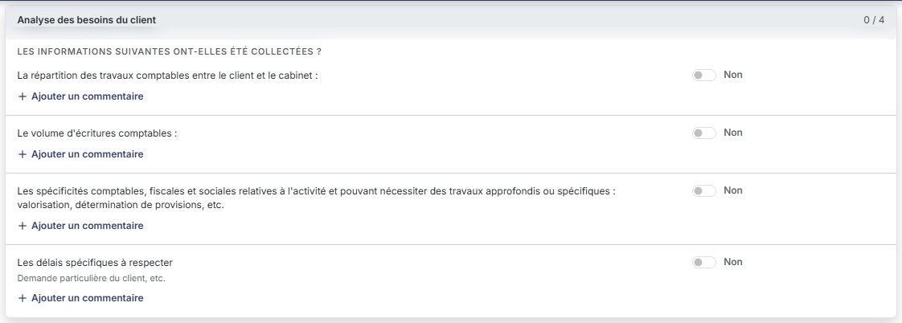<figcaption>
Rubrique « Rubrique « Analyse des besoins du client » »
</figcaption></figure>

La rubrique s'ouvre par la mention non modifiable **Les informations suivantes ont-elles été collectées ?**, puis quatre questions, chacune avec son interrupteur Non / Oui et son lien « Ajouter un commentaire » :

* **La répartition des travaux comptables entre le client et le cabinet**
* **Le volume d'écritures comptables**
* **Les spécificités comptables, fiscales et sociales relatives à l'activité et pouvant nécessiter des travaux approfondis ou spécifiques : valorisation, détermination de provisions, etc.**
* **Les délais spécifiques à respecter**, sous-titre « Demande particulière du client, etc. »

## Rubrique « Analyse de la faisabilité de la mission »

<figure>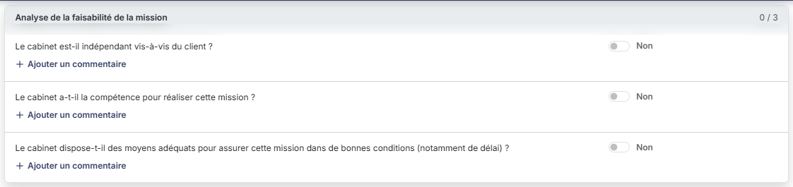<figcaption>
Rubrique « Rubrique « Analyse de la faisabilité de la mission » »
</figcaption></figure>

Trois questions, chacune avec son interrupteur Non / Oui et son lien « Ajouter un commentaire » :

* **Le cabinet est-il indépendant vis-à-vis du client ?**
* **Le cabinet a-t-il la compétence pour réaliser cette mission ?**
* **Le cabinet dispose-t-il des moyens adéquats pour assurer cette mission dans de bonnes conditions (notamment de délai) ?**

## Rubrique « Analyse des dispositions de la loi anti-blanchiment »

<figure>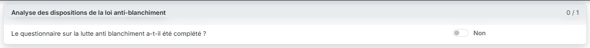<figcaption>
Rubrique « Rubrique « Analyse des dispositions de la loi anti-blanchiment » »
</figcaption></figure>

Une seule question : **Le questionnaire sur la lutte anti blanchiment a-t-il été complété ?**, avec son interrupteur Non / Oui. C'est la seule question de la feuille qui **n'a pas** de lien « Ajouter un commentaire ».

Cette réponse est une simple déclaration de votre part : le logiciel ne va pas la chercher dans la feuille « Lutte anti-blanchiment » et ne la déduit pas de son état. Complétez l'autre feuille, puis répondez ici.

## Rubrique « Lettre au confrère »

<figure>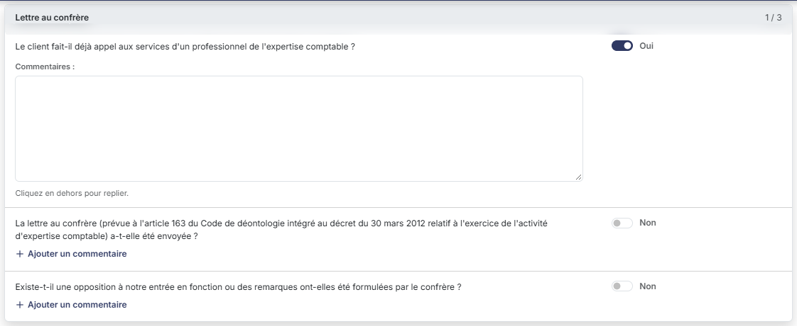<figcaption>
Rubrique « Rubrique « Lettre au confrère » »
</figcaption></figure>

Cette rubrique n'est **pas affichée** tant que le type de client reste **Déjà client**. Elle s'insère entre la rubrique « Analyse des dispositions de la loi anti-blanchiment » et la rubrique de décision dès que vous retenez **Nouveau client**.

Elle porte trois questions, chacune avec son interrupteur Non / Oui et son commentaire — mais elle ne les affiche pas toutes d'emblée :

* **Le client fait-il déjà appel aux services d'un professionnel de l'expertise comptable ?**
* **La lettre au confrère (prévue à l'article 163 du Code de déontologie intégré au décret du 30 mars 2012 relatif à l'exercice de l'activité d'expertise comptable) a-t-elle été envoyée ?**
* **Existe-t-il une opposition à notre entrée en fonction ou des remarques ont-elles été formulées par le confrère ?**

Les **deux dernières** questions n'apparaissent que si vous répondez **Oui** à la première : le logiciel ne vous interroge sur la lettre et sur la réponse du confrère que si le client fait effectivement appel à un professionnel. Si vous ramenez la première réponse sur **Non**, les deux questions disparaissent de nouveau.

## Ce que le type de client change à l'écran

La feuille se réorganise donc en cascade, et c'est son mécanisme le plus important :

**Déjà client** — neuf rubriques, neuf questions et dix zones de commentaire. La rubrique « Lettre au confrère » est absente, et la décision vous propose **de maintenir la mission** ou **de ne pas maintenir la mission**.

**Nouveau client** — la rubrique « Lettre au confrère » apparaît avec sa première question : dix questions, onze commentaires. Et la décision change de libellé : elle propose **d'accepter la mission** ou **de refuser la mission**.

**Nouveau client**, puis **Oui** à « Le client fait-il déjà appel aux services d'un professionnel de l'expertise comptable ? » — les deux dernières questions de la lettre au confrère s'ajoutent : douze questions, treize commentaires.

Le changement de libellé de la décision est facile à manquer, la rubrique de décision se trouvant en bas de page, loin du type de client. Vérifiez-la après avoir changé le type de client.

## Rubrique « Décision d'acception de la mission (partie réservée à l'expert-comptable) »

<figure>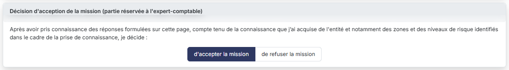<figcaption>
Rubrique « Rubrique « Décision d'acception de la mission (partie réservée à l'expert-comptable) » »
</figcaption></figure>

Le logiciel introduit la rubrique par une phrase que vous ne pouvez pas modifier : **Après avoir pris connaissance des réponses formulées sur cette page, compte tenu de la connaissance que j'ai acquise de l'entité et notamment des zones et des niveaux de risque identifiés dans le cadre de la prise de connaissance, je décide :**

Vous portez ensuite la décision au moyen de boutons-bascule à deux choix, dont le libellé dépend du type de client, comme indiqué plus haut. Sur une feuille vierge, le **premier** choix est retenu d'office — « de maintenir la mission » pour un client déjà suivi, « d'accepter la mission » pour un nouveau client. Là encore, la valeur affichée n'est pas la preuve qu'une décision a été prise.

Cette rubrique ne comporte **ni date, ni nom de signataire** : à la différence de la feuille « Bordereau juridique annuel » et de la feuille « Lutte anti-blanchiment », qui se terminent par une conclusion datée et signée, la décision d'acceptation n'est qu'un choix.

## Rubrique « Commentaires généraux »

<figure>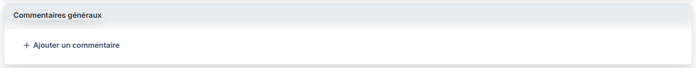<figcaption>
Rubrique « Rubrique « Commentaires généraux » »
</figcaption></figure>

Une unique zone de texte libre, sur plusieurs lignes, repliée à l'ouverture derrière un lien « Ajouter un commentaire » : le bandeau de la rubrique tient lieu de libellé de champ. Elle est vide par défaut et vous y consignez ce qui n'entre dans aucune des questions.

## Rubrique « Documents »

<figure>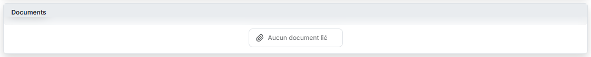<figcaption>
Rubrique « Rubrique « Documents » »
</figcaption></figure>

Cette rubrique, en fin de feuille, reçoit les pièces que vous voulez joindre à votre analyse — c'est celle que la rubrique « Prise de connaissance » vous invite à alimenter.

Tant qu'aucune pièce n'est jointe, la rubrique affiche la seule mention « **Aucun document lié** ». Elle ne porte pas de bouton : le bouton **\[Lier un document]** est dans le pied du panneau (voir plus bas).

## Les commandes du pied du panneau

Le pied porte, à gauche, la barre de progression et le décompte « n / 18 points renseignés » ; à droite, dans l'ordre : le bouton **\[Lier un document]**, le bouton **\[Valider]**, le bouton **\[Importer les valeurs n - 1]**, le bouton **\[Editer]** et le bouton **\[Enregistrer]**. Il n'y a ni pastille « Non validée », ni roue de paramétrage, ni colonne « Écriture » : la feuille ne comptabilise pas. Le pied n'a pas de bouton \[Fermer] : la croix de l'en-tête referme le panneau. Le décompte compte déjà comme renseignées les cinq cotations proposées d'office dans l'analyse des risques.

bouton **\[Importer les valeurs n - 1]**

Ce bouton reprend dans la feuille les réponses saisies sur l'exercice précédent, ce qui évite de tout ressaisir d'une année sur l'autre lorsque la situation du client n'a pas changé.

bouton **\[Enregistrer]**

Enregistre l'ensemble de la feuille. Il n'y a pas d'enregistrement rubrique par rubrique, et le pied ne propose pas de bouton **\[Annuler]** : fermez le panneau par la croix de l'en-tête sans enregistrer si vous voulez abandonner vos saisies. Ce bouton **disparaît une fois la feuille validée**.

bouton **\[Valider]**

Valide la feuille de travail. Ce bouton n'apparaît que si vous disposez du droit correspondant.

bouton **\[Editer]**

Ouvre la fenêtre d'édition de la feuille, commune à toutes les feuilles de travail : vous y choisissez le **Format :** — **Html**, **Pdf** ou **Excel**, le logiciel proposant **Html** — et un interrupteur **Tronquer les libellés trop longs :**, activé à l'ouverture. Le bouton **\[Edition]** lance le document, le bouton **\[Annuler]** ferme la fenêtre sans rien produire.
