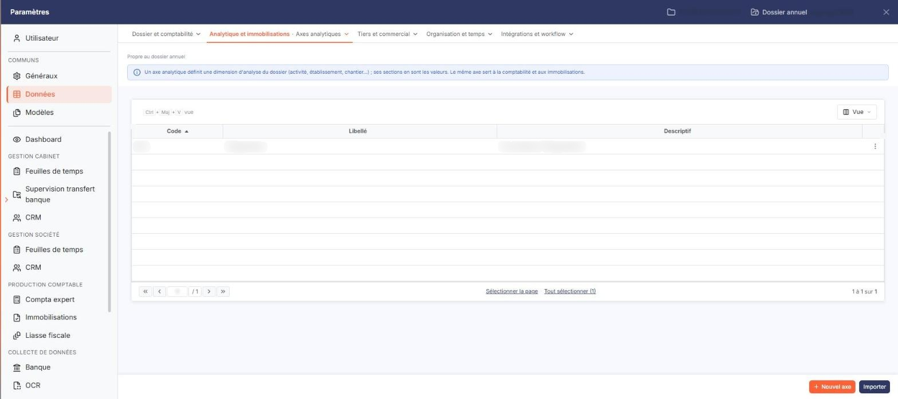
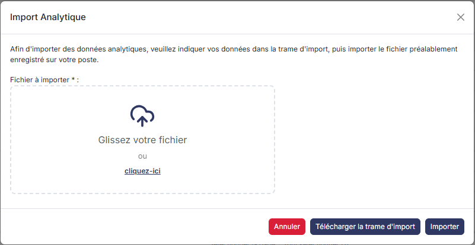
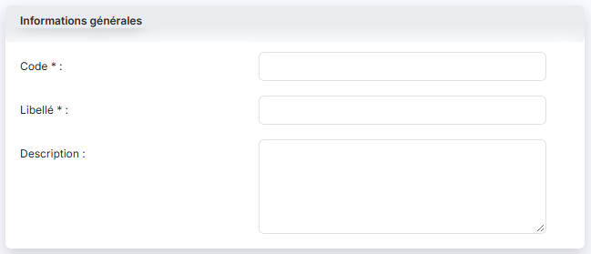

# Axes


**En bref** — Cet écran permet de gérer les axes analytiques du dossier, jusqu'à cinq, qui définissent les critères d'analyse principaux de votre comptabilité.

* Pour créer un axe : bouton \[Nouveau], renseignez la fiche, puis bouton \[Enregistrer].
* Pour créer vos données depuis un fichier : bouton \[Importer], bouton \[Télécharger la trame d'import], complétez-la, glissez-la dans la fenêtre, puis bouton \[Importer].


Les axes analytiques définissent les critères d'analyse principaux de votre comptabilité : la localisation géographique, la catégorie de produits, l'activité, etc. Chaque axe est ensuite découpé en sections, et les écritures sont ventilées sur ces sections.

<figure><figcaption>
Écran « Axes » de la nouvelle interface
</figcaption></figure>

Cette option présente la liste des axes du dossier annuel en cours et les boutons qui permettent de les créer, de les supprimer ou de les importer.

Cet écran s'ouvre dans le panneau Paramètres (entrée « Paramètres » de la barre latérale) : ouvrez la rubrique « Données », puis, dans la barre d'onglets du haut, le menu « Analytique et immobilisations » > « Axes analytiques ». Sous l'onglet, la mention « Propre au dossier annuel » et un encadré bleu rappellent qu'un axe est une dimension d'analyse du dossier et que le même axe sert à la comptabilité et aux immobilisations.

La liste elle-même ne comporte ni onglet, ni zone de filtres.

## La liste des axes

<figure><figcaption>
Bouton [Nouveau]
</figcaption></figure>

<figure><figcaption>
Bouton [Importer]
</figcaption></figure>

La liste comporte trois colonnes, toutes triables : "Code", "Libellé" et "Descriptif". La colonne de gauche, sans libellé, porte la case à cocher qui sélectionne toutes les lignes de la page, puis la case orange de sélection multipage. Au-dessus de la grille, à gauche, la « roue dentée » vous permet de choisir les colonnes affichées.

Sur chaque ligne, vous trouvez :

* une **case à cocher**, qui sélectionne l'axe en vue de sa suppression ;
* un **pictogramme « Modifier »** (un crayon), à droite de la ligne, qui ouvre la fiche de l'axe pour la modifier.

Le pied de la liste vous permet de passer d'une page à l'autre et indique le nombre total d'axes. Les boutons \[Supprimer], \[Nouveau] et \[Importer] sont dans le pied du panneau, en bas à droite ; \[Supprimer] reste inactif tant qu'aucune ligne n'est cochée.

## La fiche d'un axe — rubrique « Informations générales »

<figure><figcaption>
Rubrique « b) La fiche d'un axe »
</figcaption></figure>

La fiche ne comporte qu'une rubrique, et les mêmes trois champs en création et en modification :

| Champ           | Ce qu'il faut savoir                                                                                                                                                                         |
| --------------- | -------------------------------------------------------------------------------------------------------------------------------------------------------------------------------------------- |
| **Code**        | Doit être unique. **Il n'est saisissable qu'à la création :** lorsque vous ouvrez la fiche d'un axe existant, ce champ est grisé et ne peut plus être modifié. Choisissez-le donc avec soin. |
| **Libellé**     | C'est le nom sous lequel l'axe apparaît dans les écrans de ventilation analytique.                                                                                                           |
| **Description** | Cette zone de saisie libre, sur plusieurs lignes, vous permet de préciser ce que recouvre l'axe. C'est cette information qui alimente la colonne "Descriptif" de la liste.                   |

bouton **\[Enregistrer]**

Il enregistre l'axe et vous ramène à la liste. C'est le seul bouton du pied de la fiche, en bas à droite du panneau.

**Flèche « < » de retour**

Le bouton \[Retour] n'est plus affiché dans la fiche. La flèche « < », placée à gauche de la barre d'onglets du panneau, abandonne la saisie en cours et vous ramène à la liste sans rien enregistrer.

bouton **\[Nouveau]**

Il ouvre une fiche vierge pour créer un axe.

bouton **\[Supprimer]**

Il supprime les axes dont vous avez coché la case sur la liste.

bouton **\[Importer]**

Il ouvre la fenêtre "Import Analytique", qui vous permet de créer vos données analytiques à partir d'un fichier plutôt qu'une par une. La fenêtre vous rappelle la marche à suivre : "Afin d'importer des données analytiques, veuillez indiquer vos données dans la trame d'import, puis importer le fichier préalablement enregistré sur votre poste."

* bouton **\[Télécharger la trame d'import]** : il vous remet le fichier modèle à compléter sur votre poste.
* **Fichier à importer** : obligatoire. Glissez le fichier que vous avez complété dans la zone en pointillés (« Glissez votre fichier »), ou cliquez sur « cliquez-ici » pour le choisir sur votre poste.
* bouton **\[Importer]** : il lance l'import du fichier choisi.
* bouton **\[Annuler]** : il ferme la fenêtre sans rien importer. La croix, en haut à droite, la ferme également.
