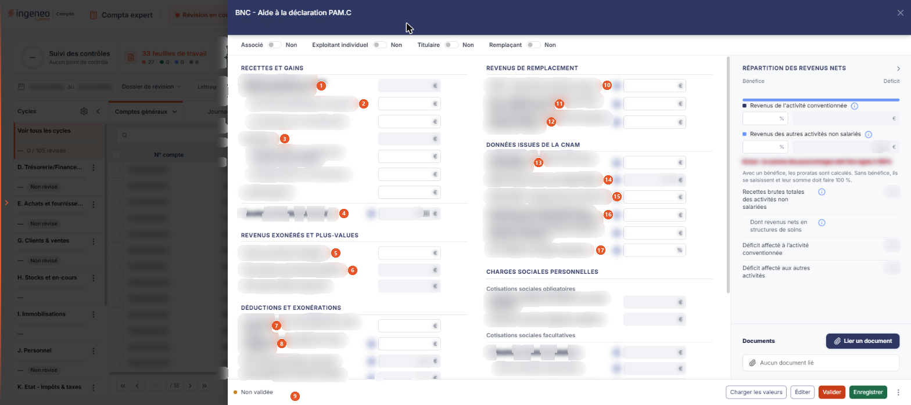
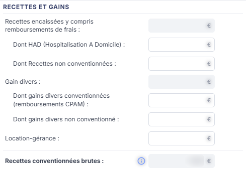
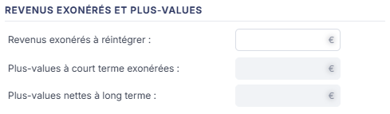
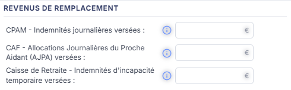
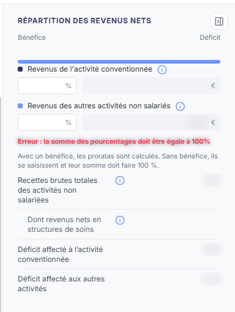
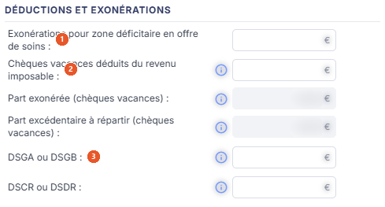
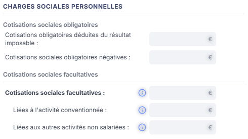
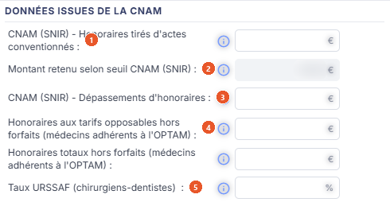
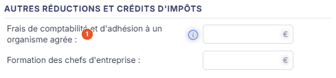
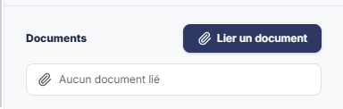

# BNC - Aide à la déclaration PAM.C


**En bref** — Cette feuille rassemble les éléments de la déclaration des praticiens et auxiliaires médicaux conventionnés : revenus encaissés, déductions, charges sociales et données du relevé de la caisse d'assurance maladie.

* Pour alimenter la feuille : bouton \[Charger les valeurs], complétez les rubriques, puis bouton \[Enregistrer].
* Pour reprendre l'exercice précédent : bouton \[Charger les valeurs N-1] du menu ⋮.
* Pour terminer : bouton \[Valider].


Cette feuille de travail rassemble les éléments nécessaires à l'établissement de la déclaration des praticiens et auxiliaires médicaux conventionnés : revenus encaissés, revenus de remplacement, déductions, charges sociales personnelles et données du relevé de la Caisse Nationale d'Assurance Maladie.

<figure><figcaption>
Écran « BNC - Aide à la déclaration PAM.C » de la nouvelle interface
</figcaption></figure>

Comme toutes les feuilles de travail, elle n'est accessible que si un **dossier de révision** a été créé sur le dossier annuel. Dans le cas contraire, le logiciel remplace l'écran par le message « **Veuillez créer un dossier de révision afin de pouvoir utiliser cette fonctionnalité.** ».

La feuille n'a plus d'entrée de menu. Dans l'écran Révision, cliquez sur la carte **« 33 feuilles de travail »** du bandeau du haut (le nombre peut varier) : la **liste** des feuilles s'ouvre en tiroir, avec une zone « Rechercher une feuille… » et les colonnes **Intitulé**, **Descriptif** et **Statut**. Cliquez sur le **crayon** de la ligne « BNC - Aide à la déclaration PAM.C » : la feuille s'ouvre dans un **panneau** à droite, dont l'en-tête porte « BNC - Aide à la déclaration PAM.C », puis « FLORE ET SENS SAS · Exercice 2026 » (votre société et votre exercice), avec une croix de fermeture.

La feuille arrive directement en saisie : il n'y a ni liste d'accueil propre à la feuille, ni bouton de création, et la feuille est créée dans le dossier de révision dès sa première ouverture, sans que vous ayez à l'enregistrer.

## Comment lire la feuille

La couleur des zones vous indique ce que vous devez renseigner :

* une zone **blanche** est une zone que vous saisissez ;
* une zone **grisée** est une zone calculée par le logiciel ou reprise de la comptabilité : elle n'est pas modifiable.

Trois pictogrammes accompagnent les zones :

* le pictogramme « Crayon », à droite de certaines zones saisies (il n'apparaît qu'au survol de la ligne), ouvre la fenêtre de formule de la cellule : le logiciel y affiche la **Formule par défaut :** en lecture seule et la **Formule actuelle :** que vous pouvez modifier, avec une palette de jetons à insérer (Défaut, Valeur, Solde, -Solde, SoldeC, -SoldeC, SoldeD, -SoldeD, MvtC, -MvtC, MvtD, -MvtD), son propre bouton **\[Enregistrer]** et son bouton **\[Annuler]**. C'est par cette fenêtre que se règle, cellule par cellule, la reprise des montants depuis la comptabilité ;
* le pictogramme « Double flèche circulaire », à droite de certaines zones calculées (il n'apparaît lui aussi qu'au survol de la ligne), recalcule la cellule ; son infobulle indique « Rafraichir les données. » ;
* le pictogramme « i » cerclé affiche une infobulle d'aide : cette feuille en comporte de nombreuses, en particulier sur les revenus de remplacement, les chèques vacances et les données de la Caisse Nationale d'Assurance Maladie. Prenez l'habitude de les lire, elles précisent ce que le montant attendu doit ou ne doit pas comprendre.

Aucun champ de cette feuille n'est marqué obligatoire.

## En tête du panneau : les quatre interrupteurs

Le panneau n'a pas de rubrique « Informations générales ». Quatre interrupteurs, alignés sous l'en-tête, décrivent la situation du praticien : **Associé :**, **Exploitant individuel :**, **Titulaire :** et **Remplaçant :**. Ils sont tous à **Non** à l'ouverture. Leur position ne fait apparaître ni disparaître aucun champ de la feuille.

## Rubriques « Recettes et gains », « Revenus de remplacement », « Revenus exonérés et plus-values » et « Répartition des revenus nets »

<figure><figcaption>
Rubrique « Rubrique « Recettes et gains » »
</figcaption></figure>

<figure><figcaption>
Rubrique « Rubrique « Revenus exonérés et plus-values » »
</figcaption></figure>

<figure><figcaption>
Rubrique « Rubrique « Revenus de remplacement » »
</figcaption></figure>

<figure><figcaption>
Rubrique « Rubrique « Répartition des revenus nets » »
</figcaption></figure>

L'écran n'a pas de rubrique « Revenus » : ces quatre blocs sont des rubriques à part entière, dont les titres s'affichent en majuscules. Le panneau les répartit sur trois colonnes : à gauche, « Recettes et gains », « Revenus exonérés et plus-values », « Déductions et exonérations » puis « Autres réductions et crédits d'impôts » ; au milieu, « Revenus de remplacement », « Données issues de la CNAM » puis « Charges sociales personnelles » ; à droite, « Répartition des revenus nets », suivie de « Documents ». Cette page les décrit dans son propre ordre, qui n'est pas celui de l'écran.

**Rubrique « Recettes et gains »**

| Champ                                                                   | Ce qu'il faut savoir                                                                                                                                                                                                                                                                                                                                                                                                                |
| ----------------------------------------------------------------------- | ----------------------------------------------------------------------------------------------------------------------------------------------------------------------------------------------------------------------------------------------------------------------------------------------------------------------------------------------------------------------------------------------------------------------------------- |
| 1. **Recettes encaissées y compris remboursements de frais**            | Montant calculé, que vous pouvez recalculer par le pictogramme « Double flèche circulaire ».                                                                                                                                                                                                                                                                                                                                        |
| 2. **Dont HAD (Hospitalisation A Domicile)**                            | , **Dont Recettes non conventionnées :**, **Dont gains divers conventionnées (remboursements CPAM) :**, **Dont gains divers non conventionné :** et **Location-gérance :** se saisissent.                                                                                                                                                                                                                                           |
| 3. **Gain divers**                                                      | Est calculé, avec le même pictogramme de recalcul.                                                                                                                                                                                                                                                                                                                                                                                  |
| 4. **Recettes conventionnées brutes**                                   | 
, en gras, est le résultat de la sous-rubrique : le logiciel le calcule en excluant les montants liés à l'hospitalisation à domicile et aux recettes non conventionnées, et en y ajoutant les gains divers. Son infobulle rappelle cette règle. <strong>Rubrique « Revenus de remplacement »</strong> Les trois montants se saisissent, et chacun porte une infobulle qui indique précisément ce qu'il faut y porter :
 |
| 5. **Revenus exonérés à réintégrer**                                    | Se saisit, et porte un pictogramme « Crayon » : vous pouvez donc lui donner une formule pour le reprendre de la comptabilité.                                                                                                                                                                                                                                                                                                       |
| 6. **Plus-values à court terme exonérées**                              | **Plus-values nettes à long terme :** sont calculées.                                                                                                                                                                                                                                                                                                                                                                               |
| 10. **CPAM - Indemnités journalières versées**                          | Les indemnités versées par la Sécurité Sociale au titre d'un congé maternité, paternité ou maladie.                                                                                                                                                                                                                                                                                                                                 |
| 11. **CAF - Allocations Journalières du Proche Aidant (AJPA) versées**  | L'allocation journalière du proche aidant versée par la Caisse d'Allocations Familiales, si vous êtes concerné. La CSG et la CRDS ont déjà été prélevées sur ce montant.                                                                                                                                                                                                                                                            |
| 12. **Caisse de Retraite - Indemnités d'incapacité temporaire versées** | 
Les indemnités d'incapacité temporaire, si vous êtes concerné. <strong>Rubrique « Revenus exonérés et plus-values »</strong>
                                                                                                                                                                                                                                                                                              |

**Rubrique « Répartition des revenus nets »**

Cette rubrique ventile les revenus entre l'activité conventionnée et les autres activités. Elle s'ouvre sur une barre horizontale portant « Bénéfice » à gauche et « Déficit » à droite : ces deux montants sont calculés par le logiciel et ne se saisissent pas.

Sont calculés : **Recettes brutes totales des activités non salariées :**, **Revenus de l'activité conventionnée :**, **Revenus des autres activités non salariés :**, **Dont revenus nets en structures de soins :**, **Déficit affecté à l'activité conventionnée :** et **Déficit affecté aux autres activités :**.

Vous saisissez en revanche les deux clés de répartition, exprimées en pourcentage : **Prorata activité conventionnée :** et **Prorata autres activités :**. Leur somme doit valoir 100.

**Le message « Erreur : la somme des pourcentages doit être égale à 100% » s'affiche dès l'ouverture d'une feuille encore vierge**, sous les deux prorata : les deux valant zéro à ce moment, le contrôle les refuse. Ce message ne signale donc pas une faute de votre part tant que vous n'avez rien saisi ; il disparaît lorsque les deux prorata totalisent 100. Une phrase d'aide, en dessous, rappelle la règle : « Avec un bénéfice, les proratas sont calculés. Sans bénéfice, ils se saisissent et leur somme doit faire 100 %. »

## Rubrique « Déductions et exonérations »

<figure><figcaption>
Rubrique « Rubrique « Déductions et exonérations » »
</figcaption></figure>

| Champ                                                       | Ce qu'il faut savoir                                                                                                                                                                                                                                                                                     |
| ----------------------------------------------------------- | -------------------------------------------------------------------------------------------------------------------------------------------------------------------------------------------------------------------------------------------------------------------------------------------------------- |
| 1. **Exonérations pour zone déficitaire en offre de soins** | Se saisit.                                                                                                                                                                                                                                                                                               |
| 2. **Chèques vacances déduits du revenu imposable**         | Se saisit : portez-y la totalité des chèques vacances octroyés. Le logiciel en déduit deux montants calculés, **Part exonérée (chèques vacances) :** et **Part excédentaire à répartir (chèques vacances) :** ; la seconde est celle qui excède le plafond d'exonération et reste soumise à cotisations. |
| 3. **DSGA ou DSGB**                                         | **DSCR ou DSDR :** se saisissent, et ne sont à renseigner que s'il existe une part excédentaire.                                                                                                                                                                                                         |

## Rubrique « Charges sociales personnelles »

<figure><figcaption>
Rubrique « Rubrique « Charges sociales personnelles » »
</figcaption></figure>

Cette rubrique est présentée sur deux colonnes et ne contient que des montants calculés.

Sous « Cotisations sociales obligatoires » : **Cotisations obligatoires déduites du résultat imposable :** et **Cotisations sociales obligatoires négatives :**, toutes deux dotées du pictogramme de recalcul.

Sous « Cotisations sociales facultatives » : **Cotisations sociales facultatives :** — hors plafonnement Madelin —, puis sa ventilation entre **Liées à l'activité conventionnée :** et **Liées aux autres activités non salariées :**.

## Rubrique « Données issues de la Caisse Nationale d'Assurance Maladie (CNAM) »

<figure><figcaption>
Rubrique « Rubrique « Données issues de la Caisse Nationale d'Assurance Maladie (CNAM) » »
</figcaption></figure>

Vous reportez ici les éléments du relevé SNIR. Ces zones se saisissent, à une exception près : **Montant retenu selon seuil CNAM (SNIR) :**, qui est calculé par le logiciel et n'est pas modifiable. Les zones saisies portent, pour la plupart, un pictogramme « Crayon » qui permet de les alimenter par formule.

| Champ                                                                                | Ce qu'il faut savoir                                                                                                        |
| ------------------------------------------------------------------------------------ | --------------------------------------------------------------------------------------------------------------------------- |
| 1. **CNAM (SNIR) - Honoraires tirés d'actes conventionnés**                          | Les honoraires conventionnés du relevé.                                                                                     |
| 2. **Montant retenu selon seuil CNAM (SNIR)**                                        | Est calculé par le logiciel à partir du précédent et des revenus de l'activité conventionnée.                               |
| 3. **CNAM (SNIR) - Dépassements d'honoraires**                                       | Les dépassements d'honoraires du relevé.                                                                                    |
| 4. **Honoraires aux tarifs opposables hors forfaits (médecins adhérents à l'OPTAM)** | **Honoraires totaux hors forfaits (médecins adhérents à l'OPTAM) :** ne concernent que les médecins signataires de l'OPTAM. |
| 5. **Taux URSSAF (chirurgiens-dentistes)**                                           | S'exprime en pourcentage. Son infobulle rappelle que ces taux varient selon le revenu et sont mis à jour régulièrement.     |

## Rubrique « Autres réductions et crédits d'impôts »

<figure><figcaption>
Rubrique « Rubrique « Autres réductions et crédits d'impôts » »
</figcaption></figure>

**Frais de comptabilité et d'adhésion à un organisme agrée** : et **Formation des chefs d'entreprise :** se saisissent.

Le premier porte un pictogramme « Double flèche circulaire » et une infobulle qui renvoie ailleurs : « Les frais de comptabilité et d'adhésion sont à remplir dans Feuilles de calcul > BNC - Réduct. d'impôts frais de compta. La valeur est plafonnée à 915 €. » C'est donc dans cette autre feuille que le montant se renseigne, avant d'être rapatrié ici.

Le second porte un pictogramme « Crayon » : il peut recevoir une formule.

## Rubrique « Documents »

<figure><figcaption>
Rubrique « Rubrique « Documents » »
</figcaption></figure>

Cette dernière rubrique permet de joindre des pièces justificatives à la feuille. Tant qu'aucune pièce n'est rattachée, la rubrique affiche la seule mention « **Aucun document lié** », précédée d'un pictogramme « Trombone ».

Le bouton **\[Lier un document]**, à droite de la rubrique, rattache une pièce à la feuille.

## Les boutons du pied du panneau

Le pied du panneau est permanent. À gauche, une pastille « Non validée » indique l'état de la feuille. À droite, une feuille non validée présente, dans cet ordre : bouton **\[Charger les valeurs]**, bouton **\[Éditer]**, bouton **\[Valider]**, bouton **\[Enregistrer]** et, tout à droite, un menu ⋮ « Autres actions ». Le menu ⋮ porte bouton **\[Charger les valeurs N-1]**, bouton **\[Éditer l'aide à la déclaration]** et, en rouge, bouton **\[Purger la feuille]**. Le pied n'a pas de bouton \[Fermer] : la croix de l'en-tête referme le panneau. Les descriptions qui suivent reprennent l'ordre de cette page, non celui du pied.

bouton **\[Charger les valeurs N-1]** (menu ⋮)

Il reprend la feuille de l'exercice précédent. Son infobulle précise la règle appliquée : « Récupération uniquement dans la feuille N-1 des champs possédants des formules, puis application de la formule. » Autrement dit, seules les cellules dotées d'une formule dans la feuille de l'exercice précédent sont reprises, et c'est la formule qui est rejouée, non le montant de l'an dernier.

Le logiciel vous demande la même confirmation que pour \[Charger les valeurs], et la même prudence s'impose : les valeurs présentes sont remplacées sans retour possible.

bouton **\[Éditer l'aide à la déclaration]** (menu ⋮)

Cette feuille est la seule à proposer, en plus de l'édition habituelle, un bouton d'édition qui lui est propre.

Il ouvre la fenêtre **Edition BNC - Pré-remplissage 2042 Volet social** : ce que ce bouton édite n'est donc pas la feuille elle-même, mais l'aide au pré-remplissage du volet social de la déclaration 2042. La fenêtre propose les mêmes options que celle du bouton \[Éditer], et les mêmes bouton **\[Edition]** et bouton **\[Annuler]**.

bouton **\[Éditer]**

Il ouvre la fenêtre **Edition BNC - Aide à la déclaration PAM.C**, qui rappelle l'intitulé de la feuille et son statut (« En cours » sur le dossier consulté) et propose le **Format :** — Html, Pdf ou Excel, Html étant proposé par défaut.

Les options qui suivent dépendent du format retenu :

* en Html, l'interrupteur **Tronquer les libellés trop longs :**, activé par défaut ;
* en Pdf, l'option de troncature disparaît et deux autres la remplacent : **Orientation :** — Portrait ou Paysage — et **Largeur :** — Fixe ou Ajustée —, dont l'infobulle précise « Ajuste la taille si la largeur des colonnes dépasse la largeur de la page » ;
* en Excel, aucune option n'est proposée.

Le bouton **\[Edition]** lance l'édition, le bouton **\[Annuler]** referme la fenêtre.

bouton **\[Purger la feuille]** (menu ⋮)

Il ramène la feuille à vide. Le logiciel vous demande de confirmer : « **Veuillez confirmer la remise à zéro de toutes les valeurs de la feuille de travail.** » C'est le moyen de repartir de zéro lorsque la feuille a été mal alimentée.

## À savoir

Cette feuille ne génère aucune écriture comptable : elle n'a ni rubrique « Ecriture », ni bouton de comptabilisation, ni paramétrage de comptes. Elle sert à préparer la déclaration, pas à l'enregistrer en comptabilité.

Enfin, le panneau n'indique pas à quel dossier de révision la feuille se rattache (son en-tête ne porte que la société et l'exercice). Si le dossier annuel en comporte plusieurs, rien dans le panneau ne vous dit lequel est servi.
