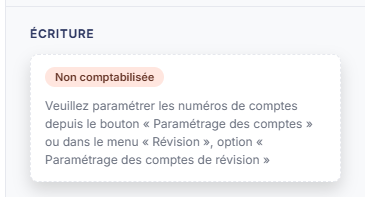

# BNC - Forfait blanchissage


**En bref** — Cette feuille récapitule, poste par poste, les frais réels de blanchissage des praticiens, des collaborateurs et des usages collectifs, en calcule les totaux et peut donner lieu à une écriture.

* Pour saisir les frais : ajoutez des lignes avec le bouton \[Nouvelle ligne], puis bouton \[Enregistrer].
* Pour passer l'écriture : bouton \[Comptabiliser et valider].


Cette feuille de travail sert à récapituler, poste par poste, les frais réels de blanchissage : ceux des praticiens, ceux des collaborateurs et ceux des usages collectifs. Elle en calcule les totaux, et peut donner lieu à une écriture comptable.

<figure><figcaption>
Écran « BNC - Forfait blanchissage » de la nouvelle interface
</figcaption></figure>

Comme toutes les feuilles de travail, elle n'est accessible que si un **dossier de révision** a été créé sur le dossier annuel. Dans le cas contraire, le logiciel remplace l'écran par le message « **Veuillez créer un dossier de révision afin de pouvoir utiliser cette fonctionnalité.** ».

Pour l'ouvrir, dans l'écran Révision, cliquez sur la carte « N feuilles de travail » du bandeau : la liste des feuilles s'ouvre dans un tiroir à droite. Repérez la ligne « BNC - Forfait blanchissage » (le champ « Rechercher une feuille… » la retrouve) et cliquez sur le crayon de la ligne : la feuille s'ouvre dans un panneau, dont l'en-tête indique « BNC - Forfait blanchissage », puis la société et l'exercice, avec une croix de fermeture. Il n'y a pas de bouton de création pour cette feuille, et elle est créée dans le dossier de révision dès sa première ouverture, sans que vous ayez à l'enregistrer.

C'est la plus simple des feuilles de calcul, et la plus manuelle : **elle ne comporte aucun bouton de chargement**. Rien n'y est repris de la comptabilité ni de l'exercice précédent, et aucune cellule n'y porte de formule. Tout est saisi ; la seule automatisation est la sommation des colonnes, et la génération de l'écriture.

## Comment lire la feuille

La couleur des zones vous indique ce que vous devez renseigner :

* une zone **blanche** est une zone que vous saisissez ;
* une zone **grisée** est une zone calculée par le logiciel : elle n'est pas modifiable.

La feuille comporte trois rubriques de frais, « Frais des praticiens », « Frais des collaborateurs » et « Frais des usages collectifs », et, dans une colonne à droite, les rubriques « Total des frais » et « Écriture » ; elle n'a aucun onglet.

Elle n'a pas de rubrique « Documents » : vous ne pouvez donc pas rattacher de pièce justificative à cette feuille, contrairement à la plupart des autres.

## Rubriques « Frais des praticiens », « Frais des collaborateurs » et « Frais des usages collectifs »

<figure><figcaption>
Rubrique « Rubriques « Frais des praticiens » »
</figcaption></figure>

<figure><figcaption>
Rubrique « Rubrique « Total des frais » »
</figcaption></figure>

Chaque rubrique porte un tableau, les trois tableaux étant de structure identique et chacun suivi de sa ligne de total ; un total général figure dans la colonne de droite :

* **Frais des praticiens**, suivi de **Total frais des praticiens :** ;
* **Frais des collaborateurs**, suivi de **Total frais des collaborateurs :** ;
* **Frais des usages collectifs**, suivi de **Total frais des usages collectifs :** ;

puis, dans la colonne de droite, la rubrique **Total des frais** qui récapitule l'ensemble : elle présente les libellés **Nb personne / Conso par personne et par unité de temps** et **Nb d'unité de temps de travail**, sans zone de saisie.

Chaque tableau présente les mêmes colonnes, dans cet ordre : une première colonne **Libellé** qui reçoit l'intitulé de la ligne, puis **Nb personne / Conso par personne et par unité de temps**, **Nb d'unité de temps de travail**, **Prix unitaire** et **Montant annuel**.

**Ce que vous saisissez sur une ligne**

Sur une ligne de frais, **les cinq cellules se saisissent** : l'intitulé de la ligne, le nombre de personnes ou la consommation, le nombre d'unités de temps, le prix unitaire **et le montant annuel**.

Autrement dit, le montant annuel n'est pas calculé à partir des trois colonnes qui le précèdent : c'est à vous de le porter. Les trois colonnes qui le précèdent servent à justifier ce montant, pas à le produire.

**Ce que le logiciel calcule**

Sur les trois lignes de total, le logiciel totalise trois colonnes seulement : **Nb personne / Conso par personne et par unité de temps**, **Nb d'unité de temps de travail** et **Montant annuel**. Ces cellules sont grisées.

La colonne **Prix unitaire** n'est pas totalisée, et c'est normal : la somme de prix unitaires n'aurait pas de sens. La cellule est simplement absente sur les lignes de total.

Sur une feuille encore vierge, tous ces totaux affichent 0,00.

**Ajouter et supprimer des lignes**

À l'ouverture, chaque tableau présente une ligne de saisie vide, prête à être renseignée.

Le bouton **\[Nouvelle ligne]**, sous chaque tableau, ajoute une ligne à ce tableau. La ligne vide proposée à l'ouverture ne porte aucune commande de suppression.

## Rubrique « Écriture »

<figure><figcaption>
Rubrique « Rubrique « Écriture » »
</figcaption></figure>

Elle se trouve dans la colonne de droite. Tant que la feuille n'a pas été comptabilisée, elle ne contient qu'une pastille **Non comptabilisée** et un message : « **Veuillez paramétrer les numéros de comptes depuis le bouton « Paramétrage des comptes » ou dans le menu « Révision », option « Paramétrage des comptes de révision »** ». Le bouton dont parle le message est la roue du pied, « Paramétrage des comptes de révision » ; le menu « Révision » n'existe plus : le même paramétrage s'atteint par ⋮ (Plus d'actions), puis « Paramétrage des comptes de révision », dans l'écran Révision.

Il n'y a alors ni liste d'écritures, ni bouton dans la rubrique. C'est le bouton \[Comptabiliser et valider] de la barre d'actions qui produit l'écriture.

## Les boutons du pied du panneau

Le pied du panneau est permanent. Il indique à gauche l'état de la feuille (une pastille orange et la mention « Non validée ») et présente à droite, de gauche à droite : la roue « Paramétrage des comptes de révision », \[Comptabiliser et valider], \[Éditer], \[Valider], \[Enregistrer] et ⋮ « Autres actions » (qui porte « Purger la feuille »). Le pied n'a pas de bouton \[Fermer] : la croix de l'en-tête referme le panneau.

bouton **\[Éditer]**

Il ouvre la fenêtre **Edition**, qui rappelle l'intitulé de la feuille, « BNC - Forfait blanchissage », avec une pastille de statut (« En cours » à la lecture), et qui propose le **Format :** — Html, Pdf ou Excel, Html étant proposé par défaut.

Les options qui suivent dépendent du format retenu :

* en Html, **Tronquer les libellés trop longs :**, interrupteur activé ;
* en Pdf, l'option de troncature disparaît et deux autres la remplacent : **Orientation :** (Portrait ou Paysage), positionnée sur Paysage, et **Largeur :** (Fixe ou Ajustée), positionnée sur Ajustée et suivie d'un pictogramme (i) ;
* en Excel, aucune option n'est proposée.

Le bouton **\[Edition]** lance l'édition, le bouton **\[Annuler]** referme la fenêtre.

**Roue « Paramétrage des comptes de révision »**

Elle ouvre, à droite, le tiroir « Paramétrage des comptes de révision » (sous-titre : société, exercice et régime), commun à toutes les feuilles : à gauche la liste des rubriques, dont une section « Spécifique BNC », à droite la rubrique sélectionnée, avec le champ « Rechercher un compte, un libellé… » en en-tête. Il s'ouvre positionné sur la rubrique **Frais de blanchissage** (2 paramètres), qui désigne les comptes que l'écriture utilisera :

* **Compte de l'exploitant** : le champ **Compte de l'exploitant**, accompagné de la mention « Même compte que la rubrique « Indemnités kilométriques » » ;
* **Frais de blanchissage** : le champ **Compte de frais de blanchissage**.

Sur chaque ligne, vous saisissez le numéro de compte, le bouton **\[+]** permet de créer le compte et le pictogramme « Loupe » de le rechercher ; le libellé du compte s'affiche à droite (« Aucun compte », en italique, dans l'état relevé). Le bouton **\[Rétablir la rubrique]**, en haut de la rubrique, la remet à son état d'origine.

Le pied du tiroir indique à gauche l'état (« Tout est enregistré ») et porte deux boutons : bouton **\[Charger les valeurs par défaut]** et bouton **\[Enregistrer]** ; il n'y a plus de bouton \[Annuler] : la croix de l'en-tête referme le tiroir. L'infobulle du premier explique la règle appliquée : « Charge les valeurs prévues et vérifie que les comptes existent dans le plan comptable du dossier. Un compte absent est signalé sur sa ligne. Rien n'est enregistré avant de cliquer sur Enregistrer. »

## À savoir

L'écran n'indique pas à quel dossier de révision la feuille se rattache. Si le dossier annuel en comporte plusieurs, rien à l'écran ne vous dit lequel est servi.
