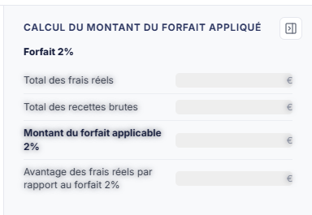
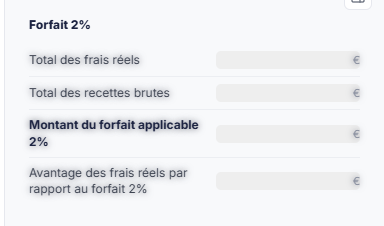

# BNC - Forfaits médecins 2% et 3%


**En bref** — Cette feuille compare, pour un médecin conventionné, ses frais réels aux déductions forfaitaires de 2 % et 3 % pour retenir la solution la plus avantageuse.

* Pour alimenter la feuille : bouton \[Charger les valeurs], puis bouton \[Enregistrer].
* Pour passer l'écriture : bouton \[Comptabiliser et valider].


Cette feuille de travail compare, pour un médecin conventionné, le montant de ses **frais réels** à celui des **déductions forfaitaires de 2 % et de 3 %**, afin d'établir laquelle des deux solutions est la plus avantageuse. Elle peut donner lieu à une écriture comptable.

<figure><figcaption>
Écran « BNC - Forfaits médecins 2% et 3% » de la nouvelle interface
</figcaption></figure>

Comme toutes les feuilles de travail, elle n'est accessible que si un **dossier de révision** a été créé sur le dossier annuel. Dans le cas contraire, le logiciel remplace l'écran par le message « **Veuillez créer un dossier de révision afin de pouvoir utiliser cette fonctionnalité.** ».

Pour l'ouvrir, dans l'écran Révision, cliquez sur la carte « N feuilles de travail » du bandeau : la liste des feuilles s'ouvre dans un tiroir à droite. Repérez la ligne « BNC - Forfaits médecins 2% et 3% » (le champ « Rechercher une feuille… » la retrouve) et cliquez sur le crayon de la ligne : la feuille s'ouvre dans un panneau, dont l'en-tête indique « BNC - Forfaits médecins 2% et 3% », puis la société et l'exercice, avec une croix de fermeture. Il n'y a pas de bouton de création pour cette feuille, et elle est créée dans le dossier de révision dès sa première ouverture, sans que vous ayez à l'enregistrer.

## Comment lire la feuille

La couleur des zones vous indique ce que vous devez renseigner :

* une zone **blanche** est une zone que vous saisissez ;
* une zone **grisée** est une zone calculée par le logiciel : elle n'est pas modifiable.

La feuille est d'un seul tenant, sans onglet. Sous l'en-tête, une barre porte les trois interrupteurs « Médecin du secteur 1 », « Forfait 2% » et « Forfait 3% ». En dessous, les rubriques affichées à l'ouverture se répartissent en trois colonnes : « Récapitulatif des frais réels » à gauche, « Récapitulatif du chiffre d'affaires » au centre, « Calcul du montant du forfait appliqué » puis « Écriture » à droite. Aucune rubrique « Données générales » ni « Comparaison » n'est affichée à l'ouverture.

**Le contenu de l'écran dépend entièrement des trois interrupteurs de la barre qui surmonte la feuille** : selon leur position, des champs, des tableaux et jusqu'à la totalité des rubriques apparaissent ou disparaissent. Commencez donc toujours par cette barre. Le paragraphe c) détaille cet enchaînement.

Cette feuille n'a pas de rubrique « Documents » : vous ne pouvez pas y rattacher de pièce justificative.

## La barre des trois interrupteurs

Trois interrupteurs, aucun marqué obligatoire :

**Médecin du secteur 1 :activé** à l'ouverture. Il commande toute la feuille.

**Forfait 2% :activé**. Il commande le calcul de la déduction de 2 %, et l'affichage du forfait de 3 %.

**Forfait 3% :désactivé**. Lorsque vous l'activez, un quatrième interrupteur apparaît, **Médecins conventionnés du groupe III :**, **désactivé**.

## Ce que chaque interrupteur fait apparaître ou disparaître

C'est le point à retenir de cet écran : les trois interrupteurs s'enchaînent, et l'un d'eux peut vider la feuille.

**« Médecin du secteur 1 : » désactivé**

**La feuille se vide.** Seule la barre des trois interrupteurs demeure ; les rubriques « Récapitulatif des frais réels », « Récapitulatif du chiffre d'affaires », « Calcul du montant du forfait appliqué », « Comparaison » et « Écriture » disparaissent entièrement.

Les boutons du pied du panneau, eux, restent tous présents. Si vous vous trouvez devant une feuille réduite à ses trois interrupteurs, c'est donc cet interrupteur qu'il faut regarder en premier : la feuille ne concerne que les médecins du secteur 1.

**« Forfait 2% : » désactivé**

Le logiciel masque le tableau **Recettes brutes** de la rubrique « Récapitulatif du chiffre d'affaires » ainsi que les deux tableaux de la rubrique « Calcul du montant du forfait appliqué », **y compris celui du forfait de 3 %**, et retire de la barre des interrupteurs l'interrupteur **Forfait 3% :** — donc aussi **Médecins conventionnés du groupe III :**. Les deux rubriques ainsi vidées restent affichées, mais ne contiennent plus rien.

Conséquence à connaître : **il n'est pas possible d'obtenir le calcul du forfait de 3 % sans avoir laissé le forfait de 2 % activé.** L'écran ne l'explique pas, et le champ du 3 % disparaît sans message.

**« Forfait 3% : » activé**

Le logiciel ajoute trois éléments :

* l'interrupteur **Médecins conventionnés du groupe III :** dans la barre des interrupteurs ;
* le tableau **Recettes conventionnelles** dans « Récapitulatif du chiffre d'affaires » ;
* le tableau **Avantage des frais réels 3%** dans « Calcul du montant du forfait appliqué ».

**« Médecins conventionnés du groupe III : » activé**

Cet interrupteur ne fait apparaître aucun champ : la ligne **Déduction du groupe III :** est déjà présente dès que le forfait de 3 % est retenu. Il n'agit donc que sur le calcul de cette déduction.

## Rubrique « Récapitulatif des frais réels »

<figure><figcaption>
Rubrique « Rubrique « Récapitulatif des frais réels » »
</figcaption></figure>

Huit lignes, le libellé à gauche et le montant à droite. Les huit natures de frais se saisissent : **Frais de représentation :**, **Frais de prospection :**, **Frais de réception :**, **Frais de blanchissage :**, **Frais de cadeau professionnel :**, **Frais de petits déplacements :**, **Frais de travaux de recherche :** et **Autres frais :**.

La dernière ligne, **Total des frais réels :**, est calculée par le logiciel.

Ces huit montants peuvent aussi être alimentés depuis la comptabilité par le bouton \[Charger les valeurs], à partir des comptes désignés dans le paramétrage des comptes. **Attention : l'écran ne distingue pas visuellement un montant chargé d'un montant que vous avez saisi.** Si vous les avez saisis à la main, sachez donc qu'un chargement les remplacera sans que rien ne le rappelle ensuite.

## Rubrique « Récapitulatif du chiffre d'affaires »

<figure><figcaption>
Rubrique « Rubrique « Récapitulatif du chiffre d'affaires » »
</figcaption></figure>

Un premier bloc, présent dès lors que le forfait de 2 % est retenu, avec une seule ligne à saisir : **Total des recettes brutes :**.

Un second tableau, **Recettes conventionnelles**, présent uniquement si le forfait de 3 % est retenu, avec une seule ligne à saisir : **Total des recettes conventionnelles :**.

## Rubrique « Calcul du montant du forfait appliqué »

<figure><figcaption>
Rubrique « Rubrique « Calcul du montant du forfait appliqué » »
</figcaption></figure>

Cette rubrique ne contient que des montants calculés, dans un ou deux tableaux selon les forfaits retenus.

Sous le sous-titre **Forfait 2%**, présent si le forfait de 2 % est retenu : **Total des frais réels :**, **Total des recettes brutes :**, **Montant du forfait applicable 2% :** et **Avantage des frais réels par rapport au forfait 2% :**.

Tableau **Avantage des frais réels 3%**, présent si le forfait de 3 % est retenu : **Total des frais réels :**, **Total des recettes conventionnelles :**, **Montant du forfait applicable 3% :**, **Déduction du groupe III :**, **Total de la déduction :** et **Avantage des frais réels 3% :**.

La ligne d'avantage est la conclusion du tableau : elle chiffre l'écart entre les frais réels et le forfait, et vous indique donc laquelle des deux solutions est la plus favorable.

## Rubrique « Comparaison »

<figure><figcaption>
Rubrique « Rubrique « Comparaison » »
</figcaption></figure>

À l'ouverture, aucune rubrique « Comparaison » n'est affichée.

## Rubrique « Écriture »

<figure><figcaption>
Rubrique « Rubrique « Écriture » »
</figcaption></figure>

Elle se trouve dans la colonne de droite, en bas. Tant que la feuille n'a pas été comptabilisée, elle ne contient qu'une pastille **Non comptabilisée** et un message : « **Veuillez paramétrer les numéros de comptes depuis le bouton « Paramétrage des comptes » ou dans le menu « Révision », option « Paramétrage des comptes de révision »** ». Le bouton dont parle le message est la roue du pied, « Paramétrage des comptes de révision » ; le menu « Révision » n'existe plus : le même paramétrage s'atteint par ⋮ (Plus d'actions), puis « Paramétrage des comptes de révision », dans l'écran Révision.

Aucune liste d'écritures n'y est présentée avant la comptabilisation. C'est le bouton \[Comptabiliser et valider] du pied du panneau qui produit l'écriture.

## Les boutons du pied du panneau

Le pied du panneau est permanent. Il indique à gauche l'état de la feuille (une pastille orange et la mention « Non validée ») et présente à droite, de gauche à droite : la roue « Paramétrage des comptes de révision », \[Charger les valeurs], \[Comptabiliser et valider], \[Éditer], \[Valider], \[Enregistrer] et ⋮ « Autres actions » (qui porte « Purger la feuille »). Le pied n'a pas de bouton \[Fermer] : la croix de l'en-tête referme le panneau. Ses boutons sont tous présents dès l'ouverture, y compris lorsque la feuille est vidée par l'interrupteur **Médecin du secteur 1 :**.

bouton **\[Éditer]**

Il ouvre la fenêtre **Edition**, qui rappelle l'intitulé de la feuille, « BNC - Forfaits médecins 2% et 3% », avec une pastille de statut (« En cours » à la lecture), et qui propose le **Format :** — Html, Pdf ou Excel, Html étant proposé par défaut.

Les options qui suivent dépendent du format retenu :

* en Html, **Tronquer les libellés trop longs :**, interrupteur activé ;
* en Pdf, l'option de troncature disparaît et deux autres la remplacent : **Orientation :** (Portrait ou Paysage), positionnée sur Paysage, et **Largeur :** (Fixe ou Ajustée), positionnée sur Ajustée et suivie d'un pictogramme (i) ;
* en Excel, aucune option n'est proposée.

Le bouton **\[Edition]** lance l'édition, le bouton **\[Annuler]** referme la fenêtre.

**Roue « Paramétrage des comptes de révision »**

Elle ouvre, à droite, le tiroir « Paramétrage des comptes de révision » (sous-titre : société, exercice et régime), commun à toutes les feuilles : à gauche la liste des rubriques, dont une section « Spécifique BNC », à droite la rubrique sélectionnée. Il s'ouvre positionné sur la rubrique **Forfait frais réel médecin 2%** (10 paramètres). Malgré ce libellé, elle désigne les comptes des **deux** forfaits.

Elle présente dix lignes de compte : **Compte forfait 2%**, **Compte forfait 3%**, puis un compte par nature de frais — **Frais de représentation**, **Frais de prospection**, **Frais de réception**, **Compte de frais de blanchissage** (avec la mention « Même compte que la rubrique « Frais de blanchissage » »), **Frais de cadeau professionnel**, **Frais de petits déplacements**, **Frais de travaux de recherche** et **Autres frais**. Ce sont ces comptes que le bouton \[Charger les valeurs] interroge pour alimenter le récapitulatif des frais réels.

Sur chaque ligne, vous saisissez le numéro de compte, le bouton **\[+]** permet de créer le compte et le pictogramme « Loupe » de le rechercher ; le libellé du compte s'affiche à droite (« Aucun compte », en italique, dans l'état relevé). Quand un numéro n'existe pas dans le plan comptable du dossier, un bandeau rouge s'affiche sous sa ligne : « Le compte … n'existe pas dans le plan comptable du dossier : l'écriture de révision ne pourra pas être générée. », avec le lien « Créer le compte ». Le bouton **\[Rétablir la rubrique]**, en haut de la rubrique, la remet à son état d'origine.

Le pied du tiroir indique à gauche l'état (« Tout est enregistré ») et porte deux boutons : bouton **\[Charger les valeurs par défaut]** et bouton **\[Enregistrer]** ; il n'y a plus de bouton \[Annuler] : la croix de l'en-tête referme le tiroir. L'infobulle du premier donne la règle appliquée : « Charge les valeurs prévues et vérifie que les comptes existent dans le plan comptable du dossier. Un compte absent est signalé sur sa ligne. Rien n'est enregistré avant de cliquer sur Enregistrer. »

Une ligne fait exception : **Autres frais** ne porte aucun numéro, son champ est entièrement vide.

## À savoir

L'écran n'indique pas à quel dossier de révision la feuille se rattache. Si le dossier annuel en comporte plusieurs, rien à l'écran ne vous dit lequel est servi.
