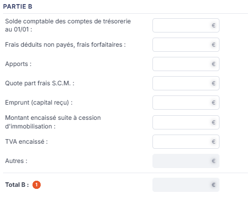

# BNC - Passage de trésorerie


**En bref** — Cette feuille rapproche la trésorerie du dossier des recettes déclarées : elle en déduit un résultat théorique et chiffre l'écart avec les recettes nettes déclarées.

* Pour alimenter la feuille : bouton \[Charger les valeurs], puis bouton \[Enregistrer].
* Pour terminer : bouton \[Valider].


Cette feuille de travail rapproche la **trésorerie** du dossier des **recettes déclarées** : elle part des soldes des comptes de trésorerie, ajoute et retranche les mouvements qui ne sont pas des recettes ou des dépenses professionnelles, en déduit un résultat théorique, et chiffre l'écart avec les recettes nettes déclarées.

<figure><figcaption>
Écran « BNC - Passage de trésorerie » de la nouvelle interface
</figcaption></figure>

Comme toutes les feuilles de travail, elle n'est accessible que si un **dossier de révision** a été créé sur le dossier annuel. Dans le cas contraire, le logiciel remplace l'écran par le message « **Veuillez créer un dossier de révision afin de pouvoir utiliser cette fonctionnalité.** ».

Pour l'ouvrir, dans l'écran Révision, cliquez sur la carte « N feuilles de travail » du bandeau : la liste des feuilles s'ouvre dans un tiroir à droite. Repérez la ligne « BNC - Passage de trésorerie » (le champ « Rechercher une feuille… » la retrouve) et cliquez sur le crayon de la ligne : la feuille s'ouvre dans un panneau, dont l'en-tête indique « BNC - Passage de trésorerie », puis la société et l'exercice, avec une croix de fermeture. Il n'y a pas de bouton de création : la feuille figure déjà dans la liste, et elle s'ouvre directement en saisie.

Cette feuille ne génère aucune écriture comptable.

## Comment lire la feuille

La feuille ne comporte aucun onglet. Elle présente trois rubriques de saisie : « PARTIE A » et « PARTIE B », côte à côte, puis « CONTRÔLE DES RECETTES », dans la colonne de droite, sous laquelle se trouve la rubrique « Documents ». Aucun champ ne fait apparaître ni disparaître de rubrique : la feuille se présente toujours de la même façon.

La couleur des zones vous indique ce que vous devez renseigner :

* une zone **blanche** est une zone que vous saisissez ;
* une zone **grisée** est une zone calculée par le logiciel : elle n'est pas modifiable. Les lignes de synthèse sont grisées et présentées en gras.

## Rubriques « PARTIE A », « PARTIE B » et « CONTRÔLE DES RECETTES »

<figure><figcaption>
Rubrique « Partie A »
</figcaption></figure>

<figure><figcaption>
Rubrique « Partie B »
</figcaption></figure>

<figure><figcaption>
Rubrique « Contrôle des recettes »
</figcaption></figure>

Chaque rubrique est un tableau sans en-tête de colonne : les libellés, à gauche, et les montants, à droite, dans une zone suivie du signe « € ». L'en-tête **Résultats comptable** n'existe plus, et il n'y a plus de colonne de pictogrammes : le pictogramme de ligne n'apparaît qu'au survol de la ligne (voir c).

La feuille se lit en trois temps : la rubrique « PARTIE A », aboutissant à **Total A :**, la rubrique « PARTIE B », aboutissant à **Total B :**, puis la rubrique « CONTRÔLE DES RECETTES », dans la colonne de droite, qui porte le rapprochement final.

**La rubrique « PARTIE A », jusqu'au « Total A : »**

Vous saisissez : **Soldes comptables des comptes professionnels 31 décembre :**, **Prélèvement personnels effectués :**, **Versements effectués à la S.C.M :**, **Montant des emprunts remboursés :**, **Montant des acquisitions d'éléments amortissables :**, **Quote-part frais privés payés :**, **TVA décaissé :**, **TVA déductible sur immobilisation :** et **TVA déductible sur biens et services :**.

La ligne **Autres :** ne se saisit pas directement : elle se renseigne par sa fenêtre de détail, décrite plus bas.

| Champ                         | Ce qu'il faut savoir                                                                                                                                                                                                                                                                                                                                                                                                                                                                                                                                                              |
| ----------------------------- | --------------------------------------------------------------------------------------------------------------------------------------------------------------------------------------------------------------------------------------------------------------------------------------------------------------------------------------------------------------------------------------------------------------------------------------------------------------------------------------------------------------------------------------------------------------------------------- |
| 1. **Total A**                | 
Est calculé. <strong>La rubrique « PARTIE B », jusqu'au « Total B : »</strong> Vous saisissez : <strong>Solde comptable des comptes de trésorerie au 01/01 :</strong>, <strong>Frais déduits non payés, frais forfaitaires :</strong>, <strong>Apports :</strong>, <strong>Quote part frais S.C.M. :</strong>, <strong>Emprunt (capital reçu) :</strong>, <strong>Montant encaissé suite à cession d'immobilisation :</strong> et <strong>TVA encaissé :</strong>. La seconde ligne <strong>Autres :</strong> se renseigne, elle aussi, par sa fenêtre de détail.
 |
| **Total B**                   | 
Est calculé. <strong>La rubrique « CONTRÔLE DES RECETTES » : le rapprochement final</strong>
                                                                                                                                                                                                                                                                                                                                                                                                                                                                            |
| **Résultat théorique**        | Est calculé à partir des deux totaux.                                                                                                                                                                                                                                                                                                                                                                                                                                                                                                                                             |
| **Dépenses professionnelles** | Se saisit.                                                                                                                                                                                                                                                                                                                                                                                                                                                                                                                                                                        |
| **Encaissements théoriques**  | Est calculé.                                                                                                                                                                                                                                                                                                                                                                                                                                                                                                                                                                      |
| **Recettes nettes déclarées** | Se saisit : portez-y le montant effectivement déclaré.                                                                                                                                                                                                                                                                                                                                                                                                                                                                                                                            |
| **Montant écart**             | **Pourcentage d'écart :** sont calculés : ce sont les deux lignes de conclusion de la feuille. Elles s'affichent en tête de la colonne, au-dessus de **Résultat théorique :**, et sur une feuille vide l'écran ne montre pas de zone de montant sous leur intitulé (le pourcentage est suivi du signe « % ») : l'affichage d'une feuille chargée n'a pas été vérifié. Un écart nul, ou négligeable, signifie que les recettes déclarées se retrouvent bien dans la trésorerie du dossier ; un écart significatif appelle une justification.                                       |

## Le pictogramme « Œil » : le détail des lignes « Autres : »

Les deux lignes **Autres :** ne se saisissent pas dans le tableau : leur montant est la somme d'un détail que vous établissez dans une fenêtre à part, ouverte par le pictogramme « Œil », qui n'apparaît lui aussi qu'au survol de la ligne. La fenêtre s'intitule **Cellule 'Autres' - Détail**.

Elle présente une liste à deux colonnes, **Libellé** et **Montant**, suivie d'une dernière colonne sans en-tête, réservée aux commandes de ligne, et affiche « Liste vide » tant qu'aucune ligne n'a été créée. Un champ **Montant total :**, en lecture seule, en donne la somme — c'est ce total qui alimente la ligne **Autres :** du tableau.

Le bouton **\[Nouvelle ligne]** ajoute une ligne, dotée d'un libellé et d'un montant à renseigner, et d'une commande qui la supprime (non vérifiée : aucune ligne n'a été créée ; sur les autres écrans, la croix de suppression est devenue une corbeille).

Le bouton **\[Enregistrer]** reporte le détail sur la feuille, le bouton **\[Annuler]** referme la fenêtre sans rien changer. Dans le pied de la fenêtre, \[Annuler] est à gauche, \[Nouvelle ligne] et \[Enregistrer] sont à droite ; la croix de l'en-tête referme aussi la fenêtre.

## Rubrique « Documents »

<figure><figcaption>
Rubrique « Rubrique « Documents » »
</figcaption></figure>

Cette rubrique, en bas de la colonne de droite, permet de joindre des pièces justificatives à la feuille, et elle est disponible dès l'ouverture, sans attendre que la feuille soit validée.

Tant qu'aucune pièce n'est rattachée, la rubrique affiche la seule mention « **Aucun document lié** », précédée d'un pictogramme « Trombone ».

Le bouton **\[Lier un document]**, à droite de la rubrique, rattache une pièce à la feuille.

## Les boutons de la barre d'actions

Le pied du panneau est permanent. Sur une feuille non validée, il présente, à gauche, la pastille orange « Non validée », puis, de gauche à droite : \[Charger les valeurs], \[Éditer], \[Valider], \[Enregistrer] et le menu ⋮ « Autres actions » (qui ne contient que « Purger la feuille »). Le pied n'a pas de bouton \[Fermer] : la croix de l'en-tête referme le panneau. Il ne porte ni roue de paramétrage des comptes, ni \[Comptabiliser et valider]. Les commandes sont décrites ci-dessous, sans suivre l'ordre du pied.

bouton **\[Éditer]**

Il ouvre la fenêtre **Edition** — son titre s'écrit parfois « Edition BNC - Passage de trésorerie » —, qui rappelle en tête le nom de la feuille et sa pastille d'état (« En cours »), puis propose le **Format :** — Html, Pdf ou Excel, Html étant proposé par défaut.

Les options qui suivent dépendent du format retenu :

* en Html, **Tronquer les libellés trop longs :**, un interrupteur sans texte, activé lorsqu'il s'affiche (il n'apparaît pas à toutes les ouvertures de la fenêtre) ;
* en Pdf, l'option de troncature disparaît et deux autres la remplacent : **Orientation :**, positionnée sur Portrait, et **Largeur :**, positionnée sur Ajustée, dont l'infobulle précise « Ajuste la taille si la largeur des colonnes dépasse la largeur de la page » ;
* en Excel, aucune option n'est proposée.

Le bouton **\[Edition]** lance l'édition, le bouton **\[Annuler]** referme la fenêtre.

## À savoir

Cette feuille n'a ni rubrique d'écritures, ni bouton de comptabilisation, ni roue de paramétrage des comptes de révision : le lien avec la comptabilité s'y règle intégralement ligne par ligne, par les formules.

Enfin, l'écran n'indique pas à quel dossier de révision la feuille se rattache. Si le dossier annuel en comporte plusieurs, rien à l'écran ne vous dit lequel est servi.
