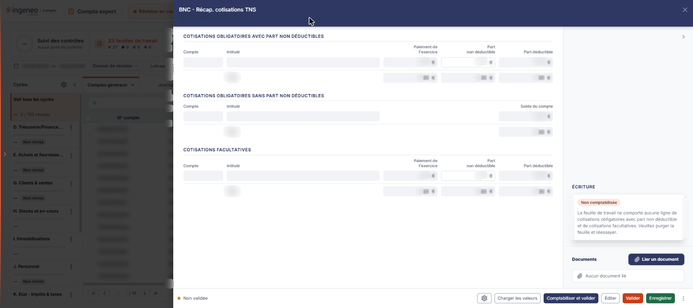
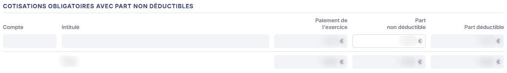
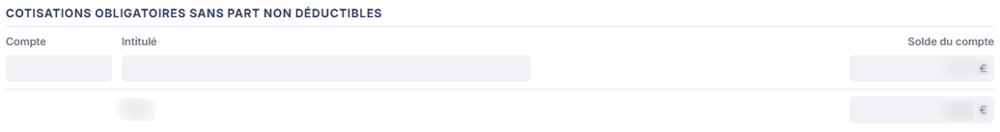
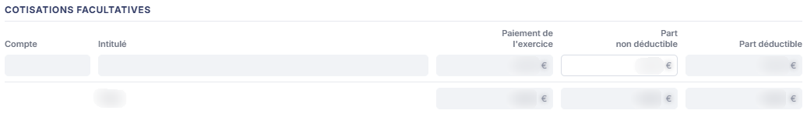
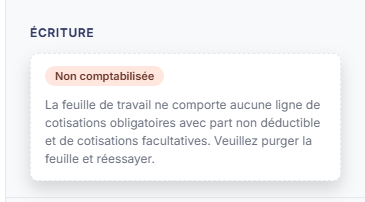
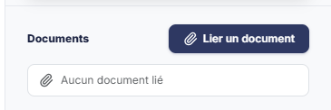

# BNC - Récap. cotisations TNS


**En bref** — Cette feuille récapitule les cotisations du travailleur non salarié, obligatoires et facultatives, en calcule la part déductible et les totaux, et peut donner lieu à une écriture.

* Pour alimenter les tableaux : bouton \[Charger les valeurs], puis bouton \[Enregistrer].
* Pour passer l'écriture : bouton \[Comptabiliser et valider].


Cette feuille de travail récapitule les cotisations du travailleur non salarié : les cotisations obligatoires, selon qu'elles comportent ou non une part non déductible, et les cotisations facultatives. Elle en calcule la part déductible et les totaux, et peut donner lieu à une écriture comptable.

<figure><figcaption>
Écran « BNC - Récap. cotisations TNS » de la nouvelle interface
</figcaption></figure>

Comme toutes les feuilles de travail, elle n'est accessible que si un **dossier de révision** a été créé sur le dossier annuel. Dans le cas contraire, le logiciel remplace l'écran par le message « **Veuillez créer un dossier de révision afin de pouvoir utiliser cette fonctionnalité.** ».

Pour l'ouvrir, dans l'écran Révision, cliquez sur la carte « N feuilles de travail » du bandeau : la liste des feuilles s'ouvre dans un tiroir à droite. Repérez la ligne « BNC - Récap. cotisations TNS » (le champ « Rechercher une feuille… » la retrouve) et cliquez sur le crayon de la ligne : la feuille s'ouvre dans un panneau, dont l'en-tête indique « BNC - Récap. cotisations TNS », puis la société et l'exercice, avec une croix de fermeture. Il n'y a pas de création préalable : la feuille est créée dans le dossier de révision dès sa première ouverture, sans que vous ayez à l'enregistrer, et l'écran est immédiatement en saisie.

Le panneau s'intitule « BNC - Récap. cotisations TNS », comme la ligne de la liste des feuilles.

## Comment lire la feuille

La couleur des zones vous indique ce que vous devez renseigner :

* une zone **blanche** est une zone que vous saisissez ;
* une zone **grisée** est une zone calculée par le logiciel, ou reprise de la comptabilité : elle n'est pas modifiable.

Sur cette feuille, **une seule colonne se saisit** : la **Part non déductible**. Tout le reste est repris de la comptabilité ou calculé.

Le panneau comporte, à gauche, les trois tableaux de cotisations et, dans une colonne à droite, la rubrique « Écriture » puis la rubrique « Documents ». Il n'y a aucun onglet, et aucun champ qui ferait apparaître ou disparaître une partie de l'écran : ce qui s'affiche est toujours le même.

## Les trois tableaux de cotisations

<figure><figcaption>
Rubrique « Tableau « Cotisations obligatoires avec part non déductibles » »
</figcaption></figure>

<figure><figcaption>
Rubrique « Tableau « Cotisations obligatoires sans part non déductibles » »
</figcaption></figure>

<figure><figcaption>
Rubrique « Tableau « Cotisations facultatives » »
</figcaption></figure>

Le panneau empile trois tableaux, chacun précédé de son sous-titre et suivi d'une ligne **Total** calculée.

Les lignes de ces tableaux ne se créent pas à la main : **elles sont produites d'après les racines de comptes paramétrées dans le panneau ouvert par la roue « Paramétrage des comptes de révision »**, un tableau par famille de cotisations. C'est donc ce paramétrage qui détermine ce que vous verrez ici.

**Tableau « Cotisations obligatoires avec part non déductibles »**

Ses colonnes sont, dans l'ordre : **Compte**, **Intitulé**, **Paiement de l'exercice**, **Part non déductible** et **Part déductible**.

Les trois premières sont reprises de la comptabilité et ne se modifient pas. Vous ne renseignez que la **Part non déductible** ; le logiciel en déduit la **Part déductible**.

La ligne **Total** totalise les trois colonnes de montants.

**Tableau « Cotisations obligatoires sans part non déductibles »**

Ses colonnes sont **Compte**, **Intitulé** et **Solde du compte**, suivies d'une ligne **Total**.

**Rien ne se saisit dans ce tableau**, ce qui est cohérent avec son intitulé : ces cotisations n'ayant pas de part non déductible, leur solde est repris tel quel de la comptabilité.

Une colonne vide et sans en-tête s'intercale avant **Solde du compte** : elle ne reçoit aucune donnée, c'est un reste de la mise en page commune aux trois tableaux.

**Tableau « Cotisations facultatives »**

Il présente les mêmes colonnes que le premier tableau et obéit aux mêmes règles : seule la **Part non déductible** se saisit, la **Part déductible** et la ligne **Total** sont calculées.

## Rubrique « Écriture » (colonne de droite)

<figure><figcaption>
Rubrique « Rubrique « Écriture » »
</figcaption></figure>

Tant que la feuille n'a pas été comptabilisée, cette rubrique affiche la pastille « Non comptabilisée », suivie d'un message. À l'ouverture de la feuille, tant qu'aucune ligne n'est chargée, ce message est :

« **La feuille de travail ne comporte aucune ligne de cotisations obligatoires avec part non déductible et de cotisations facultatives. Veuillez purger la feuille et réessayer.** »

Il n'y a alors ni liste d'écritures, ni bouton dans la rubrique. C'est le bouton \[Comptabiliser et valider] du pied qui produit l'écriture.

## Rubrique « Documents » (colonne de droite)

<figure><figcaption>
Rubrique « Rubrique « Documents » »
</figcaption></figure>

Cette rubrique vous permet de joindre à la feuille les pièces justificatives de votre choix. Elle est disponible dès l'ouverture, sans attendre que la feuille soit validée.

Tant qu'aucune pièce n'est rattachée, la rubrique affiche la seule mention « **Aucun document lié** », précédée d'un pictogramme « Trombone ».

Le bouton **\[Lier un document]**, à droite de la rubrique, rattache une pièce à la feuille.

## Les commandes du pied de la feuille

Le pied du panneau est permanent. À gauche, la pastille « Non validée » ; à droite, dans l'ordre : la roue « Paramétrage des comptes de révision », le Bouton \[Charger les valeurs], le Bouton \[Comptabiliser et valider], le Bouton \[Éditer], le Bouton \[Valider], le Bouton \[Enregistrer] et le menu ⋮ « Autres actions » (qui ne porte que l'entrée « Purger la feuille »). Sur une feuille non validée et non comptabilisée, tous sont disponibles dès l'ouverture. Le pied n'a pas de bouton \[Fermer] : la croix de l'en-tête referme le panneau.

bouton **\[Éditer]**

Il ouvre la fenêtre d'édition de la feuille, qui propose deux options : le **Format :** — Html, Pdf ou Excel, Html étant proposé par défaut — et **Tronquer les libellés trop longs :**, un interrupteur activé à l'ouverture. Les boutons **\[Edition]** et **\[Annuler]** referment la fenêtre.

**Roue « Paramétrage des comptes de révision »**

Elle ouvre, par-dessus la feuille, le panneau « Paramétrage des comptes de révision », commun à toutes les feuilles : à gauche, la liste des rubriques de paramétrage, chacune suivie du nombre de ses paramètres (dont une section « Spécifique BNC ») ; un champ « Rechercher un compte, un libellé… » en haut. À l'ouverture depuis cette feuille, la rubrique « Cotisations du gérant » est sélectionnée : elle compte trois paramètres, un par tableau de l'écran : **Comptes des cotisations obligatoires avec part non déductible**, **Comptes des cotisations obligatoires sans part non déductible** et **Comptes des cotisations facultatives**. **Ce sont ces trois champs qui déterminent les lignes des trois tableaux.**

Chacun reçoit une racine de compte, par exemple 6373, ou une plage de racines exprimée par un tiret, par exemple 6461-6463 pour toutes les racines allant de 6461 à 6463. À droite de chaque champ, une icône de rétablissement (infobulle « Rétablir la valeur par défaut (6373) » sur le premier champ) ; en haut à droite de la rubrique, le Bouton \[Rétablir la rubrique]. En bas du panneau : l'état d'enregistrement (« Tout est enregistré »), le Bouton \[Charger les valeurs par défaut] et le Bouton \[Enregistrer] ; la croix de l'en-tête ferme le panneau, qui ne propose pas de Bouton \[Annuler].

**Une valeur affichée en gris clair dans ces champs n'est pas un paramétrage** : c'est une valeur proposée par le logiciel, affichée en filigrane, qui ne devient celle de la feuille que si vous la reprenez et enregistrez le panneau. Tant que les trois champs restent en filigrane, **les trois tableaux de l'écran n'ont aucune ligne à afficher** : une feuille entièrement vide est donc le plus souvent le signe d'un paramétrage à reprendre, et non d'une absence d'écritures en comptabilité.

## À savoir

L'écran n'indique pas à quel dossier de révision la feuille se rattache. Si le dossier annuel en comporte plusieurs, rien à l'écran ne vous dit lequel est servi.

La rubrique des écritures s'appelle ici « Écriture », au singulier, alors que la même rubrique s'appelle « Ecritures » au pluriel sur d'autres feuilles de calcul, pour un contenu identique. L'ordre des boutons de la barre d'actions varie lui aussi d'une feuille à l'autre.
