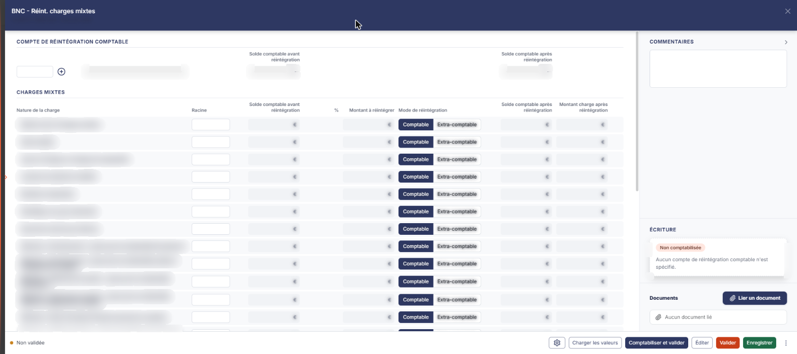
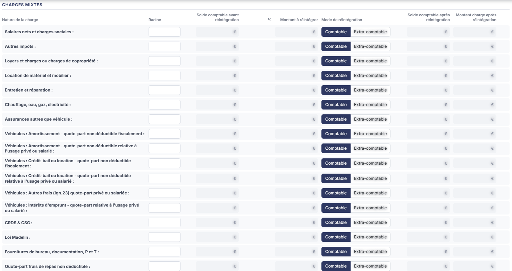
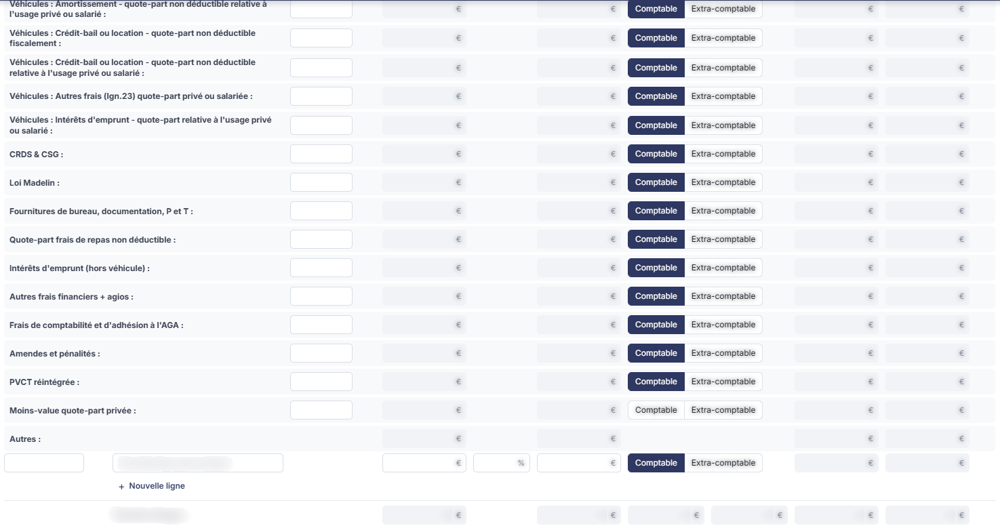

# BNC - Réint. charges mixtes


**En bref** — Cette feuille réintègre la part non déductible des charges mixtes (activité et usage privé) : elle calcule le montant à réintégrer et le solde du compte après réintégration.

* Pour alimenter le tableau : bouton \[Charger les valeurs], puis bouton \[Enregistrer].
* Pour passer l'écriture de réintégration : bouton \[Comptabiliser et valider].


Cette feuille de travail sert à réintégrer la part non déductible des charges dites mixtes, c'est-à-dire des charges qui relèvent pour partie de l'activité et pour partie d'un usage privé. Elle recense ces charges par nature, calcule le montant à réintégrer et le solde du compte après réintégration, et peut donner lieu à une écriture comptable.

<figure><figcaption>
Écran « BNC - Réint. charges mixtes » de la nouvelle interface
</figcaption></figure>

Comme toutes les feuilles de travail, elle n'est accessible que si un **dossier de révision** a été créé sur le dossier annuel. Dans le cas contraire, le logiciel remplace l'écran par le message « **Veuillez créer un dossier de révision afin de pouvoir utiliser cette fonctionnalité.** ».

Pour l'ouvrir, dans l'écran Révision, cliquez sur la carte « N feuilles de travail » du bandeau : la liste des feuilles s'ouvre dans un tiroir à droite. Repérez la ligne « BNC - Réint. charges mixtes » (le champ « Rechercher une feuille… » la retrouve) et cliquez sur le crayon de la ligne : la feuille s'ouvre dans un panneau, dont l'en-tête indique « BNC - Réint. charges mixtes », puis la société et l'exercice, avec une croix de fermeture. Il n'y a pas de bouton de création pour cette feuille, et elle est créée dans le dossier de révision dès sa première ouverture, sans que vous ayez à l'enregistrer.

## Comment lire la feuille

La couleur des zones vous indique ce que vous devez renseigner :

* une zone **blanche** est une zone que vous saisissez ;
* une zone **grisée** est une zone calculée par le logiciel, ou reprise de la comptabilité : elle n'est pas modifiable.

Le corps de la feuille comporte deux rubriques, dans cet ordre : « Compte de réintégration comptable » et « Charges mixtes ». La colonne de droite porte trois zones, de haut en bas : « Commentaires », « Écriture » et « Documents ». Il n'y a aucun onglet.

## Rubrique « Compte de réintégration comptable »

<figure><figcaption>
Rubrique « Rubrique « Compte de réintégration comptable » »
</figcaption></figure>

Cette rubrique tient sur une seule ligne : elle désigne le compte de contrepartie dans lequel la réintégration sera passée.

Vous n'y saisissez que le **numéro de compte** ; le Bouton \[+], à droite du champ, permet de créer le compte (non essayé), le pictogramme « Loupe », qui apparaît au survol du champ, de le rechercher dans le plan comptable, et le libellé du compte s'affiche à côté, en lecture seule.

Deux cellules calculées complètent la ligne : **Solde comptable avant réintégration** et **Solde comptable après réintégration**. La seconde se recalcule au fur et à mesure de ce que vous réintégrez dans la rubrique suivante.

Les deux premières cellules de cette ligne n'ont pas d'en-tête, et des colonnes vides s'y intercalent : c'est un reste de mise en page, rien n'y est attendu de vous.

## Rubrique « Charges mixtes »

<figure><figcaption>
Rubrique « Rubrique « Charges mixtes » »
</figcaption></figure>

<figure><figcaption>
Rubrique « Rubrique « Charges mixtes » »
</figcaption></figure>

C'est le cœur de la feuille. Le tableau présente les colonnes suivantes, dans l'ordre : **Nature de la charge**, **Racine**, **Solde comptable avant réintégration**, **%**, **Montant à réintégrer**, **Mode de réintégration**, **Solde comptable après réintégration** et **Montant charge après réintégration**.

Il se lit en trois parties : les natures de charges prévues par le logiciel, puis la ligne **Autres :** et les lignes que vous créez vous-même, puis la ligne de total.

**Les natures de charges prévues par le logiciel**

La première partie du tableau présente une liste de natures de charges **figée** : vous ne pouvez ni en ajouter, ni en renommer, ni en supprimer. Ce sont, dans l'ordre d'affichage :

* **Salaires nets et charges sociales**
* **Autres impôts**
* **Loyers et charges ou charges de copropriété**
* **Location de matériel et mobilier**
* **Entretien et réparation**
* **Chauffage, eau, gaz, électricité**
* **Assurances autres que véhicule**
* **Véhicules : Amortissement - quote-part non déductible fiscalement**
* **Véhicules : Amortissement - quote-part non déductible relative à l'usage privé ou salarié**
* **Véhicules : Crédit-bail ou location - quote-part non déductible fiscalement**
* **Véhicules : Crédit-bail ou location - quote-part non déductible relative à l'usage privé ou salarié :**
* **Véhicules : Autres frais (lgn.23) quote-part privé ou salariée**
* **Véhicules : Intérêts d'emprunt - quote-part relative à l'usage privé ou salarié**
* **CRDS & CSG**
* **Loi Madelin**
* **Fournitures de bureau, documentation, P et T**
* **Quote-part frais de repas non déductible**
* **Intérêts d'emprunt (hors véhicule)**
* **Autres frais financiers + agios**
* **Frais de comptabilité et d'adhésion à l'AGA**
* **Amendes et pénalités**
* **PVCT réintégrée**
* **Moins-value quote-part privée**

Sur chacune de ces lignes, **la seule zone que vous saisissez est la Racine** : la racine des comptes dont le solde doit alimenter la nature. Un pictogramme « Double flèche circulaire », à droite de la racine, complète la cellule ; son infobulle indique « Rafraichir les données pour cette racine et ses comptes mouvementés. ».

Le **Solde comptable avant réintégration**, le **Montant à réintégrer**, le **Solde comptable après réintégration** et le **Montant charge après réintégration** sont calculés par le logiciel.

La colonne **%** reste, elle, **entièrement vide sur ces lignes** : elle ne porte aucune zone de saisie. Le pourcentage ne se renseigne que sur les lignes personnalisées décrites plus bas.

La colonne **Mode de réintégration** porte deux boutons-bascule, **Comptable** et **Extra-comptable** : c'est vous qui choisissez, ligne par ligne, si la réintégration est passée en comptabilité ou reste extra-comptable.

| Champ                                                                                 | Ce qu'il faut savoir                                                                                                                                                                                                                                                                                                                                                                                                                                                                                                                                                                                                                                                                                                                                                                                                                                                                                                                                                                                                                                                                                                                                                                                                                                                     |
| ------------------------------------------------------------------------------------- | ------------------------------------------------------------------------------------------------------------------------------------------------------------------------------------------------------------------------------------------------------------------------------------------------------------------------------------------------------------------------------------------------------------------------------------------------------------------------------------------------------------------------------------------------------------------------------------------------------------------------------------------------------------------------------------------------------------------------------------------------------------------------------------------------------------------------------------------------------------------------------------------------------------------------------------------------------------------------------------------------------------------------------------------------------------------------------------------------------------------------------------------------------------------------------------------------------------------------------------------------------------------------ |
| **Toutes les natures n'arrivent pas avec un mode déjà choisi**                        | 
Certaines s'affichent sur <strong>Comptable</strong>, d'autres sans aucun mode sélectionné, et la proportion varie d'un dossier à l'autre. Le mode proposé par défaut se paramètre nature par nature dans la panneau du pictogramme « Engrenage » (Paramétrage des comptes de révision) ; tant que vous n'y avez rien changé, il vaut « Comptable » pour toutes les natures de charges prévues par le logiciel. Rien ne signale à l'écran qu'une ligne est sans mode : <strong>pensez à vérifier ce choix sur chaque ligne que vous renseignez</strong>, et à le comparer à celui du panneau de paramétrage avant de comptabiliser. <strong>La ligne « Autres : » et les lignes personnalisées</strong> La ligne <strong>Autres :</strong> ne se saisit pas : elle n'a ni racine ni mode de réintégration, et totalise les lignes personnalisées que vous créez en dessous. Une première ligne personnalisée, vierge, est déjà présente à l'ouverture, sous la ligne Autres :. Le <strong>lien « + Nouvelle ligne »</strong>, sous le tableau, en ajoute une autre. Au survol de la ligne, le pictogramme « Corbeille » apparaît à son extrémité droite : il supprime la ligne ; son infobulle indique « Supprimer la ligne de charge supplémentaire. ».
 |
| **Une ligne personnalisée ne fonctionne pas comme une nature prévue par le logiciel** | Vous y saisissez cinq zones — le numéro de compte, que le pictogramme « Loupe » (visible au survol) permet de rechercher dans le plan comptable, un libellé libre (la zone porte le texte d'invite « Nouvelle ligne personnalisée »), le **Solde comptable avant réintégration**, le **%** et le **Montant à réintégrer**. Seules les deux dernières colonnes restent calculées.                                                                                                                                                                                                                                                                                                                                                                                                                                                                                                                                                                                                                                                                                                                                                                                                                                                                                         |

Autrement dit : sur une nature prévue par le logiciel, les montants découlent de la racine ; sur une ligne personnalisée, c'est vous qui les portez.

**La ligne de total**

La ligne **Total des charges :** ferme le tableau. Toutes ses cellules sont calculées.

## Zone « Commentaires »

<figure><figcaption>
Rubrique « Zone « Commentaires » »
</figcaption></figure>

Une zone de texte libre, en haut de la colonne de droite, dans laquelle vous consignez ce que vous jugez utile de justifier : le choix d'une racine, le raisonnement retenu sur une quote-part privée, une remarque à l'attention du réviseur. Sa longueur n'est pas limitée à l'affichage.

## Zone « Écriture »

<figure><figcaption>
Rubrique « Zone « Écriture » »
</figcaption></figure>

À l'ouverture, cette zone affiche la pastille « **Non comptabilisée** » et le texte « **Aucun compte de réintégration comptable n'est spécifié.** ». Ce qu'elle affiche une fois un compte de réintégration renseigné, ou une fois la feuille comptabilisée, n'a pas été observé.

Il n'y a ni liste d'écritures, ni bouton dans la zone. C'est le bouton \[Comptabiliser et valider] du pied qui produit l'écriture.

## Zone « Documents »

<figure><figcaption>
Rubrique « Zone « Documents » »
</figcaption></figure>

Cette zone vous permet de joindre à la feuille les pièces justificatives de votre choix. Elle est disponible dès l'ouverture, sans attendre que la feuille soit validée.

Tant qu'aucune pièce n'est rattachée, la zone affiche la seule mention « **Aucun document lié** », précédée d'un pictogramme « Trombone ».

Le bouton **\[Lier un document]**, à droite du titre « Documents », rattache une pièce à la feuille.

## Les boutons du pied de la feuille

Le pied du panneau est permanent. À gauche, la mention « Non validée » ; à droite, dans l'ordre : le pictogramme « Engrenage », le Bouton \[Charger les valeurs], le Bouton \[Comptabiliser et valider], le Bouton \[Éditer], le Bouton \[Valider], le Bouton \[Enregistrer] et le menu ⋮ « Autres actions ». Le pied n'a pas de bouton \[Fermer] : la croix de l'en-tête referme le panneau ; le menu ⋮ ne porte que l'entrée « Purger la feuille ». Sur une feuille non validée et non comptabilisée, les commandes décrites ci-dessous sont toutes présentes dès l'ouverture.

bouton **\[Éditer]**

Il ouvre la fenêtre « Edition » de la feuille, qui propose deux options : le **Format :** — Html, Pdf ou Excel, Html étant proposé par défaut — et **Tronquer les libellés trop longs :**, interrupteur sans texte, activé par défaut. Les boutons **\[Edition]** et **\[Annuler]** referment la fenêtre.

**Pictogramme « Engrenage » (Paramétrage des comptes de révision)**

Placé à gauche du pied, il ouvre, par-dessus la feuille, le panneau « Paramétrage des comptes de révision ». Ce panneau n'est pas propre à cette feuille : à gauche, la liste des rubriques de paramétrage de toutes les feuilles, chacune suivie du nombre de ses paramètres, avec un groupe « Spécifique BNC » ; un champ « Rechercher un compte, un libellé… » en haut. À l'ouverture depuis cette feuille, la rubrique « Réintégration des charges mixtes » est sélectionnée (23 paramètres), et le Bouton \[Rétablir la rubrique] figure en haut à droite.

Elle présente une ligne par nature de charge prévue par le logiciel, dans le même ordre qu'à l'écran, sous les intertitres « Charges », « Véhicules » et « Autres charges ». Chaque ligne porte un champ **Racine du poste …** et un couple de boutons-bascule **Comptable** / **Extra-comptable** : **c'est ici que se définissent la racine et le mode de réintégration proposés par défaut pour cette nature.** Une ligne laissée vide correspond à une nature qui s'affichera sans racine et sans mode.

Dans un champ de racine, le **point-virgule** sépare plusieurs racines et le **tiret** exprime une plage : 6160-6162;6164 désigne les racines 6160 à 6162, plus la racine 6164.

**Une valeur affichée en gris clair n'est pas un paramétrage** : c'est une racine proposée par le logiciel, affichée en filigrane, qui ne devient celle de la feuille que si vous la reprenez et enregistrez le panneau. C'est pourquoi la colonne **Racine** de l'écran peut rester vide alors que le panneau de paramétrage semble renseigné.

Le panneau s'enregistre séparément de la feuille. En bas, de gauche à droite : l'état d'enregistrement (« Tout est enregistré »), **\[Charger les valeurs par défaut]** et **\[Enregistrer]** ; il n'y a plus de bouton **\[Annuler]**, et la croix de l'en-tête ferme le panneau. Le premier renseigne les lignes avec les valeurs proposées par le logiciel.

## À savoir

L'écran n'indique pas à quel dossier de révision la feuille se rattache. Si le dossier annuel en comporte plusieurs, rien à l'écran ne vous dit lequel est servi.

Les intitulés des natures ne sont pas rigoureusement identiques d'un écran à l'autre : la nature affichée « Assurances autres que véhicule » s'appelle « Racine du poste assurances autres que véhicules » dans la fenêtre de paramétrage. Il s'agit bien de la même nature.

La zone des écritures s'appelle ici « Écriture », au singulier, alors que la même rubrique s'appelle « Ecritures » au pluriel sur d'autres feuilles de calcul, pour un contenu identique. L'ordre des boutons du pied varie lui aussi d'une feuille à l'autre.
