# Bordereau juridique annuel


**En bref** — Cette feuille rassemble, exercice par exercice, les informations juridiques utiles à l'assemblée annuelle et au rapport de gestion : activité, délais de règlement, affectation du résultat.

* Pour alimenter le tableau : bouton \[Charger les valeurs], puis bouton \[Enregistrer].
* Pour voir les écritures retenues : bouton \[Voir le détail].
* Pour repartir de zéro : entrée « Purger la feuille » du menu ⋮ « Autres actions » du pied du panneau.


Cette page décrit la feuille de travail **Bordereau juridique annuel**, qui s'ouvre depuis l'écran Révision (voir « Avant d'ouvrir la feuille »). Vous y rassemblez, exercice par exercice, les informations juridiques que le cabinet doit réunir pour préparer l'assemblée annuelle et le rapport de gestion : situation et activité de la société, délais de règlement des fournisseurs et des clients, affectation du résultat, conventions réglementées, rémunérations des dirigeants, dépenses non déductibles, résolutions particulières, puis votre conclusion.

<figure>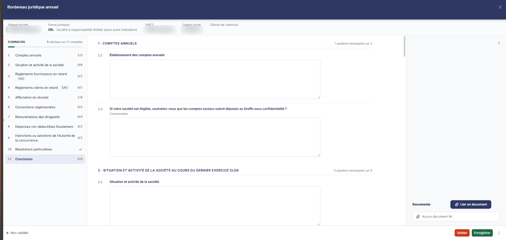<figcaption>
Écran « Bordereau juridique annuel » de la nouvelle interface
</figcaption></figure>

C'est une **feuille rédactionnelle**, comme « Acceptation et maintien de la mission » et « Lutte anti-blanchiment ». Une feuille rédactionnelle recueille votre **jugement** — des intitulés, des réponses fermées et des zones de commentaire — alors qu'une feuille de calcul recompose des **chiffres** repris de la comptabilité par des formules et peut aboutir à une écriture. Ce bordereau est le plus chiffré des trois : il porte quatre tableaux, dont deux sont alimentés depuis la comptabilité. Il ne génère toutefois **aucune écriture comptable**.

## Avant d'ouvrir la feuille

Une feuille de travail appartient à un **dossier de révision**, et non au dossier annuel. Tant qu'aucun dossier de révision n'a été créé sur le dossier annuel en cours, l'écran ne s'affiche pas : le logiciel le remplace par le message **Veuillez créer un dossier de révision afin de pouvoir utiliser cette fonctionnalité.** Il faut donc avoir créé ce dossier avant d'ouvrir la feuille.

Le panneau de la feuille ne rappelle nulle part à quel dossier de révision il travaille (son en-tête ne porte que la société et l'exercice) : si votre dossier annuel en comporte plusieurs, rien dans le panneau ne vous dit lequel est servi.

La feuille n'a plus d'entrée de menu. Dans l'écran Révision, cliquez sur la carte **« 33 feuilles de travail »** du bandeau du haut (le nombre peut varier) : la **liste** des feuilles s'ouvre en tiroir, avec une zone « Rechercher une feuille… », des filtres de statut et les colonnes **Intitulé**, **Descriptif** et **Statut**. Cliquez sur le **crayon** de la ligne « Bordereau juridique annuel » : la feuille s'ouvre dans un **panneau** à droite, dont l'en-tête porte « Bordereau juridique annuel », puis « FLORE ET SENS SAS · Exercice 2026 » (votre société et votre exercice), avec une croix de fermeture.

Il n'y a pas de liste d'accueil propre à la feuille ni de bouton **\[Nouveau]** : la feuille arrive **immédiatement en saisie**, sans bouton **\[Modifier]** ni mode consultation. Le logiciel crée la feuille en base dès votre première ouverture, sans que vous ayez à l'enregistrer ; son statut s'affiche dans la liste (« En cours » sur le dossier consulté).

## Comment se lit la feuille

<figure>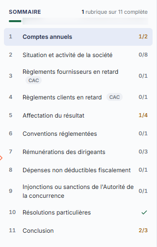<figcaption>
Rubrique « Comment se lit la feuille »
</figcaption></figure>

Le corps du bordereau est une suite de rubriques numérotées, chacune composée de questions numérotées (1.1, 1.2…) : un intitulé, puis une zone de commentaire libre, sur plusieurs lignes, déjà dépliée, dont le texte d'invite est « Saisir un commentaire ». Pour trois questions (1.2, 5.3 et 10.1), la zone est précédée du libellé « Commentaire » ; aucun interrupteur Oui / Non n'est affiché.

Dans les tableaux, le rendu vous dit ce que vous avez à faire : une **zone blanche** est une valeur que vous saisissez, une **zone grisée** est une valeur que le logiciel calcule ou reprend, et que vous ne pouvez pas modifier.

Au-dessus du corps, un bandeau d'identité rappelle la société (voir a). À gauche, un **sommaire** numérote onze rubriques ; chacune y porte un compteur (« 1/2 », « 0/8 », « Complète »…) et le sommaire indique en haut « N rubrique(s) sur 11 complète(s) » (« 1 rubrique sur 11 complète » le 05/11/2026), avec une jauge. Les onze rubriques s'affichent les unes sous les autres au centre, dans l'ordre du sommaire ; chaque titre porte à droite le nombre de questions renseignées (« 1 question renseignée sur 2 »). Le volet de droite, que le chevron « Masquer le volet de droite » replie, porte la rubrique « Documents ». Le panneau n'a aucun onglet.

## Bandeau d'identité

<figure><figcaption>
Rubrique « a) Bandeau d'identité »
</figcaption></figure>

Sous l'en-tête du panneau, un bandeau en texte, où rien n'est saisissable, reprend de la fiche de la société gérée et du dossier annuel : « Raison sociale », « Forme juridique » (le code, puis ce code en clair : « SRL · Société à responsabilité limitée (sans autre indication) » sur le dossier consulté), « SIRET », « Capital social » et « Clôture de l'exercice ». Si une valeur est fausse ou manquante, corrigez-la à sa source, dans la fiche de la société. « Clôture de l'exercice » reste vide tant que l'exercice n'est pas clos.

## Rubrique « Comptes annuels »

<figure><figcaption>
Rubrique « Rubrique « Comptes annuels » »
</figcaption></figure>

**1.1 Établissement des comptes annuels** — un commentaire libre.

**1.2 Si votre société est éligible, souhaitez-vous que les comptes sociaux soient déposés au Greffe sous confidentialité ?** — une zone « Commentaire ».

## Rubrique « Situation et activité de la société au cours du dernier exercice clos »

<figure>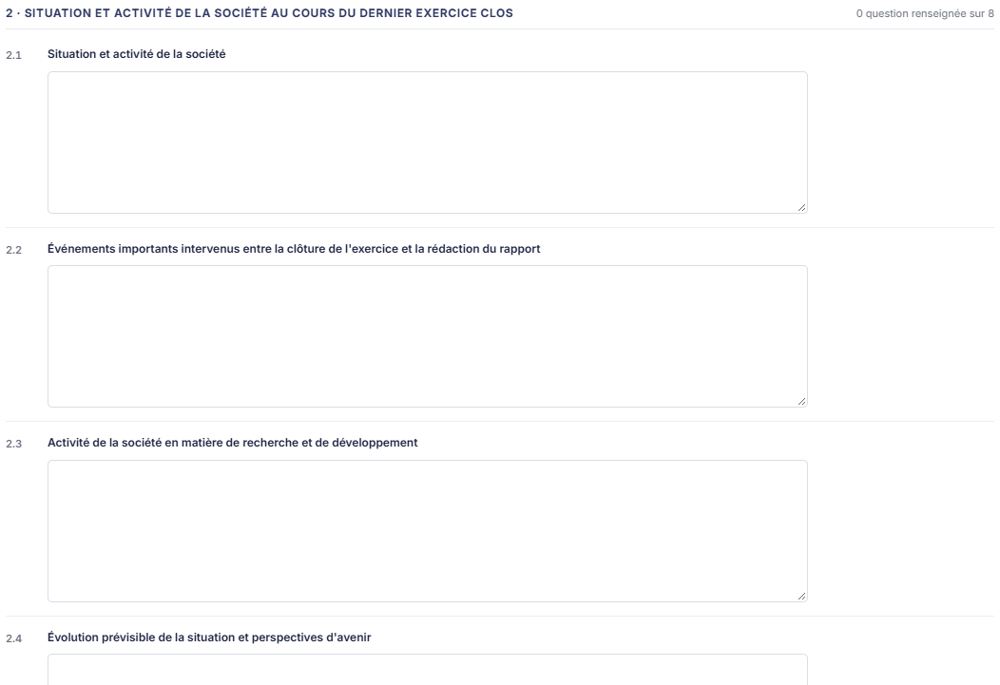<figcaption>
Rubrique « Rubrique « Situation et activité de la société au cours du dernier exercice clos » »
</figcaption></figure>

<figure>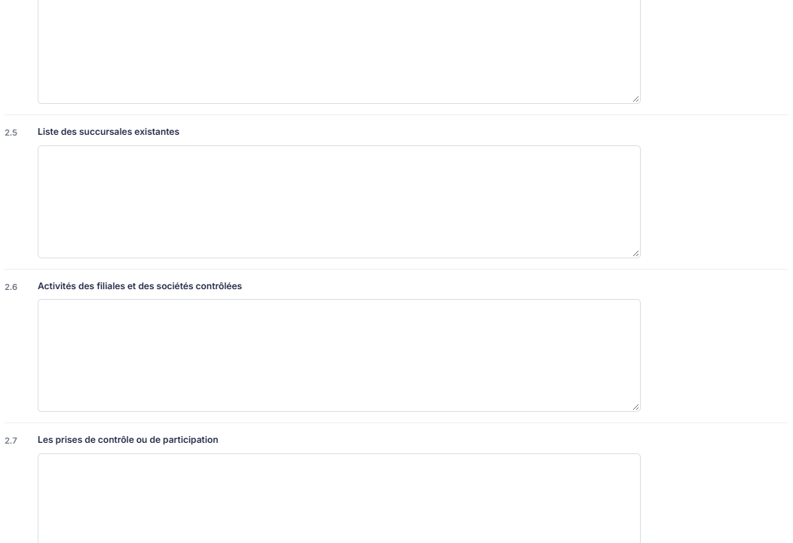<figcaption>
Rubrique « Rubrique « Situation et activité de la société au cours du dernier exercice clos » »
</figcaption></figure>

<figure>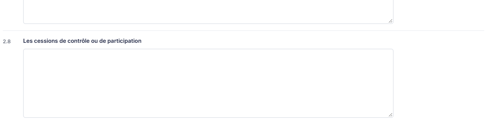<figcaption>
Rubrique « Rubrique « Situation et activité de la société au cours du dernier exercice clos » »
</figcaption></figure>

Huit questions (2.1 à 2.8), chacune composée d'un intitulé et d'une zone de commentaire libre. Ni interrupteur, ni tableau dans cette rubrique :

* **Situation et activité de la société**
* **Événements importants intervenus entre la clôture de l'exercice et la rédaction du rapport**
* **Activité de la société en matière de recherche et de développement**
* **Évolution prévisible de la situation et perspectives d'avenir**
* **Liste des succursales existantes**
* **Activités des filiales et des sociétés contrôlées**
* **Les prises de contrôle ou de participation**
* **Les cessions de contrôle ou de participation**

## Rubrique « Tableau des règlements fournisseurs en retard »

<figure><figcaption>
Rubrique « Rubrique « Tableau des règlements fournisseurs en retard » »
</figcaption></figure>

Cette rubrique, réservée aux sociétés ayant un commissaire aux comptes (mention « Uniquement pour les sociétés ayant un commissaire aux comptes » sous son titre, pastille « CAC » dans le sommaire), établit le tableau des délais de paiement des fournisseurs que la loi impose de publier lorsque la société a un commissaire aux comptes. Elle se compose de trois réglages, de deux boutons et d'un tableau.

| Champ                                                          | Ce qu'il faut savoir                                                                                                                                                                                                                                                                                                                                                                                                                                                                                                                                                                                                                                                                                                                                               |
| -------------------------------------------------------------- | ------------------------------------------------------------------------------------------------------------------------------------------------------------------------------------------------------------------------------------------------------------------------------------------------------------------------------------------------------------------------------------------------------------------------------------------------------------------------------------------------------------------------------------------------------------------------------------------------------------------------------------------------------------------------------------------------------------------------------------------------------------------ |
| 1. **Délai de règlement des écritures sans dates d'échéances** | 
Liste déroulante proposant <strong>Sélectionnez</strong>, <strong>30 jours</strong>, <strong>45 Jours</strong>, <strong>Comptant</strong> et <strong>Fin de mois</strong>. Le logiciel propose <strong>Sélectionnez</strong>. Ce délai supplée l'échéance pour les écritures qui n'en portent pas. Si vous retenez <strong>Délai de règlement fixe</strong>, le libellé de cette liste devient simplement <strong>Délai de règlement :</strong> — le délai s'applique alors à toutes les écritures. La liste et ses choix sont les mêmes, et aucun autre champ n'apparaît ni ne disparaît.
                                                                                                                                                               |
| 2. **Montant total TTC des achats de l'exercice**              | 
Montant que vous saisissez. Le logiciel affiche à sa droite un pictogramme d'information dont l'infobulle précise : <strong>Le montant total des factures est déterminé en retenant toutes les écritures aux crédits dans les comptes fournisseurs et n'appartenant ni à des journaux de banque ni au journal d'à-nouveau.</strong> Le tableau, titré <strong>Factures reçues non réglées à la date de clôture de l'exercice dont le terme est échu</strong>, présente les colonnes <strong>1 à 30 jours</strong>, <strong>31 à 60 jours</strong>, <strong>61 à 90 jours</strong>, <strong>91 jours et plus</strong> et <strong>Total</strong>. Il est découpé en trois parties : <strong>(A) Tranches de retard de paiement</strong> — trois lignes.
 |
| **Délai de paiement**                                          | Boutons-bascule à deux choix, **Dates d'échéances des écritures** ou **Délai de règlement fixe**. Le logiciel propose **Dates d'échéances des écritures**, c'est-à-dire le calcul du retard à partir de l'échéance portée par chaque écriture.                                                                                                                                                                                                                                                                                                                                                                                                                                                                                                                     |
| **Nombre de factures concernées**                              | Cette donnée n'existe pas par tranche de retard : les cellules des quatre tranches sont fusionnées et grisées, et vous ne saisissez qu'un nombre global, dans la colonne **Total**.                                                                                                                                                                                                                                                                                                                                                                                                                                                                                                                                                                                |
| **Montant total des factures concernées (TTC)**                | Vous saisissez les quatre tranches ; le logiciel calcule le **Total**.                                                                                                                                                                                                                                                                                                                                                                                                                                                                                                                                                                                                                                                                                             |
| **Pourcentage du montant des achats de l'exercice (TTC)**      | Ligne entièrement calculée, colonne **Total** comprise — elle rapporte la ligne précédente au montant des achats que vous avez saisi plus haut.                                                                                                                                                                                                                                                                                                                                                                                                                                                                                                                                                                                                                    |

**(B) Factures exclues du (A)**, « Relatives à des dettes et créances litigieuses ou non comptabilisées » — deux lignes, **Nombre de factures exclues** et **Montant total des factures exclues**. Ces deux lignes ne se ventilent pas par tranche : vous saisissez une seule valeur, dans la colonne **Total**.

**(C) Délais de paiement de référence**, « Contractuel ou délai légal, article L. 441-6 ou article L. 443-1 du code de commerce » — une ligne, **Délais utilisés pour le calcul des retards de paiement** : des boutons-bascule **Délais contractuels** ou **Délais légaux**, le logiciel proposant **Délais contractuels**, et à leur droite une zone de texte libre, de libellé « Précision ».

bouton **\[Charger les valeurs]**

Alimente le tableau depuis la comptabilité du dossier annuel. Le logiciel vous demande d'abord confirmation, dans une fenêtre titrée **Charger les valeurs** : **Cette opération va mettre à jour les valeurs des tableaux depuis les données présentes dans l'application ; elle annulera donc les modifications éventuellement saisies dans les tableaux. Veuillez confirmer.** Le bouton **\[Confirmer]** lance le chargement, le bouton **\[Annuler]** ferme la fenêtre sans rien changer.

Lisez bien ce message : le chargement **écrase** ce que vous avez saisi dans les tableaux. Chargez d'abord, corrigez ensuite.

bouton **\[Voir le détail]**

Ouvre la fenêtre **Lignes d'écritures fournisseur**, qui présente les écritures retenues pour établir le tableau. La liste porte les colonnes **Date**, **Compte général**, **Compte auxiliaire**, **Libellé**, **Montant**, **Retard** et **Facture retenue**, toutes triables par un clic sur leur titre, et dispose de la barre d'outils habituelle des listes (personnalisation des colonnes, filtre, impression). Lorsque aucune écriture ne répond aux critères, le logiciel affiche **Aucun élément à afficher.**

La fenêtre se referme par le bouton **\[Enregistrer]**, qui conserve vos choix, ou par le bouton **\[Annuler]**.

## Rubrique « Tableau des règlements clients en retard »

<figure><figcaption>
Rubrique « Rubrique « Tableau des règlements clients en retard » »
</figcaption></figure>

Cette rubrique est la symétrique de la précédente, du côté des clients : mêmes réglages, même tableau à trois parties, mêmes boutons \[Charger les valeurs] et \[Voir le détail], même bascule du libellé de la liste des délais. Trois différences seulement :

* le montant à saisir est le **Montant total du chiffre d'affaires TTC de l'exercice :** ;
* la ligne calculée de la partie (A) est le **Pourcentage du chiffre d'affaires de l'exercice (TTC)** ;
* l'infobulle du montant précise : **Le montant total des factures est déterminé en retenant toutes les écritures aux débits dans les comptes clients et n'appartenant ni à des journaux de banque ni au journal d'à-nouveau.**

Le bandeau du tableau porte ici le libellé « **Factures émises non réglées à la date de clôture de l'exercice dont le terme est échu** ».

## Rubrique « Affectation du résultat »

<figure>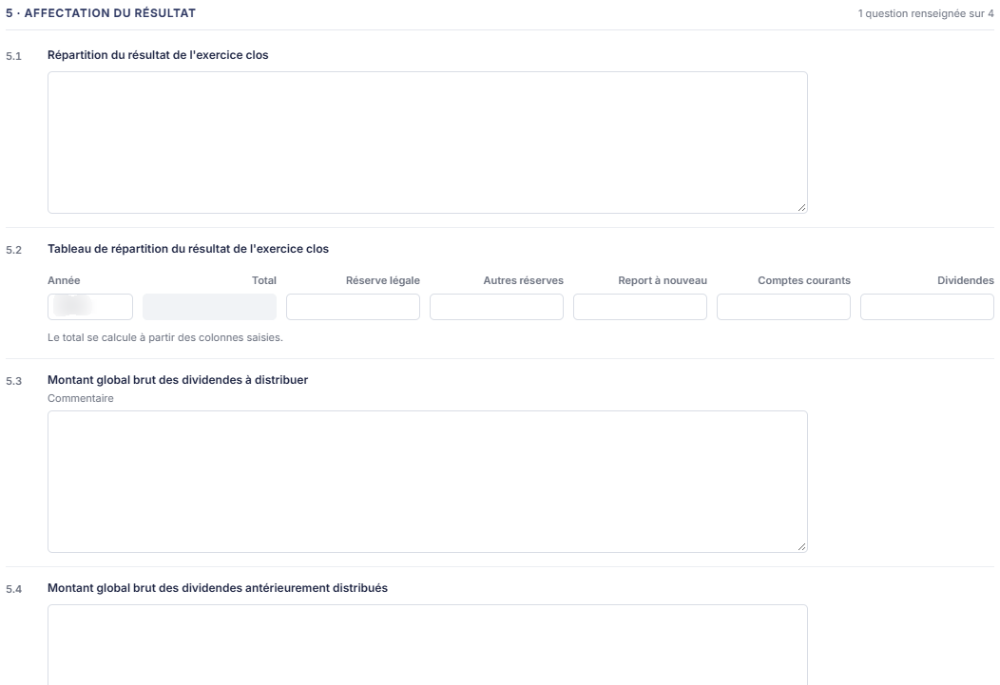<figcaption>
Rubrique « Rubrique « Affectation du résultat » »
</figcaption></figure>

**5.1 Répartition du résultat de l'exercice clos** — un commentaire libre.

**Tableau de répartition du résultat de l'exercice clos** — une seule ligne, aux colonnes **Année**, **Total**, **Réserve légale**, **Autres réserves**, **Report à nouveau**, **Comptes courants** et **Dividendes**. La colonne **Année** est préremplie de l'année en cours et reste modifiable ; vous répartissez le résultat sur les cinq dernières colonnes, et le logiciel calcule le **Total**, qui est grisé.

**5.3 Montant global brut des dividendes à distribuer** — une zone « Commentaire ».

**5.4 Montant global brut des dividendes antérieurement distribués** — un commentaire libre.

## Rubrique « Conventions réglementées »

<figure><figcaption>
Rubrique « Rubrique « Conventions réglementées » »
</figcaption></figure>

**6.1 Existence de conventions réglementées** — un commentaire libre.

## Rubrique « Rémunérations allouées aux dirigeants »

<figure>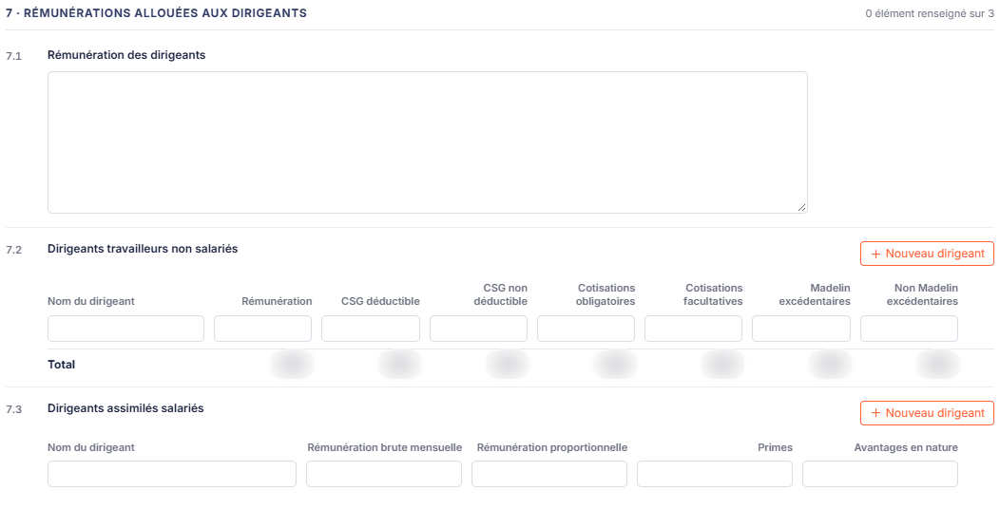<figcaption>
Rubrique « Rubrique « Rémunérations allouées aux dirigeants » »
</figcaption></figure>

**7.1 Rémunération des dirigeants** — un commentaire libre.

Puis deux tableaux, chacun précédé de son titre (7.2 et 7.3) et d'un bouton **Nouveau dirigeant** :

**7.2 Dirigeants travailleurs non salariés** — les colonnes **Nom du dirigeant**, **Rémunération**, **CSG déductible**, **CSG non déductible**, **Cotisations obligatoires**, **Cotisations facultatives**, **Madelin excédentaires**, **Non Madelin excédentaires** et **Actions**, et une ligne **Total** (à 0,00 tant qu'aucun dirigeant n'est saisi).

**7.3 Dirigeants assimilés salariés** — les colonnes **Nom du dirigeant**, **Rémunération brute mensuelle**, **Rémunération proportionnelle**, **Primes**, **Avantages en nature** et **Actions**.

Ces deux tableaux se remplissent de la même façon : le bouton **\[Nouveau dirigeant]** ajoute un dirigeant, et la colonne « Actions » porte les commandes de la ligne (leur contenu n'a pas été relevé : aucun dirigeant n'est saisi sur le dossier consulté).

## Rubrique « Dépenses non déductibles fiscalement »

<figure>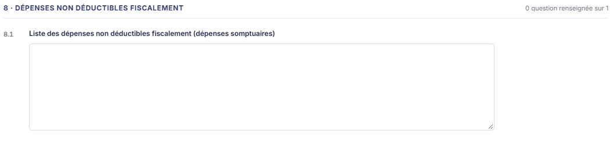<figcaption>
Rubrique « Rubrique « Dépenses non déductibles fiscalement » »
</figcaption></figure>

**8.1 Liste des dépenses non déductibles fiscalement (dépenses somptuaires)** — un commentaire libre.

## Rubrique « Injonctions ou sanctions pécuniaires de l'Autorité de la concurrence »

<figure>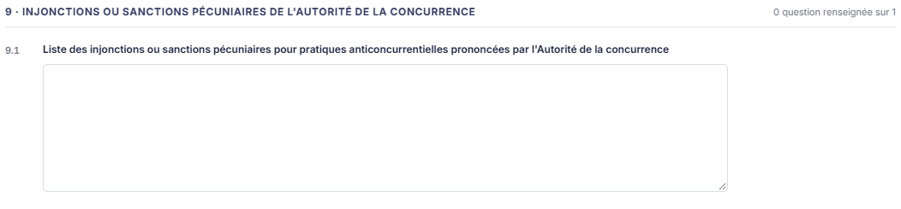<figcaption>
Rubrique « Rubrique « Injonctions ou sanctions pécuniaires de l'Autorité de la concurrence » »
</figcaption></figure>

**9.1 Liste des injonctions ou sanctions pécuniaires pour pratiques anticoncurrentielles prononcées par l'Autorité de la concurrence** — un commentaire libre.

## Rubrique « Résolutions particulières »

<figure><figcaption>
Rubrique « Rubrique « Résolutions particulières » »
</figcaption></figure>

**10.1 Autres résolutions particulières** — une zone « Commentaire ».

## Rubrique « Conclusion »

<figure><figcaption>
Rubrique « Rubrique « Conclusion » »
</figcaption></figure>

Cette rubrique signe le bordereau.

| Champ            | Ce qu'il faut savoir                                                                                                                           |
| ---------------- | ---------------------------------------------------------------------------------------------------------------------------------------------- |
| 1. **Date**      | Le logiciel propose la date du jour ; vous pouvez la corriger, à la main ou au moyen du calendrier.                                            |
| 2. **Rédacteur** | Le logiciel propose le nom de l'utilisateur connecté ; la zone reste modifiable, ce qui vous permet de signer au nom d'un autre collaborateur. |

Sous ces deux zones, la zone « Commentaire de conclusion », vide par défaut, reçoit votre conclusion.

## Rubrique « Documents »

<figure>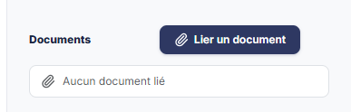<figcaption>
Rubrique « Rubrique « Documents » »
</figcaption></figure>

Cette rubrique, dans le volet de droite, reçoit les pièces que vous voulez joindre au bordereau.

Tant qu'aucune pièce n'est jointe, la rubrique affiche **Aucun document lié**. Les pièces liées sont ensuite listées dans cette rubrique.

Pour joindre une pièce, cliquez sur le bouton **\[Lier un document]** du volet de droite, à côté du titre « Documents » : un volet « Lier un document » s'ouvre à droite. Il propose deux sources, **Depuis mon poste** (une zone « Déposez vos documents ici ou parcourez vos fichiers », qui rappelle les formats acceptés) et **Depuis la GED**. Il se ferme par le bouton **\[Annuler]** ou par la croix ; le bouton « Lier le document » reste grisé tant qu'aucun fichier n'est choisi. La source « Depuis l'OCR » n'est plus proposée.

## Les boutons du pied du panneau

<figure><figcaption>
Rubrique « Entrée « Éditer » du menu ⋮ « Autres actions » »
</figcaption></figure>

<figure>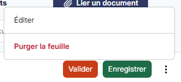<figcaption>
Rubrique « Entrée « Purger la feuille » du menu ⋮ « Autres actions » »
</figcaption></figure>

Le pied du panneau reste visible pendant que vous parcourez la feuille. Il porte à gauche la pastille « Non validée » puis, à droite, de gauche à droite : bouton **\[Valider]**, bouton **\[Enregistrer]** et le menu ⋮ « Autres actions », qui propose « Éditer » et « Purger la feuille ». La croix de l'en-tête referme le panneau et vous ramène à la liste des feuilles ; le pied ne porte pas de bouton \[Fermer].

bouton **\[Enregistrer]**

Enregistre l'ensemble de la feuille. Il n'y a pas d'enregistrement rubrique par rubrique, et le pied ne propose pas de bouton **\[Annuler]** : seule la croix de l'en-tête referme le panneau. Les fenêtres secondaires — le détail des lignes d'écritures — ont, elles, leur propre \[Enregistrer].

bouton **\[Valider]**

Valide la feuille de travail.

**Entrée « Éditer » du menu ⋮ « Autres actions »**

Ouvre la fenêtre **Edition**, qui rappelle l'intitulé de la feuille (Bordereau juridique annuel) et son statut (« En cours » sur le dossier consulté). Vous y choisissez le **Format :** — **Html**, **Pdf** ou **Excel**, le logiciel proposant **Html** — et vous indiquez par un interrupteur si vous souhaitez **Tronquer les libellés trop longs :**, activé par défaut. Le bouton **\[Edition]** lance le document, le bouton **\[Annuler]** ferme la fenêtre sans rien produire.

**Entrée « Purger la feuille » du menu ⋮ « Autres actions »**

Ramène la feuille à vide. C'est le moyen de repartir de zéro après un chargement des valeurs ou une saisie que vous ne voulez pas conserver.
