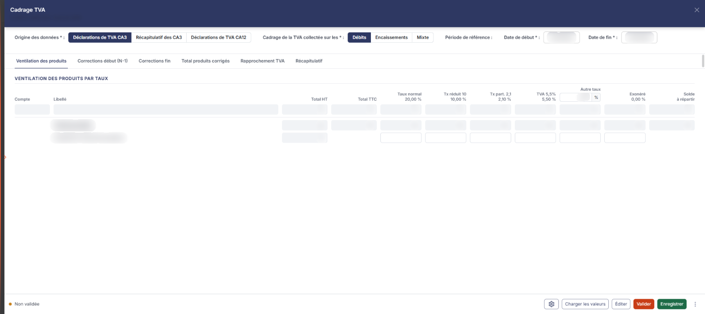
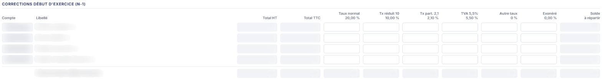
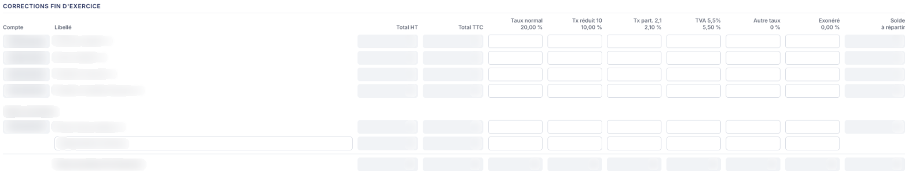
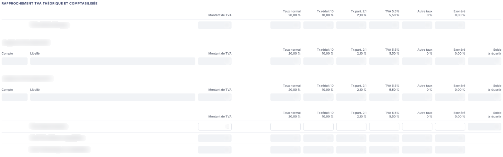

# Cadrage TVA


**En bref** — Cette feuille cadre la TVA collectée de l'exercice : elle ventile les produits par taux, corrige les rattachements début et fin d'exercice et rapproche la TVA théorique de la TVA comptabilisée.

* Pour commencer : renseignez le bandeau de paramètres, puis bouton \[Charger les valeurs].
* Pour conserver votre travail : bouton \[Enregistrer] ; pour terminer, bouton \[Valider].


Cette feuille de travail sert à cadrer la TVA collectée de l'exercice : elle ventile les produits par taux, corrige le rattachement des produits en début et en fin d'exercice, rapproche la TVA théorique ainsi obtenue de la TVA effectivement comptabilisée et déclarée, et récapitule la TVA restant à régulariser.

<figure><figcaption>
Écran « Cadrage TVA » de la nouvelle interface
</figcaption></figure>

C'est la plus riche des feuilles de calcul : elle enchaîne plusieurs rubriques dont le contenu se déduit l'un de l'autre, et il est préférable de la parcourir de haut en bas.

Comme toutes les feuilles de travail, elle n'est accessible que si un **dossier de révision** a été créé sur le dossier annuel. Dans le cas contraire, le logiciel remplace l'écran par le message « **Veuillez créer un dossier de révision afin de pouvoir utiliser cette fonctionnalité.** ».

Pour l'ouvrir, dans l'écran Révision, cliquez sur la carte « N feuilles de travail » du bandeau : la liste des feuilles s'ouvre dans un tiroir à droite. Repérez la ligne « Cadrage TVA » (le champ « Rechercher une feuille… » la retrouve) et cliquez sur le crayon de la ligne : la feuille s'ouvre dans un panneau, dont l'en-tête indique « Cadrage TVA », puis la société et l'exercice, avec une croix de fermeture. Il n'y a pas de bouton de création pour cette feuille, et elle est créée dans le dossier de révision dès sa première ouverture, sans que vous ayez à l'enregistrer.

## Comment lire la feuille

La couleur des zones vous indique ce que vous devez renseigner :

* une zone **blanche** est une zone que vous saisissez ;
* une zone **grisée** est une zone calculée par le logiciel, ou reprise de la comptabilité : elle n'est pas modifiable.

Sur cette feuille, la règle générale est que **les montants HT et TTC sont repris de la comptabilité, et que ce sont les colonnes de taux qui se saisissent** : votre travail consiste à répartir par taux de TVA des montants que le logiciel connaît déjà. La colonne **Solde à répartir** vous indique ce qui n'a pas encore été ventilé.

Au-dessus des onglets, un bandeau de paramètres porte « Origine des données », « Cadrage de la TVA collectée sur les » et « Période de référence ». Chaque rubrique de la feuille s'affiche ensuite dans son onglet, dans cet ordre : « Ventilation des produits » (ouvert à l'ouverture), « Corrections début (N-1) », « Corrections fin », « Total produits corrigés », « Rapprochement TVA », puis, sous condition, « Régul. début de période » et « Régul. fin de période », et enfin « Récapitulatif ». Les rubriques portent le titre « Ventilation des produits par taux », « Corrections début d'exercice (N-1) », « Corrections fin d'exercice », « Total produits avec corrections », « Rapprochement TVA théorique et comptabilisée », « Régularisations TVA début de période selon encaissements (N-1) », « Régularisations TVA fin de période selon encaissements » et « Récapitulatif de la TVA à régulariser ».

**Les colonnes des tables de ventilation**

La plupart des rubriques présentent le même bandeau de colonnes, dans cet ordre : **Compte**, **Libellé**, **Total HT**, **Total TTC**, puis une colonne par taux — **Taux normal 20,00 %**, **Tx réduit 10 10,00 %**, **Tx part. 2,1 2,10 %**, **TVA 5,5% 5,50 %**, **Autre taux … %** et **Exonéré 0,00 %** — et enfin **Solde à répartir**.

Dans l'onglet « Ventilation des produits », l'en-tête **Autre taux** comporte un champ dans lequel **vous saisissez vous-même le taux** à employer. Dans les autres rubriques, ce même en-tête n'est qu'un libellé : le taux retenu dans le premier onglet s'y applique.

Les rubriques de totaux et de rapprochement n'ont pas de colonnes **Compte** et **Libellé**, et la rubrique « Rapprochement TVA théorique et comptabilisée » remplace **Total HT** et **Total TTC** par une colonne unique **Montant de TVA**.

## Le bandeau de paramètres

Ce bandeau commande le reste de la feuille : renseignez-le avant tout le reste. Les champs marqués d'un astérisque sont obligatoires.

| Champ                                   | Ce qu'il faut savoir                                                                                                                                                                                            |
| --------------------------------------- | --------------------------------------------------------------------------------------------------------------------------------------------------------------------------------------------------------------- |
| **Origine des données**                 | Trois choix, **Déclarations de TVA CA3**, **Récapitulatif des CA3** et **Déclarations de TVA CA12**. Le premier est proposé par défaut. Vous désignez ainsi la source à laquelle la TVA déclarée sera comparée. |
| **Cadrage de la TVA collectée sur les** | Trois choix, **Débits**, **Encaissements** et **Mixte**. Le premier est proposé par défaut.                                                                                                                     |

Sous l'intitulé **Période de référence :**, les champs **Date de début** et **Date de fin** délimitent la période cadrée. Ils sont préremplis aux bornes de l'exercice et restent modifiables, au clavier ou par le sélecteur de calendrier.

**Deux choix qui font apparaître des zones, et il ne faut pas les confondre**

Ces deux groupes de boutons de choix ne modifient pas l'écran de la même façon.

**Le mode de cadrage fait apparaître deux rubriques entières.** Tant que **Cadrage de la TVA collectée sur les** vaut **Débits**, les onglets « Régul. début de période » et « Régul. fin de période », et donc les rubriques « Régularisations TVA début de période selon encaissements (N-1) » et « Régularisations TVA fin de période selon encaissements », ne sont pas affichés. Elles apparaissent dès que vous choisissez **Encaissements** ou **Mixte** ; ces deux choix donnent le même écran.

**L'origine des données, elle, n'ajoute que deux lignes, et aucune rubrique.** Le choix **Déclarations de TVA CA12** fait apparaître, dans la rubrique « Rapprochement TVA théorique et comptabilisée », les deux lignes **Acompte juillet** et **Acompte décembre**, que vous saisissez. Avec les deux autres origines, ces lignes sont absentes. Aucun onglet n'apparaît ni ne disparaît.

## Rubrique « Ventilation des produits par taux »

<figure><figcaption>
Rubrique « Rubrique « Ventilation des produits par taux » »
</figcaption></figure>

Cette rubrique est **intégralement reprise de la comptabilité** : ni le compte, ni le libellé, ni les montants, ni la répartition par taux ne s'y saisissent. Elle liste vos comptes de produits, avec la ventilation issue de leur paramétrage, et se referme par la ligne **Total des produits**.

Les comptes qui y figurent sont ceux **dont la gestion de la TVA a été activée dans le plan comptable** : si un compte de produits manque ici, c'est de ce côté qu'il faut aller le chercher.

La ligne **Acquisitions intracommunautaires**, à part, fait exception : son **Total HT** est repris de la comptabilité, mais **les colonnes de taux s'y saisissent**. Elle n'a pas de **Solde à répartir**.

## Rubrique « Corrections début d'exercice (N-1) »

<figure><figcaption>
Rubrique « Rubrique « Corrections début d'exercice (N-1) » »
</figcaption></figure>

Cette rubrique neutralise les produits rattachés à l'exercice précédent. Elle présente quatre lignes à compte imposé, que vous ne pouvez pas modifier :

* **Factures à établir (+)** ;
* **Avoirs à établir (-)** ;
* **Produits à recevoir (+)** ;
* **Produits constatés d'avance (-)**.

Le signe entre parenthèses vous indique le sens dans lequel la ligne joue sur le total.

Sur chaque ligne, le **Total HT** et le **Total TTC** sont repris ou calculés, **les colonnes de taux se saisissent** dès lors que le compte de la ligne est paramétré, et le **Solde à répartir** est calculé. Tant que la colonne **Compte** affiche « A paramétrer », les colonnes de taux de la ligne restent en lecture seule. La rubrique se referme par la ligne **Total corrections début d'exercice**, entièrement calculée.

Les comptes employés sur ces quatre lignes se paramètrent par la roue « Paramétrage des comptes de révision » du pied du panneau.

## Rubrique « Corrections fin d'exercice »

<figure><figcaption>
Rubrique « Rubrique « Corrections fin d'exercice » »
</figcaption></figure>

Cette rubrique fait le travail symétrique pour la fin de l'exercice. Ce sont les mêmes quatre comptes, avec les **signes inversés** : **Factures à établir (-)**, **Avoirs à établir (+)**, **Produits à recevoir (-)** et **Produits constatés d'avance (+)**. Les règles de saisie sont les mêmes que dans la rubrique précédente.

Un sous-titre **Autres corrections** ouvre ensuite deux lignes supplémentaires :

* **Pertes irrécouvrables (+)**, à compte imposé, lui aussi paramétrable par la roue « Paramétrage des comptes de révision », et dont les colonnes de taux ne se saisissent, de même, qu'une fois ce compte paramétré ;
* une ligne vierge dont **le compte se saisit** : c'est par elle que vous portez une correction sur un compte de votre choix. Le libellé du compte s'affiche à droite, les montants sont calculés et les colonnes de taux se saisissent.

La rubrique se referme par la ligne **Total corrections fin d’exercice**, entièrement calculée.

## Rubrique « Total produits avec corrections »

<figure><figcaption>
Rubrique « Rubrique « Total produits avec corrections » »
</figcaption></figure>

Une seule ligne, **Total des produits corrigés**, entièrement calculée : c'est la base à laquelle la TVA théorique est appliquée.

## Rubrique « Rapprochement TVA théorique et comptabilisée »

<figure><figcaption>
Rubrique « Rubrique « Rapprochement TVA théorique et comptabilisée » »
</figcaption></figure>

Cette rubrique confronte ce que la ventilation implique et ce que la comptabilité porte. Ses valeurs se lisent dans une colonne unique, **Montant de TVA**. Elle se présente dans cet ordre :

* la ligne **TVA collectée théorique**, calculée à partir des rubriques précédentes ;
* une sous-table **Comptes de TVA collectée (N)**, entièrement reprise de la comptabilité ;
* une sous-table **Comptes de TVA collectée (N-1)**, de même ;
* les lignes **Acompte juillet** et **Acompte décembre**, que vous saisissez, **et qui n'apparaissent que si l'origine des données estDéclarations de TVA CA12** ;
* la ligne **TVA collectée déclarée**, dont le **Montant de TVA** et les colonnes de taux se saisissent, le **Solde à répartir** étant calculé ;
* la ligne **Total TVA collectée comptabilisée**, calculée ;
* la ligne **Ecart TVA théorique et comptabilisée**, calculée : c'est le résultat du cadrage, celui que vous cherchez à expliquer.

Les comptes des deux sous-tables ne se choisissent pas ici : ce sont les comptes **appartenant aux racines paramétrées dans le panneau Paramètres, rubrique Compta expert, Configuration (ancien « Paramètres généraux »), carte « Paramètres du plan comptable », champ TVA collectée**.

Sur un champ de compte, le raccourci **Ctrl** + **Alt** + **L** ouvre la recherche dans le plan comptable.

## Onglets « Régul. début de période » et « Régul. fin de période » (rubriques « Régularisations TVA … selon encaissements »)

Ces deux onglets **ne s'affichent que si le cadrage porte sur lesEncaissementsou estMixte**. Elles servent à décaler la TVA au rythme des encaissements, en début et en fin de période.

Elles ont la même structure ; seuls les signes changent. La rubrique « Régularisations TVA début de période selon encaissements (N-1) » porte les lignes **Créances clients (+)** et **Clients douteux (+)** ; la rubrique « Régularisations TVA fin de période selon encaissements » porte les mêmes lignes en **Créances clients (-)** et **Clients douteux (-)**.

Chacune n'affiche que ces deux lignes : c'est le bouton **\[Nouveau]** qui ajoute en dessous une ligne dont le compte se saisit. Le compte de la ligne **Créances clients** se modifie — l'infobulle indique « **Indiquez la racine des comptes auxiliaires clients** » —, celui de la ligne **Clients douteux** est imposé, et l'infobulle de la ligne ajoutée invite à **indiquer le compte d'un autre type de régularisation**.

Sur chaque ligne, les montants et le **Solde à répartir** sont calculés et les colonnes de taux se saisissent.

Le bouton **\[Nouveau]**, propre à ces tables, ajoute une ligne de régularisation.

## Rubrique « Récapitulatif de la TVA à régulariser »

<figure><figcaption>
Rubrique « Rubrique « Récapitulatif de la TVA à régulariser » »
</figcaption></figure>

C'est la conclusion de la feuille. Elle n'a pas de colonne **Compte** : seulement le **Libellé**, le **Montant de TVA** et les colonnes de taux. Elle porte quatre lignes :

* **TVA collectée déclarée théorique**, calculée ;
* **TVA collectée à régulariser (N-1)**, dont **les colonnes de taux se saisissent**, le **Montant de TVA** étant calculé ;
* **TVA collectée réelle déclarée**, calculée ;
* **TVA collectée à régulariser (N)**, calculée.

## Les boutons du pied du panneau

Le pied du panneau est permanent. Il indique à gauche l'état de la feuille (une pastille orange et la mention « Non validée ») et, sur une feuille non renseignée et non validée, présente à droite les boutons suivants, tous disponibles dès l'ouverture. De gauche à droite, l'écran les range dans cet ordre : la roue « Paramétrage des comptes de révision », \[Charger les valeurs], \[Éditer], \[Valider], \[Enregistrer] et ⋮ « Autres actions » (qui porte « Purger la feuille »). Il n'y a pas de bouton \[Fermer] : la croix de l'en-tête referme le panneau.

bouton **\[Éditer]**

Il ouvre la fenêtre « Edition », qui rappelle l'intitulé de la feuille, « Cadrage TVA », avec une pastille de statut (« En cours » à la lecture), et qui propose trois options :

* **Avec la page des paramètres** : — interrupteur, désactivé à l'ouverture. Activé, il ajoute à l'édition la page des paramètres retenus pour le cadrage ;
* **Format** : — Html, Pdf ou Excel, Html étant proposé par défaut ;
* **Tronquer les libellés trop longs** : — interrupteur, activé à l'ouverture.

Les boutons **\[Edition]** et **\[Annuler]** referment la fenêtre.

**Roue « Paramétrage des comptes de révision »**

Elle ouvre, à droite, le tiroir « Paramétrage des comptes de révision » (sous-titre : société, exercice et régime), commun à toutes les feuilles : à gauche la liste des rubriques, à droite la rubrique sélectionnée, avec le champ « Rechercher un compte, un libellé… » en en-tête. Il s'ouvre positionné sur la rubrique **Cadrage de TVA** (5 paramètres), qui comporte un seul bloc, **Corrections début et fin d'exercice** : cinq champs de compte — **Factures à établir**, **Avoirs à établir**, **Produits constatés d'avance**, **Produits à recevoir** et **Pertes irrécouvrables**. Chacun porte, en italique, la mention du compte dont il reprend la valeur (« Même compte que la rubrique « Régularisations de produits » », et « Clients douteux » pour les pertes irrécouvrables). Sur chaque ligne, vous saisissez le numéro de compte, le bouton **\[+]** permet de créer le compte, le pictogramme « Loupe » de le rechercher, et le libellé du compte s'affiche à droite en lecture seule. Une ligne dont le compte a été personnalisé (ici **Produits à recevoir**) porte un badge « Personnalisé » et un pictogramme de retour arrière. Le bouton **\[Rétablir la rubrique]**, en haut de la rubrique, la remet à son état d'origine.

Le pied du tiroir indique à gauche l'état (« Tout est enregistré ») et porte deux boutons : bouton **\[Charger les valeurs par défaut]** et bouton **\[Enregistrer]** ; il n'y a plus de bouton \[Annuler] : la croix de l'en-tête referme le tiroir. L'infobulle du premier donne la règle appliquée : « **Charge les valeurs prévues et vérifie que les comptes existent dans le plan comptable du dossier. Un compte absent est signalé sur sa ligne. Rien n'est enregistré avant de cliquer sur Enregistrer.** »

L'ordre des cinq champs du tiroir n'est pas celui des lignes de l'écran : **Produits constatés d'avance** y précède **Produits à recevoir**, alors que les tables de correction les présentent dans l'ordre inverse.

## À savoir

L'écran n'indique pas à quel dossier de révision la feuille se rattache. Si le dossier annuel en comporte plusieurs, rien à l'écran ne vous dit lequel est servi.

Contrairement à la plupart des autres feuilles de travail, cet écran ne présente **pas de rubrique « Documents »** : vous ne pouvez pas y rattacher de pièce justificative. Il ne comporte pas non plus de bouton de comptabilisation : le cadrage de la TVA ne génère pas d'écriture.
