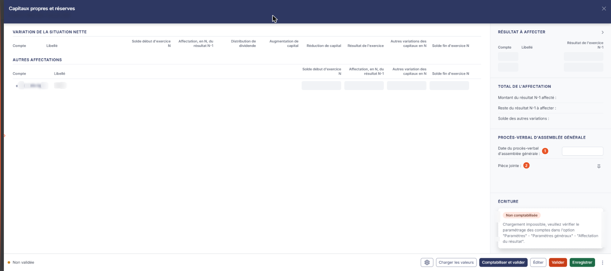
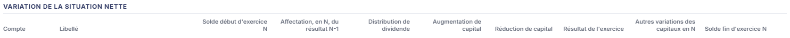
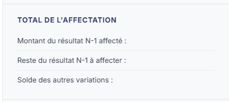

# Capitaux propres et réserves


**En bref** — Cette feuille prépare l'affectation du résultat de l'exercice précédent et suit la variation des capitaux propres, du capital et des réserves.

* Pour alimenter la feuille : bouton \[Charger les valeurs], saisissez vos affectations, puis bouton \[Enregistrer].
* Pour passer l'écriture d'affectation : bouton \[Comptabiliser et valider].


Cette feuille de travail sert à préparer l'affectation du résultat de l'exercice précédent et à suivre la variation des capitaux propres : le résultat à affecter, les mouvements du capital et des réserves, les autres affectations que vous décidez, et la référence du procès-verbal d'assemblée générale qui les entérine. Elle peut donner lieu à une écriture comptable.

<figure><figcaption>
Écran « Capitaux propres et réserves » de la nouvelle interface
</figcaption></figure>

Comme toutes les feuilles de travail, elle n'est accessible que si un **dossier de révision** a été créé sur le dossier annuel. Dans le cas contraire, le logiciel remplace l'écran par le message « **Veuillez créer un dossier de révision afin de pouvoir utiliser cette fonctionnalité.** ».

Pour l'ouvrir, dans l'écran Révision, cliquez sur la carte « N feuilles de travail » du bandeau : la liste des feuilles s'ouvre dans un tiroir à droite. Repérez la ligne « Capitaux propres et réserves » (le champ « Rechercher une feuille… » la retrouve) et cliquez sur le crayon de la ligne : la feuille s'ouvre dans un panneau, dont l'en-tête indique « Capitaux propres et réserves », puis la société et l'exercice, avec une croix de fermeture. Il n'y a pas de bouton de création pour cette feuille, et elle est créée dans le dossier de révision dès sa première ouverture, sans que vous ayez à l'enregistrer.

## Comment lire la feuille

La couleur des zones vous indique ce que vous devez renseigner :

* une zone **blanche** est une zone que vous saisissez ;
* une zone **grisée** est une zone calculée par le logiciel, ou reprise de la comptabilité et du paramétrage : elle n'est pas modifiable.

Les rubriques se répartissent en deux zones : à gauche, « Variation de la situation nette » puis « Autres affectations » ; dans la colonne de droite, « Résultat à affecter », « Total de l'affectation », « Procès-verbal d'assemblée générale » et « Écriture ». Il n'y a aucun onglet, et aucun champ n'est marqué obligatoire.

**Commencez par le paramétrage des comptes** : c'est lui qui détermine ce que les rubriques « Résultat à affecter » et « Variation de la situation nette » peuvent afficher. Une rubrique restée vide est presque toujours le signe d'un paramétrage incomplet, et non d'une absence de données.

## Rubrique « Résultat à affecter »

<figure><figcaption>
Rubrique « Rubrique « Résultat à affecter » »
</figcaption></figure>

Cette rubrique présente le résultat de l'exercice précédent, celui que vous allez affecter. Ses colonnes sont **Compte**, **Libellé** et **Résultat de l'exercice N-1**.

Elle porte deux lignes fixes, que vous ne pouvez ni ajouter ni supprimer : celle du résultat bénéficiaire et celle du résultat déficitaire.

**Rien ne se saisit dans cette rubrique.** Les comptes viennent du paramétrage (panneau Paramètres, rubrique « Compta expert », onglet « Configuration », rubrique « Affectation du résultat ») et le montant du résultat est repris de la comptabilité par le bouton **\[Charger les valeurs]**. Tant que celui-ci n'a pas été actionné, les cellules restent vides.

## Rubrique « Variation de la situation nette »

<figure><figcaption>
Rubrique « Rubrique « Variation de la situation nette » »
</figcaption></figure>

Cette rubrique retrace, compte par compte, le passage du solde de début d'exercice au solde de fin d'exercice. Ses colonnes sont, dans l'ordre : **Compte**, **Libellé**, **Solde début d'exercice N**, **Affectation, en N, du résultat N-1**, **Distribution de dividende**, **Augmentation de capital**, **Réduction de capital**, **Résultat de l'exercice**, **Autres variations des capitaux en N** et **Solde fin d'exercice N**.

Ses lignes ne se créent pas à la main : il n'y a pas de bouton d'ajout. **Elles sont produites d'après les racines des comptes de capital et de report à nouveau renseignées dans le paramétrage des comptes.**

## Rubrique « Autres affectations »

<figure><figcaption>
Rubrique « Rubrique « Autres affectations » »
</figcaption></figure>

C'est la rubrique dans laquelle vous portez vous-même les affectations : réserve légale, autres réserves, report à nouveau, tout compte que vous souhaitez mouvementer.

Ses colonnes sont **Compte**, **Libellé**, **Solde début d'exercice N**, **Affectation, en N, du résultat N-1**, **Autres variation des capitaux en N** et **Solde fin d'exercice N**. Elle se referme par une ligne **Total**, entièrement calculée.

Le bouton **\[Nouvelle ligne]**, dans la ligne de total, ajoute une ligne directement dans le tableau. Le pictogramme « Corbeille », en tête de la ligne ajoutée, la supprime ; son infobulle indique « **Effacer** ».

Sur une ligne ajoutée, vous saisissez le **Compte** — le bouton « + » (infobulle « Créer ») permet de le créer et le pictogramme « Loupe » de le rechercher dans le plan comptable —, l'**Affectation, en N, du résultat N-1** et les **Autres variation des capitaux en N**. Le **Libellé** s'affiche d'après le compte, le **Solde début d'exercice N** est repris de la comptabilité et le **Solde fin d'exercice N** est calculé.

## Rubrique « Total de l'affectation »

<figure><figcaption>
Rubrique « Rubrique « Total de l'affectation » »
</figcaption></figure>

Trois valeurs, toutes calculées, qui vous disent où vous en êtes :

* **Montant du résultat N-1 affecté** : ;
* **Reste du résultat N-1 à affecter** : — c'est la valeur à surveiller : tant qu'elle n'est pas nulle, l'affectation n'est pas complète ;
* **Solde des autres variations** : .

## Rubrique « Procès-verbal d'assemblée générale »

<figure><figcaption>
Rubrique « Rubrique « Procès-verbal d'assemblée générale » »
</figcaption></figure>

| Champ                                             | Ce qu'il faut savoir                                                                                                                                                                               |
| ------------------------------------------------- | -------------------------------------------------------------------------------------------------------------------------------------------------------------------------------------------------- |
| 1. **Date du procès-verbal d'assemblée générale** | — vous saisissez la date au clavier ou par le calendrier, qui s'ouvre au clic dans le champ. Elle est vide par défaut.                                                                             |
| 2. **Pièce jointe**                               | — cette ligne n'a pas de zone de saisie : c'est le pictogramme « Punaise », dont l'infobulle indique « **Lier un document** », qui vous permet de joindre le procès-verbal et d'y accéder ensuite. |

C'est le seul emplacement de cette feuille où rattacher un document : contrairement à la plupart des autres feuilles de travail, l'écran ne comporte pas de rubrique « Documents ».

## Rubrique « Écriture »

<figure><figcaption>
Rubrique « Rubrique « Écriture » »
</figcaption></figure>

Tant que la feuille n'a pas été comptabilisée, cette rubrique ne contient que la pastille « Non comptabilisée » et un message. Sur le dossier relevé, dont le paramétrage est incomplet, ce message est : « **Chargement impossible, veuillez vérifier le paramétrage des comptes dans l'option "Paramètres" - "Paramètres généraux" - "Affectation du résultat".** » ; le chemin qu'il cite est l'ancien nom de : panneau Paramètres, rubrique « Compta expert », onglet « Configuration », rubrique « Affectation du résultat », où se règlent les comptes du résultat bénéficiaire et du résultat déficitaire.

Il n'y a alors ni liste d'écritures, ni bouton dans la rubrique. C'est le bouton \[Comptabiliser et valider] du pied du panneau qui produit l'écriture d'affectation.

## Les boutons du pied du panneau

Le pied du panneau est permanent. Il indique à gauche l'état de la feuille (pastille « Non validée ») et présente à droite, de gauche à droite : la roue « Paramétrage des comptes de révision », \[Charger les valeurs], \[Comptabiliser et valider], \[Éditer], \[Valider], \[Enregistrer] et ⋮ « Autres actions » (qui ne porte que « Purger la feuille »). Il n'y a pas de bouton \[Fermer] : la croix de l'en-tête referme le panneau. Il n'y a pas d'entrée « Charger les valeurs n-1 » sur cette feuille.

bouton **\[Éditer]**

Il ouvre la fenêtre « Edition », qui propose le **Format :** — Html, Pdf ou Excel, Html étant proposé par défaut — et, selon le format, **Tronquer les libellés trop longs :** (interrupteur, activé par défaut) ou **Orientation :** (Portrait ou Paysage) et **Largeur :** (Fixe ou Ajustée). Les boutons **\[Edition]** et **\[Annuler]** referment la fenêtre.

**Roue « Paramétrage des comptes de révision »**

Elle ouvre, à droite, le tiroir « Paramétrage des comptes de révision » (sous-titre : société, exercice et régime), commun à toutes les feuilles, qui remplace la fenêtre « Comptes des Capitaux propres et réserves » : à gauche la liste des rubriques, à droite la rubrique sélectionnée. Il s'ouvre positionné sur la rubrique **Capitaux propres** (2 paramètres ; infobulle de la roue : « Paramétrage des comptes de révision : Capitaux propres »).

Cette rubrique porte les deux champs **Racine des comptes de capital** et **Racine des comptes de report à nouveau**. **Ce sont eux qui peuplent la rubrique « Variation de la situation nette » à l'écran**, et ils peuvent parfaitement être vides. Le bouton \[Rétablir la rubrique], en haut de la rubrique, la remet à son état d'origine.

Le tiroir ne présente aucune rubrique « Résultat à affecter » : les deux comptes du résultat, que la fenêtre d'origine désignait sous les sous-titres « Affectation du résultat bénéficiaire » et « Affectation du résultat déficitaire », n'y figurent plus (liste des rubriques relue le 26/10/2026). Ces deux comptes se règlent désormais dans le panneau Paramètres, rubrique « Compta expert », onglet « Configuration », rubrique « Affectation du résultat ».

Le pied du tiroir indique à gauche « Tout est enregistré » et porte deux boutons : **\[Charger les valeurs par défaut]** et **\[Enregistrer]** ; il n'y a plus de bouton \[Annuler] : la croix de l'en-tête referme le tiroir. Une infobulle accompagne le premier et en donne la règle : « **Charge les valeurs prévues et vérifie que les comptes existent dans le plan comptable du dossier. Un compte absent est signalé sur sa ligne. Rien n'est enregistré avant de cliquer sur Enregistrer.** »
