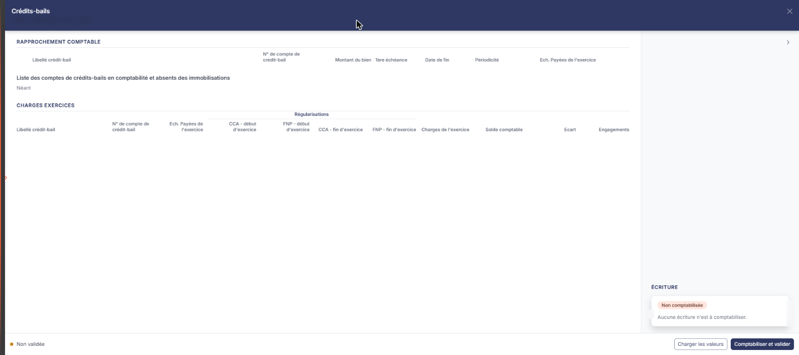
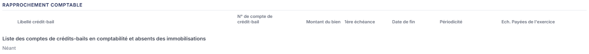
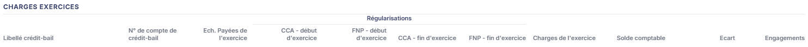
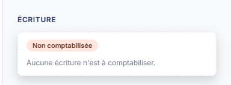

# Crédits-bails


**En bref** — Cette feuille rapproche vos contrats de crédit-bail du module Immobilisations et les soldes comptables correspondants, et met en évidence les écarts et régularisations de charges.

* Pour alimenter les tableaux : bouton \[Charger les valeurs].
* Pour passer les régularisations : bouton \[Comptabiliser et valider].


Cette feuille de travail rapproche vos contrats de crédit-bail de votre comptabilité : elle reprend d'un côté les contrats enregistrés dans le module Immobilisations, de l'autre les soldes des comptes de crédit-bail, et met en évidence les écarts ainsi que les régularisations de charges à retenir sur l'exercice.

<figure><figcaption>
Écran « Crédits-bails » de la nouvelle interface
</figcaption></figure>

Cet écran est d'abord un écran de contrôle : les contrats, leurs échéances et les soldes comptables y sont repris du module Immobilisations et de la comptabilité, et les colonnes de charge, de solde, d'écart et d'engagement sont calculées par le logiciel.

Comme toutes les feuilles de travail, cet écran n'est accessible que si un dossier de révision existe sur le dossier annuel ; sinon le logiciel affiche à la place le message « Veuillez créer un dossier de révision afin de pouvoir utiliser cette fonctionnalité. ».

La feuille n'a plus d'entrée de menu. Dans l'écran Révision, cliquez sur la carte **« 33 feuilles de travail »** du bandeau du haut (le nombre peut varier) : la **liste** des feuilles s'ouvre en tiroir, avec une zone « Rechercher une feuille… » et les colonnes **Intitulé**, **Descriptif** et **Statut**. Cliquez sur le **crayon** de la ligne « Crédits-bails » : la feuille s'ouvre dans un **panneau** à droite, dont l'en-tête porte « Crédits-bails », puis « FLORE ET SENS SAS · Exercice 2026 » (votre société et votre exercice), avec une croix de fermeture. Il n'y a pas de liste d'accueil propre à la feuille.

Le panneau comporte trois rubriques : « Rapprochement comptable » et « Charges Exercices » (affichées en majuscules) l'une sous l'autre à gauche, puis « Ecriture » (affichée « ÉCRITURE ») dans la colonne de droite, en bas. Il n'y a ni onglet, ni rubrique Documents : le pied ne propose pas de Bouton \[Lier un document].

## Rubrique « Rapprochement comptable »

<figure><figcaption>
Rubrique « Rubrique « Rapprochement comptable » »
</figcaption></figure>

Un tableau présente vos contrats de crédit-bail, une ligne par contrat, avec les colonnes suivantes :

* **Libellé crédit-bail** : le libellé du contrat tel qu'il est enregistré en Immobilisations.
* **N° de compte de crédit-bail** : le compte sur lequel le contrat est suivi en comptabilité.
* **Montant du bien**
* **1ère échéance** : la date de la première échéance du contrat.
* **Date de fin**
* **Périodicité** : le rythme des échéances.
* **Ech. Payées de l'exercice** : le montant des échéances réglées sur l'exercice.

Sous le tableau, le logiciel affiche un contrôle de cohérence, intitulé « Liste des comptes de crédits-bails en comptabilité et absents des immobilisations ». Il signale les comptes de crédit-bail mouvementés en comptabilité pour lesquels aucun contrat n'a été enregistré côté Immobilisations. La mention « Néant » signifie qu'il n'y a aucun écart de ce type ; dans le cas contraire, complétez vos fiches de crédit-bail dans le module Immobilisations.

Si le tableau est vide, c'est que le dossier ne comporte aucun contrat de crédit-bail en Immobilisations et aucun compte de crédit-bail mouvementé en comptabilité.

## Rubrique « Charges Exercices »

<figure><figcaption>
Rubrique « Rubrique « Charges Exercices » »
</figcaption></figure>

Ce tableau rapproche, contrat par contrat, la charge de crédit-bail qui revient à l'exercice et le solde comptable constaté. Quatre de ses colonnes sont regroupées sous un bandeau « Régularisations » : ce sont les charges constatées d'avance et les factures non parvenues, en début et en fin d'exercice, qui expliquent l'écart entre les échéances payées et la charge réelle de l'exercice. Ces quatre colonnes sont les seules du tableau que vous saisissez, et elles se saisissent tant que la feuille n'est pas validée ; toutes les autres sont reprises ou calculées par le logiciel.

Les colonnes, dans l'ordre :

* **Libellé crédit-bail**
* **N° de compte de crédit-bail**
* **Ech. Payées de l'exercice**
* **CCA - début d'exercice**, **FNP - début d'exercice**, **CCA - fin d'exercice** et **FNP - fin d'exercice** : les quatre colonnes regroupées sous « Régularisations ».
* **Charges de l'exercice** : la charge qui revient à l'exercice une fois les régularisations appliquées.
* **Solde comptable** : le solde du compte de crédit-bail en comptabilité.
* **Ecart** : la différence entre les deux colonnes précédentes. C'est cette colonne que vous surveillez : un écart non nul signale une charge mal enregistrée ou une régularisation manquante.
* **Engagements** : le montant restant dû au titre du contrat.

## Rubrique « Ecriture »

<figure><figcaption>
Rubrique « Rubrique « Ecriture » »
</figcaption></figure>

Cette rubrique est la colonne de droite du panneau, en bas. Elle ne contient aucun champ tant que la feuille n'a pas été comptabilisée : le logiciel y affiche une pastille **Non comptabilisée** et la phrase « Aucune écriture n'est à comptabiliser. » (vu sur une feuille aux tableaux vides). Elle présente ensuite l'écriture générée.

Ces boutons sont dans le pied du panneau : à gauche, une pastille **Non validée** ; à droite, bouton **\[Charger les valeurs]** puis **\[Comptabiliser et valider]**. Sur une feuille encore vide, ce sont les seuls éléments affichés : le pied ne porte ni Bouton \[Valider], ni Bouton \[Enregistrer], ni Bouton \[Editer], ni menu ⋮ « Autres actions », ni bouton \[Fermer]. La croix de l'en-tête referme le panneau. En revanche, le pied de cette feuille ne comporte pas la roue « Paramétrage des comptes de révision » que d'autres feuilles proposent : les comptes de crédit-bail ne se règlent pas ici, ils proviennent des fiches enregistrées dans le module Immobilisations.
