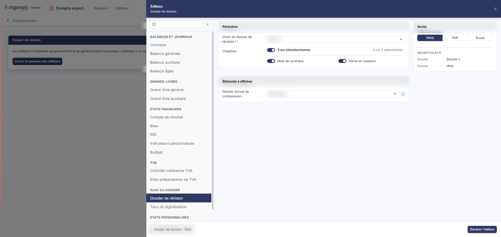
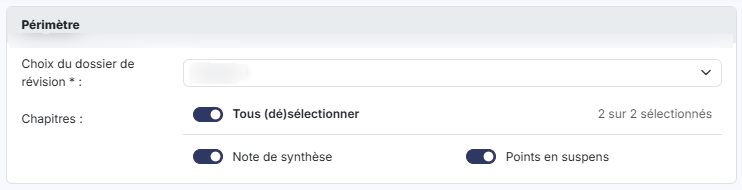
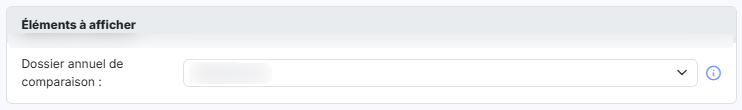
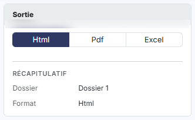

# Dossier de révision


**En bref** — Cette édition produit un dossier de révision avec les chapitres de votre choix et, en option, un dossier annuel de comparaison.

* Pour éditer : choisissez le dossier de révision, les chapitres et le format, puis bouton \[Générer l'édition].
* Pour renoncer : croix « Fermer » de l'en-tête du panneau (le pied n'a pas de bouton \[Annuler]).


Cette option permet d'éditer un dossier de révision. Le panneau d'éditions affiche, sous son titre « Éditions », le sous-titre **Dossier de révision**.

<figure><figcaption>
Écran « Dossier de révision » de la nouvelle interface
</figcaption></figure>

Vous y choisissez le dossier de révision à éditer, les chapitres à y faire figurer, éventuellement un dossier annuel de comparaison, puis le format du document. Vous le générez ensuite avec le bouton **\[Générer l'édition]**.

Pour l'ouvrir, dans l'écran Révision, cliquez sur ⋮ (Plus d'actions), puis sur « Éditions » ; dans la liste de gauche du panneau qui s'ouvre, choisissez « Dossier de révision » (groupe « Suivi du dossier »).

Cette édition ne s'ouvre plus dans une page de paramétrage : elle se paramètre et se génère dans le **panneau d'éditions**, commun à toutes les éditions comptables. La page qui s'affiche derrière porte le titre de l'édition et le bouton **\[Ouvrir le panneau des éditions]** : le panneau s'ouvre de lui-même ; si vous l'avez fermé, ce bouton le rouvre.

Le panneau est un tiroir intitulé « Éditions », suivi du nom de l'édition. **À gauche**, la liste des quinze éditions en cinq groupes — « Balances et journaux », « Grands-livres », « États financiers », « TVA » et « Suivi du dossier » — avec une zone « Rechercher une édition » et un bouton « Replier la liste » ; cliquer sur une autre édition change de formulaire sans quitter le panneau. **Au centre**, le formulaire, présenté en cartes. **À droite**, la carte « Sortie » et le « Récapitulatif » des critères retenus. **En en-tête**, la croix « Fermer » : cette édition n'a pas de liste de paramétrages enregistrés. **Dans le pied**, un résumé de l'édition (nom, dates, format) et, à droite, bouton **\[Générer l'édition]**.

## Carte « Périmètre »

<figure><figcaption>
Rubrique « a) Carte « Périmètre » »
</figcaption></figure>

| Champ                            | Ce qu'il faut savoir                                                                                                                                                                                                                                                                                                                                                                                                                                                                                                                                                                                                                                                                                                                                                           |
| -------------------------------- | ------------------------------------------------------------------------------------------------------------------------------------------------------------------------------------------------------------------------------------------------------------------------------------------------------------------------------------------------------------------------------------------------------------------------------------------------------------------------------------------------------------------------------------------------------------------------------------------------------------------------------------------------------------------------------------------------------------------------------------------------------------------------------ |
| **Choix du dossier de révision** | 
Ce champ est <strong>obligatoire</strong> — son libellé porte un astérisque. La liste propose l'invite <strong>Sélectionnez</strong>, puis un choix par dossier de révision existant sur le dossier annuel. Elle est alimentée par les dossiers créés dans l'écran « Dossiers de révision » (dans l'écran Révision, ⋮ « Plus d'actions », puis « Dossiers de révision ») : si aucun dossier n'y a été créé, vous n'avez rien à éditer ici. Le logiciel retient d'office un dossier de révision à l'ouverture de l'écran : l'invite <strong>Sélectionnez</strong> existe, mais ce n'est pas elle qui est proposée. Si vous ramenez la liste sur <strong>Sélectionnez</strong>, la ligne « Dossier » disparaît du « Récapitulatif » ; les chapitres restent présentés.
 |
| **Chapitres**                    | 
Le logiciel présente, sous ce libellé, un interrupteur par chapitre du dossier de révision retenu, chacun suivi du libellé du chapitre. Ce n'est pas un tableau : il n'y a ni colonne à trier, ni commande sur les lignes, seulement la liste des chapitres les uns sous les autres. Cette liste reflète le dossier de révision choisi : ses libellés, son nombre d'entrées et son ordre viennent de ce dossier et non d'une liste figée. Un dossier bien garni en présentera donc davantage qu'un dossier à peine commencé.
                                                                                                                                                                                                                                         |
| **Tous (dé)sélectionner**        | Cet interrupteur, placé en tête de la liste, agit sur tous les chapitres à la fois : activé il les retient tous, désactivé il les écarte tous. Vous pouvez ensuite corriger chapitre par chapitre pour n'éditer qu'une partie du dossier.                                                                                                                                                                                                                                                                                                                                                                                                                                                                                                                                      |

À l'ouverture de l'écran, l'interrupteur de tête et **tous les chapitres sont activés** : le logiciel vous propose donc d'éditer le dossier de révision complet.

## Carte « Éléments à afficher »

<figure><figcaption>
Rubrique « b) Carte « Éléments à afficher » »
</figcaption></figure>

**Dossier annuel de comparaison** : si votre dossier de révision comporte des éditions comparatives — une balance comparée, par exemple —, désignez ici l'exercice avec lequel opérer la comparaison. La liste propose l'invite **Sélectionnez**, puis un choix par dossier annuel de la société, exercice courant compris. Le logiciel propose **Sélectionnez** : ce champ n'est pas obligatoire.

Son infobulle vous le rappelle : « Si votre dossier de révision comprend des éditions de balances comparatives, veuillez indiquez le dossier annuel avec lequel vous souhaitez effectuer la comparaison. »

## Carte « Sortie » (à droite du formulaire)

<figure><figcaption>
Rubrique « c) Carte « Sortie » (à droite du formulaire) »
</figcaption></figure>

**Format** : choisissez le format du document, **Html**, **Pdf** ou **Excel**, présentés en boutons. Le logiciel propose **Html**.

Cet écran ne propose pas l'option « Avec la page des paramètres » que portent les autres éditions du panneau. Le « Récapitulatif » rappelle le dossier retenu et le format (« Html » à l'ouverture).

bouton **\[Générer l'édition]**

Lance l'édition du dossier de révision avec les chapitres retenus, au format choisi. Le panneau se ferme par la croix « Fermer » de son en-tête : le pied ne porte pas de bouton \[Annuler]. Avant la génération, le panneau ne propose pas de bouton pour ranger directement l'édition dans la GED du dossier.

## Autres vues de l'écran

<figure><figcaption>
Bouton [Ouvrir le panneau des éditions]
</figcaption></figure>
