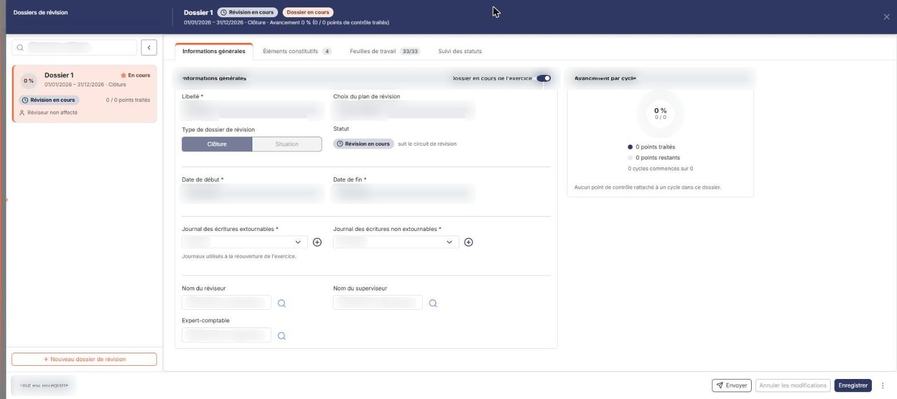
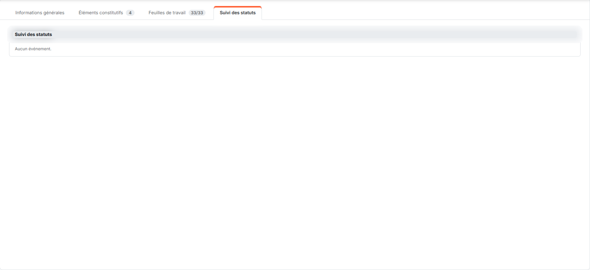
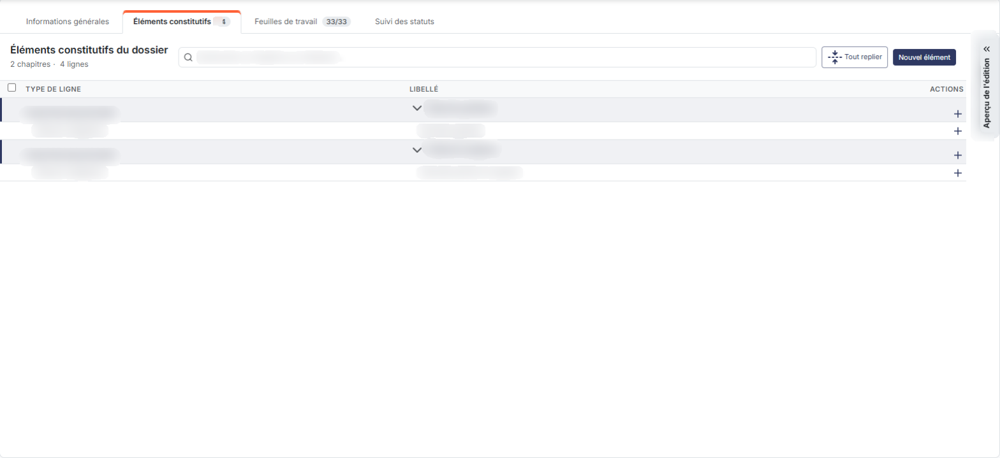
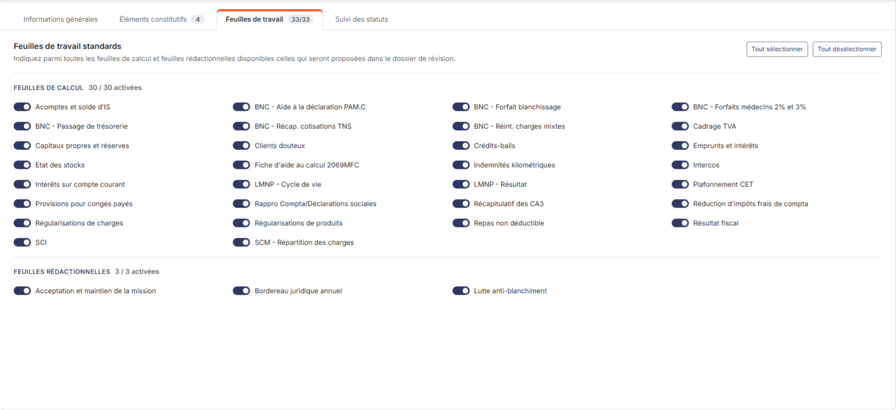
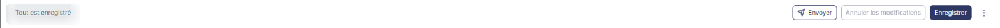

# Dossiers de révision


**En bref** — Cet écran liste et crée les dossiers de révision. Sans dossier de révision, le module reste fermé : c'est le point de départ de toute révision.

* Pour créer un dossier : bouton \[+ Nouveau dossier de révision], renseignez le libellé, puis bouton \[Enregistrer].
* Pour ajouter une ligne au dossier : onglet « Éléments constitutifs », puis bouton \[Nouvel élément].
* Pour envoyer le dossier par e-mail : bouton \[Envoyer].


**Commencez par ici : sans dossier de révision, le module de révision reste fermé.**

<figure><figcaption>
Écran « Dossiers de révision » de la nouvelle interface
</figcaption></figure>

Tant qu'aucun dossier de révision n'existe sur le dossier annuel, toutes les feuilles de calcul, toutes les feuilles rédactionnelles et les feuilles de travail personnalisées de la Révision répondent le message « Veuillez créer un dossier de révision afin de pouvoir utiliser cette fonctionnalité ». La création d'un dossier de révision est donc la première opération à mener sur un nouveau dossier annuel : c'est elle qui ouvre l'ensemble du module.

Pour un même dossier annuel, vous pouvez ouvrir plusieurs dossiers de révision simultanément. Dans l'écran Révision, cliquez sur l'icône « Dossiers de révision » de l'en-tête : l'écran s'ouvre dans un panneau plein écran (tiroir), intitulé « Dossiers de révision », dont le sous-titre rappelle la société et l'exercice. La création d'un dossier de révision peut se faire soit en utilisant le bouton **\[+ Nouveau dossier de révision]**, soit avec l'entrée « Dupliquer » du menu ⋮ du pied du panneau.

Une fois votre dossier de révision créé et activé, fermez le panneau par la croix : vous pourrez saisir les informations de révision dans l'écran Révision.

## La liste des dossiers de révision

<figure><figcaption>
Rubrique « 1) La liste des dossiers de révision »
</figcaption></figure>

La liste n'est plus un tableau : elle occupe la colonne de gauche du panneau, sous forme de cartes, une par dossier de révision. Le champ « Rechercher un dossier… » et le chevron « Replier la liste » se trouvent en tête de la colonne.

Chaque carte indique :

* le **libellé** du dossier de révision, avec une étoile orange « En cours » s'il s'agit du dossier actif ;
* la **période** couverte par le dossier, suivie de son type (« Clôture » ou « Situation ») ;
* un anneau d'avancement en pourcentage, la pastille de statut (« Révision en cours »), le nombre de points de contrôle traités (« 0 / 0 points traités ») et le réviseur (« Réviseur non affecté » tant que personne n'est désigné).

Un clic sur une carte affiche à droite le formulaire de ce dossier. Il n'y a plus de colonnes triables, de case à cocher ni de pictogrammes sur chaque ligne : la suppression et la duplication se trouvent dans le menu ⋮ du pied du panneau (paragraphe 3).

Le pied de la colonne de gauche porte le bouton :

bouton **\[+ Nouveau dossier de révision]**

Ouvre le formulaire de création décrit ci-dessous.

## Le formulaire du dossier de révision

Il occupe la partie droite du panneau. En tête, le bandeau du dossier rappelle son libellé, les pastilles « Révision en cours » et « Dossier en cours », la période, le type et l'avancement (« Avancement 0 % (0 / 0 points de contrôle traités) »). Il se compose de quatre onglets : « Informations générales », « Éléments constitutifs » (avec un compteur), « Feuilles de travail » (avec un compteur « 33/33 ») et « Suivi des statuts ».

## Onglet « Informations générales »

<figure><figcaption>
Rubrique « a) Onglet « Informations générales » »
</figcaption></figure>

* **Libellé** : le libellé est obligatoire.
* **Choix du plan de révision** : vous pouvez reprendre les informations figurant dans un modèle de plan de révision en le choisissant dans ce sélecteur. Il est positionné sur « Pas de modèle » à l'ouverture, et vous propose les modèles disponibles : « Dossier de révision », « Plan de révision BIC », « Plan de révision BNC », « Plan de révision complet », « Plan de révision LMNP », « Plan de révision SCI » et « Plan de révision simplifié ».\
  \
  Dès que vous choisissez un modèle, le logiciel recharge la page, alimente la rubrique « Eléments constitutifs du dossier de révision » avec l'arborescence du modèle, et le champ **Choix du plan de révision** devient grisé.
* **Nom du réviseur, nom du superviseur, expert-comptable** : ils sont facultatifs. Chacun de ces trois champs est doté d'un pictogramme « Loupe » qui vous permet de rechercher la personne. Le fait d'indiquer ces noms n'engendre pas de modifications dans les droits d'accès des utilisateurs correspondants.\
  Lorsque le statut du dossier de révision change, en fonction de son niveau d'avancement, un e-mail est adressé à la personne concernée pour l'informer.
* **Date de début, date de fin** : elles sont obligatoires ; par défaut elles correspondent aux dates d'exercice du dossier annuel en cours. Elles ne portent plus de pictogramme « Calendrier » ; sur le dossier présent à l'ouverture, les deux zones sont grisées. Ces dates seront systématiquement reprises dans la page « Révision » pour filtrer l'affichage des écritures du compte en cours de révision et pour toutes les éditions relatives au dossier.
* **Type de dossier de révision** : deux boutons à bascule, « Clôture » — retenu par défaut — et « Situation » (grisés sur le dossier présent à l'ouverture). Un dossier annuel peut contenir plusieurs dossiers de révision de type "Situation" mais un seul de type "Clôture".\
  \
  Si le dossier est de type "Clôture" vous devez indiquer deux codes journaux, celui qui contiendra les écritures d'OD qui sont extournables à la clôture et celui qui contiendra les écritures d'OD qui ne sont pas extournables à la clôture. Ce sont les deux champs obligatoires **Journal des écritures extournables** et **Journal des écritures non extournables** (ce dernier accompagné de l'aide « Journaux utilisés à la réouverture de l'exercice. »), tous deux positionnés sur « Sélectionnez » à la création et accompagnés d'une icône **\[+]** « Créer un journal » qui vous permet de créer un journal sans quitter le panneau. Cela permet, lors de la génération automatique des écritures d'OD par les feuilles de travail standards, de les enregistrer de manière différenciée dans ces journaux afin de générer les extournes automatiques lors de l'opération de clôture/réouverture.\
  \
  Liste des feuilles de travail générant des écritures dans le journal extournable à la réouverture :\
  \
  Emprunts et intérêts
* Provisions pour congés payés
* Régularisations de charges
* Régularisations de produits
* Acomptes et solde d'IS
* Capitaux propres et réserves
* Clients douteux
* Etat des stocks
* Indemnités kilométriques
* Intérêts sur compte courant
* Récap. cotisations TNS

## Onglet « Suivi des statuts » (ex-rubrique « Suivi des événements »)

<figure><figcaption>
Rubrique « b) Onglet « Suivi des statuts » »
</figcaption></figure>

Sur un dossier qui vient d'être créé, cette rubrique affiche simplement « Aucun événement. »

Ce tableau contient l'historique des opérations de validation qui ont eu lieu sur le dossier de révision. Pour chaque événement, il indique :

* **Date** : la date et l'heure de l'événement.
* **Type d'opération**
* **Opérateur** : c'est le nom de la personne ayant déclenché l'opération.
* **Destinataire e-mail** : c'est l'adresse de la personne à qui a été adressé l'e-mail d'information indiquant le changement de statut du dossier de révision.

## Onglet « Éléments constitutifs » (ex-rubrique « Eléments constitutifs du dossier de révision »)

<figure><figcaption>
Bouton [+ Nouveau dossier de révision]
</figcaption></figure>

<figure><figcaption>
Rubrique « c) Onglet « Éléments constitutifs » »
</figcaption></figure>

Elle contient toutes les lignes qui ont été copiées du modèle de plan de révision. Le titre de l'onglet indique le nombre de chapitres et de lignes (« 2 chapitres · 4 lignes »). Le tableau présente une colonne de sélection, puis les colonnes **Type de ligne**, **Libellé** et **Actions** (icône « + » sur les lignes obligatoires) ; les chapitres se replient par un chevron. Les quatre lignes obligatoires évoquées plus bas ne portent pas de case à cocher : elles ne peuvent pas être supprimées.

Même sans modèle de plan de révision, quatre lignes obligatoires sont présentes d'emblée et se retrouvent en tête de tout dossier : le chapitre « Note de synthèse » et son élément « Synthèse globale », le chapitre « Points en suspens » et son élément « Liste des points en suspens ».

Au-dessus du tableau, la barre d'outils porte le champ « Rechercher un chapitre ou un élément… », le bouton **\[Tout replier]** et le bouton **\[Nouvel élément]** ; une languette « Aperçu de l'édition » est proposée à droite du panneau. Le bouton **\[Supprimer la sélection]**, accompagné du bouton **\[Désélectionner]**, n'apparaît que lorsque des lignes sont cochées.

bouton **\[Nouvel élément]**

Il vous permet d'ajouter une ligne au dossier de révision. Reportez-vous à l'aide concernant la création des modèles de plans de révision pour avoir plus d'information concernant les contenus des lignes.

bouton **\[Supprimer la sélection]**

Il supprime les lignes cochées dans le tableau.

## Onglet « Feuilles de travail » (titre « Feuilles de travail standards »)

<figure><figcaption>
Rubrique « d) Onglet « Feuilles de travail » »
</figcaption></figure>

Cet onglet s'ouvre sur la phrase « Indiquez parmi toutes les feuilles de calcul et feuilles rédactionnelles disponibles celles qui seront proposées dans le dossier de révision. »

Chaque feuille est assortie d'un interrupteur sans texte, et toutes sont activées à l'ouverture d'un dossier : par défaut, l'intégralité des feuilles est donc proposée. Les **Boutons \[Tout sélectionner]** et **\[Tout désélectionner]** vous permettent de les basculer toutes en une fois.

Les feuilles sont réparties sous deux intitulés, **Feuilles de calcul** (« 30 / 30 activées ») et **Feuilles rédactionnelles** (« 3 / 3 activées »).

Feuilles de calcul proposées : Acomptes et solde d'IS, BNC - Aide à la déclaration PAM.C, BNC - Forfait blanchissage, BNC - Forfaits médecins 2% et 3%, BNC - Passage de trésorerie, BNC - Récap. cotisations TNS, BNC - Réint. charges mixtes, Cadrage TVA, Capitaux propres et réserves, Clients douteux, Crédits-bails, Emprunts et intérêts, Etat des stocks, Fiche d'aide au calcul 2069MFC, Indemnités kilométriques, Intercos, Intérêts sur compte courant, LMNP - Cycle de vie, LMNP - Résultat, Plafonnement CET, Provisions pour congés payés, Rappro Compta/Déclarations sociales, Récapitulatif des CA3, Réduction d'impôts frais de compta, Régularisations de charges, Régularisations de produits, Repas non déductible, Résultat fiscal, SCI, SCM - Répartition des charges.

Feuilles rédactionnelles proposées : Acceptation et maintien de la mission, Bordereau juridique annuel, Lutte anti-blanchiment.

## Les boutons du pied du panneau

<figure><figcaption>
Rubrique « 3) Les boutons du pied du panneau »
</figcaption></figure>

<figure><figcaption>
Bouton [Enregistrer]
</figcaption></figure>

bouton **\[Enregistrer]**

Il enregistre le dossier de révision. C'est cet enregistrement qui débloque les feuilles de calcul et les feuilles rédactionnelles de la Révision. À gauche du pied, la mention « Tout est enregistré » indique qu'aucune modification n'est en attente ; le bouton **\[Annuler les modifications]**, grisé tant que rien n'est modifié, abandonne les saisies en cours.

**Entrée « Enregistrer comme modèle » du menu ⋮ « Plus d'actions sur ce dossier »**

Ce menu ⋮, à droite du pied, propose aussi « Dupliquer » et « Supprimer ». L'entrée « Enregistrer comme modèle » permet d'enregistrer le dossier de révision en cours comme un nouveau modèle de plan de révision. Le modèle deviendra alors utilisable en tant que tel et exportable dans d'autres sociétés gérées.

Vous devez simplement indiquer un libellé qui n'existe pas déjà dans votre liste.

bouton **\[Forcer le statut]**

Ce bouton n'est pas toujours proposé : il est absent du formulaire d'un dossier dont le statut est encore « Révision en cours », puisqu'il n'y a alors aucun état antérieur vers lequel revenir.

Sur une fiche vierge, en revanche, les **Boutons \[Forcer le statut]** et **\[Envoyer]** sont proposés alors qu'ils n'ont pas encore d'objet : ils ne deviennent utiles qu'une fois le dossier de révision enregistré.

Il est utilisé si un des intervenants au dossier disposant des droits d'accès à ce bouton juge que le dossier doit revenir à un état antérieur, s'il a constaté un problème dans les opérations antérieures à celles qu'il doit effectuer.

Il faut indiquer le nouveau statut qui est imposé au dossier. Si le dossier est forcé à "Révision en cours" c'est le réviseur qui recevra un e-mail d'information, s'il est forcé à "Supervision en cours" ce sera le superviseur et enfin si un dossier terminé est forcé en "Attente visa expert-comptable" c'est l'expert-comptable qui recevra un e-mail.

**La croix du panneau**

Elle ferme le panneau et ramène à l'écran Révision ; le bouton \[Retour] n'existe plus dans ce panneau.
