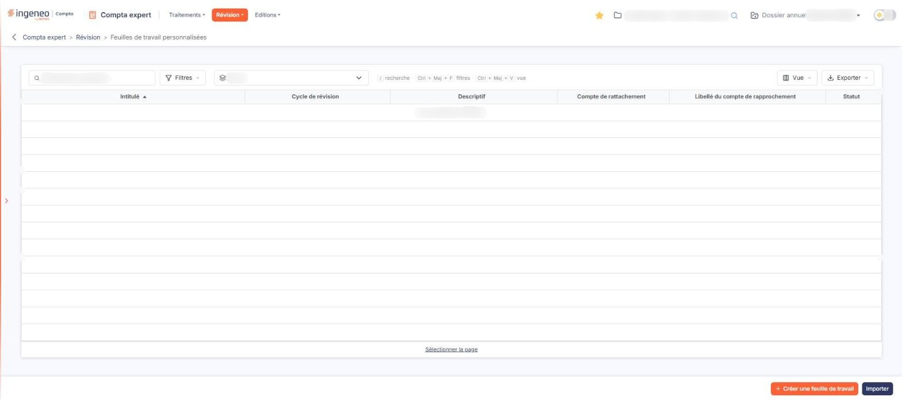
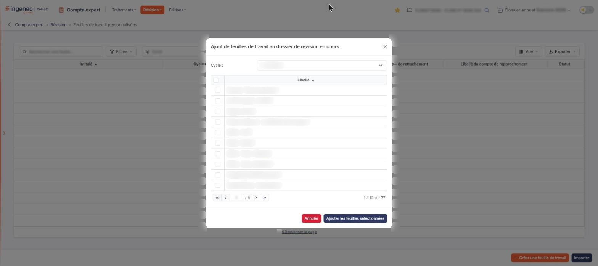

# Feuilles de travail personnalisées


**En bref** — Cet écran liste les feuilles de travail personnalisées rattachées au dossier de révision en cours ; il sert à les rattacher, éditer, importer ou supprimer, non à les saisir.

* Pour rattacher une feuille : bouton \[Créer une feuille de travail].
* Pour reprendre des feuilles d'un autre dossier annuel : bouton \[Importer].
* Pour imprimer plusieurs feuilles : cochez-les, puis bouton \[Edition].


Une feuille de travail personnalisée est un tableau de révision que vous rattachez au dossier de révision en cours pour justifier des comptes, rapprocher des montants ou consigner vos contrôles. Cet écran ne sert pas à saisir une feuille : il présente la **liste** des feuilles rattachées au dossier de révision en cours, et c'est depuis cette liste que vous en ajoutez, que vous les éditez, que vous les importez ou que vous les supprimez.

<figure><figcaption>
Écran « Feuilles de travail personnalisées » de la nouvelle interface
</figcaption></figure>

Pour l'ouvrir, utilisez le menu Révision de la barre de menus, entrée « Feuilles de travail personnalisées » ; le fil d'Ariane est « Compta expert > Révision > Feuilles de travail personnalisées ». L'écran Révision n'ayant plus de barre de menus, cette entrée ne s'offre que sur les écrans restés en page pleine. Cette page ne doit pas être confondue avec le panneau « Feuilles de travail », que la carte « N feuilles de travail » de l'écran Révision ouvre : ce panneau liste les feuilles de travail standard du dossier et porte lui aussi des boutons \[Importer] et \[Créer une feuille personnalisée].

L'écran se compose, de haut en bas, d'une barre d'outils (zone « Rechercher une feuille… », bouton **\[Filtres]**, liste **Cycle**, bouton **\[Vue]** et bouton **\[Exporter]**), de la liste des feuilles, puis de deux boutons en bas à droite de la page.

## La liste « Cycle »

<figure><figcaption>
Rubrique « a) La liste « Cycle » »
</figcaption></figure>

<figure><figcaption>
Bouton [Filtres]
</figcaption></figure>

La liste déroulante **Cycle**, dans la barre d'outils, restreint l'affichage aux feuilles de travail d'un seul cycle de révision. Elle porte le nom de la colonne, « Cycle », tant qu'aucun cycle n'est choisi (il n'y a plus d'entrée **Tous**), puis elle propose les cycles de révision du dossier en cours ; les cycles que le dossier n'utilise pas ne sont pas proposés (voir le sous-menu « Cycles de révision »).

Dès que vous choisissez un cycle, le lien « Tout effacer » apparaît à côté du bouton **\[Filtres]** : il remplace l'ancien bouton \[Annuler le filtre]. Cliquez sur « Tout effacer » pour revenir à l'affichage complet.

## La liste des feuilles de travail personnalisées

<figure><figcaption>
Bouton [Vue]
</figcaption></figure>

<figure><figcaption>
Rubrique « b) La liste des feuilles de travail personnalisées »
</figcaption></figure>

Tant qu'aucune feuille n'a été rattachée au dossier de révision en cours, la liste affiche « Aucun élément à afficher. ».

Il n'y a plus de colonne de cases à cocher : un clic sur une ligne la sélectionne, et le lien « Sélectionner la page », sous la liste, sélectionne toutes les lignes de la page. Le choix des colonnes affichées se fait avec le bouton **\[Vue]** de la barre d'outils.

Les colonnes de données, dans l'ordre d'affichage, sont les suivantes ; chacune peut servir de critère de tri :

* **Intitulé** : le libellé de la feuille de travail.
* **Cycle de révision** : le cycle auquel la feuille est affectée.
* **Descriptif** : le texte de description de la feuille.
* **Compte de rattachement** : le compte auquel la feuille est rattachée.
* **Libellé du compte de rapprochement** : le libellé du compte de rapprochement.
* **Statut** : l'état d'avancement de la feuille.

## Points d'attention

Lorsque la liste est vide, seuls les boutons **\[Créer une feuille de travail]** et **\[Importer]** sont affichés, en bas à droite de la page.

## Autres vues de l'écran

<figure><figcaption>
Bouton [Exporter]
</figcaption></figure>

<figure><figcaption>
c) Bouton [Créer une feuille de travail]
</figcaption></figure>

<figure><figcaption>
Bouton [Ajouter les feuilles sélectionnées]
</figcaption></figure>

<figure><figcaption>
Bouton [Annuler]
</figcaption></figure>
