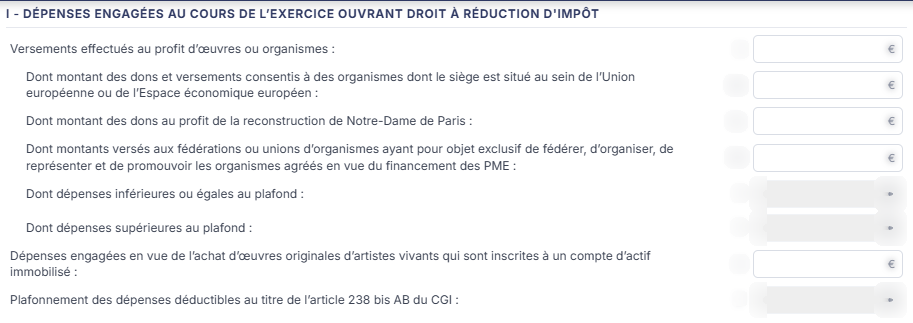
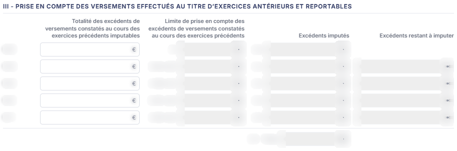
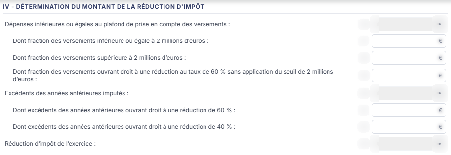
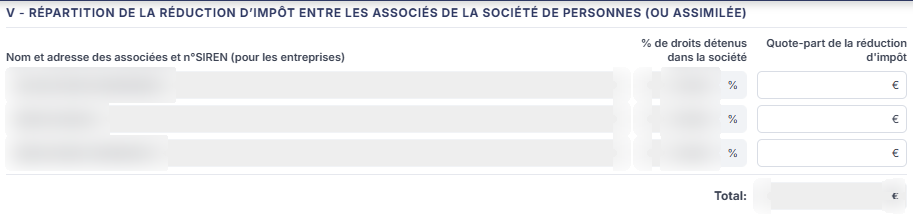
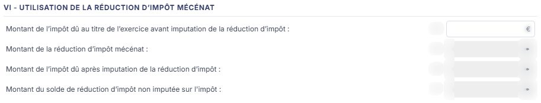
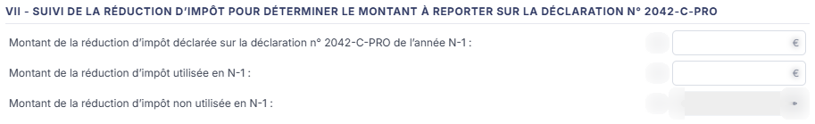
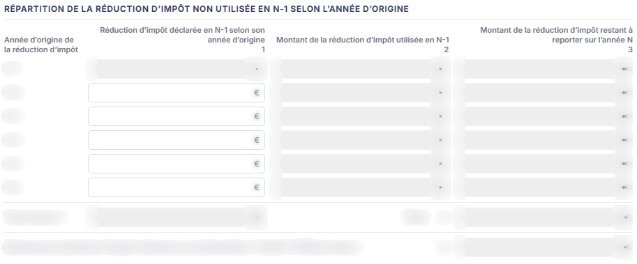

# Fiche d'aide au calcul 2069MFC


**En bref** — Cette feuille reprend l'imprimé 2069-MFC de la réduction d'impôt mécénat : versements ouvrant droit à réduction, excédents antérieurs, réduction de l'exercice et répartition.

* Pour alimenter la feuille : bouton \[Charger les valeurs], puis bouton \[Enregistrer].
* Pour terminer : bouton \[Valider] (cette feuille ne donne pas lieu à une écriture).


Cette feuille de travail, **Fiche d'aide au calcul 2069MFC**, s'ouvre depuis la liste des feuilles de l'écran Révision. Elle reprend, repère par repère, l'imprimé n° 2069-MFC relatif à la **réduction d'impôt mécénat** : elle vous aide à déterminer le montant des versements ouvrant droit à réduction, à imputer les excédents des exercices antérieurs, à calculer la réduction de l'exercice, puis à la répartir entre les associés et à en suivre le report.

<figure><figcaption>
Écran « Fiche d'aide au calcul 2069MFC » de la nouvelle interface
</figcaption></figure>

Pour l'ouvrir, dans l'écran Révision, cliquez sur la carte « N feuilles de travail » du bandeau : la liste des feuilles s'ouvre dans un tiroir à droite. Repérez la ligne « Fiche d'aide au calcul 2069MFC » (le champ « Rechercher une feuille… » la retrouve) et cliquez sur le crayon de la ligne : la feuille s'ouvre dans un panneau, dont l'en-tête indique « Fiche d'aide au calcul 2069MFC », puis la société et l'exercice, avec une croix de fermeture. Il n'y a pas de bouton de création pour cette feuille. Elle est créée dans le dossier de révision dès sa première ouverture, sans que vous ayez à l'enregistrer, et elle arrive immédiatement modifiable — il n'y a pas de mode consultation.

## Comment lire la feuille

C'est une feuille figée, calquée sur l'imprimé fiscal : vous ne pouvez ni ajouter, ni supprimer, ni déplacer une ligne. Chaque ligne porte à gauche son libellé, puis son **repère** sur l'imprimé 2069-MFC, puis sa zone.

La couleur de la zone vous indique ce que vous devez renseigner :

* une zone **blanche** est une zone que vous saisissez ;
* une zone **grisée** est une zone calculée par le logiciel, ou reprise de la comptabilité : elle n'est pas modifiable.

La feuille est très majoritairement calculée : sur l'ensemble des zones visibles, seul un tiers environ se saisit. Vous ne renseignez donc que les montants d'origine, et le logiciel en déduit tout le reste — plafonds, imputations, quotes-parts et totaux.

La feuille comporte huit rubriques, toutes dépliées d'emblée, et aucun onglet.

## L'en-tête de la feuille

Deux montants figurent au-dessus des rubriques, tous deux non modifiables :

| Champ                                         | Ce qu'il faut savoir                                                                                                                                                                                                                                                                                                                                                                                                                                  |
| --------------------------------------------- | ----------------------------------------------------------------------------------------------------------------------------------------------------------------------------------------------------------------------------------------------------------------------------------------------------------------------------------------------------------------------------------------------------------------------------------------------------- |
| **Chiffre d'affaires de l'exercice**          | Il est repris par le logiciel ; un pictogramme « Crayon » le suit.                                                                                                                                                                                                                                                                                                                                                                                    |
| **Plafond de prise en compte des versements** | C'est le plafond retenu pour l'exercice. Une infobulle en rappelle la règle : « **Le plafond de 20 000 €, alternatif à celui de 5 ‰ du chiffre d'affaires, s'applique aux versements effectués au cours des exercices clos à compter du 31 décembre 2020. Les entreprises peuvent appliquer le plafond de 20 000 € ou celui de 5 pour mille du chiffre d'affaires lorsque ce dernier montant est plus élevé.** » C'est la seule infobulle de l'écran. |

## Rubrique « I - DÉPENSES ENGAGÉES AU COURS DE L'EXERCICE OUVRANT DROIT À RÉDUCTION D'IMPÔT »

<figure><figcaption>
Rubrique « Rubrique « I - DÉPENSES ENGAGÉES AU COURS DE L'EXERCICE OUVRANT DROIT À RÉDUCTION D'IMPÔT » »
</figcaption></figure>

Vous y portez les versements de l'exercice ; le logiciel les ventile de part et d'autre du plafond.

Zones que vous saisissez :

* repère 3 — **Versements effectués au profit d'œuvres ou organismes** ;
* repère 3b — **Dont montant des dons et versements consentis à des organismes dont le siège est situé au sein de l'Union européenne ou de l'Espace économique européen** ;
* repère 3c — **Dont montant des dons au profit de la reconstruction de Notre-Dame de Paris** ;
* repère 3d — **Dont montants versés aux fédérations ou unions d'organismes ayant pour objet exclusif de fédérer, d'organiser, de représenter et de promouvoir les organismes agréés en vue du financement des PME** ;
* repère 6 — **Dépenses engagées en vue de l'achat d'œuvres originales d'artistes vivants qui sont inscrites à un compte d'actif immobilisé**.

Zones que le logiciel calcule : repère 4 **Dont dépenses inférieures ou égales au plafond**, repère 5 **Dont dépenses supérieures au plafond**, et repère 7 **Plafonnement des dépenses déductibles au titre de l'article 238 bis AB du CGI**.

## Rubrique « II - APPRÉCIATION DU MONTANT DES DÉPENSES ENGAGÉES AU COURS DE L'EXERCICE AU REGARD DU PLAFOND DE PRISE EN COMPTE DES VERSEMENTS »

<figure><figcaption>
Rubrique « Rubrique « II - APPRÉCIATION DU MONTANT DES DÉPENSES ENGAGÉES AU COURS DE L'EXERCICE AU REGARD DU PLAFOND DE PRISE EN COMPTE DES VERSEMENTS » »
</figcaption></figure>

Rien ne s'y saisit : les deux lignes sont calculées.

* repère 8 — **Plafond utilisé** ;
* repère 9 — **Montant maximum des excédents de versement des exercices antérieurs pouvant être pris en compte**.

## Rubrique « III - PRISE EN COMPTE DES VERSEMENTS EFFECTUÉS AU TITRE D'EXERCICES ANTÉRIEURS ET REPORTABLES »

<figure><figcaption>
Rubrique « Rubrique « III - PRISE EN COMPTE DES VERSEMENTS EFFECTUÉS AU TITRE D'EXERCICES ANTÉRIEURS ET REPORTABLES » »
</figcaption></figure>

C'est un tableau de cinq lignes, une par exercice antérieur reportable : **N-5**, **N-4**, **N-3**, **N-2** et **N-1**. Il comporte quatre colonnes :

* **Totalité des excédents de versements constatés au cours des exercices** : c'est la **seule colonne que vous saisissez**, une zone par exercice ;
* **Limite de prise en compte des excédents de versements constatés au cours des exercices précédents**, aux repères A, B (A-10), C (B-11), D (C-12) et E (D-13) ;
* **Excédents imputés**, aux repères 10 à 14 ;
* **Excédents restant à imputer**.

Les trois dernières colonnes sont calculées par le logiciel, ainsi que la ligne de total en pied de tableau, au repère 15 - Total.

## Rubrique « IV - DÉTERMINATION DU MONTANT DE LA RÉDUCTION D'IMPÔT »

<figure><figcaption>
Rubrique « Rubrique « IV - DÉTERMINATION DU MONTANT DE LA RÉDUCTION D'IMPÔT » »
</figcaption></figure>

Vous y répartissez les versements et les excédents par taux ; le logiciel en tire la réduction de l'exercice.

Zones que vous saisissez :

* repère 17 — **Dont fraction des versements inférieure ou égale à 2 millions d'euros** ;
* repère 18 — **Dont fraction des versements supérieure à 2 millions d'euros** ;
* repère 19 — **Dont fraction des versements ouvrant droit à une réduction au taux de 60 % sans application du seuil de 2 millions d'euros** ;
* repère 21 — **Dont excédents des années antérieures ouvrant droit à une réduction de 60 %** ;
* repère 22 — **Dont excédents des années antérieures ouvrant droit à une réduction de 40 %**.

Zones que le logiciel calcule : repère 16 **Dépenses inférieures ou égales au plafond de prise en compte des versements**, repère 20 **Excédents des années antérieures imputés** et repère 23 **Réduction d'impôt de l'exercice**.

## Rubrique « V - RÉPARTITION DE LA RÉDUCTION D'IMPÔT ENTRE LES ASSOCIÉS DE LA SOCIÉTÉ DE PERSONNES (OU ASSIMILÉE) »

<figure><figcaption>
Rubrique « Rubrique « V - RÉPARTITION DE LA RÉDUCTION D'IMPÔT ENTRE LES ASSOCIÉS DE LA SOCIÉTÉ DE PERSONNES (OU ASSIMILÉE) » »
</figcaption></figure>

C'est la seule rubrique que le logiciel vous présente **déjà remplie**, avant même le premier enregistrement de la feuille. Le tableau comporte trois colonnes :

* **Nom et adresse des associées et n°SIREN (pour les entreprises)** : cette colonne n'est **pas modifiable**. Le logiciel y reprend les associés déjà connus du dossier — vous ne les saisissez pas ici, et vous ne pouvez pas en ajouter depuis cette feuille ;
* **% de droits détenus dans la société** : elle arrive elle aussi préremplie, et n'est **pas modifiable** ; le signe % est affiché à droite de la zone ;
* **Quote-part de la réduction d'impôt** : c'est la **seule colonne que vous saisissez** dans ce tableau ; elle est vide à l'ouverture.

Une ligne **Total:** ferme le tableau ; elle n'est pas modifiable.

Le titre de la colonne des associés est écrit « **Nom et adresse des associées et n°SIREN (pour les entreprises)** », au féminin pluriel. C'est une coquille de l'écran, sans effet sur le calcul.

## Rubrique « VI - UTILISATION DE LA RÉDUCTION D'IMPÔT MÉCÉNAT »

<figure><figcaption>
Rubrique « Rubrique « VI - UTILISATION DE LA RÉDUCTION D'IMPÔT MÉCÉNAT » »
</figcaption></figure>

Vous n'y saisissez qu'une seule valeur, le repère 24 **Montant de l'impôt dû au titre de l'exercice avant imputation de la réduction d'impôt**.

Le logiciel en déduit les trois lignes suivantes : repère 25 **Montant de la réduction d'impôt mécénat**, repère 26 **Montant de l'impôt dû après imputation de la réduction d'impôt** et repère 27 **Montant du solde de réduction d'impôt non imputée sur l'impôt**.

## Rubrique « VII - SUIVI DE LA RÉDUCTION D'IMPÔT POUR DÉTERMINER LE MONTANT À REPORTER SUR LA DÉCLARATION N° 2042-C-PRO »

<figure><figcaption>
Rubrique « Rubrique « VII - SUIVI DE LA RÉDUCTION D'IMPÔT » »
</figcaption></figure>

Vous y saisissez deux valeurs, reprises de la déclaration de l'année précédente :

* repère 28 — **Montant de la réduction d'impôt déclarée sur la déclaration n° 2042-C-PRO de l'année N-1** ;
* repère 29 — **Montant de la réduction d'impôt utilisée en N-1**.

Le repère 30 **Montant de la réduction d'impôt non utilisée en N-1** en découle et n'est pas modifiable.

## Rubrique « RÉPARTITION DE LA RÉDUCTION D'IMPÔT NON UTILISÉE EN N-1 SELON L'ANNÉE D'ORIGINE »

<figure><figcaption>
Rubrique « Rubrique « RÉPARTITION DE LA RÉDUCTION D'IMPÔT NON UTILISÉE EN N-1 SELON L'ANNÉE D'ORIGINE » »
</figcaption></figure>

Cette dernière rubrique, qui ne porte pas de numéro romain, ventile le reliquat de la réduction selon l'exercice où le versement a été fait. Le tableau comporte six lignes — **N-1**, **N-6**, **N-5**, **N-4**, **N-3**, **N-2** — et trois colonnes :

* **Réduction d'impôt déclarée en N-1 selon son année d'origine** : vous la saisissez sur les lignes N-6 à N-2 ; sur la ligne N-1, elle n'est pas modifiable ;
* **Montant de la réduction d'impôt utilisée en N-1** : calculée ;
* **Montant de la réduction d'impôt restant à reporter sur l'année N** : calculée.

Le pied du tableau porte le **Total colonne 1** au repère **Total : 31**, puis la ligne **Montant de la réduction d'impôt à déclarer sur la déclaration n° 2042-C-PRO de l'année : 32**. C'est cette dernière valeur que vous reportez sur la déclaration. Aucune de ces lignes n'est modifiable.

## Les boutons du pied du panneau

Le pied du panneau est permanent. Il indique à gauche l'état de la feuille (une pastille orange et la mention « Non validée ») et présente à droite, de gauche à droite : le Bouton \[Charger les valeurs], \[Éditer], \[Valider], \[Enregistrer] et ⋮ « Autres actions » (qui porte « Purger la feuille »). Le pied n'a pas de bouton \[Fermer] : la croix de l'en-tête referme le panneau. Cet écran ne comporte ni bouton de création, ni roue de paramétrage des comptes, ni rubrique « Documents ».

bouton **\[Éditer]**

Il ouvre la fenêtre d'édition de la feuille.

## À savoir

Comme toutes les feuilles de travail, celle-ci se range dans un dossier de révision. L'écran n'indique cependant pas à quel dossier de révision elle se rattache : si le dossier annuel en comporte plusieurs, rien à l'écran ne vous dit lequel est servi.

## Autres vues de l'écran

<figure><figcaption>
Rubrique « Chiffre d'affaires de l'exercice »
</figcaption></figure>
