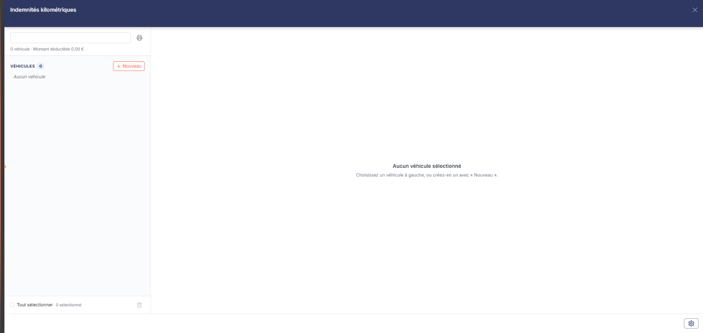
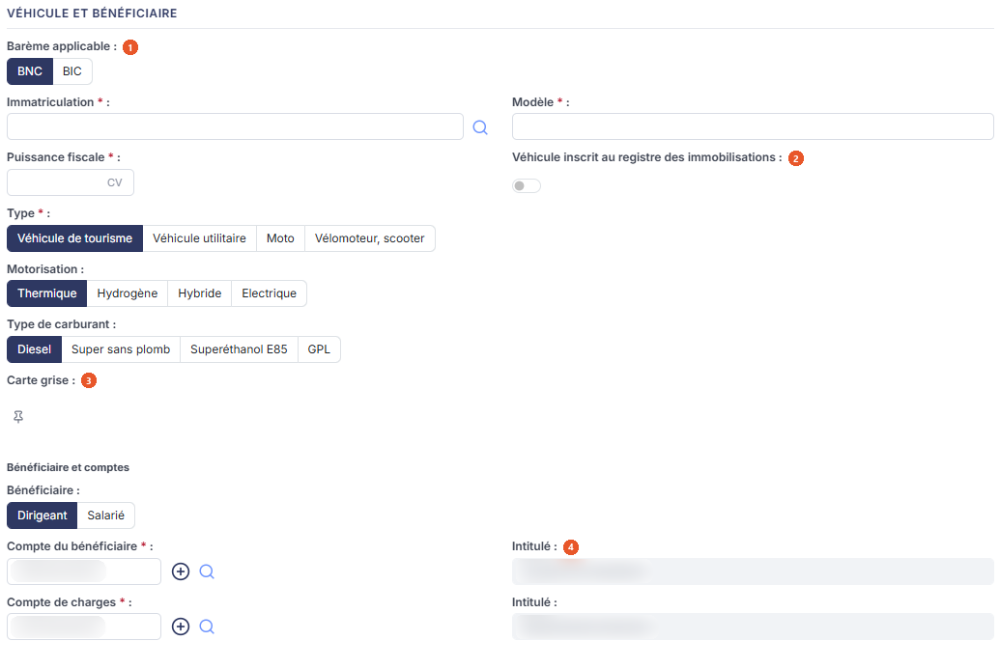
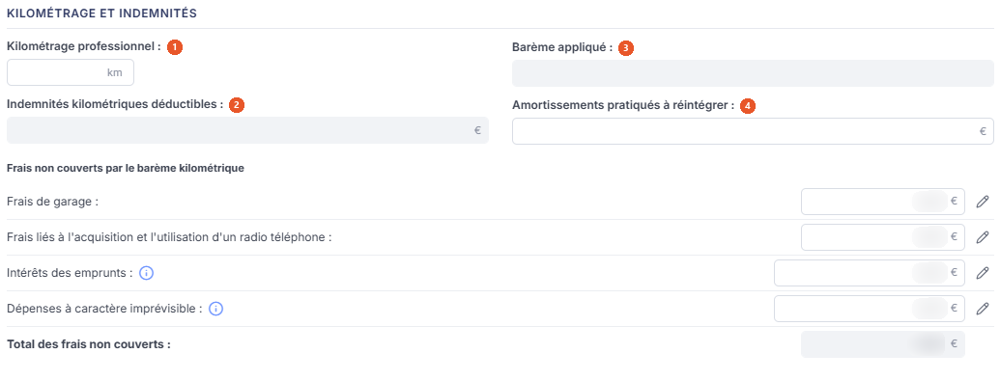
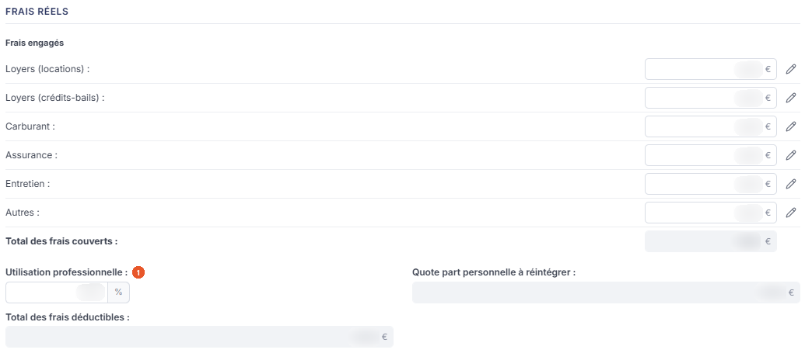
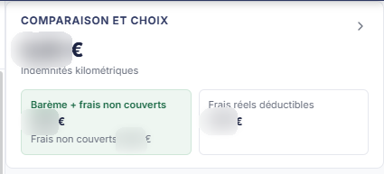
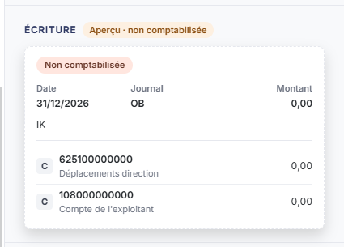
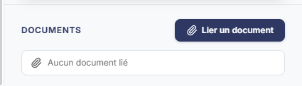

# Indemnités kilométriques


**En bref** — Cette feuille compare, véhicule par véhicule, le barème kilométrique et les frais réels pour retenir la méthode la plus favorable, puis comptabilise l'indemnité.

* Pour ajouter un véhicule : bouton \[Nouveau], renseignez la fiche, puis bouton \[Enregistrer].
* Pour consulter le barème employé : pictogramme « Visualiser le barème », à droite du titre de la fiche.
* Pour comptabiliser : bouton \[Comptabiliser et valider].


Cette feuille de travail, **Indemnités kilométriques**, s'ouvre depuis l'écran Révision : cliquez sur la carte « N feuilles de travail » du bandeau ; la liste des feuilles s'ouvre dans un tiroir à droite. Repérez la ligne « Indemnités kilométriques » (le champ « Rechercher une feuille… » la retrouve) et cliquez sur le crayon de la ligne : la feuille s'ouvre dans un panneau, dont l'en-tête indique « Indemnités kilométriques », puis la société et l'exercice, avec une croix de fermeture. Vous y déclarez, véhicule par véhicule, le kilométrage professionnel et les frais engagés, afin de comparer les deux modes de déduction — l'**indemnité kilométrique** issue du barème, et les **frais réels** — et de retenir le plus favorable. La feuille peut ensuite donner lieu à une écriture comptable.

<figure><figcaption>
Écran « Indemnités kilométriques » de la nouvelle interface
</figcaption></figure>

Contrairement à la plupart des feuilles de calcul, cet écran ne s'ouvre pas directement sur une feuille : il présente d'abord la **liste** des véhicules déjà saisis, depuis laquelle vous ouvrez ou créez une **fiche**. Vous établissez donc une fiche par véhicule et par bénéficiaire.

Comme toutes les feuilles de travail, celles-ci se rangent dans le dossier de révision du dossier annuel.

## La navigation (liste des véhicules)

<figure><figcaption>
Bouton [Nouveau]
</figcaption></figure>

En haut de la navigation, la zone « Rechercher un véhicule, une immatriculation ou un bénéficiaire » filtre les véhicules ; à sa droite, un pictogramme d'infobulle « Édition des indemnités kilométriques » (décrit plus bas). Dessous, une ligne de synthèse : « N véhicule · Montant déductible … € » (« 0 véhicule · Montant déductible 0,00 € » tant qu'aucune fiche n'a été créée).

Les véhicules sont rangés dans un groupe « Véhicules », avec son compteur ; il affiche « Aucun véhicule » tant qu'aucune fiche n'a été créée. La navigation n'a ni colonnes, ni tri, ni roue de choix des colonnes ; ce que chaque véhicule y affiche n'a pas été relevé, aucune fiche n'étant enregistrée sur le dossier consulté.

Au bas de la navigation : la case « Tout sélectionner », le compteur « N sélectionné » et un pictogramme corbeille d'infobulle « Supprimer la sélection ».

bouton **\[Nouveau]**

Placé à droite de l'intitulé du groupe « Véhicules » (infobulle « Nouveau véhicule »), il ouvre au centre du panneau, sous le titre « Nouveau véhicule », une fiche vierge, décrite plus bas.

**Pictogramme « Édition des indemnités kilométriques »**

Il édite les fiches.

**Pictogramme « Supprimer la sélection » (corbeille)**

Il supprime les fiches sélectionnées dans la navigation (non vérifié : aucune fiche n'est enregistrée sur le dossier consulté, aucune ligne n'a pu être sélectionnée).

**Roue du pied du panneau (« Paramétrage des comptes »)**

Cette roue, d'infobulle « Paramétrage des comptes de révision : Indemnités kilométriques », ouvre le tiroir commun « Paramétrage des comptes de révision », sur la rubrique « Indemnités kilométriques » (treize paramètres, en trois groupes : « Indemnités et dirigeant », « Frais annexes », « Frais réels »). C'est le paramétrage des comptes employés par cette feuille de travail. C'est de ce paramétrage que proviennent le compte du bénéficiaire et le compte de charges déjà renseignés sur une fiche neuve.

## La fiche : comment la lire

La couleur de la zone vous indique ce que vous devez renseigner :

* une zone **blanche** est une zone que vous saisissez ;
* une zone **grisée** est une zone calculée par le logiciel, ou reprise d'ailleurs : elle n'est pas modifiable.

Les champs marqués d'un astérisque sont obligatoires. Plusieurs champs de montant portent à leur droite un pictogramme « Crayon ».

La fiche s'ouvre au centre du panneau, sous le titre « Nouveau véhicule » (au-dessus : les pastilles « Barème BNC » et « Barème kilométrique retenu »), sans onglet. Elle comporte six rubriques : au centre, dans cet ordre, « Véhicule et bénéficiaire » (avec les sous-titres « Véhicule » et « Bénéficiaire et comptes »), « Kilométrage et indemnités » et « Frais réels » (avec le sous-titre « Frais engagés ») ; dans le volet de droite, « Comparaison et choix », « Écriture » et « Documents » (le chevron « Masquer le volet de droite » replie ce volet). Trois pictogrammes sont à droite du titre de la fiche : « Charger les valeurs », « Visualiser le barème » et « Éditer ».

## Rubrique « Véhicule et bénéficiaire »

<figure><figcaption>
Rubrique « Rubrique « Véhicule et bénéficiaire » »
</figcaption></figure>

Vous y décrivez le véhicule, son usage et la personne à qui l'indemnité revient.

| Champ                                                   | Ce qu'il faut savoir                                                                                                                                                                                                                                                                                                                                                                                                                                                                                                                                                                                                                                                                                                                                                                                                                                                                                                                                                                                                                                                                                                                                                                                                                                                                                                                                                                  |
| ------------------------------------------------------- | ------------------------------------------------------------------------------------------------------------------------------------------------------------------------------------------------------------------------------------------------------------------------------------------------------------------------------------------------------------------------------------------------------------------------------------------------------------------------------------------------------------------------------------------------------------------------------------------------------------------------------------------------------------------------------------------------------------------------------------------------------------------------------------------------------------------------------------------------------------------------------------------------------------------------------------------------------------------------------------------------------------------------------------------------------------------------------------------------------------------------------------------------------------------------------------------------------------------------------------------------------------------------------------------------------------------------------------------------------------------------------------- |
| 1. **Barème applicable**                                | Choisissez entre **BNC** et **BIC** ; le logiciel propose BNC.                                                                                                                                                                                                                                                                                                                                                                                                                                                                                                                                                                                                                                                                                                                                                                                                                                                                                                                                                                                                                                                                                                                                                                                                                                                                                                                        |
| 2. **Véhicule inscrit au registre des immobilisations** | 
Interrupteur Oui/Non, positionné sur Non. Il conditionne notamment la réintégration des amortissements, plus bas. **Immatriculation *** : l'immatriculation du véhicule. Le pictogramme « Loupe » permet de le rechercher. **Modèle *** et **Puissance fiscale *** : ils servent à déterminer le barème applicable.
                                                                                                                                                                                                                                                                                                                                                                                                                                                                                                                                                                                                                                                                                                                                                                                                                                                                                                                                                                                                                                                      |
| 3. **Carte grise**                                      | 
Le pictogramme « Épingle » rattache la carte grise à la fiche. Son infobulle indique « <strong>Lier une carte grise</strong> » (le raccourci Ctrl + Alt + L cité auparavant n'a pas été retrouvé : non vérifié ; ailleurs dans la refonte, Ctrl + Alt + L ouvre le sélecteur de société). **Type *** : la catégorie du véhicule — <strong>Véhicule de tourisme</strong>, <strong>Véhicule utilitaire</strong>, <strong>Moto</strong> ou <strong>Vélomoteur, scooter</strong>. Le logiciel propose Véhicule de tourisme. <strong>Motorisation :Thermique</strong>, <strong>Hydrogène</strong>, <strong>Hybride</strong> ou <strong>Electrique</strong> — le logiciel propose Thermique. Le dernier choix est écrit sans accent à l'écran. <strong>Type de carburant :Diesel</strong>, <strong>Super sans plomb</strong>, <strong>Superéthanol E85</strong> ou <strong>GPL</strong> — le logiciel propose Diesel. <strong>Bénéficiaire :Dirigeant</strong> ou <strong>Salarié</strong> — le logiciel propose Dirigeant. **Compte du bénéficiaire *** et **Compte de charges *** : les deux comptes que l'écriture emploiera. Ils arrivent déjà renseignés, repris du paramétrage des comptes (roue du pied du panneau). Sur chacun, le bouton <strong>[+]</strong> permet de créer le compte et le pictogramme « Loupe » de le rechercher dans le plan comptable.
 |
| 4. **Intitulé**                                         | À droite de chaque compte, l'intitulé du compte s'affiche en lecture seule ; vous ne pouvez pas le modifier ici.                                                                                                                                                                                                                                                                                                                                                                                                                                                                                                                                                                                                                                                                                                                                                                                                                                                                                                                                                                                                                                                                                                                                                                                                                                                                      |

## Rubrique « Kilométrage et indemnités »

<figure><figcaption>
Rubrique « Rubrique « Kilométrage et indemnités » »
</figcaption></figure>

C'est ici que se calcule la déduction au barème.

| Champ                                        | Ce qu'il faut savoir                                                                                                                                |
| -------------------------------------------- | --------------------------------------------------------------------------------------------------------------------------------------------------- |
| 1. **Kilométrage professionnel**             | Vous le saisissez ; c'est la donnée d'entrée du calcul.                                                                                             |
| 2. **Indemnités kilométriques déductibles**  | Le logiciel la calcule ; elle n'est pas modifiable.                                                                                                 |
| 3. **Barème appliqué**                       | Non modifiable également. Son infobulle précise : « **Formule obtenue avec les informations saisies dans la feuille et le barème IK en vigueur.** » |
| 4. **Amortissements pratiqués à réintégrer** | Vous le saisissez. Son infobulle rappelle qu'il « **Concerne les véhicules inscrits au registre des immobilisations.** »                            |

Un sous-titre souligné, **Frais non couverts par le barème kilométrique :**, introduit ensuite les frais qui s'ajoutent à l'indemnité parce que le barème ne les couvre pas. Vous les saisissez tous les quatre :

* **Frais de garage** : ;
* **Frais liés à l'acquisition et l'utilisation d'un radio téléphone** : — écrit ainsi à l'écran, en deux mots ;
* **Intérêts des emprunts** : — son infobulle indique « **Pour mettre à jour cette valeur depuis le module Immobilisations, cliquez sur le bouton \[Charger les valeurs].** » ;
* **Dépenses à caractère imprévisible** : — son infobulle indique « **Exemple : Réparation suite à un accident.** ».

La ligne **Total des frais non couverts :** qui les suit est calculée par le logiciel.

## Rubrique « Frais réels »

<figure><figcaption>
Rubrique « Rubrique « Frais réels » »
</figcaption></figure>

Vous y portez le second terme de la comparaison : ce que le véhicule a réellement coûté.

**Utilisation professionnelle** : exprimée en pourcentage ; elle sert à isoler la part personnelle.

Vous saisissez ensuite les postes de dépense : **Loyers (locations) :**, **Loyers (crédits-bails) :**, **Carburant :**, **Assurance :**, **Entretien :** et **Autres :**.

Les trois dernières lignes sont calculées par le logiciel et ne sont pas modifiables : **Total des frais couverts :**, **Quote part personnelle à réintégrer :** et **Total des frais déductibles :**.

## Rubrique « Comparaison et choix »

<figure><figcaption>
Rubrique « Rubrique « Comparaison et choix » »
</figcaption></figure>

Ce volet, en haut à droite de la fiche, affiche le résultat de la comparaison entre les deux modes de déduction : le montant retenu (0,00 € sur une fiche vierge, sous la mention « Indemnités kilométriques »), puis deux cartes, « Barème + frais non couverts » (avec « Frais non couverts … € ») et « Frais réels déductibles », la carte retenue étant teintée en vert.

## Rubrique « Écriture »

<figure><figcaption>
Rubrique « Rubrique « Écriture » »
</figcaption></figure>

Tant que la feuille n'a pas été comptabilisée, cette rubrique affiche la pastille « Non comptabilisée » au-dessus d'une carte qui présente l'écriture prévue : la date, le journal, le montant, le libellé, puis deux lignes de compte, chacune précédée d'une pastille « C » et suivie de son montant. Sur le dossier relevé le 26/10/2026, la carte portait la date 31/12/2026, le journal OB (infobulle « Od de bilan »), le libellé « IK » et les comptes 625100000000 « Déplacements direction » et 108000000000 « Compte de l'exploitant », montants à 0,00 : ces valeurs dépendent du dossier. La phrase suivante, citée auparavant, n'a pas été retrouvée dans le relevé :

« **Cette feuille de travail n'a pas encore été comptabilisée.** »

C'est le bouton \[Comptabiliser et valider] du pied du panneau qui produit l'écriture.

Le titre de cette rubrique s'écrit désormais avec l'accent, « Écriture ».

## Rubrique « Documents »

<figure><figcaption>
Rubrique « Rubrique « Documents » »
</figcaption></figure>

Elle sert à joindre des pièces justificatives à la fiche. Tant qu'aucune pièce n'est jointe, elle affiche la seule mention « Aucun document lié ».

Le bouton **\[Lier un document]** rattache une pièce à la fiche (le tiroir qu'il ouvre n'a pas été ouvert : ce qu'il propose n'est pas décrit ici).

## Les commandes du pied de la fiche

Le pied du panneau est permanent. Sur une fiche non validée et non comptabilisée, il présente, à gauche, la pastille orange « Non validée » puis, à droite, la roue « Paramétrage des comptes de révision : Indemnités kilométriques », le bouton **\[Comptabiliser et valider]**, le bouton **\[Valider]** et le bouton **\[Enregistrer]**. Les trois pictogrammes « Charger les valeurs », « Visualiser le barème » et « Éditer » sont à droite du titre de la fiche. Les commandes sont décrites ci-dessous, sans suivre l'ordre du pied.

bouton **\[Valider]**

Il valide la feuille de travail au sein du dossier de révision, sans produire d'écriture.

**Pictogramme « Éditer »**

Il ouvre la fenêtre d'édition de la feuille.

**Pictogramme « Visualiser le barème »**

Il ouvre le barème kilométrique employé par le calcul. Ce bouton est propre à cet écran.

Il est placé à droite du titre de la fiche, comme « Charger les valeurs » et « Éditer ».

**Croix de l'en-tête**

Elle referme le panneau tout entier, fiche comprise, et vous ramène à la liste des feuilles de travail. Le pied ne porte ni bouton \[Fermer] ni bouton \[Retour].

## À savoir

Cette fiche ne comporte pas de bouton de purge : pour repartir de zéro, supprimez la fiche depuis la navigation et recréez-la (le pied de la fiche ne porte pas de menu ⋮ « Autres actions » : aucune entrée « Purger la feuille » n'est proposée à l'écran).

L'écran n'indique pas à quel dossier de révision la feuille se rattache. Si le dossier annuel en comporte plusieurs, rien à l'écran ne vous dit lequel est servi.
