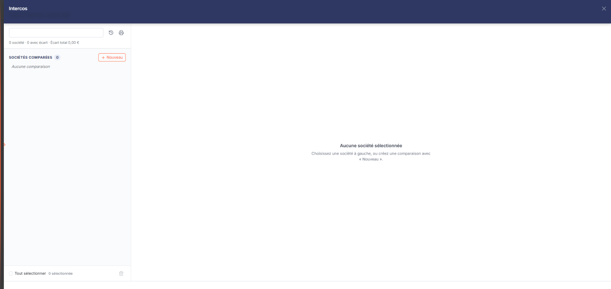
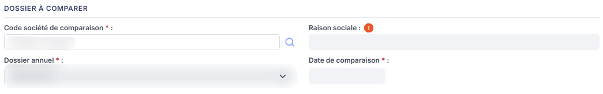
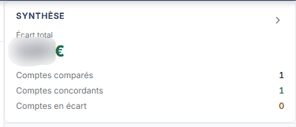
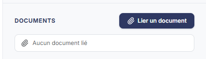

# Intercos


**En bref** — Cette feuille rapproche les comptes du dossier de ceux d'un autre dossier du cabinet à une date donnée, pour contrôler les opérations réciproques entre sociétés liées.

* Pour ajouter une comparaison : bouton \[Nouveau], renseignez la fiche, puis bouton \[Enregistrer].
* Pour reprendre l'exercice précédent : pictogramme « Charger les valeurs N-1 », en haut de la navigation.
* Pour actualiser les soldes après un changement de date : pictogramme « Recalculer les soldes », à droite du titre de la fiche.


La feuille de travail **Intercos** sert à rapprocher les comptes du dossier en cours de ceux d'un **autre dossier** du cabinet, à une date donnée : c'est le contrôle des **opérations réciproques** entre sociétés liées, où ce que l'une porte en compte client doit se retrouver, en sens inverse, dans le compte fournisseur de l'autre.

<figure><figcaption>
Écran « Intercos » de la nouvelle interface
</figcaption></figure>

Pour l'ouvrir, dans l'écran Révision, cliquez sur la carte « N feuilles de travail » du bandeau : la liste des feuilles s'ouvre dans un tiroir à droite. Repérez la ligne « Intercos » (le champ « Rechercher une feuille… » la retrouve) et cliquez sur le crayon de la ligne : la feuille s'ouvre dans un panneau, dont l'en-tête indique « Intercos », puis la société et l'exercice, avec une croix de fermeture.

Ce panneau ne s'ouvre pas directement sur une fiche : il présente d'abord, à gauche, une **navigation** qui liste les comparaisons déjà établies, depuis laquelle vous ouvrez ou créez une **fiche**, qui s'affiche au centre du panneau. Vous établissez donc une fiche par société comparée et par date de comparaison.

Comme toutes les feuilles de travail, celles-ci se rangent dans le dossier de révision du dossier annuel.

## La navigation (liste des comparaisons)

<figure><figcaption>
Bouton [Nouveau]
</figcaption></figure>

En haut de la navigation, la zone « Rechercher une société ou un code » filtre les comparaisons ; à sa droite, deux pictogrammes d'infobulles « Charger les valeurs N-1 » et « Édition des intercos » (le second est décrit plus bas). Dessous, une ligne de synthèse : « N société · N avec écart · Écart total … € » (« 0 société · 0 avec écart · Écart total 0,00 € » tant qu'aucune comparaison n'est établie).

Les comparaisons sont rangées dans un groupe « Sociétés comparées », avec son compteur ; il affiche « Aucune comparaison » tant qu'aucune fiche n'a été créée. La navigation n'a ni colonnes, ni tri, ni roue de choix des colonnes ; ce que chaque comparaison y affiche n'a pas été relevé, aucune fiche n'étant enregistrée sur le dossier consulté.

Au bas de la navigation : la case « Tout sélectionner », le compteur « N sélectionnée » et un pictogramme corbeille d'infobulle « Supprimer la sélection ». Sans fiche ouverte, le pied du panneau ne porte aucun bouton : il n'y a ni bouton **\[Valider]** ni bouton **\[Enregistrer]** sur la liste.

bouton **\[Nouveau]**

Placé à droite de l'intitulé du groupe « Sociétés comparées » (infobulle « Nouvelle comparaison »), il ouvre au centre du panneau, sous le titre « Nouvelle comparaison », la fiche vierge, décrite plus bas.

**Pictogramme « Édition des intercos »**

Il édite les comparaisons.

**Pictogramme « Supprimer la sélection » (corbeille)**

Il supprime les comparaisons sélectionnées dans la navigation (non vérifié : aucune comparaison n'est enregistrée sur le dossier consulté).

## La fiche : comment la lire

La couleur de la zone vous indique ce que vous devez renseigner :

* une zone **blanche** est une zone que vous saisissez ;
* une zone **grisée** est une zone que le logiciel renseigne lui-même : elle n'est pas modifiable.

Les champs marqués d'un astérisque sont obligatoires. La fiche ne comporte pas d'onglet. Le pictogramme « Loupe » des zones de recherche porte pour seule infobulle le rappel de son raccourci, Ctrl + Alt + R.

Elle présente d'abord, au centre du panneau, la rubrique « Dossier à comparer », qui porte les quatre champs désignant le dossier à comparer. Une rubrique « Comptes à comparer » s'insère sous elle et **n'apparaît pas tant que la société à comparer n'a pas été désignée** : c'est elle qui porte le rapprochement proprement dit. Renseignez donc d'abord les champs du haut. Le volet de droite (que le chevron « Masquer le volet de droite » replie) porte trois blocs : « Synthèse », « Écarts à justifier » et « Documents ».

## Les champs du dossier à comparer

<figure><figcaption>
Rubrique « Les champs du dossier à comparer »
</figcaption></figure>

Vous y désignez l'autre dossier du rapprochement, et la date à laquelle il est fait.

\*\*Code société de comparaison \*\*\* : le code de la société à comparer. Le pictogramme « Loupe » permet de la rechercher.

**Raison sociale** : le logiciel l'affiche à partir du code société ; vous ne la saisissez pas.

\*\*Dossier annuel \*\*\* : le dossier annuel de cette société sur lequel porte la comparaison. **Cette liste reste vide tant que vous n'avez pas renseigné le code société** : elle n'affiche alors que l'invite **Sélectionnez**. Renseignez donc les deux champs dans cet ordre.

Une fois le dossier annuel choisi, le logiciel renseigne lui-même la **Date de comparaison** : sur le dossier observé, il a proposé le dernier jour de l'exercice. Vous pouvez ensuite la modifier.

\*\*Date de comparaison \*\*\* : la date à laquelle les soldes des deux dossiers sont rapprochés. Cliquez dans le champ pour ouvrir le calendrier.

## Rubrique « Comptes à comparer »

C'est le cœur de la feuille : elle rapproche les comptes du dossier en cours de ceux du dossier désigné plus haut. Elle n'est pas affichée sur une fiche vierge et apparaît dès que la société de comparaison est désignée.

Le tableau est coiffé de deux en-têtes : **Compte interne** pour le dossier en cours, **Compte externe** pour le dossier comparé. Sous chacun d'eux, trois colonnes : **N° de compte**, **Intitulé** et **Solde**. Viennent ensuite **Ecart**, puis **Commentaires**.

Vous saisissez les deux numéros de compte — le bouton « + » (infobulle « Créer ») permet de créer le compte et le pictogramme « Loupe » de le rechercher dans le plan comptable — et le commentaire. Les intitulés, les soldes et l'écart sont renseignés par le logiciel.

Une première ligne vide est proposée d'emblée ; elle ne porte pas de commande de suppression à l'écran. Le bouton **\[Nouvelle ligne]**, sous le tableau, en ajoute une.

## d bis) Volet « Synthèse » et « Écarts à justifier »

<figure><figcaption>
Rubrique « Volet « Synthèse » »
</figcaption></figure>

<figure><figcaption>
Rubrique « Écarts à justifier »
</figcaption></figure>

En haut du volet de droite, « Synthèse » affiche « Écart total » (0,00 € sur une fiche vierge), puis les compteurs « Comptes comparés », « Comptes concordants » et « Comptes en écart ». Dessous, « Écarts à justifier » affiche « Aucun écart à justifier » tant qu'il n'y en a pas, et la précision : « Cette feuille ne génère pas d'écriture : les écarts se corrigent dans le dossier concerné. »

## Rubrique « Documents »

<figure><figcaption>
Rubrique « Rubrique « Documents » »
</figcaption></figure>

Elle sert à joindre des pièces justificatives à la fiche — typiquement la confirmation de solde obtenue de l'autre société. Tant qu'aucune pièce n'est jointe, elle affiche « **Aucun document lié** » ; dès qu'une pièce l'est, elle présente sa liste : une colonne de commande sans titre, puis **Description**, **Nom du fichier**, **Date** et **Créé par**.

Le rattachement passe par le bouton **\[Lier un document]**, placé en tête de la rubrique, à côté de son titre : le panneau qu'il ouvre vous laisse choisir un fichier de votre poste, un document de la GED — si vous avez accès à ce module — ou une pièce reçue dans l'OCR.

## Les boutons de la fiche

Le pied du panneau est permanent. Il indique à gauche l'état de la fiche (pastille « Non validée ») et présente à droite, de gauche à droite : le bouton **\[Valider]** et le bouton **\[Enregistrer]**. Le pictogramme « Recalculer les soldes » se trouve à droite du titre de la fiche.

**Pictogramme « Recalculer les soldes »**

Il reprend les soldes des deux dossiers à la date de comparaison. Employez-le après avoir modifié la date ou le dossier comparé, et après toute saisie d'écritures susceptible d'avoir bougé les soldes rapprochés.

Ce bouton est propre à cet écran.

**Croix de l'en-tête**

Elle referme le panneau tout entier, fiche comprise, et vous ramène à la liste des feuilles de travail, sans demander de confirmation, même après la désignation d'une société (lu le 26/10/2026 : rien n'est enregistré ; fiche vierge refermée sans question le 05/11/2026). Le pied ne porte pas de bouton \[Fermer].

## À savoir

Cette fiche ne comporte ni bouton de chargement des valeurs, ni bouton de purge : le seul chargement disponible, le pictogramme « Charger les valeurs N-1 », se trouve en haut de la navigation.

L'écran n'indique pas à quel dossier de révision la feuille se rattache. Si le dossier annuel en comporte plusieurs, rien à l'écran ne vous dit lequel est servi.
