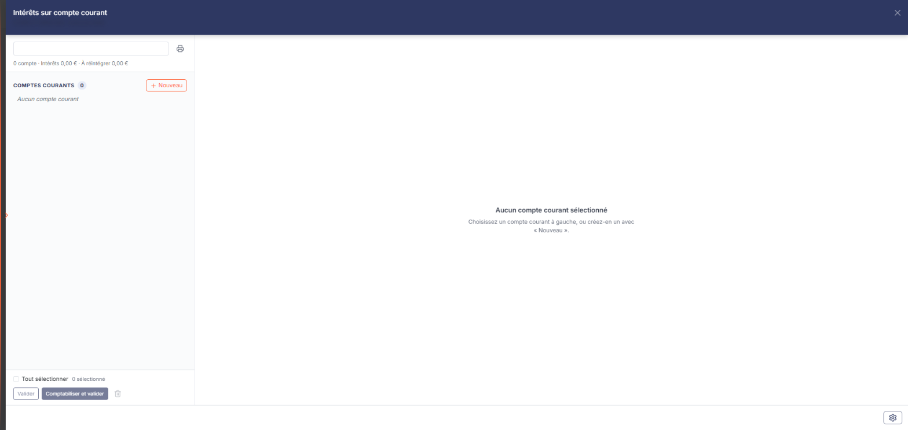
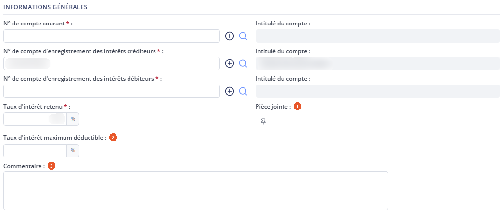
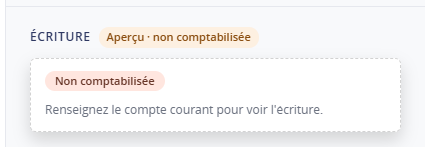

# Intérêts sur compte courant


**En bref** — Cette feuille calcule les intérêts dus sur les comptes courants d'associés, à partir du solde moyen de l'exercice et du taux retenu, puis les comptabilise.

* Pour ajouter un compte courant : bouton \[Nouveau], renseignez la fiche, puis bouton \[Lancer le calcul].
* Pour comptabiliser les intérêts : bouton \[Comptabiliser et valider].
* Pour conserver la fiche : bouton \[Enregistrer].


Cette page décrit la feuille de travail **Intérêts sur compte courant**, qui s'ouvre depuis l'écran Révision (voir plus bas). Elle sert à calculer les intérêts dus sur les comptes courants d'associés, à partir du solde moyen de l'exercice et du taux retenu, puis à déterminer la part d'intérêts qui excède le taux maximum déductible et doit être **réintégrée**. La feuille peut ensuite donner lieu à une écriture comptable.

<figure><figcaption>
Écran « Intérêts sur compte courant » de la nouvelle interface
</figcaption></figure>

La feuille n'a plus d'entrée de menu « Feuilles de calcul > Intérêts sur compte courant ». Dans l'écran Révision, cliquez sur la carte **« 33 feuilles de travail »** du bandeau du haut (le nombre peut varier) : la **liste** des feuilles s'ouvre en tiroir (zone « Rechercher une feuille… », filtres de statut, colonnes **Intitulé**, **Descriptif** et **Statut**). Cliquez sur le **crayon** de la ligne « Intérêts sur compte courant » (statut « Aucune » sur le dossier consulté) : un **panneau** s'ouvre à droite, dont l'en-tête porte « Intérêts sur compte courant », puis « FLORE ET SENS SAS · Exercice 2026 » (votre société et votre exercice), avec une croix de fermeture.

Le panneau ne s'ouvre pas directement sur une fiche : il présente à gauche une **navigation** qui liste les comptes courants déjà traités, depuis laquelle vous ouvrez ou créez une **fiche**, qui s'affiche au centre du panneau, avec à droite les volets « Résultat » et « Écriture ». Vous établissez donc une fiche par compte courant.

Comme toutes les feuilles de travail, celles-ci se rangent dans le dossier de révision du dossier annuel.

## La navigation (liste des comptes courants)

<figure><figcaption>
Bouton [Nouveau]
</figcaption></figure>

En haut de la navigation, la zone « Rechercher un compte ou un associé » filtre les comptes courants ; à sa droite, un pictogramme d'infobulle « Édition des comptes courants » (décrit plus bas). Dessous, une ligne de synthèse : « N compte · Intérêts … € · À réintégrer … € » (« 0 compte · Intérêts 0,00 € · À réintégrer 0,00 € » tant qu'aucune fiche n'est créée).

Les comptes courants sont rangés dans un groupe « Comptes courants », avec son compteur ; il affiche « Aucun compte courant » tant qu'aucune fiche n'a été créée. La navigation n'a ni colonnes, ni tri, ni roue de choix des colonnes ; ce que chaque compte courant y affiche n'a pas été relevé, aucune fiche n'étant enregistrée sur le dossier consulté.

Au bas de la navigation : la case « Tout sélectionner » et le compteur « N sélectionné », puis le bouton **\[Valider]**, le bouton **\[Comptabiliser et valider]** et un pictogramme corbeille d'infobulle « Supprimer la sélection ».

Sans fiche ouverte, le pied du panneau ne porte que la roue « Paramétrage des comptes de révision », à droite. La croix de l'en-tête referme le panneau et vous ramène à la liste des feuilles de travail ; le pied ne porte pas de bouton \[Fermer].

bouton **\[Nouveau]**

Placé à droite de l'intitulé du groupe « Comptes courants » (infobulle « Nouveau compte courant »), il ouvre au centre du panneau, sous le titre « Nouveau compte courant », une fiche vierge, décrite plus bas.

**Pictogramme « Édition des comptes courants »**

Il édite les fiches.

**Pictogramme « Supprimer la sélection » (corbeille)**

Placé au bas de la navigation, il vise les fiches sélectionnées (son effet n'a pas été observé : aucune fiche n'est enregistrée sur le dossier consulté). Le panneau ne porte pas de menu ⋮ « Autres actions ».

**Roue « Paramétrage des comptes de révision »**

La roue du pied du panneau ouvre à droite le tiroir « Paramétrage des comptes de révision », commun à toutes les feuilles, sur la rubrique « Intérêts sur comptes courants d'associés » (cinq paramètres : **Racine des comptes courants d'associés**, **Compte d'enregistrement des intérêts créditeurs**, **Compte d'enregistrement des intérêts débiteurs**, **Racine des comptes d'intérêts courus** et **Taux d'intérêt**). C'est de ce paramétrage que proviennent le compte d'intérêts et le taux déjà renseignés sur une fiche neuve.

## La fiche : comment la lire

La couleur de la zone vous indique ce que vous devez renseigner :

* une zone **blanche** est une zone que vous saisissez ;
* une zone **grisée** est une zone calculée par le logiciel, ou reprise d'ailleurs : elle n'est pas modifiable.

Les champs marqués d'un astérisque sont obligatoires. La fiche ne comporte pas d'onglet. Au centre du panneau, elle présente deux rubriques, dans cet ordre : « Informations générales » et « Calcul des intérêts » ; à droite, deux volets : « Résultat », puis « Écriture » (ce dernier titre s'affiche en capitales, accent compris : « ÉCRITURE »). Une pastille « Taux 5 % » est placée au-dessus du titre de la fiche, et un pictogramme d'infobulle « Édition » à droite de ce titre.

## Rubrique « Informations générales »

<figure><figcaption>
Rubrique « Rubrique « Informations générales » »
</figcaption></figure>

Elle se présente sur deux colonnes : chaque zone de compte est suivie, à sa droite, de son intitulé. Viennent ensuite le taux d'intérêt retenu et la pièce jointe, le taux maximum déductible, puis le commentaire.

| Champ                                    | Ce qu'il faut savoir                                                                                                                                                                                                                                                                                                                                                                                                                                                                                                                                                                                                                                                                                                                                                                                                                                                                                                                                                                                                                                                                                                                                                                                                                                              |
| ---------------------------------------- | ----------------------------------------------------------------------------------------------------------------------------------------------------------------------------------------------------------------------------------------------------------------------------------------------------------------------------------------------------------------------------------------------------------------------------------------------------------------------------------------------------------------------------------------------------------------------------------------------------------------------------------------------------------------------------------------------------------------------------------------------------------------------------------------------------------------------------------------------------------------------------------------------------------------------------------------------------------------------------------------------------------------------------------------------------------------------------------------------------------------------------------------------------------------------------------------------------------------------------------------------------------------- |
| 1. **Pièce jointe**                      | Le pictogramme « Épingle » rattache un document à la fiche — son infobulle indique « **Lier un document** ». Une fois un document rattaché, deux autres pictogrammes apparaissent, « **Visualiser le document** » et « **Supprimer le document** ». Cette fiche ne comporte pas de rubrique « Documents » : c'est par ce champ que passe le rattachement des pièces.                                                                                                                                                                                                                                                                                                                                                                                                                                                                                                                                                                                                                                                                                                                                                                                                                                                                                              |
| 2. **Taux d'intérêt maximum déductible** | Le taux au-delà duquel les intérêts ne sont plus déductibles. Il est vide à l'ouverture et se saisit.                                                                                                                                                                                                                                                                                                                                                                                                                                                                                                                                                                                                                                                                                                                                                                                                                                                                                                                                                                                                                                                                                                                                                             |
| 3. **Commentaire**                       | 
Une zone de texte libre, où vous justifiez le taux retenu ou les particularités du compte. La zone qui reste :
                                                                                                                                                                                                                                                                                                                                                                                                                                                                                                                                                                                                                                                                                                                                                                                                                                                                                                                                                                                                                                                                                                                                          |
| **Attention**                            | 
Trois champs portent exactement le même libellé, <strong>Intitulé du compte :</strong>. C'est leur position, en face de l'un ou l'autre des trois numéros de compte, qui les distingue. Aucun n'est modifiable : le logiciel les renseigne à partir du numéro saisi en regard, et un intitulé resté vide signale un compte non renseigné ou inconnu du plan comptable. Les zones, dans l'ordre où elles sont décrites ici : **N° de compte courant *** : le compte courant d'associé sur lequel porte le calcul. Il est vide à l'ouverture, et c'est la première donnée à renseigner. **N° de compte d'enregistrement des intérêts créditeurs *** : le compte de charges où l'écriture portera les intérêts. Il arrive déjà renseigné, repris du paramétrage des comptes (roue du pied du panneau). **N° de compte d'enregistrement des intérêts débiteurs *** : son symétrique, vide à l'ouverture. Sur chacun de ces trois comptes, le bouton <strong>[+]</strong> permet de créer le compte et le pictogramme « Loupe » de le rechercher dans le plan comptable. **Taux d'intérêt retenu *** : le taux appliqué au solde du compte courant, exprimé en pourcentage. Il arrive lui aussi renseigné, repris du paramétrage des comptes.
 |
| **Montant d'intérêt à réintégrer**       | **Solde moyen annuel :** ne figurent plus dans cette rubrique : ils se lisent dans le volet « Résultat », décrit plus bas.                                                                                                                                                                                                                                                                                                                                                                                                                                                                                                                                                                                                                                                                                                                                                                                                                                                                                                                                                                                                                                                                                                                                        |

## Rubrique « Calcul des intérêts »

<figure><figcaption>
Rubrique « Rubrique « Calcul des intérêts » »
</figcaption></figure>

Elle présente le détail du calcul des intérêts ; le bouton \[Lancer le calcul] se trouve à droite de son titre. Tant que le calcul n'a pas été lancé, elle ne contient que la mention « **Aucune ligne trouvée** », et aucune colonne n'y est affichée.

## d bis) Volet « Résultat »

<figure><figcaption>
Rubrique « Volet « Résultat » »
</figcaption></figure>

Ce volet, en haut à droite de la fiche, affiche « Intérêts de l'exercice » (un montant, 0,00 € sur une fiche neuve), puis « Solde moyen annuel : » et « Montant d'intérêt à réintégrer : ». Le logiciel calcule le solde moyen annuel à partir des mouvements du compte courant, et le montant d'intérêt à réintégrer à partir de l'écart entre les deux taux ; ces valeurs ne sont pas modifiables (elles sont vides sur une fiche neuve).

## Volet « Écriture »

<figure><figcaption>
Rubrique « Volet « Écriture » »
</figcaption></figure>

Ce volet porte le titre « ÉCRITURE » suivi de la mention « Aperçu · non comptabilisée ». Tant que la feuille n'a pas été comptabilisée, il ne contient qu'une pastille « **Non comptabilisée** » et un message :

« **Renseignez le compte courant pour voir l'écriture.** » (constaté le 05/11/2026 sur une fiche neuve)

Il n'y a alors ni liste d'écritures, ni bouton dans le volet.

## Les boutons de la fiche

Le pied du panneau est permanent. Sur une fiche non validée et non comptabilisée, il présente à gauche une pastille orange « Non validée » et, à droite, la roue « Paramétrage des comptes de révision » puis les trois boutons suivants (de gauche à droite : le bouton **\[Comptabiliser et valider]**, le bouton **\[Valider]** et le bouton **\[Enregistrer]**).

**Pictogramme « Édition » de la fiche**

Il ouvre la fenêtre « Edition de l'écriture d'intérêts d'un compte courant d'associés », qui rappelle la feuille (« Intérêts sur compte courant ») et son statut (« Aucune » sur le dossier consulté) et propose le **Format :** « Html » (proposé par défaut), « Pdf » ou « Excel » ; le libellé « Tronquer les libellés trop longs : » y est affiché sans interrupteur. Le Bouton \[Edition] de la fenêtre lance l'impression, le Bouton \[Annuler] la referme. Sur d'autres feuilles de calcul du module, le même bouton porte le libellé « Editer » ou « Éditer ».

**Croix de l'en-tête**

Elle referme le panneau tout entier, fiche comprise, et vous ramène à la liste des feuilles de travail, sans demander de confirmation (constaté le 05/11/2026 sur une fiche neuve non enregistrée). Le pied ne porte pas de bouton \[Fermer].

## À savoir

Cette fiche ne comporte ni bouton de chargement des valeurs, ni bouton de purge : pour repartir de zéro, supprimez la fiche depuis la navigation et recréez-la.

Le panneau n'indique pas à quel dossier de révision la feuille se rattache (son en-tête ne porte que la société et l'exercice). Si le dossier annuel en comporte plusieurs, rien dans le panneau ne vous dit lequel est servi.
