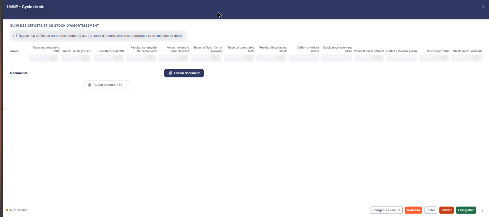
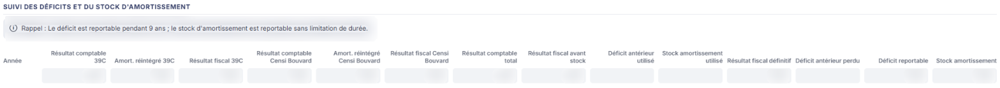
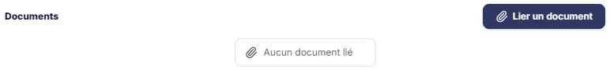

# LMNP - Cycle de vie


**En bref** — Cette feuille suit, année après année, le déficit reportable et le stock d'amortissement des biens en location meublée non professionnelle ; elle reprend la feuille « LMNP - Résultat ».

* Pour alimenter la feuille : bouton \[Charger les valeurs], arbitrez l'imputation de l'année, puis bouton \[Enregistrer].
* Pour terminer : bouton \[Valider].


Cette feuille de travail permet de suivre, année après année, le **déficit reportable** et le **stock d'amortissement** des biens détenus en Location Meublée Non Professionnelle. Elle ne se saisit pratiquement pas : elle reprend la synthèse de la feuille de travail « LMNP - Résultat » et ne vous laisse arbitrer que l'imputation des déficits et du stock d'amortissement de l'année en cours.

<figure><figcaption>
Écran « LMNP - Cycle de vie » de la nouvelle interface
</figcaption></figure>

Comme toutes les feuilles de travail, elle appartient au **dossier de révision** du dossier annuel : sans dossier de révision, le logiciel remplace l'écran par le message « **Veuillez créer un dossier de révision afin de pouvoir utiliser cette fonctionnalité.** ».

Pour l'ouvrir, dans l'écran Révision, cliquez sur la carte « N feuilles de travail » du bandeau : la liste des feuilles s'ouvre dans un tiroir à droite. Repérez la ligne « LMNP - Cycle de vie » (le champ « Rechercher une feuille… » la retrouve) et cliquez sur le crayon de la ligne : la feuille s'ouvre dans un panneau, dont l'en-tête indique « LMNP - Cycle de vie », puis la société et l'exercice, avec une croix de fermeture. Il n'y a pas de création préalable : la feuille est créée dans le dossier de révision dès sa première ouverture, sans que vous ayez à l'enregistrer, et l'écran est immédiatement en saisie.

## Comment lire la feuille

La couleur des zones vous indique ce que vous devez renseigner :

* une zone **blanche** est une zone que vous saisissez ;
* une zone **grisée** est une zone calculée par le logiciel, ou reprise d'ailleurs : elle n'est pas modifiable.

La feuille comporte deux rubriques, « Suivi des déficits et du stock d'amortissement » et « Documents », et aucun onglet.

Sur une feuille qui vient d'être ouverte et qui n'a pas encore été alimentée, **aucune cellule du tableau n'est saisissable** : la feuille est entièrement à zéro et attend son chargement. C'est le comportement normal, et non un défaut de droits.

Les commandes sont dans le pied du panneau. À gauche, la pastille « Non validée » ; à droite, dans l'ordre : le Bouton \[Charger les valeurs], le Bouton \[Nouveau], le Bouton \[Éditer], le Bouton \[Valider], le Bouton \[Enregistrer] et le menu ⋮ « Autres actions » (entrées « Charger les valeurs n -1 » et « Purger la feuille »). Il n'y a pas de bouton \[Fermer] : la croix de l'en-tête referme le panneau.

## Rubrique « Suivi des déficits et du stock d'amortissement »

<figure><figcaption>
Rubrique « Rubrique « Suivi des déficits et du stock d'amortissement » »
</figcaption></figure>

La rubrique s'ouvre sur une phrase de rappel de la règle fiscale de report :

« **Rappel : Le déficit est reportable pendant 9 ans ; le stock d'amortissement est reportable sans limitation de durée.** »

Puis vient un tableau d'une ligne par année. Ses colonnes, dans l'ordre d'affichage :

* **Année** : l'année à laquelle la ligne se rapporte. Ce n'est pas une zone de saisie : cette colonne est renseignée par le logiciel au moment du chargement des valeurs. Sur une feuille non encore chargée, elle est vide.
* **Résultat comptable 39C**, **Amort. réintégré 39C** et **Résultat fiscal 39C** : le résultat des biens relevant du régime des amortissements, avant et après réintégration.
* **Résultat comptable Censi Bouvard**, **Amort. réintégré Censi Bouvard** et **Résultat fiscal Censi Bouvard** : les mêmes valeurs pour les biens relevant du régime Censi - Bouvard.
* **Résultat comptable total** : le cumul des deux régimes.
* **Résultat fiscal avant stock** : le résultat fiscal avant imputation du déficit antérieur et du stock d'amortissement.
* **Déficit antérieur utilisé** : la part du déficit des années précédentes que vous décidez d'imputer sur l'année.
* **Stock amortissement utilisé** : la part du stock d'amortissement que vous décidez d'imputer sur l'année.
* **Résultat fiscal définitif** : le résultat obtenu après ces deux imputations.
* **Déficit antérieur perdu** : la part du déficit antérieur que vous déclarez perdue, la durée de report de 9 ans étant écoulée.
* **Déficit reportable** et **Stock amortissement** : ce qui reste reportable sur les années suivantes.

Le tableau ne porte aucun total en pied, et aucune infobulle.

**Ce que vous saisissez, et ce que le logiciel calcule**

Une fois la ligne de l'année chargée, **trois colonnes seulement deviennent saisissables** : **Déficit antérieur utilisé**, **Stock amortissement utilisé** et **Déficit antérieur perdu**. Ce sont exactement les trois arbitrages que la règle de report vous laisse.

Toutes les autres colonnes restent en lecture seule : les résultats comptables et les amortissements réintégrés sont **repris de la feuille de travail « LMNP - Résultat »**, et les résultats fiscaux, le déficit reportable et le stock d'amortissement sont **calculés** par la feuille.

## Rubrique « Documents »

<figure><figcaption>
Rubrique « Rubrique « Documents » »
</figcaption></figure>

Vous pouvez rattacher ici les pièces justificatives liées au suivi du cycle de vie des biens. Tant qu'aucune pièce n'est rattachée, la rubrique affiche la seule mention « **Aucun document lié** ». Le bouton **\[Lier un document]**, à droite du titre de la rubrique, rattache une pièce à la feuille.

## Bouton \[Charger les valeurs]

<figure><figcaption>
Bouton [Charger les valeurs]
</figcaption></figure>

C'est ce bouton qui alimente la ligne de **l'année en cours**.

Le logiciel demande d'abord confirmation : « **Cette opération va importer la synthèse des données présentes dans la feuille de travail « LMNP – Résultat » ; elle annulera et remplacera donc la ligne éventuellement déjà chargée de l'année en cours. Veuillez confirmer.** » Après confirmation, il indique « **Les données ont été importées avec succès.** ».

**L'alimentation vient de la feuille de travail « LMNP - Résultat », et non directement de la comptabilité.** C'est le point à retenir : si vous n'avez pas renseigné la feuille « LMNP - Résultat » de l'exercice, cette feuille-ci reste à zéro. Renseignez donc « LMNP - Résultat » en premier.

Le chargement fait deux choses : il renseigne la colonne **Année** avec l'exercice en cours, et il ouvre à la saisie les trois colonnes d'arbitrage décrites plus haut.

**Attention** : ce chargement est **immédiat et enregistré**. Les valeurs importées subsistent même si vous quittez l'écran sans utiliser le bouton \[Enregistrer]. Pour revenir en arrière, utilisez l'entrée « Purger la feuille » du menu ⋮ « Autres actions ».

## Entrée « Charger les valeurs n -1 » du menu ⋮ « Autres actions »

Ce bouton reprend la feuille de travail « LMNP - Cycle de vie » de **l'exercice précédent**, afin de reconstituer les lignes des **années antérieures** à l'année en cours. Il n'alimente donc pas la ligne de l'année en cours : c'est le rôle du bouton \[Charger les valeurs].

Le logiciel demande confirmation : « **Cette opération va importer les données présentes dans la feuille de travail « LMNP – Cycle de vie » de l'exercice précédent et va effectuer un recalcul ; elle annulera et remplacera donc les lignes éventuellement déjà importées ou créées et relatives à toutes les années précédentes à l'année en cours. Veuillez confirmer.** »

Si l'exercice précédent ne comporte pas cette feuille de travail, rien n'est chargé et le logiciel vous l'indique : « **Aucune valeur chargée. Vous n'avez pas de feuille de travail LMNP - Cycle de vie dans l'exercice précédent.** ».

## Bouton \[Éditer]

<figure><figcaption>
Bouton [Éditer]
</figcaption></figure>

Il déclenche l'édition de la feuille de travail. Il ouvre une fenêtre « Edition », qui indique le nom de la feuille et son état, puis propose le **Format :** — Html (retenu par défaut), Pdf ou Excel — et un interrupteur **Tronquer les libellés trop longs :**, activé à l'ouverture. Le bouton **\[Annuler]** ferme la fenêtre, le bouton **\[Edition]** lance le document.
