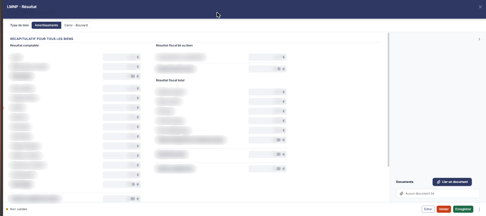
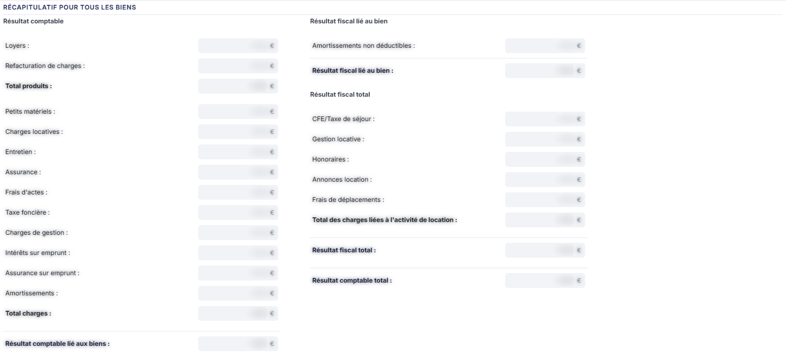
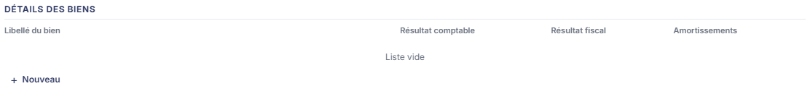
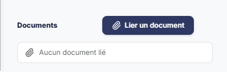

# LMNP - Résultat


**En bref** — Cette feuille saisit les informations des biens immobiliers en location meublée non professionnelle pour déterminer le résultat comptable et le résultat fiscal, en régime « Amortissements » ou « Censi - Bouvard ».

* Pour ajouter un bien : bouton \[Nouveau], renseignez sa fiche, puis bouton \[Enregistrer].
* Pour terminer : bouton \[Valider].
* Pour imprimer la feuille : bouton \[Éditer].


Cette feuille de travail permet, pour les Locations Meublées Non Professionnelles, de saisir toutes les informations relatives aux biens immobiliers afin de déterminer le **résultat comptable** et le **résultat fiscal** de l'activité. Elle gère les deux régimes « Amortissements » et « Censi - Bouvard », sachant qu'un même dossier peut détenir des biens dans les deux régimes.

<figure><figcaption>
Écran « LMNP - Résultat » de la nouvelle interface
</figcaption></figure>

Comme toutes les feuilles de travail, elle appartient au **dossier de révision** du dossier annuel : sans dossier de révision, le logiciel remplace l'écran par le message « **Veuillez créer un dossier de révision afin de pouvoir utiliser cette fonctionnalité.** ».

Pour l'ouvrir, dans l'écran Révision, cliquez sur la carte « N feuilles de travail » du bandeau : la liste des feuilles s'ouvre dans un tiroir à droite. Repérez la ligne « LMNP - Résultat » (le champ « Rechercher une feuille… » la retrouve) et cliquez sur le crayon de la ligne : la feuille s'ouvre dans un panneau, dont l'en-tête indique « LMNP - Résultat », puis la société et l'exercice, avec une croix de fermeture. Il n'y a pas de création préalable : la feuille est créée dans le dossier de révision dès sa première ouverture, sans que vous ayez à l'enregistrer, et l'écran est immédiatement en saisie.

La synthèse de cette feuille alimente la feuille de travail « **LMNP - Cycle de vie** », qui suit d'une année sur l'autre le déficit reportable et le stock d'amortissement. Renseignez donc celle-ci en premier.

## Comment lire la feuille

La couleur des zones vous indique ce que vous devez renseigner :

* une zone **blanche** est une zone que vous saisissez ;
* une zone **grisée** est une zone calculée par le logiciel : elle n'est pas modifiable.

La feuille ne comporte aucun onglet. Le corps du panneau présente, dans cet ordre : le sélecteur **Type de bien**, la rubrique « Récapitulatif pour tous les biens » et la rubrique « Détails des biens ». La rubrique « Documents » est dans une colonne à droite, en bas du panneau.

**La saisie ne se fait pas dans le récapitulatif** : celui-ci est entièrement calculé. Vous saisissez dans la fiche d'un bien, ouverte depuis la grille « Détails des biens ».

Les commandes sont dans le pied du panneau. À gauche, la pastille « Non validée » ; à droite, dans l'ordre : le Bouton \[Éditer], le Bouton \[Valider], le Bouton \[Enregistrer] et le menu ⋮ « Autres actions » (entrées « Charger les valeurs n - 1 » et « Purger la feuille »). Il n'y a pas de bouton \[Fermer] : la croix de l'en-tête referme le panneau.

## Type de bien

Deux boutons exclusifs vous font choisir le régime sur lequel vous travaillez : **Amortissements**, retenu par défaut, ou **Censi - Bouvard**.

Un bien ne peut relever que d'un seul régime, mais un dossier peut en détenir dans les deux. Vous devez donc systématiquement préciser sur quel régime vous travaillez avant toute modification.

**Ce choix change la liste des champs affichés**, aussi bien dans le récapitulatif que dans la fiche d'un bien : le logiciel recharge l'écran pour présenter les rubriques du régime retenu.

## Rubrique « Récapitulatif pour tous les biens »

<figure><figcaption>
Rubrique « Rubrique « Récapitulatif pour tous les biens » »
</figcaption></figure>

**Aucune donnée n'y est modifiable** : c'est le cumul de toutes les valeurs saisies dans les fiches des biens. La rubrique présente trois tableaux.

**Tableau « Résultat comptable »** — **Loyers :**, **Refacturation de charges :**, **Total produits :**, puis les charges : **Petits matériels :**, **Charges locatives :**, **Entretien :**, **Assurance :**, **Frais d'actes :**, **Taxe foncière :**, **Charges de gestion :**, **Intérêts sur emprunt :**, **Assurance sur emprunt :**, et l'amortissement — **Amortissements :** en régime Amortissements, **Amortissements immobiliers :** en régime Censi - Bouvard. Le tableau se termine par **Total charges :** et **Résultat comptable lié aux biens :**.

**Tableau « Résultat fiscal lié au bien »** — en régime Amortissements, il porte **Amortissements non déductibles :** puis **Résultat fiscal lié au bien :**. En régime Censi - Bouvard, il porte **Amortissements immobilier non déductibles :**, **Amortissements mobiliers :** et **Réintégration 39C :**, puis **Résultat fiscal lié au bien :**.

**Tableau « Résultat fiscal total »**, identique dans les deux régimes — **CFE/Taxe de séjour :**, **Gestion locative :**, **Honoraires :**, **Annonces location :**, **Frais de déplacements :**, puis **Total des charges liées à l'activité de location :**, **Résultat fiscal total :** et **Résultat comptable total :**.

## Grille « Détails des biens »

<figure><figcaption>
Rubrique « Grille « Détails des biens » »
</figcaption></figure>

Elle liste les biens du régime retenu. Ses colonnes : une colonne de commandes, puis **Libellé du bien**, **Résultat comptable**, **Résultat fiscal** et **Amortissements**. Tant qu'aucun bien n'a été créé, la grille affiche « Liste vide ».

Vous devez créer une ligne par bien à l'aide du bouton **\[Nouveau]**, précédé d'un « + », situé sous la grille. Le logiciel ouvre alors la fiche « Détail d'un bien ».

## Rubrique « Documents » (colonne de droite)

<figure><figcaption>
Rubrique « Rubrique « Documents » »
</figcaption></figure>

Vous pouvez rattacher ici toutes les pièces justificatives liées aux locations meublées. Tant qu'aucune pièce n'est rattachée, la rubrique affiche la seule mention « **Aucun document lié** ». Le bouton **\[Lier un document]**, à droite du titre de la rubrique, rattache une pièce à la feuille.

## Bouton \[Éditer]

<figure><figcaption>
Bouton [Éditer]
</figcaption></figure>

Il déclenche l'édition du récapitulatif pour tous les biens et du détail des biens. Il ouvre une fenêtre « Edition », qui indique le nom de la feuille et son état, puis propose le **Format :** — Html (retenu par défaut), Pdf ou Excel — et un interrupteur **Tronquer les libellés trop longs :**, activé à l'ouverture. Le bouton **\[Annuler]** ferme la fenêtre, le bouton **\[Edition]** lance le document.
