# Lutte anti-blanchiment


**En bref** — Cette feuille consigne, sous forme de questionnaire commenté, la vigilance exercée par le cabinet à l'égard du client au titre de la lutte contre le blanchiment des capitaux.

* Pour reprendre l'exercice précédent : bouton \[Charger les valeurs n - 1].
* Pour conserver votre travail : bouton \[Enregistrer] ; pour terminer, bouton \[Valider].


Cette page décrit la feuille de travail **Lutte anti-blanchiment**, qui s'ouvre depuis l'écran Révision (voir « Avant d'ouvrir la feuille »). Vous y consignez, sous forme de questionnaire commenté, la vigilance que le cabinet exerce à l'égard du client au titre de ses obligations de lutte contre le blanchiment des capitaux : vigilance sur l'entité, sur le bénéficiaire, sur l'actionnariat, sur les dirigeants, sur la structure et sur les opérations, puis votre conclusion — l'appréciation globale du risque et le niveau de vigilance retenu.

<figure>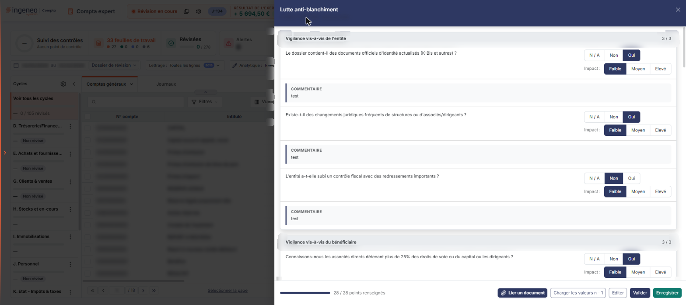<figcaption>
Écran « Lutte anti-blanchiment » de la nouvelle interface
</figcaption></figure>

C'est une **feuille rédactionnelle**. Une feuille rédactionnelle recueille votre **jugement** — des questions à réponse fermée et des zones de commentaire — alors qu'une feuille de calcul recompose des **chiffres** repris de la comptabilité par des formules et peut aboutir à une écriture. Celle-ci est la plus purement rédactionnelle des trois : hormis le tableau des travaux spécifiques décrit plus bas, dont toutes les cellules se saisissent à la main, elle ne comporte aucun montant, ne calcule rien, ne reprend rien de la comptabilité et ne génère aucune écriture.

Cette analyse a une portée qui dépasse la feuille : le logiciel l'annonce lui-même en conclusion, et la feuille « Acceptation et maintien de la mission » vous demande d'ailleurs si ce questionnaire a été complété. Répondez-y donc avant de renseigner l'autre feuille — le logiciel ne fait pas le lien tout seul.

## Avant d'ouvrir la feuille

Une feuille de travail appartient à un **dossier de révision**, et non au dossier annuel. Tant qu'aucun dossier de révision n'a été créé sur le dossier annuel en cours, l'écran ne s'affiche pas : le logiciel le remplace par le message **Veuillez créer un dossier de révision afin de pouvoir utiliser cette fonctionnalité.** Il faut donc avoir créé ce dossier avant d'ouvrir la feuille.

Le panneau de la feuille ne rappelle nulle part à quel dossier de révision il travaille (son en-tête ne porte que la société et l'exercice) : si votre dossier annuel en comporte plusieurs, rien dans le panneau ne vous dit lequel est servi.

La feuille n'a plus d'entrée de menu. Dans l'écran Révision, cliquez sur la carte **« 33 feuilles de travail »** du bandeau du haut (le nombre peut varier) : la **liste** des feuilles s'ouvre en tiroir, avec une zone « Rechercher une feuille… » et les colonnes **Intitulé**, **Descriptif** et **Statut**. Cliquez sur le **crayon** de la ligne « Lutte anti-blanchiment » : la feuille s'ouvre dans un **panneau** à droite, dont l'en-tête porte « Lutte anti-blanchiment », puis « FLORE ET SENS SAS · Exercice 2026 » (votre société et votre exercice), avec une croix de fermeture.

Il n'y a pas de liste d'accueil propre à la feuille ni de bouton **\[Nouveau]** : la feuille arrive **immédiatement en saisie**, sans bouton **\[Modifier]** ni mode consultation. Le logiciel crée la feuille en base dès votre première ouverture, sans que vous ayez à l'enregistrer.

## Une précaution propre à cette feuille

Cet écran est le seul du module à cumuler deux caractéristiques qui, ensemble, demandent de la prudence :

* son bouton **\[Charger les valeurs n - 1]** écrit **immédiatement en base, sans vous demander confirmation** : ses valeurs survivent au rechargement de la page, alors même que vous n'avez pas cliqué sur \[Enregistrer] ;
* l'écran **n'offre aucun Bouton \[Purger la feuille]**, contrairement au bordereau juridique annuel et aux feuilles de calcul : il n'existe donc **aucun moyen, depuis l'écran, de revenir à une feuille vierge**.

Autrement dit, une reprise de l'exercice précédent est une opération immédiate et non annulable : vous n'aurez plus qu'à corriger les réponses une à une. N'actionnez ce bouton qu'en début de saisie, sur une feuille dont le contenu ne vous importe pas.

## Comment se lit une question

Les vingt et une questions de la feuille sont bâties à l'identique :

* l'**intitulé** de la question ;
* à sa droite, la **réponse** : des boutons-bascule à trois choix, **N / A**, **Non** ou **Oui**. Le logiciel propose **N / A**, c'est-à-dire « sans objet » ;
* un groupe **Impact :** à trois choix, **Faible**, **Moyen** ou **Elevé**, réglé sur **Faible** ;
* un lien **+ Ajouter un commentaire**, qui déplie une zone **Commentaires :** libre, sur plusieurs lignes ; le texte « Cliquez en dehors pour replier. », sous la zone, indique comment la refermer. Lorsqu'un commentaire existe déjà, il s'affiche sous la question dans un bloc **COMMENTAIRE**, à la place du lien.

Le groupe **Impact :ne s'affiche pas tant que la réponse vaut N / A** : le logiciel ne vous demande d'apprécier l'impact que si la question a effectivement un sens pour ce client. Il apparaît dès que vous répondez **Non** ou **Oui**, et disparaît de nouveau si vous ramenez la réponse sur **N / A**. Sur une feuille vierge, les vingt et un groupes sont donc tous masqués.

Aucune question n'est signalée comme obligatoire : la feuille ne porte ni astérisque, ni encadré rouge.

Les rubriques s'affichent les unes sous les autres, dans l'ordre ci-dessous. Le panneau n'a aucun onglet. Chacune des six rubriques de questions porte, à droite de son titre, un compteur (« 3 / 3 », « 2 / 2 » ou « 7 / 7 » sur la feuille consultée), et le pied du panneau affiche une jauge « 28 / 28 points renseignés » ; le sens exact d'un « point renseigné » n'est pas établi.

## Rubrique « Vigilance vis-à-vis de l'entité »

<figure>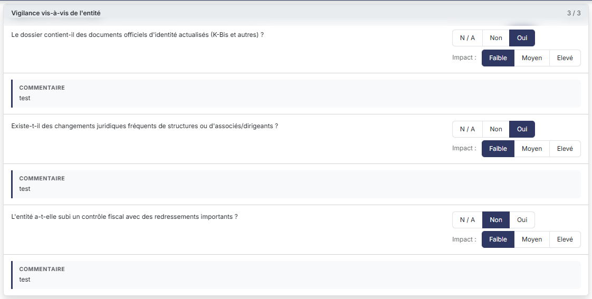<figcaption>
Rubrique « Rubrique « Vigilance vis-à-vis de l'entité » »
</figcaption></figure>

* **Le dossier contient-il des documents officiels d'identité actualisés (K-Bis et autres) ?**
* **Existe-t-il des changements juridiques fréquents de structures ou d'associés/dirigeants ?**
* **L'entité a-t-elle subi un contrôle fiscal avec des redressements importants ?**

## Rubrique « Vigilance vis-à-vis du bénéficiaire »

<figure>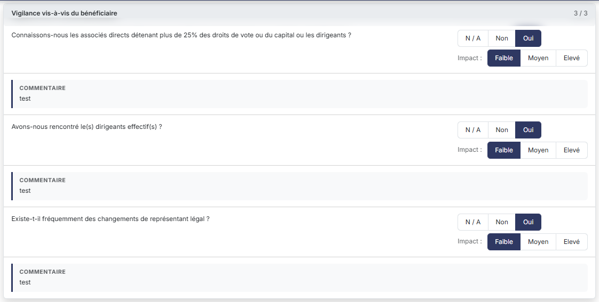<figcaption>
Rubrique « Rubrique « Vigilance vis-à-vis du bénéficiaire » »
</figcaption></figure>

* **Connaissons-nous les associés directs détenant plus de 25% des droits de vote ou du capital ou les dirigeants ?**
* **Avons-nous rencontré le(s) dirigeants effectif(s) ?**
* **Existe-t-il fréquemment des changements de représentant légal ?**

## Rubrique « Informations sur l'actionnariat »

<figure>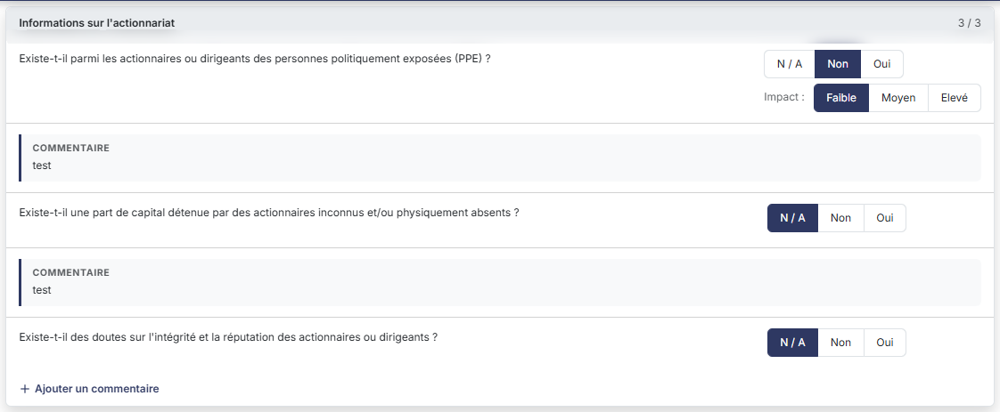<figcaption>
Rubrique « Rubrique « Informations sur l'actionnariat » »
</figcaption></figure>

* **Existe-t-il parmi les actionnaires ou dirigeants des personnes politiquement exposées (PPE) ?**
* **Existe-t-il une part de capital détenue par des actionnaires inconnus et/ou physiquement absents ?**
* **Existe-t-il des doutes sur l'intégrité et la réputation des actionnaires ou dirigeants ?**

## Rubrique « Informations sur les dirigeants »

<figure>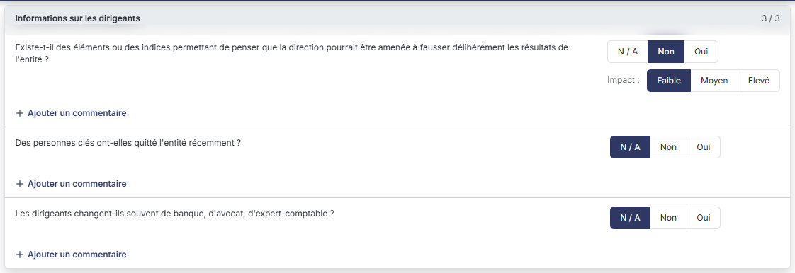<figcaption>
Rubrique « Rubrique « Informations sur les dirigeants » »
</figcaption></figure>

* **Existe-t-il des éléments ou des indices permettant de penser que la direction pourrait être amenée à fausser délibérément les résultats de l'entité ?**
* **Des personnes clés ont-elles quitté l'entité récemment ?**
* **Les dirigeants changent-ils souvent de banque, d'avocat, d'expert-comptable ?**

## Rubrique « Structure de l'entité »

<figure>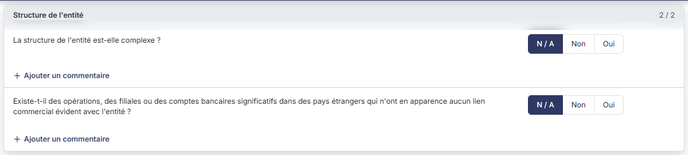<figcaption>
Rubrique « Rubrique « Structure de l'entité » »
</figcaption></figure>

* **La structure de l'entité est-elle complexe ?**
* **Existe-t-il des opérations, des filiales ou des comptes bancaires significatifs dans des pays étrangers qui n'ont en apparence aucun lien commercial évident avec l'entité ?**

## Rubrique « Vigilance liée aux opérations »

<figure>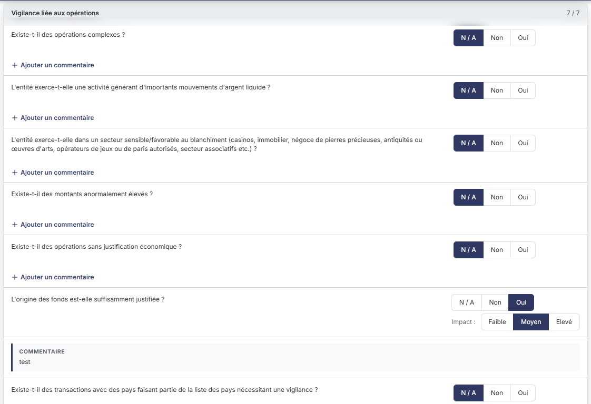<figcaption>
Rubrique « Rubrique « Vigilance liée aux opérations » »
</figcaption></figure>

<figure>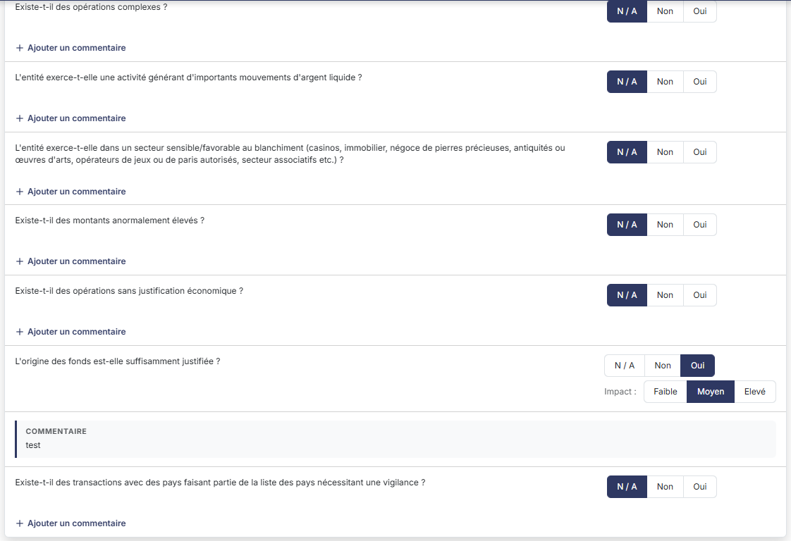<figcaption>
Rubrique « Rubrique « Vigilance liée aux opérations » »
</figcaption></figure>

* **Existe-t-il des opérations complexes ?**
* **L'entité exerce-t-elle une activité générant d'importants mouvements d'argent liquide ?**
* **L'entité exerce-t-elle dans un secteur sensible/favorable au blanchiment (casinos, immobilier, négoce de pierres précieuses, antiquités ou œuvres d'arts, opérateurs de jeux ou de paris autorisés, secteur associatifs etc.) ?**
* **Existe-t-il des montants anormalement élevés ?**
* **Existe-t-il des opérations sans justification économique ?**
* **L'origine des fonds est-elle suffisamment justifiée ?**
* **Existe-t-il des transactions avec des pays faisant partie de la liste des pays nécessitant une vigilance ?**

## Rubrique « Conclusion »

<figure>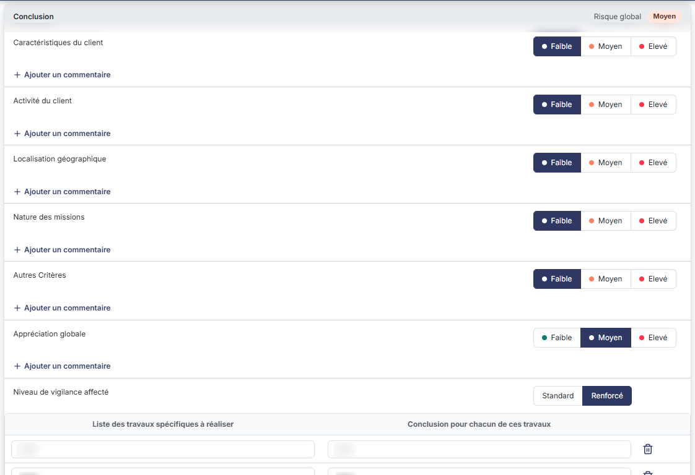<figcaption>
Rubrique « Rubrique « Conclusion » »
</figcaption></figure>

<figure>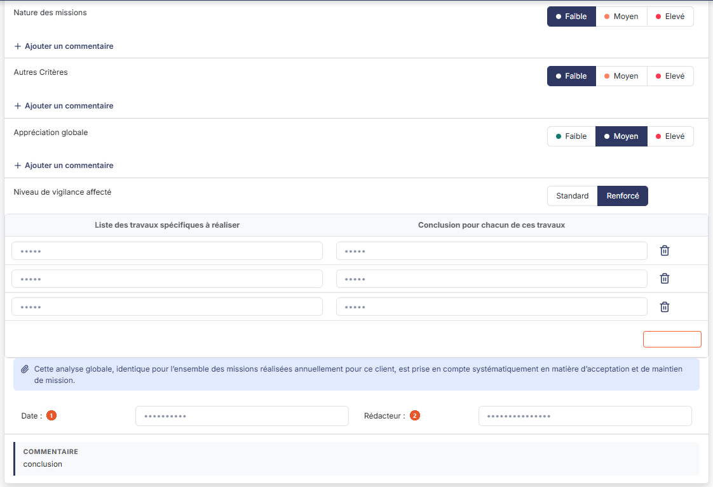<figcaption>
Rubrique « Rubrique « Conclusion » »
</figcaption></figure>

La conclusion se compose de six critères d'appréciation, du niveau de vigilance retenu, puis de la signature. L'en-tête de la rubrique rappelle, à droite, « Risque global » suivi d'un badge (« Moyen » sur la feuille consultée, valeur identique à celle de **Appréciation globale :**).

Chacun des six critères se cote par des boutons-bascule **Faible**, **Moyen** ou **Elevé**, réglés sur **Faible**, dans cet ordre :

* **Caractéristiques du client**
* **Activité du client**
* **Localisation géographique**
* **Nature des missions**
* **Autres Critères**
* **Appréciation globale**

Chacun des six est suivi de son propre lien **+ Ajouter un commentaire**, qui déplie une zone **Commentaires :** libre, sur plusieurs lignes.

Ces six groupes sont visibles d'emblée — ils ne se masquent pas, contrairement aux groupes **Impact :** des questions. Et les six sont à votre main, **Appréciation globale :** comprise : le logiciel ne la déduit pas des cinq critères qui la précèdent et ne la recalcule pas quand vous les modifiez. C'est donc bien vous qui portez la synthèse.


Attention : aucun de ces six critères, ni aucune des vingt et une réponses, ne dispose d'une valeur « non renseigné ». Sur une feuille jamais complétée, le logiciel affiche déjà des réponses **N / A** et des cotations **Faible** : une feuille vierge se lit donc comme une feuille dont tous les risques auraient été jugés faibles. Ne concluez pas de ce qui s'affiche qu'un examen a eu lieu.


Puis :

**Niveau de vigilance affecté** — boutons-bascule **Standard** ou **Renforcé**, réglés sur **Standard**. C'est le résultat opérationnel de la feuille : le régime de vigilance que le cabinet appliquera à ce client.

Ce niveau n'est pas indépendant de l'appréciation globale : dès que vous portez **Appréciation globale :** à **Elevé**, le logiciel bascule seul le niveau sur **Renforcé** ; dès que vous la ramenez à **Faible** ou **Moyen**, il le ramène sur **Standard**. Vous pouvez ensuite le corriger à la main, mais toute nouvelle modification de l'appréciation globale l'écrasera de nouveau.

Lorsque le niveau vaut **Renforcé**, et seulement alors, le logiciel affiche sous ces boutons un tableau à deux colonnes, **Liste des travaux spécifiques à réaliser** et **Conclusion pour chacun de ces travaux**, suivies, à droite, d'une corbeille par ligne. Vous y décrivez, ligne par ligne, les diligences supplémentaires que la vigilance renforcée impose et la conclusion de chacune. Le bouton **\[Nouvelle ligne]**, placé sous le tableau, à droite, ajoute une ligne ; la **corbeille** (infobulle « Effacer ») placée à l'extrémité droite d'une ligne la retire. Repasser le niveau sur **Standard** masque ce tableau sans effacer ce que vous y avez saisi : il réapparaît tel quel si vous revenez à **Renforcé**.

Le logiciel affiche ensuite une phrase que vous ne pouvez pas modifier : **Cette analyse globale, identique pour l'ensemble des missions réalisées annuellement pour ce client, est prise en compte systématiquement en matière d'acceptation et de maintien de mission.**

| Champ            | Ce qu'il faut savoir                                                                                                                           |
| ---------------- | ---------------------------------------------------------------------------------------------------------------------------------------------- |
| 1. **Date**      | Le logiciel propose la date du jour ; vous pouvez la corriger, à la main ou au moyen du calendrier.                                            |
| 2. **Rédacteur** | Le logiciel propose le nom de l'utilisateur connecté ; la zone reste modifiable, ce qui vous permet de signer au nom d'un autre collaborateur. |

Sous ces deux zones, un commentaire de conclusion, sans libellé propre : le lien **+ Ajouter un commentaire** déplie la zone dans laquelle vous rédigez votre conclusion (sur la feuille consultée, le texte déjà saisi s'affiche dans un bloc COMMENTAIRE).

## Rubrique « Documents »

<figure>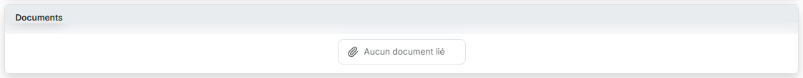<figcaption>
Rubrique « Rubrique « Documents » »
</figcaption></figure>

Cette rubrique, en fin de feuille, reçoit les pièces que vous voulez joindre à votre analyse — pièces d'identité, extrait K-Bis, notes d'entretien.

Tant qu'aucune pièce n'est jointe, le logiciel affiche **Aucun document lié**.

Pour joindre une pièce, cliquez sur bouton **\[Lier un document]**, dans le pied du panneau (bouton bleu foncé orné d'un trombone) : un volet « Lier un document » s'ouvre à droite. Il propose, sous « Source du document », deux choix : **Depuis mon poste**, retenu à l'ouverture, et **Depuis la GED**. Pour « Depuis mon poste », une zone de dépôt (« Déposez vos documents ici ou parcourez vos fichiers ») rappelle les formats acceptés (.doc, .docx, .xls, .xlsx, .pdf, .txt, .csv, .bmp, .gif, .jpg, .jpeg, .png) et la longueur maximale du nom du fichier (100 caractères). Le pied du volet porte bouton **\[Annuler]** et bouton **\[Lier le document]**, ce dernier grisé à l'ouverture. Le choix d'une pièce issue de l'OCR ne figure plus dans ce volet.

## Les boutons du pied du panneau

Le pied du panneau affiche, à gauche, la jauge « 28 / 28 points renseignés », puis, à droite et dans cet ordre : bouton **\[Lier un document]** (décrit plus haut), \[Charger les valeurs n - 1], \[Editer], \[Valider] et \[Enregistrer]. Le pied n'a pas de bouton \[Fermer] : la croix de l'en-tête referme le panneau. Le pied n'a ni menu ⋮ « Autres actions » ni \[Purger la feuille].

bouton **\[Charger les valeurs n - 1]**

Reprend dans la feuille les réponses, les impacts, les cotations et les commentaires saisis sur l'exercice précédent, ce qui évite de tout ressaisir d'une année sur l'autre lorsque la situation du client n'a pas changé.

Le logiciel ne vous demande **aucune confirmation** : le traitement part au clic, écrit aussitôt, et vous rend une fenêtre titrée **Lutte anti-blanchiment - Charger les valeurs n - 1** portant le message **Les valeurs de l'exercice précédent ont été importées avec succès.** et un bouton **\[OK]**. Les valeurs reprises sont alors enregistrées, même si vous n'avez pas cliqué sur \[Enregistrer] et même si vous quittez l'écran aussitôt. Cet écran n'offrant pas de bouton **\[Purger la feuille]**, vous ne pourrez revenir en arrière qu'en corrigeant les réponses une à une.

bouton **\[Enregistrer]**

Enregistre l'ensemble de la feuille. Il n'y a pas d'enregistrement rubrique par rubrique, et le pied ne propose pas de bouton **\[Annuler]** : refermez le panneau par la croix de l'en-tête, sans enregistrer, si vous voulez abandonner vos saisies.

bouton **\[Valider]**

Valide la feuille de travail.

bouton **\[Editer]**

Ouvre la fenêtre **Lutte anti-blanchiment - Editer**, qui recouvre le panneau et rappelle l'intitulé de la feuille et son statut (« En cours » sur le dossier consulté). Vous y choisissez le **Format :** — **Html**, **Pdf** ou **Excel**, le logiciel proposant **Html** — et vous réglez l'interrupteur **Tronquer les libellés trop longs :**, activé par défaut. Le bouton **\[Edition]** lance le document, le bouton **\[Annuler]** ferme la fenêtre sans rien produire.
