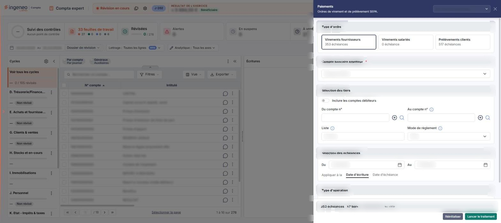
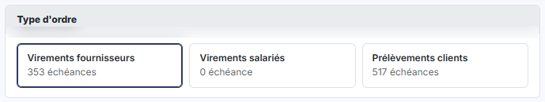
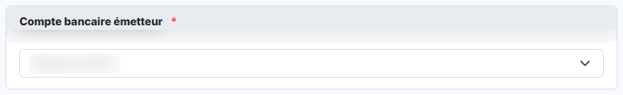
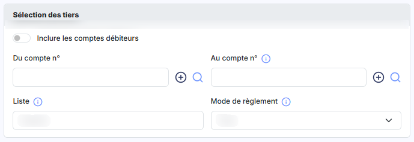
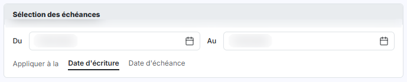
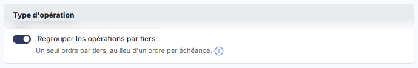

# Paiements


**En bref** — Cette option est la première étape du règlement de vos tiers par virement ou prélèvement : vous délimitez les échéances à régler, puis validez les ordres dans le module « Banque ».

* Pour préparer les ordres : choisissez le type d'ordre et le compte bancaire émetteur, délimitez les échéances, puis bouton \[Lancer le traitement].
* Pour repartir des valeurs proposées à l'ouverture : bouton \[Réinitialiser].


Cette option constitue la première étape du règlement de vos tiers par virement ou par prélèvement. Vous y délimitez les échéances à régler.

<figure><figcaption>
Écran « Paiements » de la nouvelle interface
</figcaption></figure>

Pour l'ouvrir, dans l'écran Révision, cliquez sur ⋮ (Plus d'actions), puis sur **Paiements**. L'écran s'ouvre dans un panneau, à droite, intitulé « Paiements », sous le message « Ordres de virement et de prélèvement SEPA. ». La croix « Fermer » du bandeau de titre referme le panneau.

Le panneau présente cinq rubriques, dans lesquelles vous définissez les critères de sélection : « Type d'ordre », « Compte bancaire émetteur », « Sélection des tiers », « Sélection des échéances » et « Type d'opération ». Le pied du panneau résume la sélection en cours (nombre d'échéances, nombre de tiers et montant total, calculés dès l'ouverture à partir des valeurs proposées) et porte les boutons \[Réinitialiser] et \[Lancer le traitement]. En en-tête, la liste « Nouveau paramétrage… » donne accès aux paramétrages enregistrés (voir plus bas).

## Rubriques « Type d'ordre » et « Compte bancaire émetteur »

<figure><figcaption>
Rubrique « a) Rubriques « Type d'ordre » et « Compte bancaire émetteur » »
</figcaption></figure>

<figure><figcaption>
Rubrique « a) Rubriques « Type d'ordre » et « Compte bancaire émetteur » »
</figcaption></figure>

| Champ                                                                    | Ce qu'il faut savoir                                                                                                                                                                                                                                                                                                                                                                                                                                                                                                                                                                                                                                                                                   |
| ------------------------------------------------------------------------ | ------------------------------------------------------------------------------------------------------------------------------------------------------------------------------------------------------------------------------------------------------------------------------------------------------------------------------------------------------------------------------------------------------------------------------------------------------------------------------------------------------------------------------------------------------------------------------------------------------------------------------------------------------------------------------------------------------ |
| **Type d'ordre**                                                         | 
Trois cartes à choix unique, dans cet ordre : <strong>Virements fournisseurs</strong>, <strong>Virements salariés</strong> et <strong>Prélèvements clients</strong>. Chaque carte indique le nombre d'échéances concernées. Le logiciel retient <strong>Virements fournisseurs</strong> à l'ouverture de l'écran. Si vous retenez <strong>Prélèvements clients</strong>, le logiciel adapte deux libellés de l'écran, puisque le sens de l'opération est inversé : **Compte bancaire émetteur *** devient **Compte bancaire bénéficiaire ***, et <strong>Inclure les comptes débiteurs</strong> devient <strong>Inclure les comptes créditeurs</strong>. Aucun champ n'est ajouté ni retiré.
 |
| 
<strong>Compte bancaire émetteur</strong> <em>Obligatoire</em>
 | La liste déroulante propose les comptes bancaires de la société, et le premier de la liste est retenu à l'ouverture ; retenez celui qui sera émetteur des virements — ou bénéficiaire des prélèvements, le libellé devenant alors **Compte bancaire bénéficiaire \* :**.                                                                                                                                                                                                                                                                                                                                                                                                                               |

## Rubrique « Sélection des tiers »

<figure><figcaption>
Rubrique « b) Rubrique « Sélection des tiers » »
</figcaption></figure>

Tous les champs de cette rubrique sont facultatifs : laissés en l'état, ils ne restreignent pas la recherche.

| Champ                             | Ce qu'il faut savoir                                                                                                                                                                                                                                                                                                                                                                                                                                                                                                                                                                                                        |
| --------------------------------- | --------------------------------------------------------------------------------------------------------------------------------------------------------------------------------------------------------------------------------------------------------------------------------------------------------------------------------------------------------------------------------------------------------------------------------------------------------------------------------------------------------------------------------------------------------------------------------------------------------------------------- |
| **Inclure les comptes débiteurs** | Interrupteur, **désactivé** à l'ouverture. Ce libellé devient **Inclure les comptes créditeurs :** si vous avez retenu **Prélèvements clients**.                                                                                                                                                                                                                                                                                                                                                                                                                                                                            |
| **Du compte n°**                  | Première borne de la fourchette de comptes de tiers. Saisissez le numéro de compte, ou recherchez-le à l'aide du pictogramme « Loupe » placé à droite du champ, après le « + » (« Créer »).                                                                                                                                                                                                                                                                                                                                                                                                                                 |
| **Au compte n°**                  | Seconde borne, même fonctionnement. Une infobulle, sur l'icône d'information placée à côté du champ, rappelle que ces bornes sont facultatives : « Laissez vides ces champs si vous souhaitez lancer le traitement pour l'intégralité des comptes. »                                                                                                                                                                                                                                                                                                                                                                        |
| **Liste**                         | Il s'agit d'une autre façon de désigner les comptes à retenir, par racines de compte plutôt que par fourchette. L'infobulle de l'icône d'information en donne la forme attendue : « Saisissez les racines des comptes à rechercher, séparés par des ";". »                                                                                                                                                                                                                                                                                                                                                                  |
| **Mode de règlement**             | Le sélecteur s'ouvre sur « Tous ». Il permet de ne retenir que les tiers pour lesquels un mode de règlement précis a été paramétré. L'infobulle de l'icône d'information le précise : « Si vous choisissez un mode de règlement en particulier, l'application effectuera la recherche parmi les tiers pour lesquels ce seul mode de règlement a été défini. » Les choix proposés sont, dans l'ordre : « Tous », « Carte bancaire », « Chèques », « Ecart de règlement - », « Ecart de règlement + », « Espèces », « Import règl. compta », « Import remb. compta », « Prélèvement », « Ticket Restaurant » et « Virement ». |

## Rubrique « Sélection des échéances »

<figure><figcaption>
Rubrique « c) Rubrique « Sélection des échéances » »
</figcaption></figure>

| Champ              | Ce qu'il faut savoir                                                                                                                                                                   |
| ------------------ | -------------------------------------------------------------------------------------------------------------------------------------------------------------------------------------- |
| **Du**             | Le logiciel propose le premier jour du dossier annuel.                                                                                                                                 |
| **Au**             | Le logiciel propose le dernier jour du mois en cours. Vous pouvez saisir ces deux dates ou les choisir dans le calendrier.                                                             |
| **Appliquer à la** | Choix entre deux onglets, **Date d'écriture**, retenu à l'ouverture, et **Date d'échéance**. Il indique au logiciel sur laquelle des deux dates la période ci-dessus doit s'appliquer. |

## Rubrique « Type d'opération »

<figure><figcaption>
Rubrique « d) Rubrique « Type d'opération » »
</figcaption></figure>

**Regrouper les opérations par tiers** : interrupteur, **activé** à l'ouverture — c'est celui des deux interrupteurs de l'écran qui est activé. Une ligne sous l'interrupteur résume son effet : « Un seul ordre par tiers, au lieu d'un ordre par échéance. » Une infobulle, sur l'icône d'information placée à la fin de cette ligne, le détaille : « Si vous répondez "Oui" et s'il existe plusieurs opérations à réaliser pour un même tiers, elles seront centralisées sur un seul montant. Si vous répondez "Non", une opération sera réalisée pour chaque pièce à régler. S'il existe un avoir, la centralisation sera opérée automatiquement pour le compte de tiers concerné même si vous avez répondu "Non". »

bouton **\[Lancer le traitement]**

Placé dans le pied du panneau.

**Paramétrages enregistrés**

Les boutons \[Mémoriser les paramètres] et \[Charger des paramètres] ont disparu : en en-tête du panneau, à côté de la croix, une liste déroulante intitulée « Nouveau paramétrage… » donne accès aux critères enregistrés (infobulle « Afficher les paramètres enregistrés »). Elle sert à conserver un jeu de critères et à le retrouver sans le ressaisir. Son fonctionnement n'a pas été observé : la page ne le détaille pas.
