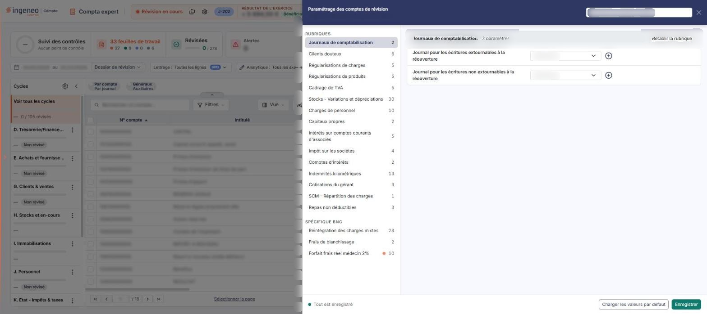
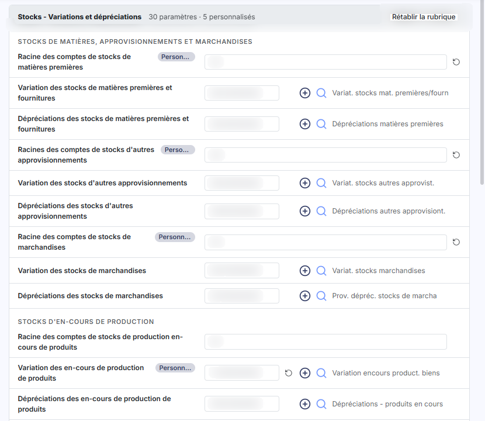
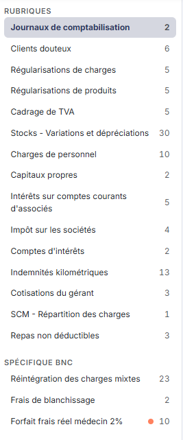
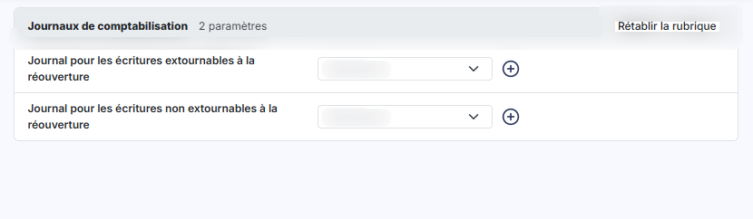
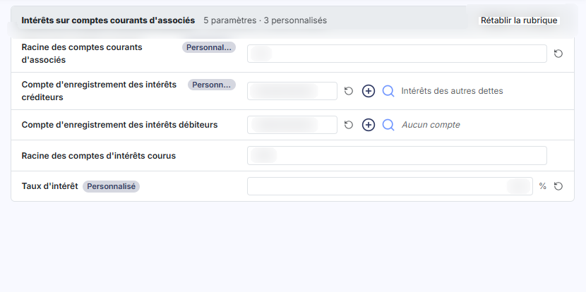
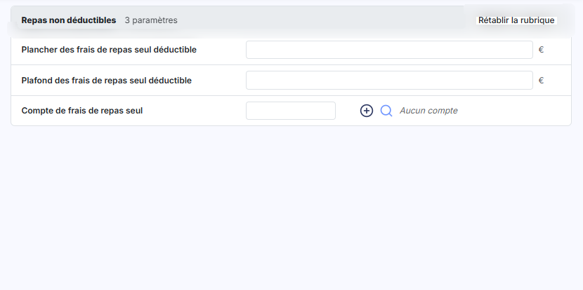
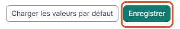
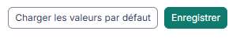

# Paramétrage des comptes de révision


**En bref** — Ce formulaire unique désigne une fois pour toutes les comptes et journaux utilisés pour générer les écritures des feuilles de travail standards de la révision.

* Pour partir des comptes préparamétrés : bouton \[Charger les valeurs par défaut], contrôlez-les, puis bouton \[Enregistrer].
* Pour valider votre paramétrage de toutes les rubriques : bouton \[Enregistrer].


Les comptes de révision sont utilisés pour la génération des écritures lorsque vous employez les feuilles de travail standards, soit depuis la liste des feuilles de travail de l'écran Révision (carte « N feuilles de travail » du bandeau). Cet écran est le formulaire unique où vous désignez, une fois pour toutes, le compte que le logiciel doit utiliser dans chacune de ces situations.

<figure><figcaption>
Écran « Paramétrage des comptes de révision » de la nouvelle interface
</figcaption></figure>

Pour l'ouvrir, cliquez dans l'écran Révision sur l'icône « Paramétrage des comptes de révision » de l'en-tête : il s'affiche dans un panneau (tiroir) dont le sous-titre rappelle la société, l'exercice et un repère du dossier (« BIC-IS » sur le dossier relevé). La croix du panneau le ferme.

Le panneau se compose de trois parties. Un champ « Rechercher un compte, un libellé… » figure en tête. Le rail de gauche, intitulé « RUBRIQUES », liste les rubriques avec, à côté de chacune, son nombre de paramètres : quinze rubriques, puis trois autres sous le titre « SPÉCIFIQUE BNC ». Une pastille rouge ou orange sur une rubrique signale qu'un compte paramétré n'existe pas dans le plan comptable du dossier. Le volet de droite n'affiche qu'une rubrique à la fois — « Journaux de comptabilisation » à l'ouverture — avec son nom, son nombre de paramètres (« N paramètres ») et le bouton **\[Rétablir la rubrique]**. Le pied du panneau est décrit aux paragraphes g) et h). Aucun champ ne porte d'astérisque : aucun champ n'est signalé comme obligatoire, et vous pouvez ne renseigner que les rubriques qui concernent le dossier.

## Comment se renseigne une ligne

<figure><figcaption>
Rubrique « a) Comment se renseigne une ligne »
</figcaption></figure>

Toutes les rubriques sont bâties sur le même modèle : inutile de les apprendre une par une, il suffit de connaître les deux formes de ligne que vous rencontrerez.

**La ligne « compte »** se compose, de gauche à droite, du libellé du paramètre, d'une zone de saisie du numéro de compte, d'une icône « Rétablir la valeur par défaut » (flèche circulaire, absente quand le paramètre n'a pas de valeur par défaut), d'un bouton **\[+]** (« Créer »), d'un pictogramme « Loupe », puis, à droite, de l'intitulé du compte (« Aucun compte » tant que la zone est vide).

* Saisissez directement le numéro de compte si vous le connaissez.
* Cliquez sur le pictogramme « Loupe » pour rechercher un compte dans le plan comptable.
* Cliquez sur le bouton **\[+]** pour créer le compte s'il n'existe pas encore.
* Cliquez sur l'icône « Rétablir la valeur par défaut » pour remettre la valeur prévue : son infobulle la rappelle entre parenthèses.

**La ligne « racine de comptes »** ne comporte que le libellé, une zone de saisie et, quand une valeur par défaut existe, l'icône « Rétablir la valeur par défaut » : ni bouton **\[+]**, ni pictogramme « Loupe ». La valeur attendue n'y est pas un compte mais une racine, c'est-à-dire les premiers chiffres communs à une famille de comptes. Vous pouvez en indiquer plusieurs, séparées par des « ; » ou par des « - ».

Lorsque le compte saisi n'existe pas dans le plan comptable du dossier, un encart orange apparaît sous la ligne : « Le compte … n'existe pas dans le plan comptable du dossier : l'écriture de révision ne pourra pas être générée. », avec le lien « Créer le compte ». Certains libellés portent un sous-texte « Même compte que la rubrique « … » » : le même compte sert alors à deux rubriques.

## Les rubriques

<figure><figcaption>
Rubrique « b) Les rubriques »
</figcaption></figure>

Les rubriques sont regroupées par nature de travail de révision, et se présentent dans le rail dans cet ordre :

* **Journaux de comptabilisation**
* **Clients douteux**
* **Régularisations de charges**
* **Régularisations de produits**
* **Cadrage de TVA**
* **Stocks - Variations et dépréciations**
* **Charges de personnel**
* **Capitaux propres**
* **Intérêts sur comptes courants d'associés**
* **Impôt sur les sociétés**
* **Comptes d'intérêts**
* **Indemnités kilométriques**
* **Cotisations du gérant**
* **SCM – Répartition des charges**
* **Repas non déductibles**

Puis, sous le titre « SPÉCIFIQUE BNC » :

* **Réintégration des charges mixtes**
* **Frais de blanchissage**
* **Forfait frais réel médecin 2%**

Le libellé de chaque ligne dit à lui seul le compte attendu : « Clients douteux », « Factures non parvenues », « Charges constatées d'avance », « Variation des stocks de marchandises », « Congés payés », etc. Le nombre de lignes est important, mais chacune se renseigne exactement comme les autres.

Quatre rubriques appellent toutefois une explication particulière. La rubrique « Compte de l'exploitant », qui existait à part, n'est plus proposée : le compte de l'exploitant se renseigne dans « Indemnités kilométriques » et se retrouve, avec la mention « Même compte que la rubrique « Indemnités kilométriques » », dans « Frais de blanchissage ».

## Rubrique « Journaux de comptabilisation »

<figure><figcaption>
Rubrique « c) Rubrique « Journaux de comptabilisation » »
</figcaption></figure>

Elle ne contient pas des comptes mais deux journaux, désignés chacun par une liste déroulante suivie d'un bouton **\[+]** qui vous conduit à la création d'un journal :

* **Journal pour les écritures extournables à la réouverture** : le journal dans lequel le logiciel comptabilisera les écritures destinées à être extournées à la réouverture de l'exercice suivant.
* **Journal pour les écritures non extournables à la réouverture** : le journal des écritures qui, elles, ne seront pas extournées.

Les deux listes proposent les mêmes journaux : ceux du dossier annuel en cours dont le type est « Opérations diverses ». Les journaux d'un autre type — achats, ventes, banque, à-nouveaux — n'y figurent pas, même s'ils existent dans le dossier. Elles s'ouvrent sur l'entrée **Sélectionnez**, qui correspond à l'absence de choix.

## Rubrique « Intérêts sur comptes courants d'associés »

<figure><figcaption>
Rubrique « e) Rubrique « Intérêts sur comptes courants d'associés » »
</figcaption></figure>

Outre la racine des comptes courants d'associés, les deux comptes d'enregistrement des intérêts créditeurs et débiteurs et la racine des comptes d'intérêts courus, cette rubrique porte un champ qui n'est pas un compte : **Taux d'intérêt**, une zone numérique suivie du signe « % ». Renseignez-y le taux à appliquer au calcul des intérêts.

## Rubrique « Repas non déductibles »

<figure><figcaption>
Rubrique « f) Rubrique « Repas non déductibles » »
</figcaption></figure>

Elle porte, outre le compte de frais de repas seul, deux montants : **Plancher des frais de repas seul déductible** et **Plafond des frais de repas seul déductible**, qui encadrent la part déductible.

## Bouton \[Enregistrer]

<figure><figcaption>
Bouton [Enregistrer]
</figcaption></figure>

<figure><figcaption>
Rubrique « g) Bouton [Enregistrer] »
</figcaption></figure>

Il enregistre le paramétrage saisi dans l'ensemble des rubriques. Il se trouve dans le pied du panneau, à droite ; à gauche, un voyant vert et la mention « Tout est enregistré » indiquent qu'aucune modification n'est en attente.

## Autres vues de l'écran

<figure><figcaption>
d) Rubrique « Stocks - Variations et dépréciations »
</figcaption></figure>
