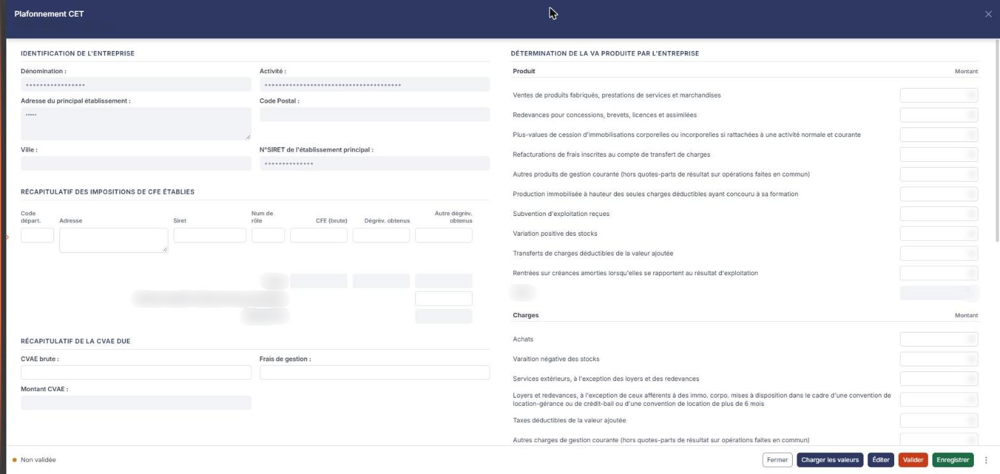
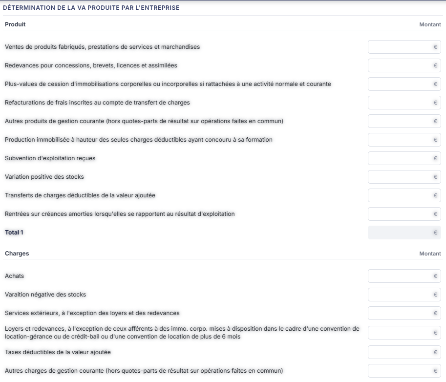

# Plafonnement CET


**En bref** — Cette feuille calcule le plafonnement de la contribution économique territoriale en fonction de la valeur ajoutée, et en déduit le dégrèvement que l'entreprise peut demander.

* Pour alimenter la feuille : bouton \[Charger les valeurs], ajoutez des lignes si besoin avec le bouton \[Nouvelle ligne], puis bouton \[Enregistrer].
* Pour terminer : bouton \[Valider].


Cette feuille de travail permet de calculer le **plafonnement de la Contribution Économique Territoriale** en fonction de la valeur ajoutée, et d'en déduire le dégrèvement que l'entreprise peut demander. Vous y récapitulez les impositions de CFE établies et la CVAE due, vous y déterminez la valeur ajoutée produite, et le logiciel en tire le plafonnement puis le dégrèvement.

<figure><figcaption>
Écran « Plafonnement CET » de la nouvelle interface
</figcaption></figure>

Comme toutes les feuilles de travail, elle appartient au **dossier de révision** du dossier annuel : sans dossier de révision, le logiciel remplace l'écran par le message « **Veuillez créer un dossier de révision afin de pouvoir utiliser cette fonctionnalité.** ».

Pour l'ouvrir, dans l'écran Révision, cliquez sur la carte « N feuilles de travail » du bandeau : la liste des feuilles s'ouvre dans un tiroir à droite. Repérez la ligne « Plafonnement CET » (le champ « Rechercher une feuille… » la retrouve) et cliquez sur le crayon de la ligne : la feuille s'ouvre dans un panneau, dont l'en-tête indique « Plafonnement CET », puis la société et l'exercice, avec une croix de fermeture. Il n'y a pas de bouton de création pour cette feuille, et elle est créée dans le dossier de révision dès sa première ouverture, sans que vous ayez à l'enregistrer.

## Comment lire la feuille

La couleur des zones vous indique ce que vous devez renseigner :

* une zone **blanche** est une zone que vous saisissez ;
* une zone **grisée** est une zone calculée par le logiciel, ou reprise d'ailleurs : elle n'est pas modifiable.

La feuille tient sur une seule page, sans onglet, et se découpe en six rubriques qui suivent l'ordre du calcul : « Identification de l'entreprise », « Récapitulatif des impositions de CFE établies », « Récapitulatif de la CVAE due », « Détermination de la VA produite par l'entreprise », « Calcul du plafonnement » et « Dégrèvement au titre du plafonnement demandé ».

Contrairement à d'autres feuilles de calcul, celle-ci ne comporte **ni cellule à formule** — aucune zone ne porte de pictogramme de modification de formule — **ni rubrique « Documents »** : vous ne pouvez donc pas y rattacher de pièce justificative. Chaque montant y est soit saisi par vous, soit calculé par le logiciel.

## Rubrique « Identification de l'entreprise »

<figure><figcaption>
Rubrique « Rubrique « Identification de l'entreprise » »
</figcaption></figure>

Cette rubrique est **entièrement en lecture seule** : elle reprend l'identité de la société telle qu'elle est renseignée dans sa fiche. Vous ne la corrigez donc pas ici, mais dans la fiche de la société.

Elle présente **Dénomination :**, **Activité :**, **Adresse du principal établissement :**, **Code Postal :**, **Ville :** et **N°SIRET de l'établissement principal :**.

## Rubrique « Récapitulatif des impositions de CFE établies »

<figure><figcaption>
Rubrique « Rubrique « Récapitulatif des impositions de CFE établies » »
</figcaption></figure>

Vous saisissez ici, **ligne par ligne, chacun des avis de CFE** reçus par l'entreprise. Une ligne vierge vous est proposée dès l'ouverture, et le bouton **\[Nouvelle ligne]** situé sous le tableau en ajoute autant que nécessaire. Au survol de la ligne vierge proposée à l'ouverture, une icône « Effacer » (c'est son infobulle) apparaît à l'extrémité droite de la ligne ; elle supprime la ligne.

Toutes les cellules d'une ligne se saisissent : **Code départ.**, **Adresse**, **Siret**, **Num de rôle**, **CFE (brute)**, **Dégrèv. obtenus** et **Autre dégrèv. obtenus**.

Sous le tableau, trois lignes de synthèse :

* **Totaux** : le logiciel additionne les trois colonnes de montants. Non modifiable.
* **Montant cotisation minimum due par l'entreprise** : **à saisir**. C'est la seule zone saisissable de cette synthèse.
* **Montant CFE** : calculé. C'est le montant de CFE retenu pour la suite du calcul.

## Rubrique « Récapitulatif de la CVAE due »

<figure><figcaption>
Rubrique « Rubrique « Récapitulatif de la CVAE due » »
</figcaption></figure>

Trois lignes seulement :

* **CVAE brute** : à saisir.
* **Frais de gestion** : à saisir.
* **Montant CVAE** : calculé par le logiciel à partir des deux précédentes.

## Rubrique « Détermination de la VA produite par l'entreprise »

<figure><figcaption>
Rubrique « Rubrique « Détermination de la VA produite par l'entreprise » »
</figcaption></figure>

<figure><figcaption>
Rubrique « Rubrique « Détermination de la VA produite par l'entreprise » »
</figcaption></figure>

La rubrique enchaîne trois tableaux à deux colonnes, le libellé à gauche et le montant à droite.

**Tableau « Produit »** — toutes les lignes se saisissent, sauf le total :

* **Ventes de produits fabriqués, prestations de services et marchandises**
* **Redevances pour concessions, brevets, licences et assimilées**
* **Plus-values de cession d'immobilisations corporelles ou incorporelles si rattachées à une activité normale et courante**
* **Refacturations de frais inscrites au compte de transfert de charges**
* **Autres produits de gestion courante (hors quotes-parts de résultat sur opérations faites en commun)**
* **Production immobilisée à hauteur des seules charges déductibles ayant concouru à sa formation**
* **Subvention d'exploitation reçues**
* **Variation positive des stocks**
* **Transferts de charges déductibles de la valeur ajoutée**
* **Rentrées sur créances amorties lorsqu'elles se rapportent au résultat d'exploitation**
* **Total 1** : calculé par le logiciel.

**Tableau « Charges »** — toutes les lignes se saisissent, sauf le total :

* **Achats**
* **Varaition négative des stocks**
* **Services extérieurs, à l'exception des loyers et des redevances**
* **Loyers et redevances, à l'exception de ceux afférents à des immo. corpo. mises à disposition dans le cadre d'une convention de location-gérance ou de crédit-bail ou d'une convention de location de plus de 6 mois**
* **Taxes déductibles de la valeur ajoutée**
* **Autres charges de gestion courante (hors quotes-parts de résultat sur opérations faites en commun)**
* **Charges déductibles de la valeur ajoutée afférente à la production immobilisée déclarée**
* **Fraction déd. de la VA des dot. aux amort. afférentes à des immo. corpo. mises à dispo. dans le cadre d'une convention de location-gérance ou de crédit-bail ou d'une convention de location de plus de 6 mois**
* **Moins-values de cession d'immobilisations corporelles et incorporelles, si rattachées à une activité normale et courante**
* **Total 2** : calculé par le logiciel.

**Tableau « Calcul de la VA pour le calcul du plafonnement »** — **entièrement calculé**, aucune zone ne s'y saisit :

* **Valeur ajoutée produite** : la différence entre les deux totaux précédents.
* **Chiffre d'affaires réalisé au cours de la période de référence**
* **Montant corrigé en fonction du CA réel**
* **Montant de la VA corrigé pour correspondre à une année pleine**
* **Valeur ajoutée retenue pour le calcul du plafonnement** : c'est la valeur qui sera reprise par la rubrique suivante.

## Rubrique « Calcul du plafonnement »

<figure><figcaption>
Rubrique « Rubrique « Calcul du plafonnement » »
</figcaption></figure>

Deux lignes :

* **Taux de plafonnement** : , exprimé en pourcentage. **Ce taux est imposé par le logiciel et ne se saisit pas** : vous ne pouvez ni le corriger, ni le remplacer par un taux propre au dossier.
* **Plafonnement** : le montant obtenu en appliquant ce taux à la valeur ajoutée retenue. Calculé.

## Rubrique « Dégrèvement au titre du plafonnement demandé »

<figure><figcaption>
Rubrique « Rubrique « Dégrèvement au titre du plafonnement demandé » »
</figcaption></figure>

C'est la conclusion de la feuille. Une seule zone s'y renseigne, toutes les autres sont calculées :

* **L'entreprise est-elle assujettie à la cotisation minimum ?** : interrupteur Oui / Non, positionné sur **Non** par défaut. Le basculer **ne change pas la liste des champs affichés** : le logiciel se contente de recalculer les montants de la rubrique.
* **Montant CET (CFE + CVAE)** : le cumul des deux impositions récapitulées plus haut.
* **Plafonnement** : rappel du montant calculé par la rubrique précédente.
* **Dégrèvement au titre du plafonnement demandé** : l'écart entre les deux.
* **Limitation de dégrèvement** : le plafond applicable à ce dégrèvement.
* **Dégrèvement demandé après limitation** : le montant finalement demandé.

## Bouton \[Éditer]

<figure><figcaption>
Bouton [Éditer]
</figcaption></figure>

Il déclenche l'édition de la feuille de travail.
