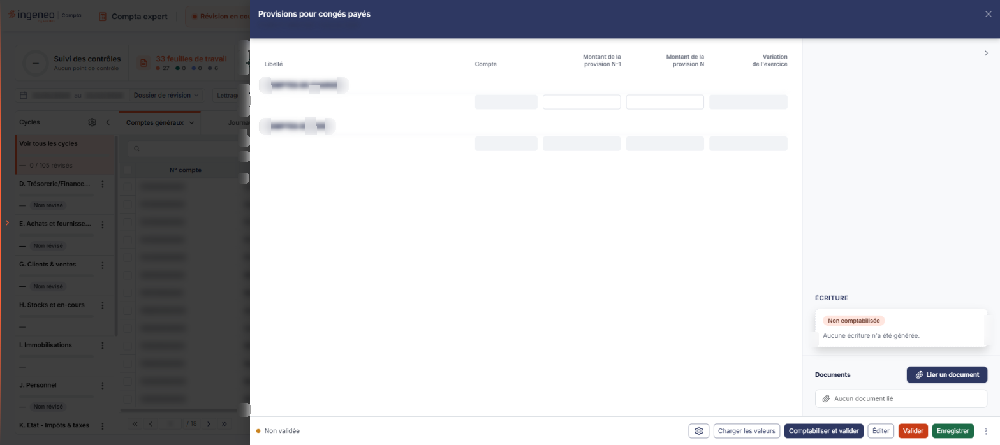
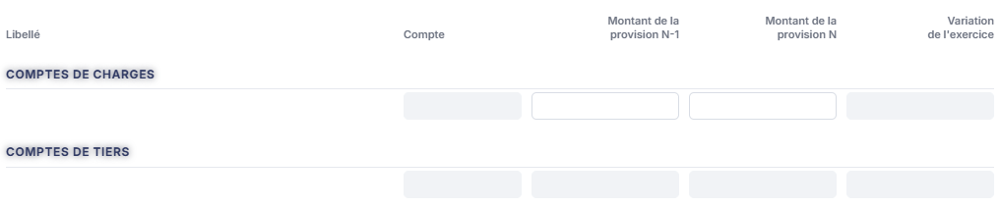
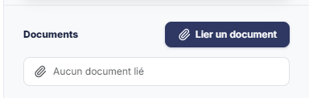

# Provisions pour congés payés


**En bref** — Cette feuille détermine la provision pour congés payés à partir des montants de l'exercice précédent et de l'exercice en cours, puis la comptabilise.

* Pour alimenter le tableau : bouton \[Charger les valeurs], ou entrée « Charger les valeurs n-1 » du menu ⋮ pour reprendre l'exercice précédent.
* Pour sauvegarder votre avancement : bouton \[Enregistrer].
* Pour comptabiliser : bouton \[Comptabiliser et valider].


Cette feuille de travail permet de déterminer la **provision pour congés payés** et de la comptabiliser. Vous y indiquez le montant de la provision de l'exercice précédent et celui de l'exercice en cours ; le logiciel en déduit la variation, les dettes de charges sociales et fiscales correspondantes, et peut générer l'écriture.

<figure><figcaption>
Écran « Provisions pour congés payés » de la nouvelle interface
</figcaption></figure>

Comme toutes les feuilles de travail, elle appartient au **dossier de révision** du dossier annuel : sans dossier de révision, le logiciel remplace l'écran par le message « **Veuillez créer un dossier de révision afin de pouvoir utiliser cette fonctionnalité.** ».

Pour l'ouvrir, dans l'écran Révision, cliquez sur la carte « N feuilles de travail » du bandeau : la liste des feuilles s'ouvre dans un tiroir à droite. Repérez la ligne « Provisions pour congés payés » (le champ « Rechercher une feuille… » la retrouve) et cliquez sur le crayon de la ligne : la feuille s'ouvre dans un panneau, dont l'en-tête indique « Provisions pour congés payés », puis la société et l'exercice, avec une croix de fermeture. Il n'y a pas de bouton de création pour cette feuille, et elle est créée dans le dossier de révision dès sa première ouverture, sans que vous ayez à l'enregistrer.

## Comment lire la feuille

La couleur des zones vous indique ce que vous devez renseigner :

* une zone **blanche** est une zone que vous saisissez ;
* une zone **grisée** est une zone calculée par le logiciel, ou reprise d'ailleurs : elle n'est pas modifiable.

C'est une feuille courte, sans onglet, à trois rubriques : « Provisions pour congés payés », puis, dans la colonne de droite, « Écriture » et « Documents ».

**La saisie y est très réduite** : deux montants, et rien d'autre. Tout le reste de la feuille est calculé par le logiciel ou repris du paramétrage des comptes.

Le pied du panneau est permanent. Il indique à gauche l'état de la feuille (pastille « Non validée ») et présente à droite, de gauche à droite : la roue « Paramétrage des comptes de révision », \[Charger les valeurs], \[Comptabiliser et valider], \[Éditer], \[Valider], \[Enregistrer] et ⋮ « Autres actions » (qui porte « Charger les valeurs n-1 » et « Purger la feuille »). Il n'y a pas de bouton \[Fermer] : la croix de l'en-tête referme le panneau.

## Rubrique « Provisions pour congés payés »

<figure><figcaption>
Rubrique « Rubrique « Provisions pour congés payés » »
</figcaption></figure>

Un seul tableau, à cinq colonnes : **Libellé**, **Compte**, **Montant de la provision N-1**, **Montant de la provision N** et **Variation de l'exercice**.

Il se lit en deux sections, signalées chacune par une ligne de titre grisée :

* **Comptes de charges** : c'est là, et là seulement, que vous saisissez. Les deux montants — celui de la provision de l'exercice précédent et celui de l'exercice en cours — sont à votre main.
* **Comptes de tiers** : intégralement déduite par le logiciel. Aucune de ses zones ne se saisit.

## Rubrique « Écriture »

<figure><figcaption>
Rubrique « Rubrique « Écriture » »
</figcaption></figure>

Cette rubrique reçoit l'écriture que le logiciel génère et comptabilise depuis la feuille.

Tant que vous n'avez rien comptabilisé, elle ne contient que la pastille « Non comptabilisée » et une phrase, sans grille ni bouton : « **Aucune écriture n'a été générée.** ». C'est le comportement normal d'une feuille en cours de travail.

## Rubrique « Documents »

<figure><figcaption>
Rubrique « Rubrique « Documents » »
</figcaption></figure>

Vous pouvez rattacher ici les pièces justificatives liées à la provision pour congés payés — l'état des congés acquis, par exemple. Tant qu'aucune pièce n'est jointe, la rubrique affiche « **Aucun document lié** » et présente un seul bouton, bouton **\[Lier un document]**, par lequel passe tout rattachement. Le panneau qu'il ouvre vous laisse choisir l'origine de la pièce : un fichier de votre poste, un document de la GED — si vous avez accès à ce module — ou une pièce reçue dans l'OCR.

La rubrique reste disponible même si la feuille n'est ni validée ni comptabilisée.

## Roue « Paramétrage des comptes de révision »

Elle ouvre, à droite, le tiroir « Paramétrage des comptes de révision », commun à toutes les feuilles, qui remplace la fenêtre « Comptes des Provisions pour congés payés » : à gauche la liste des rubriques, à droite la rubrique sélectionnée. Il désigne les comptes que la feuille utilisera — pour alimenter son tableau comme pour générer son écriture — et s'ouvre positionné sur la rubrique **Charges de personnel** (10 paramètres ; infobulle de la roue : « Paramétrage des comptes de révision : Charges de personnel »). La croix de l'en-tête le referme.

Vous y renseignez alternativement des **racines** de comptes et des **numéros de compte** :

* **Racine des comptes de rémunération du personnel**
* **Congés payés**
* **Racine des comptes de charges sociales salariales**
* **Charges sociales sur congés payés**
* **Charges fiscales sur congés payés**
* **Racine des comptes de dettes auprès du personnel**
* **Dettes sur provisions congés payés**
* **Racine des comptes de dettes sur charges sociales**
* **Dettes sur charges sociales sur provisions congés payés**
* **Etat - Charges fiscales sur congés à payer**

Chaque ligne de numéro de compte est suivie d'un bouton « + » (infobulle « Créer »), d'un pictogramme « Loupe » qui ouvre la recherche dans le plan comptable, et du **libellé du compte**, repris du plan comptable et non modifiable. Un badge « Personnalisé » marque certains paramètres, et le bouton \[Rétablir la rubrique], en haut de la rubrique, la remet à son état d'origine.

Le pied du tiroir indique à gauche « Tout est enregistré » et porte deux boutons — bouton **\[Charger les valeurs par défaut]** et bouton **\[Enregistrer]** ; il n'y a plus de bouton \[Annuler] : le tiroir s'enregistre séparément de la feuille.

Le bouton **\[Charger les valeurs par défaut]** a une infobulle qui en précise la règle : « **Charge les valeurs prévues et vérifie que les comptes existent dans le plan comptable du dossier. Un compte absent est signalé sur sa ligne. Rien n'est enregistré avant de cliquer sur Enregistrer.** »

**À savoir** : ce paramétrage n'est pas propre à cette feuille. **C'est le même paramétrage, avec les mêmes comptes, que celui de la feuille de travail « Rappro Compta/Déclarations sociales »** : les deux feuilles partagent le paramétrage des comptes de charges de personnel, et le modifier depuis l'une le modifie pour l'autre. Vous ne paramétrez donc pas deux choses distinctes.

## Entrée « Charger les valeurs n-1 » du menu ⋮ (Autres actions)

Il reprend les montants de l'exercice précédent pour les comptes liés à la provision pour congés payés.

Son infobulle indique d'où vient l'information, et c'est un point important : « **Les informations de l'exercice n-1 sont lues dans la feuille de travail et non dans les écritures.** » Si la feuille de travail « Provisions pour congés payés » n'a pas été renseignée sur l'exercice précédent, il n'y a donc rien à reprendre, quel que soit le contenu de la comptabilité.

## Bouton \[Éditer]

<figure><figcaption>
Bouton [Éditer]
</figcaption></figure>

Il déclenche l'édition de la feuille de travail.
