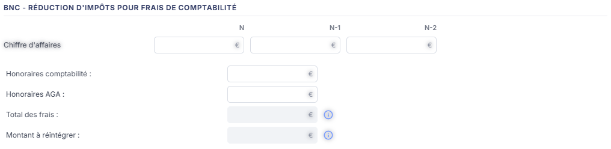
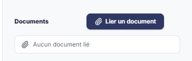

# Réduction d'impôts frais de compta


**En bref** — Cette feuille détermine le montant à réintégrer au titre de la réduction d'impôt pour frais de comptabilité, à partir du chiffre d'affaires et des honoraires payés.

* Pour alimenter la feuille : bouton \[Charger les valeurs], saisissez le chiffre d'affaires et les honoraires, puis bouton \[Enregistrer].
* Pour terminer : bouton \[Valider] (pas d'écriture).


Cette feuille de travail détermine le montant à réintégrer au titre de la réduction d'impôt pour frais de comptabilité, à partir du chiffre d'affaires des trois derniers exercices et des honoraires payés.

<figure><figcaption>
Écran « Réduction d'impôts frais de compta » de la nouvelle interface
</figcaption></figure>

Vous y saisissez le chiffre d'affaires et les honoraires ; le logiciel en déduit le total des frais et le montant à réintégrer.

Comme toutes les feuilles de travail, cet écran n'est accessible que si un dossier de révision existe sur le dossier annuel ; sinon le logiciel affiche à la place le message « Veuillez créer un dossier de révision afin de pouvoir utiliser cette fonctionnalité. ».

Pour l'ouvrir, dans l'écran Révision, cliquez sur la carte « N feuilles de travail » du bandeau : la liste des feuilles s'ouvre dans un tiroir à droite. Repérez la ligne « Réduction d'impôts frais de compta » (le champ « Rechercher une feuille… » la retrouve) et cliquez sur le crayon de la ligne : la feuille s'ouvre dans un panneau, dont l'en-tête indique « Réduction d'impôts frais de compta », puis la société et l'exercice, avec une croix de fermeture.

Le panneau comporte trois rubriques : « Informations générales », puis la rubrique de calcul, titrée « BNC - Réduction d'impôts pour frais de comptabilité », et, dans la colonne de droite, « Documents ».

## Rubrique « Informations générales »

<figure><figcaption>
Rubrique « Rubrique « Informations générales » »
</figcaption></figure>

<figure><figcaption>
Rubrique « Rubrique « Informations générales » »
</figcaption></figure>

Cette rubrique ne contient qu'un choix :

**Type de revenus** : boutons-bascule à trois choix, « BNC », « BIC » et « BA ». À l'ouverture d'une feuille neuve, aucun des trois n'est actif : c'est à vous de désigner le type de revenus.

Le titre de la rubrique de calcul annonce « BNC » quel que soit le type retenu : il ne suit pas votre choix.

## Rubrique de calcul

Elle commence par un tableau à trois colonnes — **N**, **N-1** et **N-2** — et une seule ligne, **Chiffre d'affaires**. Les trois cellules sont saisissables : vous y portez le chiffre d'affaires de l'exercice et des deux exercices précédents.

Viennent ensuite quatre champs, dans cet ordre :

* **Honoraires comptabilité** : saisissable. Un pictogramme « Crayon », qui apparaît au survol de la ligne, vous permet d'en régler la formule de reprise comptable.
* **Honoraires AGA** : saisissable, avec le même pictogramme « Crayon » au survol.
* **Total des frais** : calculé par le logiciel, non modifiable. Son icône d'information précise : « Uniquement les honoraires payés. »
* **Montant à réintégrer** : calculé par le logiciel, non modifiable. Son icône d'information précise : « 2/3 des frais dans la limite de 915 €. Case 7FF de la déclaration IR 2042. »

**La fenêtre de détail d'une cellule**

Le pictogramme « Crayon » d'une ligne ouvre une fenêtre titrée du nom de la cellule, par exemple « Cellule 'Honoraires comptabilité' - Détail ». C'est là que vous réglez la façon dont le logiciel reprend le montant de la comptabilité.

La fenêtre présente deux zones :

* **Formule par défaut** : la formule que le logiciel propose d'origine. Elle reste affichée, grisée, et n'est pas modifiable — vous savez donc toujours de quoi vous êtes parti.
* **Formule actuelle** : la formule effectivement appliquée. C'est celle que vous modifiez.

Une palette de boutons vous permet d'insérer les éléments d'une formule sans les saisir : **Défaut**, **Valeur**, **Solde**, **-Solde**, **SoldeC**, **-SoldeC**, **SoldeD**, **-SoldeD**, **MvtC**, **-MvtC**, **MvtD** et **-MvtD**. Une formule s'écrit en associant l'un de ces éléments à un compte ou à une racine de comptes : ainsi, « Honoraires comptabilité » a pour formule par défaut le solde du compte 6226.

La fenêtre porte ses propres commandes et s'enregistre séparément de la feuille : le Bouton \[Enregistrer] et le Bouton \[Annuler]. Vous pouvez également la refermer par la croix de son bandeau de titre.

## Rubrique « Documents »

<figure><figcaption>
Rubrique « Rubrique « Documents » »
</figcaption></figure>

Ce volet vous permet de joindre à la feuille les pièces qui justifient votre calcul — vos notes d'honoraires, par exemple. Il est disponible dès l'ouverture de la feuille, sans attendre sa validation.

Tant qu'aucune pièce n'est jointe, la rubrique affiche « Aucun document lié ». Un bouton unique, le bouton **\[Lier un document]**, permet d'ajouter une pièce.

**Le pied du panneau**

Les boutons décrits ci-dessous se trouvent dans le pied du panneau, permanent. Il indique à gauche l'état de la feuille (pastille « Non validée ») et présente à droite, de gauche à droite : le Bouton \[Charger les valeurs], \[Éditer], \[Valider], \[Enregistrer] et ⋮ « Autres actions » (qui ne porte que « Purger la feuille »). Le pied n'a pas de bouton \[Fermer] : la croix de l'en-tête referme le panneau.

bouton **\[Éditer]**

Il ouvre la fenêtre « Edition BNC - Réduction d'impôts pour frais de compta », qui rappelle l'intitulé de la feuille avec une pastille de statut (« En cours » à la lecture) et propose le **Format :** — boutons-bascule « Html », « Pdf » et « Excel », « Html » étant le choix proposé par défaut — puis **Tronquer les libellés trop longs :**, interrupteur activé par défaut. Sur cette feuille, la fenêtre n'affiche ni Bouton \[Edition] ni Bouton \[Annuler] (relevé du 26/10/2026) : seule la croix de son en-tête la referme.


Notez que le pied de cet écran présente ses boutons dans cet ordre : \[Charger les valeurs], \[Éditer], \[Valider], \[Enregistrer], puis ⋮ (Purger la feuille). Cet ordre et la liste des boutons ne sont pas les mêmes sur toutes les feuilles de travail : fiez-vous au libellé du bouton, pas à sa position.

