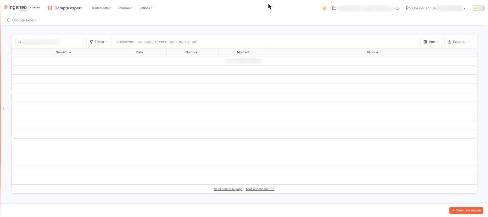
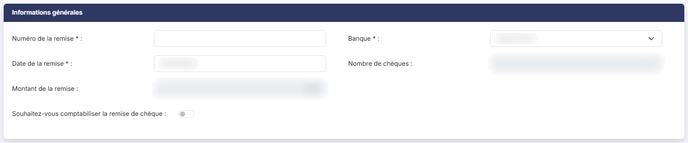
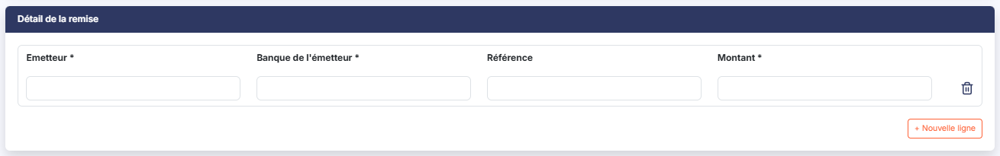

# Remises de chèques


**En bref** — Cet écran permet de saisir vos remises de chèques et d'imprimer le bordereau destiné à la banque, avec comptabilisation possible de la remise.

* Pour créer une remise : bouton \[Nouveau], renseignez le numéro de la remise, ajoutez une ligne par chèque, puis bouton \[Enregistrer].
* Pour imprimer le bordereau : bouton \[Edition].


Cette option vous permet de saisir vos remises de chèques et d'imprimer le bordereau de remise destiné à la banque. Vous pouvez, si vous le souhaitez, demander au logiciel de comptabiliser la remise en même temps.

<figure><figcaption>
Écran « Remises de chèques » de la nouvelle interface
</figcaption></figure>

## La liste des remises de chèques

Le logiciel affiche la liste des remises saisies dans le dossier annuel, avec les colonnes suivantes, toutes triables :

| Champ       | Ce qu'il faut savoir                                  |
| ----------- | ----------------------------------------------------- |
| **Numéro**  | Le numéro que vous avez donné à la remise.            |
| **Date**    | La date de la remise.                                 |
| **Nombre**  | Le nombre de chèques que comporte la remise.          |
| **Montant** | Le montant total de la remise.                        |
| **Banque**  | La banque auprès de laquelle la remise est effectuée. |

Une case à cocher en tête de la première colonne vous permet de sélectionner ou de désélectionner toutes les lignes de la page en une seule fois ; une pastille vous rappelle le nombre d'éléments sélectionnés. Cette même colonne porte les pictogrammes habituels des grilles du logiciel : choix des colonnes, filtre et impression.

Tant qu'aucune remise n'a été saisie, le logiciel affiche « Aucun élément à afficher. »

bouton **\[Nouveau]**

Il ouvre la fiche de saisie d'une nouvelle remise de chèques.

bouton **\[Supprimer]**

Il supprime toutes les remises que vous avez cochées dans la liste.

## Rubrique « Informations générales »

<figure><figcaption>
Rubrique « b) Rubrique « Informations générales » »
</figcaption></figure>

| Champ                                                | Ce qu'il faut savoir                                                                                                                                                                                                              |
| ---------------------------------------------------- | --------------------------------------------------------------------------------------------------------------------------------------------------------------------------------------------------------------------------------- |
| **Numéro de la remise**                              | Il permet de différencier les remises.                                                                                                                                                                                            |
| **Banque**                                           | Le sélecteur affiche vos banques ; il s'ouvre sur « Sélectionnez ». Les coordonnées de la banque retenue sont reprises sur le bordereau.                                                                                          |
| **Date de la remise**                                | Le logiciel propose la date du jour, que vous pouvez modifier, en saisissant la date ou en la choisissant dans le calendrier.                                                                                                     |
| **Nombre de chèques**                                | Non modifiable. Le logiciel le calcule d'après le nombre de lignes saisies dans le détail de la remise.                                                                                                                           |
| **Montant de la remise**                             | Non modifiable. Le logiciel le calcule d'après les montants saisis dans le détail de la remise.                                                                                                                                   |
| **Souhaitez-vous comptabiliser la remise de chèque** | À « Non » par défaut. Si vous répondez « Oui », le logiciel affiche deux champs supplémentaires dans cette rubrique — **Code journal** et **Numéro de compte** — ainsi qu'une colonne supplémentaire dans le détail de la remise. |
| **Code journal**                                     | Ce champ n'est présent que si vous avez demandé la comptabilisation. Choisissez dans le sélecteur le journal dans lequel l'écriture doit être passée.                                                                             |
| **Numéro de compte**                                 | Ce champ n'est présent que si vous avez demandé la comptabilisation. Il s'agit du compte à mouvementer pour la remise. Saisissez-le directement, recherchez-le à l'aide de la loupe, ou créez-le à l'aide du **bouton \[+]**.     |

## Rubrique « Détail de la remise »

<figure><figcaption>
Rubrique « c) Rubrique « Détail de la remise » »
</figcaption></figure>

<figure><figcaption>
Bouton [Enregistrer]
</figcaption></figure>

Créez autant de lignes de détail qu'il y a de chèques à remettre en banque. Une ligne vide vous est proposée à l'ouverture de la fiche.

Le tableau comporte les colonnes suivantes :

| Champ                    | Ce qu'il faut savoir                                                                                                                                                                                              |
| ------------------------ | ----------------------------------------------------------------------------------------------------------------------------------------------------------------------------------------------------------------- |
| **Compte de l'émetteur** | Cette colonne n'est présente que si vous avez demandé la comptabilisation de la remise. Saisissez le compte de l'émetteur du chèque, recherchez-le à l'aide de la loupe, ou créez-le à l'aide du **bouton \[+]**. |
| **Emetteur**             | Il s'agit du nom de l'émetteur du chèque.                                                                                                                                                                         |
| **Banque de l'émetteur** | Il s'agit du nom de la banque de l'émetteur.                                                                                                                                                                      |
| **Référence**            | Vous pouvez y porter le numéro du chèque ou toute autre référence utile.                                                                                                                                          |
| **Montant**              | C'est le montant unitaire du chèque de l'émetteur.                                                                                                                                                                |

Une croix, en début de chaque ligne, supprime la ligne du tableau.

bouton **\[Nouveau]** (sous le tableau du détail)

Il ajoute une ligne de chèque au tableau du détail de la remise.

Le bandeau bas de la fiche porte quatre boutons, dans cet ordre : **\[Enregistrer]**, **\[Valider]**, **\[Edition]** et **\[Retour]**.

bouton **\[Enregistrer]**

Il enregistre la remise et ses lignes de détail.

bouton **\[Valider]**

Il figure au bandeau bas de la fiche, entre le bouton **\[Enregistrer]** et le bouton **\[Edition]**.

bouton **\[Edition]**

Il imprime le bordereau de remise en banque, en reprenant les coordonnées de la banque de remise et toutes les informations saisies.

bouton **\[Retour]**

Il revient à la liste des remises de chèques.
