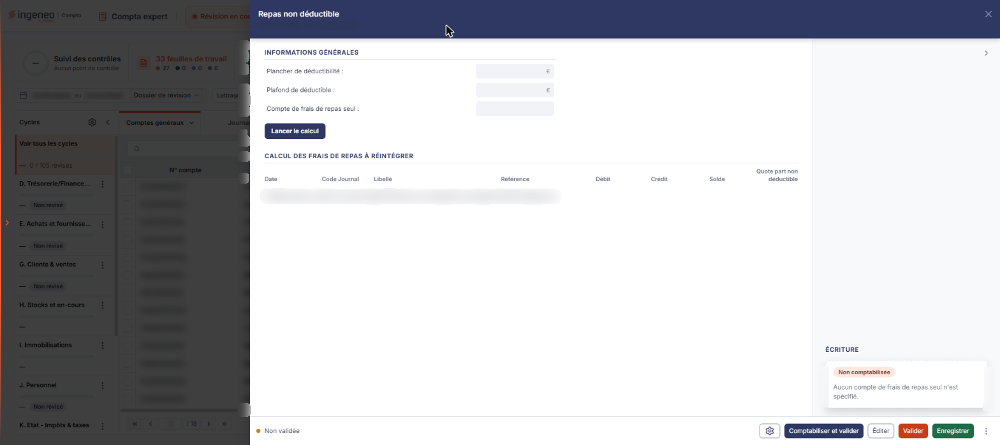
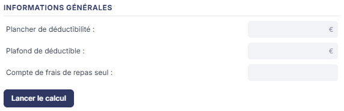
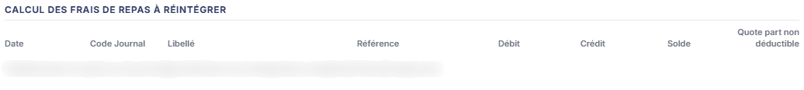
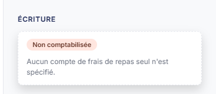

# Repas non déductible


**En bref** — Cette feuille détermine la part non déductible des frais de repas pris seul, à partir des écritures du compte concerné, et permet de la comptabiliser.

* Pour calculer : réglez le paramétrage, puis bouton \[Lancer le calcul].
* Pour passer l'écriture de réintégration : bouton \[Comptabiliser et valider].


Cette feuille de travail détermine la part non déductible des frais de repas pris seul, à partir des écritures du compte concerné, et vous permet de la comptabiliser.

<figure><figcaption>
Écran « Repas non déductible » de la nouvelle interface
</figcaption></figure>

Vous n'y saisissez rien directement : la feuille se remplit toute seule, à partir d'un **paramétrage** que vous réglez au préalable et d'un **calcul** que vous déclenchez.

Comme toutes les feuilles de travail, cet écran n'est accessible que si un dossier de révision existe sur le dossier annuel ; sinon le logiciel affiche à la place le message « Veuillez créer un dossier de révision afin de pouvoir utiliser cette fonctionnalité. ».

Pour l'ouvrir, dans l'écran Révision, cliquez sur la carte « N feuilles de travail » du bandeau : la liste des feuilles s'ouvre dans un tiroir à droite. Repérez la ligne « Repas non déductible » (le champ « Rechercher une feuille… » la retrouve) et cliquez sur le crayon de la ligne : la feuille s'ouvre dans un panneau, dont l'en-tête indique « Repas non déductible », puis la société et l'exercice, avec une croix de fermeture. Ce panneau est plus étroit que celui de la plupart des autres feuilles.

Le corps de l'écran comporte deux rubriques, dans cet ordre : « Informations générales » et « Calcul des frais de repas à réintégrer ». Dans la colonne de droite, une zone « Écriture ». Il n'y a pas de zone Documents sur cette feuille.

**Commencez par le paramétrage : sans lui, la feuille ne peut rien produire.** Le Bouton \[Lancer le calcul] a besoin du compte de frais de repas seul et des deux bornes de déductibilité. Réglez donc d'abord le paramétrage, par le pictogramme « Engrenage » du pied (Paramétrage des comptes de révision), décrit plus bas.

## Rubrique « Informations générales »

<figure><figcaption>
Rubrique « Rubrique « Informations générales » »
</figcaption></figure>

Trois champs, **tous en lecture seule** : ils ne se saisissent pas ici, ils **restituent** ce que vous avez réglé par le pictogramme « Engrenage ». Si vous les voyez grisés et vides, c'est que le paramétrage n'a pas encore été fait.

* **Plancher de déductibilité** : le montant en deçà duquel le repas n'est pas réintégré.
* **Plafond de déductible** : le montant au-delà duquel la dépense n'est plus déductible.
* **Compte de frais de repas seul** : le compte de charges dont les écritures seront examinées par le calcul.

bouton **\[Lancer le calcul]**

Ce bouton est rendu **à l'intérieur de cette rubrique**, sous les trois champs, à gauche, et non dans le pied du panneau.

Il examine les écritures du compte de frais de repas seul et alimente le tableau de la rubrique suivante, en calculant pour chaque ligne la quote-part non déductible d'après le plancher et le plafond.

**Si le compte de frais de repas seul n'est pas paramétré, ce bouton reste sans effet.** Le logiciel n'affiche alors ni message d'erreur, ni avertissement : la rubrique « Informations générales » reste vide, le tableau reste vide, et rien ne bouge à l'écran. Ce n'est pas une anomalie de votre dossier, c'est le paramétrage qui manque.

## Rubrique « Calcul des frais de repas à réintégrer »

<figure><figcaption>
Rubrique « Rubrique « Calcul des frais de repas à réintégrer » »
</figcaption></figure>

Un tableau unique, à huit colonnes : **Date**, **Code Journal**, **Libellé**, **Référence**, **Débit**, **Crédit**, **Solde** et **Quote part non déductible**.

Les sept premières colonnes reprennent les écritures du compte de frais de repas seul ; la dernière porte le montant que le logiciel calcule à réintégrer.

Tant que le tableau ne contient aucune ligne, le logiciel affiche à sa place, sur toute la largeur, le message : « Veuillez lancer le calcul ou aucune ligne d'écriture ne correspond au compte de frais de repas seul. »

Ce message couvre deux situations à la fois — le calcul n'a pas encore été lancé, ou il a été lancé et n'a rien trouvé — et il ne les distingue pas. Il ne mentionne pas non plus le cas le plus fréquent à la première ouverture : **le compte de frais de repas seul n'est pas paramétré du tout**. Si vous rencontrez ce message, commencez donc par vérifier le paramétrage.

## Zone « Écriture »

<figure><figcaption>
Rubrique « Zone « Écriture » »
</figcaption></figure>

Cette zone, placée dans la colonne de droite, ne contient aucun champ tant que la feuille n'a pas été comptabilisée : le logiciel y affiche la pastille « Non comptabilisée » et la phrase « Aucun compte de frais de repas seul n'est spécifié. ». Ce qu'elle affiche une fois ce compte renseigné n'a pas été observé ; elle présente ensuite l'écriture générée.

bouton **\[Éditer]**

Il ouvre la fenêtre « Edition », qui rappelle le nom de la feuille et son état, et comporte deux options : le **Format :** — boutons-bascule « Html », « Pdf » et « Excel », « Html » étant le choix proposé par défaut — et **Tronquer les libellés trop longs :**, interrupteur sans texte, activé par défaut. Le Bouton \[Edition] de cette fenêtre lance l'édition ; le Bouton \[Annuler] la referme sans rien produire.

**Entrée « Purger » du menu ⋮ (Autres actions)**

Elle ramène la feuille à vide. Le menu ⋮, dans le pied, ne porte que cette entrée, affichée en rouge. Notez qu'elle s'appelle ici « Purger », et non « Purger la feuille » comme sur d'autres feuilles.

**Pictogramme « Engrenage » (Paramétrage des comptes de révision)**

Placé à gauche du pied, il ouvre, par-dessus la feuille, le panneau « Paramétrage des comptes de révision ». Ce panneau est commun à toutes les feuilles : à gauche, la liste des rubriques de paramétrage, chacune suivie du nombre de ses paramètres ; un champ « Rechercher un compte, un libellé… » en haut. À l'ouverture depuis cette feuille, la rubrique « Repas non déductibles » est sélectionnée : elle compte trois paramètres, donc trois champs :

* **Plancher des frais de repas seul déductible** : montant.
* **Plafond des frais de repas seul déductible** : montant.
* **Compte de frais de repas seul** : vous y saisissez un numéro de compte ; le Bouton \[+] vous permet de créer le compte et le pictogramme « Loupe » de le rechercher dans le plan comptable. L'intitulé du compte s'affiche à droite et n'est pas modifiable.

Ce sont ces trois valeurs qui s'affichent ensuite, en lecture seule, dans la rubrique « Informations générales ». Les libellés n'y sont pas rédigés de la même façon d'un endroit à l'autre — « Plancher des frais de repas seul déductible » dans le panneau, « Plancher de déductibilité » à l'écran — mais il s'agit bien de la même donnée.

**À l'ouverture, les trois champs sont vides** : le logiciel ne vous y propose aucune valeur. Le pied du panneau comporte un Bouton \[Charger les valeurs par défaut] ; il n'a pas été actionné, et on ignore s'il renseigne ces trois champs. Tant que vous ne l'avez pas essayé, le plancher, le plafond et le compte sont à votre charge.

Le panneau s'enregistre séparément de la feuille. Le Bouton \[Rétablir la rubrique] figure en haut à droite de la rubrique. En bas, de gauche à droite : l'état d'enregistrement (« Tout est enregistré »), le Bouton \[Charger les valeurs par défaut] et le Bouton \[Enregistrer] ; il n'y a plus de Bouton \[Annuler], et la croix de l'en-tête ferme le panneau.

Le pied de la feuille, de gauche à droite, comporte : la mention « Non validée », le pictogramme « Engrenage », les boutons \[Comptabiliser et valider] et \[Éditer], le Bouton \[Valider], le Bouton \[Enregistrer] et le menu ⋮. Le pied n'a pas de bouton \[Fermer] : la croix de l'en-tête referme le panneau. Cette feuille ne comporte **aucun bouton de chargement des valeurs**, ni depuis la comptabilité, ni depuis l'exercice précédent : son seul mode d'alimentation est le Bouton \[Lancer le calcul] de la première rubrique.
