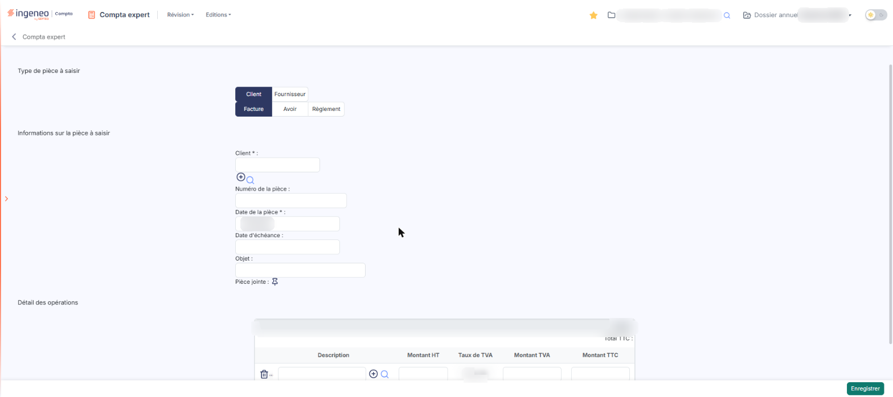
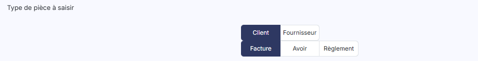
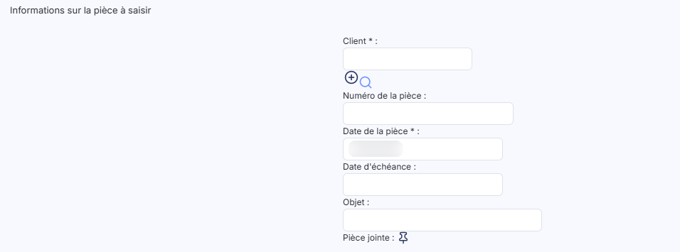
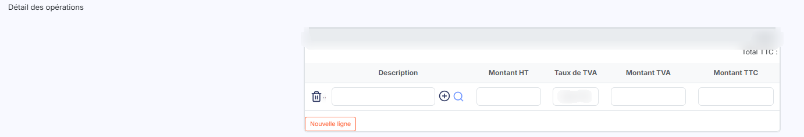
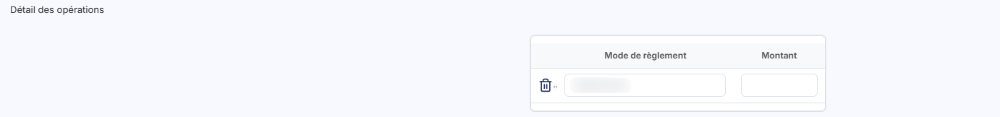

# Saisie guidée


**En bref** — Cette saisie permet d'enregistrer rapidement pièces clients, pièces fournisseurs et règlements sans notions de débit et de crédit : vous décrivez la pièce, le logiciel génère l'écriture.

* Pour saisir une pièce : décrivez-la dans le formulaire, ajoutez des lignes si besoin avec le bouton \[Nouvelle ligne], puis bouton \[Enregistrer].
* Pour la paramétrer au préalable : vérifiez le paramétrage de la saisie guidée dans le panneau Paramètres.


Cette option permet de saisir rapidement les pièces clients et fournisseurs ainsi que leurs règlements, sans passer par la grille de saisie en journal. Elle est destinée aux personnes qui ont peu de connaissances comptables, car elle ne fait pas appel aux notions de débit et de crédit : vous décrivez la pièce telle que vous l'avez sous les yeux, et le logiciel génère l'écriture.

<figure><figcaption>
Écran « Saisie guidée » de la nouvelle interface
</figcaption></figure>

Avant d'utiliser la saisie guidée, assurez-vous que son paramétrage a bien été effectué dans le panneau Paramètres, rubrique « Compta expert », onglet « Saisie guidée » : c'est lui qui détermine les comptes utilisés pour générer les écritures.

Dans la nouvelle interface, cet écran n'a plus d'entrée de menu : la barre de menus de la page ne propose plus que « Révision » et « Editions », et le menu ⋮ (Plus d'actions) de l'écran Révision n'a pas d'entrée « Saisie guidée ». Le panneau « Saisie d'écritures », que le bouton **\[Créer une écriture]** de l'écran Révision ouvre, ne propose que les segments « Saisie libre », « Sur trame » et « Sur pièce » : il n'a pas de mode guidé. La description qui suit est celle de la page « Saisie guidée ».

L'écran est un formulaire unique, en trois rubriques successives, sans onglet et sans liste des pièces déjà saisies.

## Rubrique « Type de pièce à saisir »

<figure><figcaption>
Rubrique « a) Rubrique « Type de pièce à saisir » »
</figcaption></figure>

Cette première rubrique commande tout le reste de l'écran. Elle présente deux séries de boutons superposées, sans libellé de champ :

* la première indique de qui émane la pièce : **Client** (proposé par défaut) ou **Fournisseur** ;
* la seconde indique la nature de la pièce : **Facture** (proposée par défaut), **Avoir** ou **Règlement**.

Les deux séries sont toujours affichées et se combinent, ce qui donne six cas de saisie. Le choix que vous faites ici recompose les deux rubriques suivantes : ne le modifiez donc pas après avoir commencé votre saisie.

Le passage de **Client** à **Fournisseur** ne change que le libellé du premier champ de la rubrique suivante. Le passage de **Facture** à **Avoir** ne change aucun champ. En revanche, le choix **Règlement** modifie l'écran en profondeur : il retire le champ **Date d'échéance** et remplace le tableau du détail des opérations par un tableau réduit au mode de règlement et au montant.

## Rubrique « Informations sur la pièce à saisir »

<figure><figcaption>
Rubrique « b) Rubrique « Informations sur la pièce à saisir » »
</figcaption></figure>

| Champ                                                            | Ce qu'il faut savoir                                                                                                                                                                                                                                                                                                                                                                                                                                                                                   |
| ---------------------------------------------------------------- | ------------------------------------------------------------------------------------------------------------------------------------------------------------------------------------------------------------------------------------------------------------------------------------------------------------------------------------------------------------------------------------------------------------------------------------------------------------------------------------------------------ |
| 
<strong>Client</strong> <em>Obligatoire</em>
           | Ce champ s'intitule \*\*Fournisseur \*\*\* lorsque vous avez choisi **Fournisseur** dans la rubrique précédente. Indiquez la raison sociale du tiers : en tapant les premiers caractères, le logiciel vous propose les comptes du plan comptable auxiliaire qui les contiennent, et vous choisissez dans la liste. Deux pictogrammes accompagnent le champ : le pictogramme « Créer » (un « + » cerclé), pour créer un nouveau client ou fournisseur, et le pictogramme « Loupe », pour le rechercher. |
| **Numéro de la pièce**                                           | Il est enregistré dans la référence de l'écriture générée. Cette référence peut ensuite être utilisée lors du lettrage.                                                                                                                                                                                                                                                                                                                                                                                |
| 
<strong>Date de la pièce</strong> <em>Obligatoire</em>
 | Le logiciel la prérenseigne avec la date du jour ; vous pouvez la modifier, à la main ou en cliquant dans le champ, qui ouvre le calendrier. Elle doit être comprise dans la période de saisie du dossier annuel.                                                                                                                                                                                                                                                                                      |
| **Date d'échéance**                                              | Facultative. Elle n'est affichée que pour les factures et les avoirs : elle disparaît dès que la nature de la pièce est **Règlement**.                                                                                                                                                                                                                                                                                                                                                                 |
| **Objet**                                                        | Il est enregistré dans le libellé de toutes les lignes de l'écriture. Si vous ne le renseignez pas, le logiciel reprend le type de la pièce comme libellé, « Facture client » par exemple.                                                                                                                                                                                                                                                                                                             |
| **Pièce jointe**                                                 | Ce champ ne comporte pas de zone de saisie, mais un pictogramme « Épingle », qui permet de joindre un document à toutes les lignes de l'écriture qui sera générée.                                                                                                                                                                                                                                                                                                                                     |

## Rubrique « Détail des opérations » — factures et avoirs

<figure><figcaption>
Rubrique « c) Rubrique « Détail des opérations » — factures et avoirs »
</figcaption></figure>

Le détail des opérations correspond aux différentes lignes de la pièce, qui peuvent porter sur des produits ou des services de natures différentes. Créez donc autant de lignes de saisie que la pièce comporte de natures différentes.

Au-dessus du tableau, à droite, le logiciel affiche **Total TTC :** — une zone grisée, que vous ne pouvez pas modifier, à **0,00** à l'ouverture.

Une ligne vide est proposée à l'ouverture. Les colonnes sont les suivantes :

La première colonne, sans en-tête, porte un pictogramme en forme de corbeille, d'infobulle « Effacer », qui supprime la ligne.

| Champ           | Ce qu'il faut savoir                                                                                                                                                                                                                                                                                                                               |
| --------------- | -------------------------------------------------------------------------------------------------------------------------------------------------------------------------------------------------------------------------------------------------------------------------------------------------------------------------------------------------- |
| **Description** | Indiquez la nature du bien ou du service. En tapant les premiers caractères, le logiciel vous propose les comptes de charges ou de produits du plan comptable général qui les contiennent, et vous choisissez dans la liste. Comme pour le tiers, le pictogramme « Créer » permet de créer un compte et le pictogramme « Loupe » de le rechercher. |
| **Montant HT**  | Saisissez le montant hors taxes de la ligne.                                                                                                                                                                                                                                                                                                       |
| **Taux de TVA** | Choisissez le taux dans le sélecteur. Il propose **Sans TVA**, retenu par défaut, puis les taux paramétrés pour le dossier : **20,00**, **10,00**, **2,10** et **5,50** au moment du relevé.                                                                                                                                                       |
| **Montant TVA** | Le logiciel le calcule à partir du montant hors taxes et du taux de TVA, mais il reste modifiable. Sa modification n'entraîne aucun autre recalcul.                                                                                                                                                                                                |
| **Montant TTC** | Le logiciel le calcule à partir du montant hors taxes et du taux de TVA, mais il reste modifiable. Si vous le modifiez, le montant hors taxes et le montant de TVA de la ligne ne changent pas, mais le **Total TTC** affiché au-dessus du tableau suit immédiatement votre saisie.                                                                |

bouton **\[Nouvelle ligne]**

Placé sous le tableau, il ajoute une ligne de saisie identique à la première. Il n'est présent que pour les factures et les avoirs.

## Rubrique « Détail des opérations » — règlements

<figure><figcaption>
Rubrique « d) Rubrique « Détail des opérations » — règlements »
</figcaption></figure>

Lorsque la nature de la pièce est **Règlement**, la rubrique change entièrement : le **Total TTC** et le bouton \[Nouvelle ligne] disparaissent, et le tableau se réduit à une seule ligne, que vous ne pouvez pas dupliquer. Un règlement se saisit donc en une seule opération.

La première colonne, sans en-tête, porte le pictogramme en forme de corbeille, d'infobulle « Effacer », qui vide la ligne.

| Champ                 | Ce qu'il faut savoir                                                                                                                                                                                                                                                                                                                                                                                                                                            |
| --------------------- | --------------------------------------------------------------------------------------------------------------------------------------------------------------------------------------------------------------------------------------------------------------------------------------------------------------------------------------------------------------------------------------------------------------------------------------------------------------- |
| **Mode de règlement** | Choisissez le mode dans le sélecteur, qui affiche **Sélectionnez** tant que vous n'avez rien choisi. Son contenu vient du paramétrage des modes de règlement du dossier et diffère donc d'une société à l'autre : au moment du relevé, il proposait **Chèques**, **Carte bancaire**, **Prélèvement**, **Virement**, **Espèces**, **Ticket Restaurant**, **Ecart de règlement -**, **Ecart de règlement +**, **Import règl. compta** et **Import remb. compta**. |
| **Montant**           | Saisissez le montant réglé.                                                                                                                                                                                                                                                                                                                                                                                                                                     |

## Enregistrement de la pièce

bouton **\[Enregistrer]**

Seul bouton du bas de l'écran, toujours présent. Il valide votre saisie et génère l'écriture comptable correspondant à la pièce.

Une pièce enregistrée en saisie guidée n'est plus modifiable depuis cet écran : pour la corriger, intervenez directement sur les écritures générées, dans la saisie en journal.

Si un champ obligatoire n'est pas renseigné, le logiciel n'enregistre rien : il encadre le champ en rouge et affiche dessous le message **Champ obligatoire**. C'est le cas, par exemple, si vous cliquez sur \[Enregistrer] sans avoir désigné de client.
