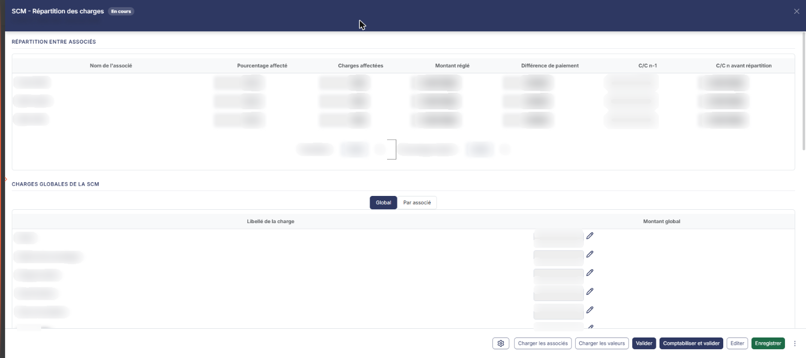
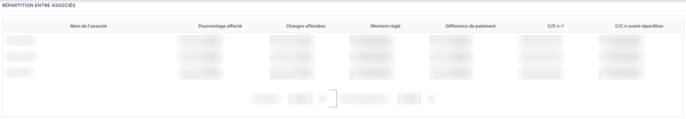
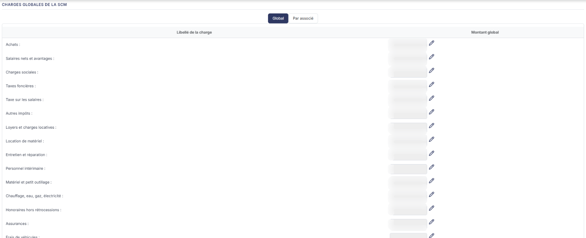
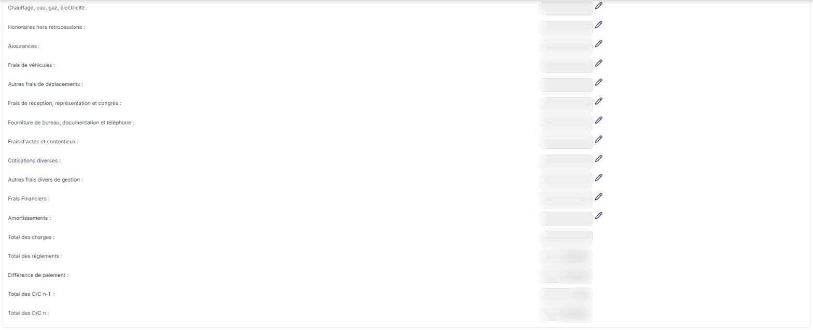

# SCM - Répartition des charges


**En bref** — Cette feuille répartit entre les associés d'une société civile de moyens les charges supportées par la société, et compare pour chacun ce qui lui revient à ce qu'il a réglé.

* Pour récupérer les associés : bouton \[Charger les associés], puis bouton \[Charger les valeurs].
* Pour passer l'écriture de répartition : bouton \[Comptabiliser et valider].


Cette option vous permet de répartir entre les associés d'une société civile de moyens (SCM) les charges supportées globalement par celle-ci, et de comparer, associé par associé, les charges qui lui reviennent avec ce qu'il a effectivement réglé.

<figure><figcaption>
Écran « SCM - Répartition des charges » de la nouvelle interface
</figcaption></figure>

Il s'agit d'une **feuille de travail** : elle appartient au dossier de révision de l'exercice, et non à l'exercice lui-même. Si aucun dossier de révision n'a été créé, le logiciel remplace l'écran par le message « Veuillez créer un dossier de révision afin de pouvoir utiliser cette fonctionnalité. ».

Pour l'ouvrir, dans l'écran Révision, cliquez sur la carte « N feuilles de travail » du bandeau : la liste des feuilles s'ouvre dans un tiroir à droite. Repérez la ligne « SCM - Répartition des charges » (le champ « Rechercher une feuille… » la retrouve) et cliquez sur le crayon de la ligne : la feuille s'ouvre dans un panneau, dont l'en-tête indique « SCM - Répartition des charges » et son état, puis la société et l'exercice, avec une croix de fermeture. Il n'y a pas de création préalable : le logiciel crée la feuille dès sa première ouverture, sans que vous ayez à l'enregistrer, et l'écran est immédiatement en saisie.

Comme sur toutes les feuilles de travail, la couleur de la zone vous indique sa nature : une zone **blanche** est une valeur que vous saisissez, une zone **grisée** est une valeur calculée par le logiciel ou reprise de la comptabilité, que vous ne pouvez pas modifier.

**a) Rubrique « Répartition entre associés »**

Cette rubrique porte le tableau des associés entre lesquels les charges seront réparties.

Le tableau comporte les colonnes suivantes :

| Champ                       | Ce qu'il faut savoir                                                                                                                                                                                                                                                                                                                                                                                                                                                                                                                                                                                                                                                                                                                                                                                                                                                                                                                                                                                                                                                                                                                                                                                                                                                                                                                                                                                                                                                                                                                                                                                                                                                                                                                                                                                                                                                                                                                                                                                                                                                                                                                                                                                                                                                                                                                                                                                                                                                                                                                                                                                                                                                                                                                                                                                                                                                                                                                                                                                                                                                                                                                                                                                                                                                                                                                                                                                                                 |
| --------------------------- | ------------------------------------------------------------------------------------------------------------------------------------------------------------------------------------------------------------------------------------------------------------------------------------------------------------------------------------------------------------------------------------------------------------------------------------------------------------------------------------------------------------------------------------------------------------------------------------------------------------------------------------------------------------------------------------------------------------------------------------------------------------------------------------------------------------------------------------------------------------------------------------------------------------------------------------------------------------------------------------------------------------------------------------------------------------------------------------------------------------------------------------------------------------------------------------------------------------------------------------------------------------------------------------------------------------------------------------------------------------------------------------------------------------------------------------------------------------------------------------------------------------------------------------------------------------------------------------------------------------------------------------------------------------------------------------------------------------------------------------------------------------------------------------------------------------------------------------------------------------------------------------------------------------------------------------------------------------------------------------------------------------------------------------------------------------------------------------------------------------------------------------------------------------------------------------------------------------------------------------------------------------------------------------------------------------------------------------------------------------------------------------------------------------------------------------------------------------------------------------------------------------------------------------------------------------------------------------------------------------------------------------------------------------------------------------------------------------------------------------------------------------------------------------------------------------------------------------------------------------------------------------------------------------------------------------------------------------------------------------------------------------------------------------------------------------------------------------------------------------------------------------------------------------------------------------------------------------------------------------------------------------------------------------------------------------------------------------------------------------------------------------------------------------------------------------ |
| **Nom de l'associé**        | Il s'agit du nom repris du Dossier permanent. Vous ne le saisissez pas ici.                                                                                                                                                                                                                                                                                                                                                                                                                                                                                                                                                                                                                                                                                                                                                                                                                                                                                                                                                                                                                                                                                                                                                                                                                                                                                                                                                                                                                                                                                                                                                                                                                                                                                                                                                                                                                                                                                                                                                                                                                                                                                                                                                                                                                                                                                                                                                                                                                                                                                                                                                                                                                                                                                                                                                                                                                                                                                                                                                                                                                                                                                                                                                                                                                                                                                                                                                          |
| **Pourcentage affecté**     | C'est la seule valeur que vous saisissez dans ce tableau. Elle indique la part des charges globales qui revient à cet associé.                                                                                                                                                                                                                                                                                                                                                                                                                                                                                                                                                                                                                                                                                                                                                                                                                                                                                                                                                                                                                                                                                                                                                                                                                                                                                                                                                                                                                                                                                                                                                                                                                                                                                                                                                                                                                                                                                                                                                                                                                                                                                                                                                                                                                                                                                                                                                                                                                                                                                                                                                                                                                                                                                                                                                                                                                                                                                                                                                                                                                                                                                                                                                                                                                                                                                                       |
| **Charges affectées**       | Montant calculé par le logiciel. En mode de saisie « Global », il découle du pourcentage affecté et du total des charges ; en mode « Par associé », le logiciel le recalcule comme la somme de la colonne de cet associé dans le tableau des charges.                                                                                                                                                                                                                                                                                                                                                                                                                                                                                                                                                                                                                                                                                                                                                                                                                                                                                                                                                                                                                                                                                                                                                                                                                                                                                                                                                                                                                                                                                                                                                                                                                                                                                                                                                                                                                                                                                                                                                                                                                                                                                                                                                                                                                                                                                                                                                                                                                                                                                                                                                                                                                                                                                                                                                                                                                                                                                                                                                                                                                                                                                                                                                                                |
| **Montant réglé**           | Montant calculé, repris de la comptabilité.                                                                                                                                                                                                                                                                                                                                                                                                                                                                                                                                                                                                                                                                                                                                                                                                                                                                                                                                                                                                                                                                                                                                                                                                                                                                                                                                                                                                                                                                                                                                                                                                                                                                                                                                                                                                                                                                                                                                                                                                                                                                                                                                                                                                                                                                                                                                                                                                                                                                                                                                                                                                                                                                                                                                                                                                                                                                                                                                                                                                                                                                                                                                                                                                                                                                                                                                                                                          |
| **Différence de paiement**  | Écart calculé entre les charges affectées à l'associé et le montant qu'il a réglé.                                                                                                                                                                                                                                                                                                                                                                                                                                                                                                                                                                                                                                                                                                                                                                                                                                                                                                                                                                                                                                                                                                                                                                                                                                                                                                                                                                                                                                                                                                                                                                                                                                                                                                                                                                                                                                                                                                                                                                                                                                                                                                                                                                                                                                                                                                                                                                                                                                                                                                                                                                                                                                                                                                                                                                                                                                                                                                                                                                                                                                                                                                                                                                                                                                                                                                                                                   |
| **C/C n-1**                 | Solde calculé du compte courant de l'associé à la clôture de l'exercice précédent.                                                                                                                                                                                                                                                                                                                                                                                                                                                                                                                                                                                                                                                                                                                                                                                                                                                                                                                                                                                                                                                                                                                                                                                                                                                                                                                                                                                                                                                                                                                                                                                                                                                                                                                                                                                                                                                                                                                                                                                                                                                                                                                                                                                                                                                                                                                                                                                                                                                                                                                                                                                                                                                                                                                                                                                                                                                                                                                                                                                                                                                                                                                                                                                                                                                                                                                                                   |
| **C/C n avant répartition** | 
Solde calculé du compte courant de l'associé sur l'exercice, repris de la comptabilité, avant prise en compte de la répartition. Les commandes de la ligne ne sont pas dans une colonne à part : elles se trouvent <strong>dans la cellulePourcentage affecté</strong>. Aucune ne porte d'infobulle. Le pictogramme « Crayon » passe la cellule en modification. Le pictogramme « Coche » n'apparaît qu'une fois la cellule en modification : il confirme la valeur saisie. Le pictogramme « Croix » ouvre une fenêtre « Confirmation » portant le message « Confirmer la suppression d'affectation ? » : le Bouton [Confirmer] vide le <strong>Pourcentage affecté</strong> de la ligne, ainsi que les <strong>Charges affectées</strong> qui en découlent, le Bouton [Annuler] referme la fenêtre sans rien changer. La ligne de l'associé, elle, <strong>reste dans le tableau</strong> : c'est son affectation qui est vidée, pas l'associé qui est retiré. Sous le tableau, un encadré vous restitue deux totaux, calculés par le logiciel et non saisissables :
                                                                                                                                                                                                                                                                                                                                                                                                                                                                                                                                                                                                                                                                                                                                                                                                                                                                                                                                                                                                                                                                                                                                                                                                                                                                                                                                                                                                                                                                                                                                                                                                                                                                                                                                                                                                                                                                                                                                                                                                                                                                                                                                                                                                                                                                                                                                          |
| **Total affecté**           | Somme, en pourcentage, des pourcentages affectés aux associés du tableau.                                                                                                                                                                                                                                                                                                                                                                                                                                                                                                                                                                                                                                                                                                                                                                                                                                                                                                                                                                                                                                                                                                                                                                                                                                                                                                                                                                                                                                                                                                                                                                                                                                                                                                                                                                                                                                                                                                                                                                                                                                                                                                                                                                                                                                                                                                                                                                                                                                                                                                                                                                                                                                                                                                                                                                                                                                                                                                                                                                                                                                                                                                                                                                                                                                                                                                                                                            |
| **Pourcentage à répartir**  | 
Pourcentage qui reste à affecter, soit l'écart entre 100 et le total affecté. <strong>b) Rubrique « Charges globales de la SCM »</strong> Cette rubrique porte le tableau des charges à répartir. En tête de rubrique, deux boutons-bascule « Global » et « Par associé » commandent la façon dont vous saisissez ces charges. Ce ne sont pas des onglets : ils ne changent pas de page, ils changent le mode de saisie du tableau. Le logiciel présente le mode « Global » à l'ouverture de l'écran, et y revient à chaque rechargement de la page. <strong>Mode « Global »</strong> Le tableau présente alors les colonnes <strong>Libellé de la charge :</strong> et <strong>Montant global :</strong>. Une colonne <strong>Écart :</strong> existe également, mais le logiciel la garde masquée dans ce mode. Vous saisissez un seul montant par charge, pour l'ensemble de la SCM ; c'est ensuite le pourcentage affecté à chaque associé qui détermine sa part. Vous pouvez aussi le faire reprendre de la comptabilité par le Bouton [Charger les valeurs], qui applique la formule de reprise de chaque charge, et adapter cette formule par le pictogramme « Crayon » de la ligne si la reprise ne vous convient pas. Les lignes de charges sont fixes : vous ne pouvez ni en ajouter ni en supprimer. Elles se présentent dans cet ordre : <strong>Achats :</strong>, <strong>Salaires nets et avantages :</strong>, <strong>Charges sociales :</strong>, <strong>Taxes foncières :</strong>, <strong>Taxe sur les salaires :</strong>, <strong>Autres impôts :</strong>, <strong>Loyers et charges locatives :</strong>, <strong>Location de matériel :</strong>, <strong>Entretien et réparation :</strong>, <strong>Personnel intérimaire :</strong>, <strong>Matériel et petit outillage :</strong>, <strong>Chauffage, eau, gaz, électricité :</strong>, <strong>Honoraires hors rétrocessions :</strong>, <strong>Assurances :</strong>, <strong>Frais de véhicules :</strong>, <strong>Autres frais de déplacements :</strong>, <strong>Frais de réception, représentation et congrès :</strong>, <strong>Fourniture de bureau, documentation et téléphone :</strong>, <strong>Frais d'actes et contentieux :</strong>, <strong>Cotisations diverses :</strong>, <strong>Autres frais divers de gestion :</strong>, <strong>Frais Financiers :</strong>, <strong>Amortissements :</strong>. Aucune n'est préremplie : elles sont vides tant que vous n'avez rien saisi. Chaque ligne porte un pictogramme « Crayon » qui ouvre une fenêtre de détail — intitulée « Cellule '…' - Détail », le libellé de la charge figurant entre apostrophes — et vous permet d'adapter la formule de reprise comptable de cette charge. Vous y trouvez la zone <strong>Formule par défaut :</strong>, que vous ne modifiez pas, et la zone <strong>Formule actuelle :</strong>, que vous saisissez ; une rangée de boutons vous insère les termes admis dans la formule — « Défaut », « Valeur », « Solde », « SoldeC », « SoldeD », « MvtC », « MvtD » et leurs variantes négatives. Le Bouton [Enregistrer] retient la formule, le Bouton [Annuler] referme la fenêtre sans rien changer. Le tableau se termine par des lignes de totaux, que le logiciel calcule et que vous ne pouvez pas atteindre au clic — elles restent cependant affichées sur fond blanc, comme les zones de saisie :
 |
| **Total des charges**       | Total des montants de charges du tableau.                                                                                                                                                                                                                                                                                                                                                                                                                                                                                                                                                                                                                                                                                                                                                                                                                                                                                                                                                                                                                                                                                                                                                                                                                                                                                                                                                                                                                                                                                                                                                                                                                                                                                                                                                                                                                                                                                                                                                                                                                                                                                                                                                                                                                                                                                                                                                                                                                                                                                                                                                                                                                                                                                                                                                                                                                                                                                                                                                                                                                                                                                                                                                                                                                                                                                                                                                                                            |
| **Total des règlements**    | Total des montants réglés par les associés.                                                                                                                                                                                                                                                                                                                                                                                                                                                                                                                                                                                                                                                                                                                                                                                                                                                                                                                                                                                                                                                                                                                                                                                                                                                                                                                                                                                                                                                                                                                                                                                                                                                                                                                                                                                                                                                                                                                                                                                                                                                                                                                                                                                                                                                                                                                                                                                                                                                                                                                                                                                                                                                                                                                                                                                                                                                                                                                                                                                                                                                                                                                                                                                                                                                                                                                                                                                          |
| **Différence de paiement**  | Écart entre les deux totaux précédents.                                                                                                                                                                                                                                                                                                                                                                                                                                                                                                                                                                                                                                                                                                                                                                                                                                                                                                                                                                                                                                                                                                                                                                                                                                                                                                                                                                                                                                                                                                                                                                                                                                                                                                                                                                                                                                                                                                                                                                                                                                                                                                                                                                                                                                                                                                                                                                                                                                                                                                                                                                                                                                                                                                                                                                                                                                                                                                                                                                                                                                                                                                                                                                                                                                                                                                                                                                                              |
| **Total des C/C n-1**       | Total des soldes de comptes courants de l'exercice précédent.                                                                                                                                                                                                                                                                                                                                                                                                                                                                                                                                                                                                                                                                                                                                                                                                                                                                                                                                                                                                                                                                                                                                                                                                                                                                                                                                                                                                                                                                                                                                                                                                                                                                                                                                                                                                                                                                                                                                                                                                                                                                                                                                                                                                                                                                                                                                                                                                                                                                                                                                                                                                                                                                                                                                                                                                                                                                                                                                                                                                                                                                                                                                                                                                                                                                                                                                                                        |
| **Total des C/C n**         | Total des soldes de comptes courants de l'exercice.                                                                                                                                                                                                                                                                                                                                                                                                                                                                                                                                                                                                                                                                                                                                                                                                                                                                                                                                                                                                                                                                                                                                                                                                                                                                                                                                                                                                                                                                                                                                                                                                                                                                                                                                                                                                                                                                                                                                                                                                                                                                                                                                                                                                                                                                                                                                                                                                                                                                                                                                                                                                                                                                                                                                                                                                                                                                                                                                                                                                                                                                                                                                                                                                                                                                                                                                                                                  |

**c) Les commandes du pied de la feuille**

Les commandes sont dans le pied du panneau, à droite, dans l'ordre : le pictogramme « Engrenage », le Bouton \[Charger les associés], le Bouton \[Charger les valeurs], le Bouton \[Valider], le Bouton \[Comptabiliser et valider], le Bouton \[Editer], le Bouton \[Enregistrer] et le menu ⋮ « Autres actions », qui ne porte que l'entrée « Purger la feuille ». Le pied n'a pas de bouton \[Fermer] : la croix de l'en-tête referme le panneau.

**Pictogramme « Engrenage » (Paramétrage des comptes de révision)**

Il ouvre, par-dessus la feuille, le panneau « Paramétrage des comptes de révision », commun à toutes les feuilles : à gauche, la liste des rubriques de paramétrage, chacune suivie du nombre de ses paramètres ; un champ « Rechercher un compte, un libellé… » en haut. À l'ouverture depuis cette feuille, la rubrique « SCM - Répartition des charges » est sélectionnée : elle compte un seul paramètre, « Racine des comptes de règlements effectués par les associés », que le Bouton \[Rétablir la rubrique] (en haut à droite) permet de rétablir. En bas : l'état d'enregistrement (« Tout est enregistré »), le Bouton \[Charger les valeurs par défaut] et le Bouton \[Enregistrer] ; la croix de l'en-tête ferme le panneau, qui s'enregistre séparément de la feuille.

bouton **\[Charger les associés]**

Ce bouton alimente le tableau des associés à partir du **Dossier permanent**. L'infobulle du bouton, qui s'affiche à son survol, précise : « Charge les noms des associés présents dans le Dossier permanent et absents de la liste. » Le chargement est donc complémentaire : le logiciel ajoute les associés qui manquent et ne touche pas aux lignes déjà présentes.

bouton **\[Editer]**

Ouvre la fenêtre « Edition », qui rappelle le nom de la feuille et son état, puis produit le document. Vous y trouvez trois zones : **Format :**, sous forme de boutons-bascule « Html », « Pdf » et « Excel », « Html » étant proposé ; **Tronquer les libellés trop longs :**, interrupteur sans texte, proposé activé ; et **Filtre associé :**, une liste déroulante proposée à « Tous » et peuplée des associés du tableau, pour n'éditer que l'un d'eux. Le Bouton \[Edition] lance l'édition, le Bouton \[Annuler] referme la fenêtre.

**d) Points de vigilance**

Cette feuille est prévue pour une société civile de moyens, mais le logiciel n'en contrôle pas la forme juridique : l'option s'ouvre et fonctionne sur n'importe quelle société, sans message d'avertissement.

L'écran ne rappelle nulle part à quel dossier de révision la feuille se rattache. Si plusieurs dossiers de révision existent sur l'exercice, rien à l'écran ne vous indique celui sur lequel vous travaillez.

Le passage d'un mode de saisie à l'autre change ce qui est saisi et ce qui est calculé : décidez du mode **avant** de saisir vos charges, plutôt qu'en cours de saisie.

## Autres vues de l'écran

<figure><figcaption>
Rubrique « Répartition entre associés »
</figcaption></figure>

<figure><figcaption>
Rubrique « Charges globales de la SCM »
</figcaption></figure>

<figure><figcaption>
Rubrique « Charges globales de la SCM »
</figcaption></figure>
