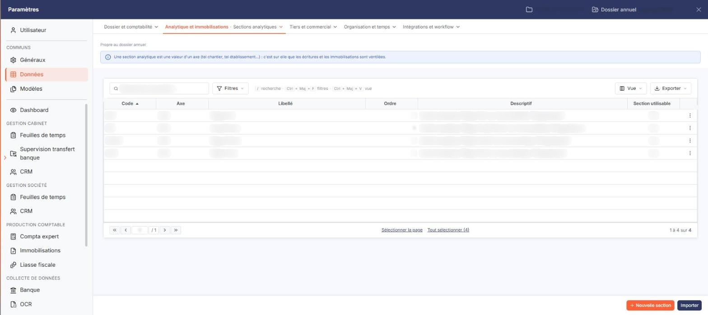
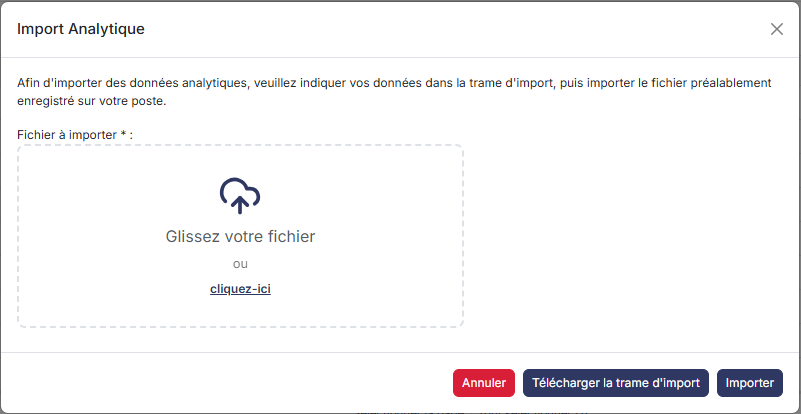
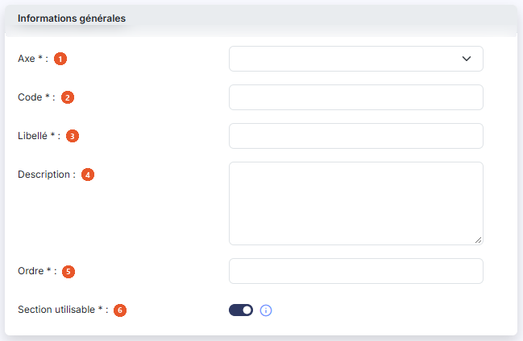

# Sections


**En bref** — Cet écran présente les sections analytiques, c'est-à-dire les possibilités d'affectation au sein d'un axe, et permet d'en ajouter, modifier, supprimer ou importer.

* Pour créer une section : bouton \[Nouveau], choisissez l'axe de rattachement, puis bouton \[Enregistrer].
* Pour supprimer des sections : cochez-les dans la liste, puis bouton \[Supprimer].
* Pour reprendre des sections d'un fichier : bouton \[Importer].


Les sections analytiques définissent les différentes possibilités d'affectation au sein d'un axe : par exemple, pour un axe géographique, vous créez les sections « Ile de France », « Région Est », « Région Ouest » et « Région Sud ».

<figure><figcaption>
Écran « Sections » de la nouvelle interface
</figcaption></figure>

Cet écran présente la liste des sections déjà créées et vous permet d'en ajouter, d'en modifier, d'en supprimer ou de les importer.

Cet écran s'ouvre dans le panneau Paramètres (entrée « Paramètres » de la barre latérale) : ouvrez la rubrique « Données », puis, dans la barre d'onglets du haut, le menu « Analytique et immobilisations » > « Sections analytiques ». Sous l'onglet, la mention « Propre au dossier annuel » et un encadré bleu rappellent qu'une section est une valeur d'un axe, et que c'est sur elle que les écritures et les immobilisations sont ventilées.

## La liste des sections

<figure><figcaption>
Bouton [Nouveau]
</figcaption></figure>

<figure><figcaption>
Bouton [Importer]
</figcaption></figure>

La grille présente les colonnes suivantes :

* **Code** : le code de la section.
* **Axe** : le code de l'axe auquel la section est rattachée.
* **Libellé** : le libellé de la section.
* **Ordre** : le rang d'affichage de la section.
* **Descriptif** : le texte libre saisi dans le champ **Description** de la fiche.
* **Section utilisable** : indique si la section peut encore être employée dans les ventilations analytiques.

Chaque colonne est triable en cliquant sur son en-tête. La première cellule d'en-tête regroupe deux cases à cocher : « tout sélectionner » et la sélection de toutes les pages, dont l'infobulle rappelle le nombre d'éléments sélectionnés. Au-dessus de la grille, à gauche, trois pictogrammes : la « roue dentée » (choix des colonnes affichées), l'« Entonnoir » (filtres) et l'« Imprimante ». Le pied de la grille indique la pagination et le nombre de sections affichées. Les boutons \[Supprimer], \[Nouveau] et \[Importer] décrits au paragraphe 2 sont dans le pied du panneau, en bas à droite ; \[Supprimer] reste inactif tant qu'aucune ligne n'est cochée.

Sur chaque ligne, la case à cocher sert à sélectionner la section et le pictogramme « Modifier » (un crayon), à droite de la ligne, ouvre sa fiche en modification.

## Les boutons de la liste

bouton **\[Nouveau]**

Ouvre une fiche vierge pour créer une section (rubrique décrite au paragraphe 3).

bouton **\[Supprimer]**

Supprime les sections cochées dans la liste.

bouton **\[Importer]**

Ouvre la fenêtre « Import Analytique », commune aux écrans « Axes », « Sections » et « Ventilations types », qui vous permet de reprendre vos données analytiques depuis un fichier.

## La fiche d'une section

## Rubrique « Informations générales »

<figure><figcaption>
Rubrique « Rubrique « Informations générales » »
</figcaption></figure>

| Champ                     | Ce qu'il faut savoir                                                                                                                                                                                                        |
| ------------------------- | --------------------------------------------------------------------------------------------------------------------------------------------------------------------------------------------------------------------------- |
| 1. **Axe**                | À la création. Choisissez dans la liste déroulante l'axe auquel la section est rattachée.                                                                                                                                   |
| 2. **Code**               | À la création. Il identifie la section.                                                                                                                                                                                     |
| 3. **Libellé**            | —                                                                                                                                                                                                                           |
| 4. **Description**        | Zone de saisie sur plusieurs lignes ; son contenu est repris dans la colonne **Descriptif** de la liste.                                                                                                                    |
| 5. **Ordre**              | Ce nombre définit le rang d'affichage de la section.                                                                                                                                                                        |
| 6. **Section utilisable** | Interrupteur activé à l'ouverture d'une fiche vierge. Le pictogramme d'information placé à droite du champ rappelle : « Si vous répondez « Non » cette section ne sera plus utilisable dans les ventilations analytiques. » |

bouton **\[Enregistrer]**

Enregistre la section. C'est le seul bouton du pied de la fiche, en bas à droite du panneau.

**Flèche « < » de retour**

Le bouton \[Retour] n'est plus affiché dans la fiche. La flèche « < », placée à gauche de la barre d'onglets du panneau, vous ramène à la liste des sections sans rien enregistrer.

## Ce qui change lorsque vous rouvrez une section existante

La fiche présente les mêmes champs, avec deux différences :

* le champ **Code** est grisé : le code d'une section ne se modifie plus une fois la section enregistrée ;
* les champs **Axe** et **Code** ne portent plus l'astérisque des champs obligatoires ; la liste déroulante **Axe** est elle aussi grisée, et elle est réellement désactivée : l'axe de rattachement d'une section ne se modifie plus une fois la section enregistrée.

## Filtrer la liste

Le pictogramme « Entonnoir », au-dessus de la grille, ouvre la fenêtre « Filtres ». Elle présente une ligne par colonne de la liste — **Code**, **Axe**, **Libellé**, **Ordre**, **Descriptif**, **Section utilisable** — chacune composée d'un opérateur, d'une valeur, d'un choix « Et » / « Ou », puis d'un second couple opérateur et valeur suivi d'un second « Et » / « Ou ».

Cette fenêtre propose le bouton **\[Filtrer]**, le bouton **\[Mémoriser les paramètres]**, le bouton **\[Charger les paramètres]**, et le bouton **\[Vider les filtres]**. Il n'y a plus de bouton \[Fermer] : la croix, en haut à droite de la fenêtre, la ferme.
