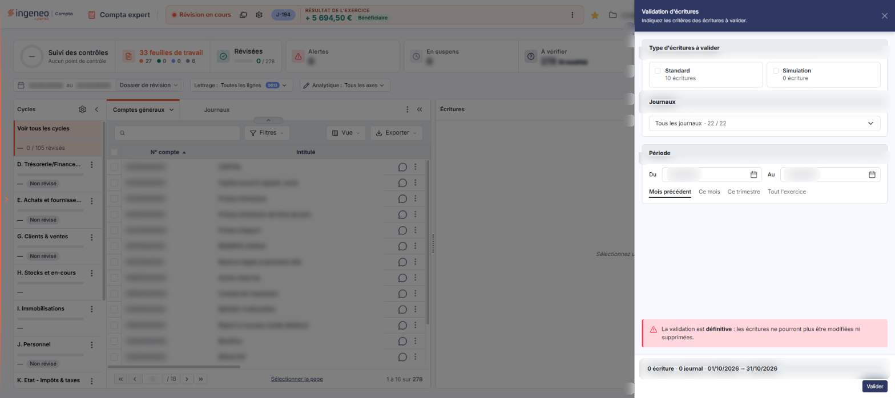
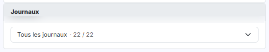
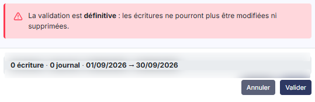
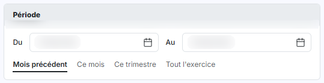
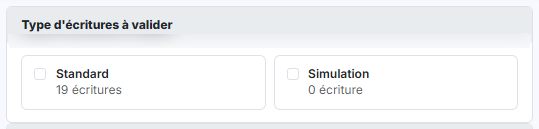

# Validation


**En bref** — Cette option valide en une seule opération toutes les écritures répondant aux critères indiqués, dans un panneau ouvert depuis l'écran Révision.

* Pour choisir la période : bouton \[Mois précédent], \[Ce mois], \[Ce trimestre] ou \[Tout l'exercice], ou saisissez les deux dates.
* Pour valider les écritures retenues : bouton \[Valider] ; pour renoncer, croix « Fermer » du bandeau de titre (le pied n'a pas de bouton \[Annuler]).


Cette option permet de valider en une seule opération toutes les écritures répondant aux critères que vous indiquez. Dans l'écran Révision, cliquez sur ⋮ (Plus d'actions), puis, dans la rubrique Traitements, sur Validation : l'option s'ouvre dans un panneau à droite de l'écran, titré « Validation d'écritures », qui vous invite à indiquer vos critères dès son ouverture : « Indiquez les critères des écritures à valider. ». Le panneau comporte trois blocs, « Type d'écritures à valider », « Journaux » et « Période », puis un encadré rouge et un pied où se trouvent un récapitulatif de vos critères et, à droite, le Bouton \[Valider]. Le pied ne porte pas de bouton \[Annuler]. La croix « Fermer » du bandeau de titre referme le panneau.

<figure><figcaption>
Écran « Validation » de la nouvelle interface
</figcaption></figure>

**La validation d'écritures est définitive : une écriture validée n'est plus modifiable ni supprimable.** Le logiciel vous demande une confirmation avant de lancer le traitement, mais cette confirmation ne vous rappelle ni le journal ni la période que vous avez retenus : vérifiez donc vos critères, et en particulier les deux bornes de dates, avant de presser le Bouton \[Valider].

## Les blocs du panneau « Validation d'écritures »

<figure><figcaption>
Rubrique « b) Les blocs du panneau « Validation d'écritures » »
</figcaption></figure>

<figure><figcaption>
Rubrique « b) Les blocs du panneau « Validation d'écritures » »
</figcaption></figure>

Aucun de ces champs ne porte d'astérisque d'obligation.

| Champ                          | Ce qu'il faut savoir                                                                                                                                                                                                                                                                                                                                                                                                                                                                                                                                                   |
| ------------------------------ | ---------------------------------------------------------------------------------------------------------------------------------------------------------------------------------------------------------------------------------------------------------------------------------------------------------------------------------------------------------------------------------------------------------------------------------------------------------------------------------------------------------------------------------------------------------------------- |
| **Journaux**                   | Ce bloc est un bouton déroulant qui reprend les journaux de votre société ; la liste n'est donc pas la même d'un dossier à l'autre. À l'ouverture, le bouton affiche « Tous les journaux · 22 / 22 » (sur le dossier relevé) : tous les journaux sont cochés, ce qui ne restreint la validation à aucun journal. La liste, une fois ouverte, regroupe les journaux par type (Achats, Ventes, Opérations diverses, Banques, Caisses, À-nouveaux), chaque groupe portant son compteur ; des boutons « Tout » et « Aucun » permettent de cocher ou décocher les journaux. |
| **Type d'écritures à valider** | Ce ne sont pas deux choix qui s'excluent, mais **deux cases à cocher indépendantes**, "Standard" et "Simulation", présentées côte à côte sous forme de deux cartes. Chaque carte porte un compteur (« 19 écritures » pour Standard et « 0 écriture » pour Simulation sur le dossier relevé) ; ce à quoi ce compteur se rapporte n'a pas été établi. Vous pouvez donc n'en cocher aucune, n'en cocher qu'une, ou les cocher toutes les deux pour valider les deux types en une seule opération. À l'ouverture de l'écran, les deux sont décochées.                      |
| **Du**                         | **Au :** ces deux bornes, regroupées dans le bloc « Période », délimitent la période des écritures à valider. À l'ouverture de l'écran, le logiciel propose le mois précédent.                                                                                                                                                                                                                                                                                                                                                                                         |

## Les quatre raccourcis de période

<figure><figcaption>
Rubrique « c) Les quatre raccourcis de période »
</figcaption></figure>

Dans le bloc « Période », quatre raccourcis vous évitent de saisir les dates à la main : Bouton \[Mois précédent], Bouton \[Ce mois], Bouton \[Ce trimestre] et Bouton \[Tout l'exercice]. Chacun se contente de recalculer les deux bornes ; il ne valide rien.

Le Bouton \[Tout l'exercice] reprend les dates de début et de fin du dossier annuel en cours. Le raccourci correspondant à la période retenue est souligné ; à l'ouverture de l'écran, « Mois précédent » est souligné, ce qui correspond aux bornes proposées. Le soulignement après un clic sur un autre raccourci n'a pas été revu sur le nouvel écran.

Vous pouvez également saisir directement les deux dates, ou les choisir dans le calendrier qui s'ouvre au clic dans le champ.

bouton **\[Valider]**

C'est le bouton d'action de l'écran : il se trouve en pied de panneau, à droite, et il est présent, actif, dès l'ouverture, même si aucune case de type d'écriture n'est cochée. Le récapitulatif placé dans le pied indique alors « 0 écriture · 0 journal » suivi des deux bornes de dates (« 01/09/2026 → 30/09/2026 » lors du relevé). Au-dessus du pied, un encadré rouge rappelle : « La validation est définitive : les écritures ne pourront plus être modifiées ni supprimées. »

Lorsque vous le pressez, le logiciel ouvre d'abord une fenêtre de confirmation intitulée "Validation", portant le texte "La validation d'écritures est définitive. Elle aura pour effet d'interdire toute modification ou suppression de ces écritures et de mémoriser la date de validation au" suivi de la date du jour. Le Bouton \[Confirmer] lance le traitement ; le Bouton \[Annuler], comme la croix de fermeture, y renonce et ne valide rien.

## Autres vues de l'écran

<figure><figcaption>
a) Rappel sur les types d'écritures
</figcaption></figure>
