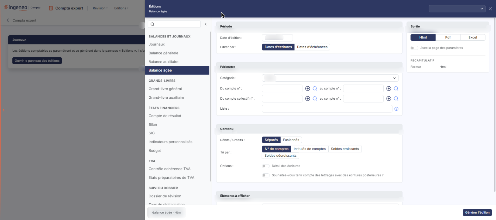
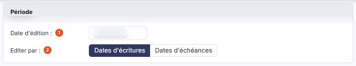
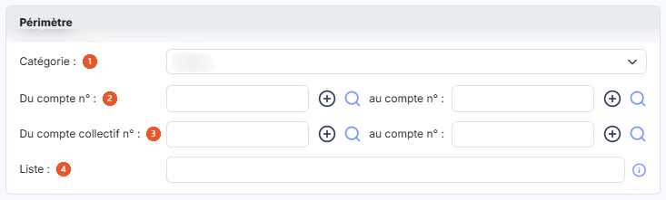
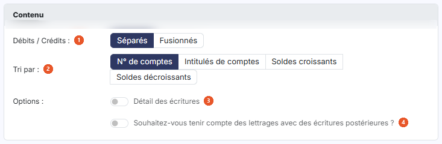
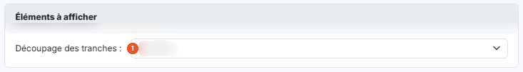
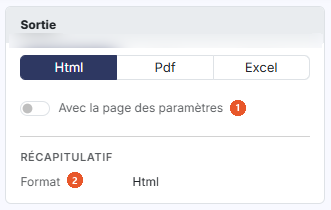

# Balance âgée


**Où le trouver :** Menu **Editions › Balance âgée**



**En bref** — Cette édition répartit par tranches d'ancienneté les écritures des comptes auxiliaires, selon leur date d'écriture ou d'échéance, à partir d'une date d'édition de référence.

* Pour éditer : renseignez la « Date d'édition » et la catégorie de comptes, choisissez le format dans la carte « Sortie », puis bouton \[Générer l'édition].


Cette page vous permet d'éditer les écritures passées sur des comptes auxiliaires en fonction de leur date d'écriture ou de leur date d'échéance, et de les ventiler par tranches d'ancienneté. Vous y renseignez les critères de l'édition, puis vous la déclenchez avec le bouton **\[Générer l'édition]**.

<figure><figcaption>
Écran « Balance âgée » de la nouvelle interface
</figcaption></figure>

## Le panneau d'éditions

<figure><figcaption>
Bouton [Ouvrir le panneau des éditions]
</figcaption></figure>

Cette édition ne s'ouvre plus dans une page de paramétrage : elle se paramètre et se génère dans le **panneau d'éditions**, commun à toutes les éditions comptables. Pour l'ouvrir, cliquez sur le menu **Éditions** de la barre du module, puis sur **Balance âgée** ; depuis l'écran Révision, ouvrez le menu ⋮ (Plus d'actions), puis **Éditions**, et choisissez l'édition dans la liste de gauche du panneau. La page qui s'affiche derrière porte le titre de l'édition et le bouton **\[Ouvrir le panneau des éditions]** : le panneau s'ouvre de lui-même ; si vous l'avez fermé, ce bouton le rouvre.

Le panneau est un tiroir intitulé « Éditions », suivi du nom de l'édition. **À gauche**, la liste des quinze éditions en cinq groupes — « Balances et journaux », « Grands-livres », « États financiers », « TVA » et « Suivi du dossier » — avec une zone « Rechercher une édition » et un bouton « Replier la liste » ; cliquer sur une autre édition change de formulaire sans quitter le panneau. **Au centre**, le formulaire, présenté en cartes. **À droite**, la carte « Sortie » et le « Récapitulatif » des critères retenus. **En en-tête**, la liste des paramétrages enregistrés (voir plus bas) et la croix « Fermer ». **Dans le pied**, un résumé de l'édition (nom, dates, format) et, à droite, le bouton **\[Générer l'édition]**. Le pied ne porte pas de bouton \[Annuler] : le panneau se referme par la croix « Fermer » de l'en-tête.

Les critères se présentent en quatre cartes, dans l'ordre suivant : « Période », « Périmètre », « Contenu » et « Éléments à afficher ». Aucun champ n'est obligatoire.

## Carte « Période »

<figure><figcaption>
Rubrique « Carte « Période » »
</figcaption></figure>

| Champ                 | Ce qu'il faut savoir                                                                                                                                                                             |
| --------------------- | ------------------------------------------------------------------------------------------------------------------------------------------------------------------------------------------------ |
| 1. **Date d'édition** | C'est la date de référence à partir de laquelle le logiciel calcule les tranches d'ancienneté. Le logiciel propose la date du jour ; vous pouvez la modifier, directement ou avec le calendrier. |
| 2. **Editer par**     | Vous retenez « Dates d'écritures » (choix par défaut) ou « Dates d'échéances ».                                                                                                                  |

## Carte « Périmètre »

<figure><figcaption>
Rubrique « Carte « Périmètre » »
</figcaption></figure>

| Champ                         | Ce qu'il faut savoir                                                                                                                                                                                                                                                                                                        |
| ----------------------------- | --------------------------------------------------------------------------------------------------------------------------------------------------------------------------------------------------------------------------------------------------------------------------------------------------------------------------- |
| 1. **Catégorie**              | Choisissez la catégorie de comptes auxiliaires pour laquelle vous éditez la balance : « Divers » (choix retenu par défaut), « Clients », « Fournisseurs » ou « Salariés ».                                                                                                                                                  |
| 2. **Du compte n°**           | **au compte n° :** vous avez la possibilité de ne retenir qu'une partie du plan comptable auxiliaire en indiquant le compte de début et le compte de fin. À droite de chaque champ de compte se trouvent un bouton « + » (infobulle « Créer ») et une loupe ; la loupe ouvre la recherche de compte.                        |
| 3. **Du compte collectif n°** | Le champ **au compte n° :** qui le suit immédiatement vous permettent de restreindre l'édition à une fourchette de comptes collectifs. Attention : ce second champ porte le même libellé que la borne haute de la fourchette de comptes auxiliaires ; c'est sa position, sous « Du compte collectif n° », qui le distingue. |
| 4. **Liste**                  | Vous pouvez indiquer des comptes ou des racines de comptes qui ne se suivent pas. Le logiciel rappelle la règle de saisie dans l'infobulle du champ : « Séparez les numéros de comptes ou les racines par des points virgules ou des tirets. »                                                                              |

## Carte « Contenu »

<figure><figcaption>
Rubrique « Carte « Contenu » »
</figcaption></figure>

| Champ                                                                              | Ce qu'il faut savoir                                                                                                                         |
| ---------------------------------------------------------------------------------- | -------------------------------------------------------------------------------------------------------------------------------------------- |
| 1. **Débits / Crédits**                                                            | Vous retenez « Séparés » (choix par défaut) ou « Fusionnés ».                                                                                |
| 2. **Tri par**                                                                     | Vous triez les comptes par « N° de comptes » (choix par défaut), « Intitulés de comptes », « Soldes croissants » ou « Soldes décroissants ». |
| 3. **Détail des écritures**                                                        | Interrupteur désactivé par défaut.                                                                                                           |
| 4. **Souhaitez-vous tenir compte des lettrages avec des écritures postérieures ?** | Interrupteur désactivé par défaut.                                                                                                           |

## Carte « Éléments à afficher »

<figure><figcaption>
Rubrique « Carte « Éléments à afficher » »
</figcaption></figure>

**Découpage des tranches** : l'édition répartit les écritures dans cinq tranches d'ancienneté, calculées à partir de la « Date d'édition ». Vous choisissez leur découpage parmi « Par décades », « Par quizaines », « Par Mois » (choix retenu par défaut), « Par Trimestres », « Par Trimestres civils » et « Personnalisé ».

Le choix « Par quizaines » est bien celui qui découpe par quinzaines : son libellé comporte une faute de frappe à l'écran.

Le choix **Personnalisé** fait apparaître, sous le champ, quatre champs « Tranche 1 : » à « Tranche 4 : » qui vous permettent de définir vous-même les bornes des tranches : vous y saisissez la borne haute des tranches 1 à 4. Le logiciel propose 29, 59, 89 et 119.

## Carte « Sortie » (à droite du formulaire)

<figure><figcaption>
Rubrique « Carte « Sortie » (à droite du formulaire) »
</figcaption></figure>

| Champ                              | Ce qu'il faut savoir                                                                                                                                                                                                                                                                                                                                                                                                                                                                                                                      |
| ---------------------------------- | ----------------------------------------------------------------------------------------------------------------------------------------------------------------------------------------------------------------------------------------------------------------------------------------------------------------------------------------------------------------------------------------------------------------------------------------------------------------------------------------------------------------------------------------- |
| 1. **Avec la page des paramètres** | Interrupteur désactivé par défaut.                                                                                                                                                                                                                                                                                                                                                                                                                                                                                                        |
| 2. **Format**                      | 
Vous avez le choix entre trois formats, présentés en boutons : • « Html » : c'est le format retenu par défaut. • « Pdf » : le logiciel fait alors apparaître deux champs supplémentaires. <strong>Orientation :</strong> « Portrait » par défaut, ou « Paysage ». <strong>Largeur :</strong> « Ajustée » par défaut, ou « Fixe » ; le logiciel précise dans l'infobulle du champ : « Ajuste la taille si la largeur des colonnes dépasse la largeur de la page ». • « Excel » : aucun champ supplémentaire n'est demandé.
 |

Sous la carte « Sortie », le « Récapitulatif » rappelle le format retenu (« Html » à l'ouverture), et l'orientation lorsque vous choisissez « Pdf ».

## Paramétrages enregistrés et génération

**Les paramétrages enregistrés**

La zone « Nouveau paramétrage… », en haut à droite du panneau, remplace les anciens boutons \[Mémoriser les paramètres] et \[Charger les paramètres]. Son chevron (« Afficher les paramètres enregistrés ») ouvre une liste : l'entrée « Nouveau paramètre — À partir des critères affichés », puis, sous le nom de l'édition et avec leur nombre, les paramétrages déjà enregistrés **pour cette édition** (un paramétrage enregistré pour une autre édition n'y figure pas). Au survol d'un paramétrage, deux icônes permettent de le dupliquer ou de le supprimer.

| Champ                                 | Ce qu'il faut savoir                                                                                                                                                                                                                                                                                                                            |
| ------------------------------------- | ----------------------------------------------------------------------------------------------------------------------------------------------------------------------------------------------------------------------------------------------------------------------------------------------------------------------------------------------- |
| **Enregistrer les critères affichés** | Saisissez un nom dans la zone « Nouveau paramétrage… », puis validez par la touche Entrée ou par le bouton d'enregistrement placé à droite de la zone (info-bulle « Enregistrer comme nouveau paramètre (Entrée) »).                                                                                                                            |
| **Reprendre un paramétrage**          | Cliquez sur son nom dans la liste. Le formulaire se remplit avec ses critères, y compris le format de sortie, et le nom s'affiche dans la zone d'en-tête. Une icône d'enregistrement placée à côté du nom (info-bulle « Modifié – mettre à jour « nom » (Entrée) ») permet de remettre à jour le paramétrage chargé avec les critères affichés. |

bouton **\[Générer l'édition]**

Il se trouve dans le pied du panneau et lance la génération du document dans le format que vous avez retenu. bouton **\[Retour au paramétrage]**, bouton **\[Ouvrir dans un onglet]**, bouton **\[Excel]** et bouton **\[Pdf]** ne sont pas affichés à l'ouverture : le panneau les prévoit après la génération.
