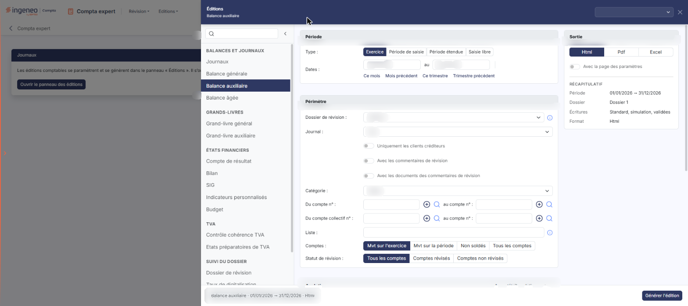
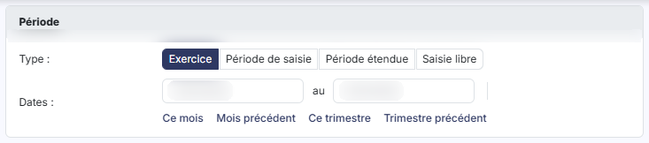
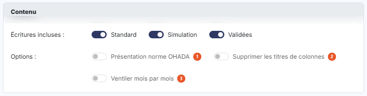
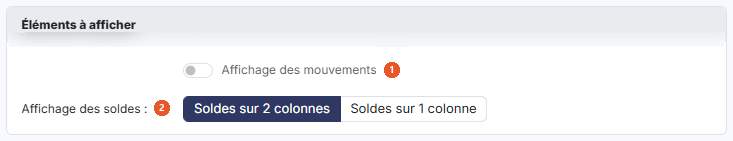
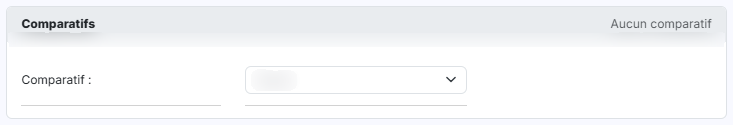
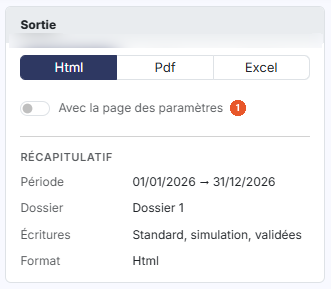

# Balance auxiliaire


**Où le trouver :** Menu **Editions › Balance auxiliaire**



**En bref** — Cette édition produit les soldes des comptes auxiliaires, avec en option les mouvements et des comparatifs, à partir de critères réglés dans le panneau des éditions.

* Pour éditer : réglez les cartes « Période » et « Périmètre », puis bouton \[Générer l'édition].
* Pour ajouter les mouvements : passez « Affichage des mouvements » à « Oui », puis bouton \[Générer l'édition].


Cette option permet d'éditer les soldes des comptes auxiliaires.

<figure><figcaption>
Écran « Balance auxiliaire » de la nouvelle interface
</figcaption></figure>

L'édition se paramètre dans un panneau : le formulaire est un ensemble de cartes (« Période », « Périmètre », « Analytique », « Contenu », « Éléments à afficher » et « Comparatifs ») que vous renseignez de haut en bas ; vous lancez ensuite l'édition avec le bouton \[Générer l'édition]. Aucun critère n'est obligatoire : le logiciel part des valeurs proposées à l'ouverture.

## Le panneau d'éditions

<figure><figcaption>
Bouton [Ouvrir le panneau des éditions]
</figcaption></figure>

Cette édition ne s'ouvre plus dans une page de paramétrage : elle se paramètre et se génère dans le **panneau d'éditions**, commun à toutes les éditions comptables. Pour l'ouvrir, cliquez sur le menu **Éditions** de la barre du module, puis sur **Balance auxiliaire** ; depuis l'écran Révision, ouvrez le menu ⋮ (Plus d'actions), puis **Éditions**, et choisissez l'édition dans la liste de gauche du panneau. La page qui s'affiche derrière porte le titre de l'édition et le bouton **\[Ouvrir le panneau des éditions]** : le panneau s'ouvre de lui-même ; si vous l'avez fermé, ce bouton le rouvre.

Le panneau est un tiroir intitulé « Éditions », suivi du nom de l'édition. **À gauche**, la liste des quinze éditions en cinq groupes — « Balances et journaux », « Grands-livres », « États financiers », « TVA » et « Suivi du dossier » — avec une zone « Rechercher une édition » et un bouton « Replier la liste » ; cliquer sur une autre édition change de formulaire sans quitter le panneau. **Au centre**, le formulaire, présenté en cartes. **À droite**, la carte « Sortie » et le « Récapitulatif » des critères retenus. **En en-tête**, la liste des paramétrages enregistrés (voir plus bas) et la croix « Fermer ». **Dans le pied**, un résumé de l'édition (nom, dates, format) et, à droite, le bouton **\[Générer l'édition]**. Le pied ne porte pas de bouton \[Annuler] : le panneau se referme par la croix « Fermer » de l'en-tête.

## Carte « Période »

<figure><figcaption>
Rubrique « Carte « Période » »
</figcaption></figure>

| Champ          | Ce qu'il faut savoir                                                                                                                                                                                                                                                                                                                                                                          |
| -------------- | --------------------------------------------------------------------------------------------------------------------------------------------------------------------------------------------------------------------------------------------------------------------------------------------------------------------------------------------------------------------------------------------- |
| **Type**       | Choisissez la période sur laquelle porte l'édition, au moyen de quatre boutons : « Exercice », « Période de saisie », « Période étendue » et « Saisie libre ».                                                                                                                                                                                                                                |
| **Dates … au** | Le logiciel renseigne les deux dates d'après le type choisi. Elles restent saisissables à tout moment : modifier une date fait passer le type sur « Saisie libre ». Il n'y a plus de pictogramme « Calendrier » : le calendrier s'ouvre au clic dans la zone de date.                                                                                                                         |
| **Raccourcis** | Sous les dates, « Ce mois », « Mois précédent », « Ce trimestre » et « Trimestre précédent » renseignent les deux dates et passent le type sur « Saisie libre ». Une ligne de rappel, par exemple « Période relative : Ce mois (dates du jour, recalculées à chaque chargement du modèle d'édition). », précise alors que ces dates sont recalculées à chaque chargement du modèle d'édition. |

## Carte « Périmètre »

<figure><figcaption>
Rubrique « Carte « Périmètre » »
</figcaption></figure>

| Champ                                                  | Ce qu'il faut savoir                                                                                                                                                                                                                                                                                                                                                                                                                                                                                       |
| ------------------------------------------------------ | ---------------------------------------------------------------------------------------------------------------------------------------------------------------------------------------------------------------------------------------------------------------------------------------------------------------------------------------------------------------------------------------------------------------------------------------------------------------------------------------------------------- |
| 1. **Dossier de révision**                             | Liste proposant « Aucun », puis chacun des dossiers de révision du dossier annuel. Une info-bulle précise : « Sélectionnez le dossier de révision pris en compte par l'édition : ses commentaires de révision si l'option « Avec les commentaires de révision » est active, et les écritures de simulation de son journal si l'option « Avec les écritures de simulation » est active. « Aucun » : seules les écritures de simulation des journaux non rattachés à un dossier de révision sont retenues. » |
| 2. **Journal**                                         | Choisissez « Tous » pour ne pas restreindre l'édition, ou un journal du dossier pour ne retenir que ses écritures.                                                                                                                                                                                                                                                                                                                                                                                         |
| 3. **Uniquement les clients créditeurs**               | Cet interrupteur, placé sous le choix du journal, n'apparaît que pour deux catégories, et son libellé change avec elles. Si « Catégorie » vaut « Clients », il s'intitule « Uniquement les clients créditeurs » ; si elle vaut « Fournisseurs », il s'intitule « Uniquement les fournisseurs débiteurs ». Dans les deux cas, il ne retient que les comptes au solde anormal. Il n'apparaît pas pour les catégories « Toutes », « Divers » et « Salariés ».                                                 |
| 4. **Avec les commentaires de révision**               | Interrupteur.                                                                                                                                                                                                                                                                                                                                                                                                                                                                                              |
| 5. **Avec les documents des commentaires de révision** | Interrupteur.                                                                                                                                                                                                                                                                                                                                                                                                                                                                                              |
| 6. **Catégorie**                                       | Choisissez la catégorie de comptes auxiliaires pour laquelle vous souhaitez éditer la balance, parmi « Toutes », « Divers », « Clients », « Fournisseurs » et « Salariés ». À l'ouverture, « Clients » est sélectionné. Ce choix commande deux autres critères de la carte : les zones de compte collectif, et l'interrupteur « Uniquement les clients créditeurs » (ou « fournisseurs débiteurs »).                                                                                                       |
| 7. **Du compte collectif n° … au compte n°**           | Même principe que la fourchette de comptes, appliqué aux comptes collectifs. Ces deux zones ne s'affichent pas lorsque « Catégorie » vaut « Toutes ».                                                                                                                                                                                                                                                                                                                                                      |
| 8. **Liste**                                           | Vous pouvez indiquer des comptes ou des racines de comptes qui ne se suivent pas. Le logiciel rappelle en infobulle : « Séparez les numéros de comptes ou les racines par des points virgules ou des tirets. »                                                                                                                                                                                                                                                                                             |
| 9. **Comptes**                                         | 
Vous affinez encore votre édition en indiquant quels comptes retenir : • « Mvt sur l'exercice » • « Mvt sur la période » • « Non soldés » • « Tous les comptes »
                                                                                                                                                                                                                                                                                                                        |
| 10. **Statut de révision**                             | Retenez « Tous les comptes », « Comptes révisés » ou « Comptes non révisés ». Attention : le choix « Tous les comptes » existe aussi dans le critère « Comptes » juste au-dessus, où il a un tout autre sens.                                                                                                                                                                                                                                                                                              |
| **Du compte n° … au compte n°**                        | Vous avez la possibilité de ne retenir qu'une partie du plan comptable auxiliaire en indiquant le compte de début et le compte de fin. À droite de chaque zone se trouvent un bouton « + » (info-bulle « Créer ») et une loupe ; la loupe vous permet de rechercher un compte.                                                                                                                                                                                                                             |

Les critères de choix des comptes sont cumulatifs.

## Carte « Analytique »

<figure><figcaption>
Rubrique « Carte « Analytique » »
</figcaption></figure>

**Avec détail analytique** : La carte, repliée tant que l'interrupteur est désactivé, se déplie alors et propose « Axes » et « Sections » (deux listes à choix multiple), « Présentation de l'édition » (« Détail des sections par compte » par défaut, ou « Détail des comptes par section ») et « Inclure les écritures non ventilées ».

## Carte « Contenu »

<figure><figcaption>
Rubrique « Carte « Contenu » »
</figcaption></figure>

| Champ                                   | Ce qu'il faut savoir                                                                                                                                                                                                                                          |
| --------------------------------------- | ------------------------------------------------------------------------------------------------------------------------------------------------------------------------------------------------------------------------------------------------------------- |
| 1. **Présentation norme OHADA**         | Le logiciel rappelle en infobulle : « Si vous activer cette option, les colonnes de la balance seront organisées chronologiquement comme l'exige la norme OHADA » (le libellé de l'infobulle est fautif dans le logiciel : il faut lire « si vous activez »). |
| 2. **Supprimer les titres de colonnes** | Interrupteur.                                                                                                                                                                                                                                                 |
| 3. **Ventiler mois par mois**           | Interrupteur.                                                                                                                                                                                                                                                 |
| **Écritures incluses**                  | Trois interrupteurs, tous activés par défaut. « Standard » fait figurer dans l'édition les écritures ordinaires de la comptabilité, « Simulation » les écritures de simulation et « Validées » les écritures validées.                                        |

## Carte « Éléments à afficher »

<figure><figcaption>
Rubrique « Carte « Éléments à afficher » »
</figcaption></figure>

| Champ                                                    | Ce qu'il faut savoir                                                                                                                                |
| -------------------------------------------------------- | --------------------------------------------------------------------------------------------------------------------------------------------------- |
| 1. **Affichage des mouvements**                          | À « Oui », le logiciel ajoute les colonnes de totaux des mouvements au débit et au crédit.                                                          |
| 2. **Affichage des soldes**                              | Vous pouvez afficher les soldes sur deux colonnes (débit et crédit) avec « Soldes sur 2 colonnes », ou sur une seule avec « Soldes sur 1 colonne ». |
| **Inclure les à-nouveaux dans les totaux de mouvements** | Cet interrupteur n'apparaît que si vous avez mis le précédent à « Oui ».                                                                            |

## Carte « Comparatifs »

<figure><figcaption>
Rubrique « Carte « Comparatifs » »
</figcaption></figure>

**Comparatif 1** : et **Comparatif 2 :** dans la même édition, vous pouvez comparer les soldes des comptes à ceux d'autres exercices. Chaque comparatif a sa colonne dans la carte. Les deux listes proposent les mêmes choix : « Aucun », « n-1 (générique) », « n-2 (générique) », puis chacun des exercices du dossier. Dès qu'un comparatif est choisi, ses paramètres (période, dossier de révision, dates, solde, variations) apparaissent sous la liste, comme pour la balance générale, avec un lien « Retirer ».

## Carte « Sortie » et récapitulatif

<figure><figcaption>
Rubrique « Carte « Sortie » et récapitulatif »
</figcaption></figure>

La carte « Sortie » se trouve dans la colonne de droite, sous le titre du panneau. **Format :** trois boutons, « Html », « Pdf » et « Excel ».

| Champ                              | Ce qu'il faut savoir                                                                                                                                                                                                                                                                                                                                                                                                             |
| ---------------------------------- | -------------------------------------------------------------------------------------------------------------------------------------------------------------------------------------------------------------------------------------------------------------------------------------------------------------------------------------------------------------------------------------------------------------------------------- |
| 1. **Avec la page des paramètres** | 
Interrupteur désactivé par défaut. • « Html » : c'est le choix proposé par défaut.
                                                                                                                                                                                                                                                                                                                                     |
| **Orientation**                    | Ce choix n'apparaît que si le format retenu est « Pdf ». Il vous permet d'imprimer en « Portrait » (choix par défaut) ou en « Paysage ».                                                                                                                                                                                                                                                                                         |
| **Largeur**                        | Ce choix n'apparaît lui aussi que si le format retenu est « Pdf ». La largeur « Ajustée » réduit la taille lorsque la largeur des colonnes dépasse la largeur de la page (info-bulle : « Ajuste la taille si la largeur des colonnes dépasse la largeur de la page ») ; la largeur « Fixe » ne la modifie pas. Attention : lorsque vous passez le format à « Pdf », le logiciel positionne de lui-même ce choix sur « Ajustée ». |
| **Récapitulatif**                  | Sous la carte « Sortie », il rappelle les critères retenus (période, dossier de révision, écritures, format, et selon l'édition les journaux, l'analytique ou le nombre de colonnes). Il se met à jour au fil de vos choix.                                                                                                                                                                                                      |

## Paramétrages enregistrés et génération

**Les paramétrages enregistrés**

La zone « Nouveau paramétrage… », en haut à droite du panneau, remplace les anciens boutons \[Mémoriser les paramètres] et \[Charger les paramètres]. Son chevron (« Afficher les paramètres enregistrés ») ouvre une liste : l'entrée « Nouveau paramètre — À partir des critères affichés », puis, sous le nom de l'édition et avec leur nombre, les paramétrages déjà enregistrés **pour cette édition** (un paramétrage enregistré pour une autre édition n'y figure pas). Au survol d'un paramétrage, deux icônes permettent de le dupliquer ou de le supprimer.

| Champ                                 | Ce qu'il faut savoir                                                                                                                                                                                                                                                                                                                            |
| ------------------------------------- | ----------------------------------------------------------------------------------------------------------------------------------------------------------------------------------------------------------------------------------------------------------------------------------------------------------------------------------------------- |
| **Enregistrer les critères affichés** | Saisissez un nom dans la zone « Nouveau paramétrage… », puis validez par la touche Entrée ou par le bouton d'enregistrement placé à droite de la zone (info-bulle « Enregistrer comme nouveau paramètre (Entrée) »).                                                                                                                            |
| **Reprendre un paramétrage**          | Cliquez sur son nom dans la liste. Le formulaire se remplit avec ses critères, y compris le format de sortie, et le nom s'affiche dans la zone d'en-tête. Une icône d'enregistrement placée à côté du nom (info-bulle « Modifié – mettre à jour « nom » (Entrée) ») permet de remettre à jour le paramétrage chargé avec les critères affichés. |

bouton **\[Générer l'édition]**

Il se trouve dans le pied du panneau et lance la génération du document dans le format que vous avez retenu. bouton **\[Retour au paramétrage]**, bouton **\[Ouvrir dans un onglet]**, bouton **\[Excel]** et bouton **\[Pdf]** ne sont pas affichés à l'ouverture : le panneau les prévoit après la génération.
