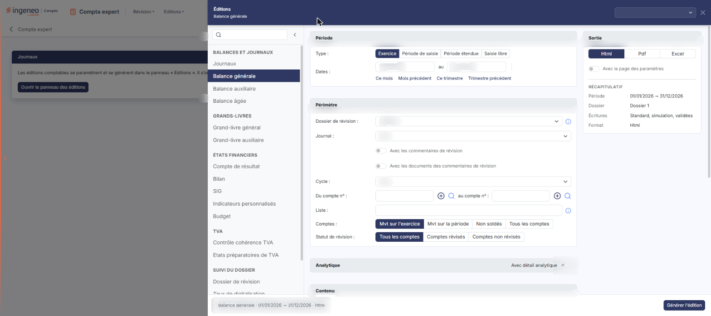
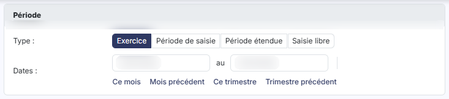
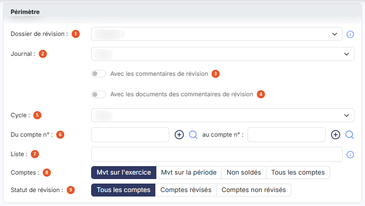
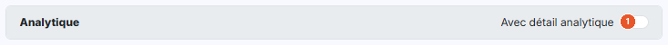
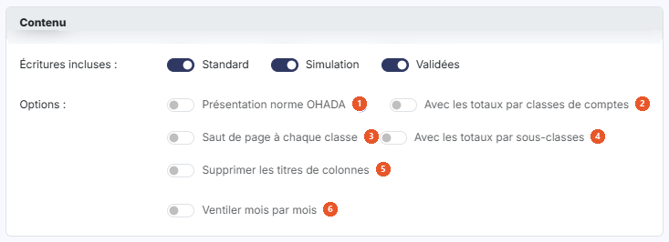
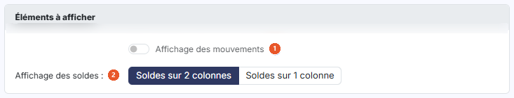
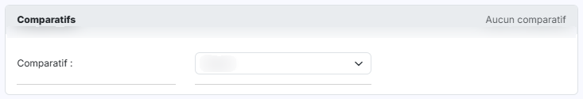
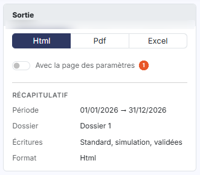

# Balance générale


**Où le trouver :** Menu **Editions › Balance générale**



**En bref** — Cette édition produit les soldes de vos comptes généraux, avec en option les mouvements et des comparatifs, à partir de critères réglés dans le panneau des éditions.

* Pour éditer : réglez les cartes « Période » et « Périmètre », puis bouton \[Générer l'édition].
* Pour comparer les soldes à d'autres périodes : renseignez « Comparatif 1 » et « Comparatif 2 », puis bouton \[Générer l'édition].


Cette page vous permet d'éditer les soldes de vos comptes généraux. Vous y renseignez les critères de l'édition dans un panneau, puis vous la déclenchez avec le bouton **\[Générer l'édition]**.

<figure><figcaption>
Écran « Balance générale » de la nouvelle interface
</figcaption></figure>

Le formulaire se présente en cartes, dans l'ordre suivant : « Période », « Périmètre », « Analytique », « Contenu », « Eléments à afficher » et « Comparatifs », complétées à droite par la carte « Sortie ». Certains choix font apparaître des champs supplémentaires : ils sont signalés au fil du texte. Aucun champ n'est obligatoire.

## Le panneau d'éditions

<figure><figcaption>
Bouton [Ouvrir le panneau des éditions]
</figcaption></figure>

Cette édition ne s'ouvre plus dans une page de paramétrage : elle se paramètre et se génère dans le **panneau d'éditions**, commun à toutes les éditions comptables. Pour l'ouvrir, cliquez sur le menu **Éditions** de la barre du module, puis sur **Balance générale** ; depuis l'écran Révision, ouvrez le menu ⋮ (Plus d'actions), puis **Éditions**, et choisissez l'édition dans la liste de gauche du panneau. La page qui s'affiche derrière porte le titre de l'édition et le bouton **\[Ouvrir le panneau des éditions]** : le panneau s'ouvre de lui-même ; si vous l'avez fermé, ce bouton le rouvre.

Le panneau est un tiroir intitulé « Éditions », suivi du nom de l'édition. **À gauche**, la liste des quinze éditions en cinq groupes — « Balances et journaux », « Grands-livres », « États financiers », « TVA » et « Suivi du dossier » — avec une zone « Rechercher une édition » et un bouton « Replier la liste » ; cliquer sur une autre édition change de formulaire sans quitter le panneau. **Au centre**, le formulaire, présenté en cartes. **À droite**, la carte « Sortie » et le « Récapitulatif » des critères retenus. **En en-tête**, la liste des paramétrages enregistrés (voir plus bas) et la croix « Fermer ». **Dans le pied**, un résumé de l'édition (nom, dates, format) et, à droite, le bouton **\[Générer l'édition]**. Le pied ne porte pas de bouton \[Annuler] : le panneau se referme par la croix « Fermer » de l'en-tête.

## Carte « Période »

<figure><figcaption>
Rubrique « Carte « Période » »
</figcaption></figure>

| Champ          | Ce qu'il faut savoir                                                                                                                                                                                                                                                                                                                                                                          |
| -------------- | --------------------------------------------------------------------------------------------------------------------------------------------------------------------------------------------------------------------------------------------------------------------------------------------------------------------------------------------------------------------------------------------- |
| **Type**       | Choisissez la période sur laquelle porte l'édition, au moyen de quatre boutons : « Exercice », « Période de saisie », « Période étendue » et « Saisie libre ». Le logiciel se positionne par défaut sur « Exercice ».                                                                                                                                                                         |
| **Dates … au** | Le logiciel renseigne les deux dates d'après le type choisi. Elles restent saisissables à tout moment : modifier une date fait passer le type sur « Saisie libre ». Il n'y a plus de pictogramme « Calendrier » : le calendrier s'ouvre au clic dans la zone de date.                                                                                                                         |
| **Raccourcis** | Sous les dates, « Ce mois », « Mois précédent », « Ce trimestre » et « Trimestre précédent » renseignent les deux dates et passent le type sur « Saisie libre ». Une ligne de rappel, par exemple « Période relative : Ce mois (dates du jour, recalculées à chaque chargement du modèle d'édition). », précise alors que ces dates sont recalculées à chaque chargement du modèle d'édition. |

## Carte « Périmètre »

<figure><figcaption>
Rubrique « Carte « Périmètre » »
</figcaption></figure>

| Champ                                                  | Ce qu'il faut savoir                                                                                                                                                                                                                                                                                                                                                                                                                                                                                       |
| ------------------------------------------------------ | ---------------------------------------------------------------------------------------------------------------------------------------------------------------------------------------------------------------------------------------------------------------------------------------------------------------------------------------------------------------------------------------------------------------------------------------------------------------------------------------------------------- |
| 1. **Dossier de révision**                             | Liste proposant « Aucun », puis chacun des dossiers de révision du dossier annuel. Une info-bulle précise : « Sélectionnez le dossier de révision pris en compte par l'édition : ses commentaires de révision si l'option « Avec les commentaires de révision » est active, et les écritures de simulation de son journal si l'option « Avec les écritures de simulation » est active. « Aucun » : seules les écritures de simulation des journaux non rattachés à un dossier de révision sont retenues. » |
| 2. **Journal**                                         | Par défaut la liste est positionnée sur « Tous », mais vous pouvez restreindre l'édition aux écritures d'un seul journal en le sélectionnant. La liste reprend les journaux du dossier.                                                                                                                                                                                                                                                                                                                    |
| 3. **Avec les commentaires de révision**               | « Non » par défaut.                                                                                                                                                                                                                                                                                                                                                                                                                                                                                        |
| 4. **Avec les documents des commentaires de révision** | « Non » par défaut.                                                                                                                                                                                                                                                                                                                                                                                                                                                                                        |
| 5. **Cycle**                                           | Par défaut la liste est positionnée sur « Tous », ce qui édite tous les comptes. Si vous souhaitez restreindre l'édition à un seul cycle de révision, choisissez-le dans la liste.                                                                                                                                                                                                                                                                                                                         |
| 6. **Du compte n°**                                    | **au compte n° :** vous avez la possibilité de ne retenir qu'une partie du plan comptable en indiquant le compte de début et le compte de fin. À droite de chaque champ se trouvent un bouton « + » (info-bulle « Créer ») et une loupe ; la loupe ouvre la recherche de compte.                                                                                                                                                                                                                           |
| 7. **Liste**                                           | Vous pouvez indiquer des comptes ou des racines de comptes qui ne se suivent pas. Le logiciel rappelle la règle de saisie dans l'infobulle du champ : « Séparez les numéros de comptes ou les racines par des points virgules ou des tirets. »                                                                                                                                                                                                                                                             |
| 8. **Comptes**                                         | Vous affinez l'édition en indiquant quels comptes doivent y figurer : « Mvt sur l'exercice » (choix par défaut), « Mvt sur la période », « Non soldés » ou « Tous les comptes ».                                                                                                                                                                                                                                                                                                                           |
| 9. **Statut de révision**                              | Vous retenez « Tous les comptes » (choix par défaut), « Comptes révisés » ou « Comptes non révisés ».                                                                                                                                                                                                                                                                                                                                                                                                      |
| **Remarque**                                           | Les critères de choix des comptes sont cumulatifs. Ainsi, si vous ne souhaitez éditer que les comptes compris dans une fourchette donnée pour un cycle de révision, sélectionnez le cycle et saisissez la fourchette souhaitée.                                                                                                                                                                                                                                                                            |

## Carte « Analytique »

<figure><figcaption>
Rubrique « Carte « Analytique » »
</figcaption></figure>

**Avec détail analytique** : « Non » par défaut ; la carte reste repliée. Sur « Oui », le logiciel fait apparaître les paramètres de l'édition analytique :

* **Axes** : liste à choix multiple, positionnée sur « Tous les axes » par défaut, avec une case par axe du dossier : plusieurs axes peuvent être retenus dans la même édition. Il n'y a plus de choix « Type d'axe » (« Liste » ou « Agrégat »).
* **Sections** : liste à choix multiple, positionnée sur « Toutes les sections » par défaut, avec une case par section. Il n'y a plus de choix « Type de section ».
* **Présentation de l'édition** : deux choix : « Détail des sections par compte » (choix par défaut) ou « Détail des comptes par section ».
* **Inclure les écritures non ventilées** : « Non » par défaut.

## Carte « Contenu »

<figure><figcaption>
Rubrique « Carte « Contenu » »
</figcaption></figure>

| Champ                                         | Ce qu'il faut savoir                                                                                                                                                                                                                                                                                                                        |
| --------------------------------------------- | ------------------------------------------------------------------------------------------------------------------------------------------------------------------------------------------------------------------------------------------------------------------------------------------------------------------------------------------- |
| 1. **Présentation norme OHADA**               | « Non » par défaut. Le logiciel indique dans l'infobulle du champ : « Si vous activer cette option, les colonnes de la balance seront organisées chronologiquement comme l'exige la norme OHADA ».                                                                                                                                          |
| 2. **Avec les totaux par classes de comptes** | « Non » par défaut.                                                                                                                                                                                                                                                                                                                         |
| 3. **Saut de page à chaque classe**           | « Non » par défaut.                                                                                                                                                                                                                                                                                                                         |
| 4. **Avec les totaux par sous-classes**       | « Non » par défaut.                                                                                                                                                                                                                                                                                                                         |
| 5. **Supprimer les titres de colonnes**       | « Non » par défaut.                                                                                                                                                                                                                                                                                                                         |
| 6. **Ventiler mois par mois**                 | 
Positionné sur « Non » par défaut. Sur « Oui », le logiciel modifie le formulaire : • il fait apparaître <strong>Position du total :</strong> qui place la colonne de total à gauche (choix par défaut) ou à droite ; • il masque la carte « Comparatifs » : aucun comparatif n'est proposé tant que cette option est activée.
 |
| **Écritures incluses**                        | Trois interrupteurs, tous activés par défaut. « Standard » fait figurer dans l'édition les écritures ordinaires de la comptabilité, « Simulation » les écritures de simulation et « Validées » les écritures validées.                                                                                                                      |

## Carte « Eléments à afficher »

<figure><figcaption>
Rubrique « Carte « Eléments à afficher » »
</figcaption></figure>

| Champ                           | Ce qu'il faut savoir                                                                                                                                                                                                                                                                                                                                     |
| ------------------------------- | -------------------------------------------------------------------------------------------------------------------------------------------------------------------------------------------------------------------------------------------------------------------------------------------------------------------------------------------------------- |
| 1. **Affichage des mouvements** | Positionné sur « Non » par défaut. L'infobulle indique : « Ajoute les colonnes de totaux des mouvements au débit et au crédit ». Sur « Oui », le logiciel ajoute ces colonnes et fait apparaître juste en dessous le champ **Inclure les à-nouveaux dans les totaux de mouvements :** (« Non » par défaut).                                              |
| 2. **Affichage des soldes**     | Vous affichez les soldes des comptes sur deux colonnes, débit et crédit (choix par défaut), ou sur une seule colonne. Avec « Soldes sur 1 colonne », le logiciel fait apparaître **Affichage du signe (-) :** qui place le signe devant les crédits (« Signe (-) devant crédits », choix par défaut) ou devant les débits (« Signe (-) devant débits »). |

## Carte « Comparatifs »

<figure><figcaption>
Rubrique « Carte « Comparatifs » »
</figcaption></figure>

**Comparatif 1** : et **Comparatif 2 :** dans la même édition, vous pouvez comparer les soldes des comptes à ceux de deux autres exercices. Chaque comparatif a sa colonne dans la carte ; les deux listes sont positionnées sur « Aucun » par défaut et proposent « n-1 (générique) », « n-2 (générique) » ainsi que chacun des exercices du dossier. Le bandeau de la carte indique « Aucun comparatif » ou « 1 comparatif actif » ; une colonne dont la liste est sur « Aucun » affiche « Choisissez un comparatif ci-dessus pour renseigner cette colonne. »

Dès que vous retenez autre chose que « Aucun », le logiciel fait apparaître sous la liste les paramètres du comparatif, ainsi qu'un lien « Retirer » à côté du titre de la colonne :

* **Période** : « Tout l'exercice » par défaut ou « Saisie libre ». La liste **Dossier de révision :** (« Aucun » par défaut) est présentée sous ce choix.
* **Du** : … **Jusqu'au :** les deux dates de la période comparée ; le logiciel les renseigne avec les dates de l'exercice retenu (par exemple 01/01/2025 et 31/12/2025 pour « n-1 (générique) »).
* **Avec solde** : activé par défaut.
* **Avec variation en valeur** : désactivé par défaut.
* **Avec variation en %** : désactivé par défaut.

## Carte « Sortie » et récapitulatif

<figure><figcaption>
Rubrique « Carte « Sortie » et récapitulatif »
</figcaption></figure>

La carte « Sortie » se trouve dans la colonne de droite, sous le titre du panneau. **Format :** trois boutons, « Html », « Pdf » et « Excel ».

| Champ                              | Ce qu'il faut savoir                                                                                                                                                                                                                                                                                                                                                                                                             |
| ---------------------------------- | -------------------------------------------------------------------------------------------------------------------------------------------------------------------------------------------------------------------------------------------------------------------------------------------------------------------------------------------------------------------------------------------------------------------------------- |
| 1. **Avec la page des paramètres** | 
Interrupteur désactivé par défaut. • « Html » : c'est le format retenu par défaut. • « Pdf » : le logiciel fait alors apparaître deux champs supplémentaires, « Orientation » et « Largeur » (décrits ci-dessous). • « Excel » : aucun champ supplémentaire n'est demandé.
                                                                                                                                       |
| **Orientation**                    | Ce choix n'apparaît que si le format retenu est « Pdf ». Il vous permet d'imprimer en « Portrait » (choix par défaut) ou en « Paysage ».                                                                                                                                                                                                                                                                                         |
| **Largeur**                        | Ce choix n'apparaît lui aussi que si le format retenu est « Pdf ». La largeur « Ajustée » réduit la taille lorsque la largeur des colonnes dépasse la largeur de la page (info-bulle : « Ajuste la taille si la largeur des colonnes dépasse la largeur de la page ») ; la largeur « Fixe » ne la modifie pas. Attention : lorsque vous passez le format à « Pdf », le logiciel positionne de lui-même ce choix sur « Ajustée ». |
| **Récapitulatif**                  | Sous la carte « Sortie », il rappelle les critères retenus (période, dossier de révision, écritures, format, et selon l'édition les journaux, l'analytique ou le nombre de colonnes). Il se met à jour au fil de vos choix.                                                                                                                                                                                                      |

## Paramétrages enregistrés et génération

**Les paramétrages enregistrés**

La zone « Nouveau paramétrage… », en haut à droite du panneau, remplace les anciens boutons \[Mémoriser les paramètres] et \[Charger les paramètres]. Son chevron (« Afficher les paramètres enregistrés ») ouvre une liste : l'entrée « Nouveau paramètre — À partir des critères affichés », puis, sous le nom de l'édition et avec leur nombre, les paramétrages déjà enregistrés **pour cette édition** (un paramétrage enregistré pour une autre édition n'y figure pas). Au survol d'un paramétrage, deux icônes permettent de le dupliquer ou de le supprimer.

| Champ                                 | Ce qu'il faut savoir                                                                                                                                                                                                                                                                                                                            |
| ------------------------------------- | ----------------------------------------------------------------------------------------------------------------------------------------------------------------------------------------------------------------------------------------------------------------------------------------------------------------------------------------------- |
| **Enregistrer les critères affichés** | Saisissez un nom dans la zone « Nouveau paramétrage… », puis validez par la touche Entrée ou par le bouton d'enregistrement placé à droite de la zone (info-bulle « Enregistrer comme nouveau paramètre (Entrée) »).                                                                                                                            |
| **Reprendre un paramétrage**          | Cliquez sur son nom dans la liste. Le formulaire se remplit avec ses critères, y compris le format de sortie, et le nom s'affiche dans la zone d'en-tête. Une icône d'enregistrement placée à côté du nom (info-bulle « Modifié – mettre à jour « nom » (Entrée) ») permet de remettre à jour le paramétrage chargé avec les critères affichés. |

bouton **\[Générer l'édition]**

Il se trouve dans le pied du panneau et lance la génération du document dans le format que vous avez retenu. bouton **\[Retour au paramétrage]**, bouton **\[Ouvrir dans un onglet]**, bouton **\[Excel]** et bouton **\[Pdf]** ne sont pas affichés à l'ouverture : le panneau les prévoit après la génération.
