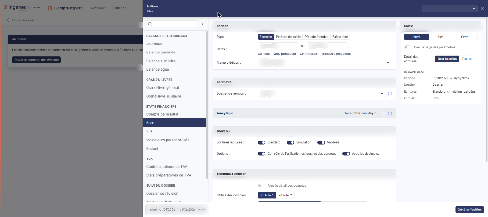
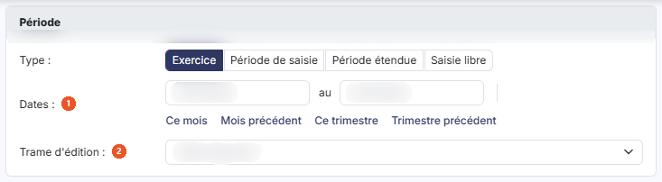
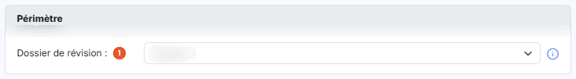
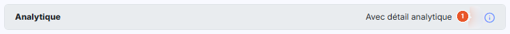
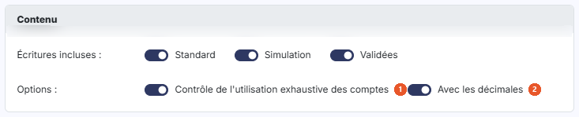
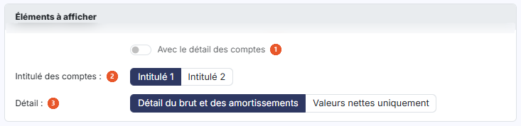
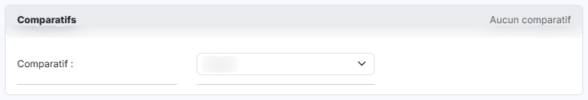
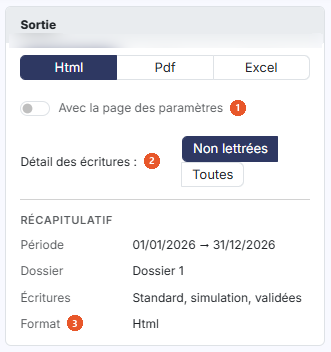

# Bilan


**Où le trouver :** Menu **Editions › Bilan**



**En bref** — Cette édition produit le bilan du dossier, avec en option le détail analytique, le détail des comptes et des comparatifs, à partir du panneau des éditions.

* Pour éditer : choisissez la période, choisissez le format dans la carte « Sortie », puis bouton \[Générer l'édition].
* Pour voir les comptes de chaque agrégat : activez « Avec le détail des comptes », puis bouton \[Générer l'édition].


Cette page vous permet d'éditer le bilan du dossier. Vous y renseignez les critères de l'édition, puis vous la déclenchez avec le bouton **\[Générer l'édition]**.

<figure><figcaption>
Écran « Bilan » de la nouvelle interface
</figcaption></figure>

## Le panneau d'éditions

<figure><figcaption>
Bouton [Ouvrir le panneau des éditions]
</figcaption></figure>

Cette édition ne s'ouvre plus dans une page de paramétrage : elle se paramètre et se génère dans le **panneau d'éditions**, commun à toutes les éditions comptables. Pour l'ouvrir, cliquez sur le menu **Éditions** de la barre du module, puis sur **Bilan** ; depuis l'écran Révision, ouvrez le menu ⋮ (Plus d'actions), puis **Éditions**, et choisissez l'édition dans la liste de gauche du panneau. La page qui s'affiche derrière porte le titre de l'édition et le bouton **\[Ouvrir le panneau des éditions]** : le panneau s'ouvre de lui-même ; si vous l'avez fermé, ce bouton le rouvre.

Le panneau est un tiroir intitulé « Éditions », suivi du nom de l'édition. **À gauche**, la liste des quinze éditions en cinq groupes — « Balances et journaux », « Grands-livres », « États financiers », « TVA » et « Suivi du dossier » — avec une zone « Rechercher une édition » et un bouton « Replier la liste » ; cliquer sur une autre édition change de formulaire sans quitter le panneau. **Au centre**, le formulaire, présenté en cartes. **À droite**, la carte « Sortie » et le « Récapitulatif » des critères retenus. **En en-tête**, la liste des paramétrages enregistrés (voir plus bas) et la croix « Fermer ». **Dans le pied**, un résumé de l'édition (nom, dates, format) et, à droite, le bouton **\[Générer l'édition]**. Le pied ne porte pas de bouton \[Annuler] : le panneau se referme par la croix « Fermer » de l'en-tête.

Les critères se présentent en six cartes, dans l'ordre suivant : « Période », « Périmètre », « Analytique », « Contenu », « Éléments à afficher » et « Comparatifs ». Aucun champ n'est obligatoire.

## Carte « Période »

<figure><figcaption>
Rubrique « Carte « Période » »
</figcaption></figure>

| Champ                  | Ce qu'il faut savoir                                                                                                                                                                                                                                                                                                                                                    |
| ---------------------- | ----------------------------------------------------------------------------------------------------------------------------------------------------------------------------------------------------------------------------------------------------------------------------------------------------------------------------------------------------------------------- |
| 1. **Dates**           | Du … au … : le logiciel renseigne ces deux dates d'après la période choisie. Elles restent saisissables à tout moment, directement ou avec le calendrier, qui s'ouvre au clic dans la zone de date : modifier une date fait passer le type sur « Saisie libre ».                                                                                                        |
| 2. **Trame d'édition** | Choisissez dans la liste la trame d'édition du bilan. Cette liste dépend du dossier : elle reprend les modèles d'états financiers paramétrés pour lui, avec leur libellé tel qu'il a été enregistré.                                                                                                                                                                    |
| **Type**               | Vous choisissez la période éditée avec les boutons « Exercice », « Période de saisie », « Période étendue » et « Saisie libre ». Le logiciel se positionne par défaut sur « Exercice ». Sous les dates, les raccourcis « Ce mois », « Mois précédent », « Ce trimestre » et « Trimestre précédent » renseignent les deux dates et passent le type sur « Saisie libre ». |

## Carte « Périmètre »

<figure><figcaption>
Rubrique « Carte « Périmètre » »
</figcaption></figure>

**Dossier de révision** : le logiciel rappelle la règle dans l'infobulle du champ : « Sélectionnez le dossier de révision pris en compte par l'édition : ses commentaires de révision si l'option « Avec les commentaires de révision » est active, et les écritures de simulation de son journal si l'option « Avec les écritures de simulation » est active. « Aucun » : seules les écritures de simulation des journaux non rattachés à un dossier de révision sont retenues. »

## Carte « Analytique »

<figure><figcaption>
Rubrique « Carte « Analytique » »
</figcaption></figure>

**Avec détail analytique** : cet interrupteur, placé dans l'en-tête de la carte, vous permet de détailler l'édition par section analytique. Il est grisé, donc non actionnable, tant que « Avec le détail des comptes » (carte « Éléments à afficher ») est désactivé ; le logiciel l'explique dans l'infobulle placée à sa droite. Activez d'abord « Avec le détail des comptes » pour pouvoir l'utiliser. Désactiver de nouveau « Avec le détail des comptes » le grise et le ramène sur « désactivé ».

Lorsque vous l'activez, la carte se déplie et propose :

* **Axes** : et **Sections :** deux listes déroulantes qui retiennent par défaut tous les axes et toutes les sections ;
* **Présentation de l'édition** : « Détail des sections par compte » (choix par défaut) ou « Détail des comptes par section » ;
* **Inclure les écritures non ventilées** : interrupteur désactivé par défaut.

Une ligne « Analytique » s'ajoute alors au « Récapitulatif ».

## Carte « Contenu »

<figure><figcaption>
Rubrique « Carte « Contenu » »
</figcaption></figure>

| Champ                                                   | Ce qu'il faut savoir                                                                                                                                                                                                |
| ------------------------------------------------------- | ------------------------------------------------------------------------------------------------------------------------------------------------------------------------------------------------------------------- |
| 1. **Contrôle de l'utilisation exhaustive des comptes** | Interrupteur activé par défaut.                                                                                                                                                                                     |
| 2. **Avec les décimales**                               | Interrupteur activé par défaut.                                                                                                                                                                                     |
| **Écritures incluses**                                  | Trois interrupteurs, « Standard », « Simulation » et « Validées », tous activés par défaut, qui indiquent si l'édition doit contenir les écritures standard, les écritures de simulation et les écritures validées. |

## Carte « Éléments à afficher »

<figure><figcaption>
Rubrique « Carte « Éléments à afficher » »
</figcaption></figure>

| Champ                             | Ce qu'il faut savoir                                                                                                                            |
| --------------------------------- | ----------------------------------------------------------------------------------------------------------------------------------------------- |
| 1. **Avec le détail des comptes** | Interrupteur désactivé par défaut. C'est lui qui commande l'accès à « Avec détail analytique », décrit plus haut.                               |
| 2. **Intitulé des comptes**       | Vous retenez « Intitulé 1 » (choix par défaut) ou « Intitulé 2 ». Ce choix reste affiché que « Avec le détail des comptes » soit activé ou non. |
| 3. **Détail**                     | Deux choix, « Détail du brut et des amortissements » (choix retenu par défaut) et « Valeurs nettes uniquement ».                                |

## Carte « Comparatifs »

<figure><figcaption>
Rubrique « Carte « Comparatifs » »
</figcaption></figure>

La carte indique « Aucun comparatif » à l'ouverture, puis « 1 comparatif actif » ou « 2 comparatifs actifs » selon vos choix. Dans la même édition, vous pouvez comparer les valeurs du bilan à celles de deux autres exercices, présentés côte à côte en deux colonnes, « Comparatif 1 » et « Comparatif 2 ».

**Comparatif** : la liste de chaque colonne est positionnée sur « Aucun » par défaut et propose « n-1 (générique) », « n-2 (générique) » ainsi que chacun des exercices du dossier. Tant que vous gardez « Aucun », la colonne indique « Aucun comparatif ». Dès que vous retenez autre chose, le logiciel fait apparaître les paramètres du comparatif, ainsi qu'un lien « Retirer » qui le retire :

* **Période** : « Tout l'exercice » par défaut, ou « Saisie libre ».
* **Dossier de révision** : « Aucun » par défaut.
* **Du** : et **Jusqu'au :** les dates de début et de fin de la période comparée ; le logiciel les renseigne avec les dates de l'exercice retenu. Elles ne sont saisissables que si « Saisie libre » est retenu.
* **Avec solde** : activé par défaut.
* **Avec variation en valeur** : désactivé par défaut.
* **Avec variation en %** : désactivé par défaut.

## Carte « Sortie » (à droite du formulaire)

<figure><figcaption>
Rubrique « Carte « Sortie » (à droite du formulaire) »
</figcaption></figure>

| Champ                              | Ce qu'il faut savoir                                                                                                                                                                                                                                                                                                                                                                                                                                                                           |
| ---------------------------------- | ---------------------------------------------------------------------------------------------------------------------------------------------------------------------------------------------------------------------------------------------------------------------------------------------------------------------------------------------------------------------------------------------------------------------------------------------------------------------------------------------- |
| 1. **Avec la page des paramètres** | Interrupteur désactivé par défaut.                                                                                                                                                                                                                                                                                                                                                                                                                                                             |
| 2. **Détail des écritures**        | Vous retenez « Non lettrées » (choix par défaut) ou « Toutes ». Ce choix est proposé quel que soit le format retenu.                                                                                                                                                                                                                                                                                                                                                                           |
| 3. **Format**                      | 
Vous avez le choix entre trois formats, présentés en boutons : • « Html » : c'est le format retenu par défaut. • « Pdf » : le logiciel fait alors apparaître deux champs supplémentaires. <strong>Orientation :</strong> « Portrait » par défaut, ou « Paysage ». <strong>Largeur :</strong> « Ajustée » par défaut, ou « Fixe » ; le logiciel précise dans l'infobulle du champ : « Ajuste la taille si la largeur des colonnes dépasse la largeur de la page ». • « Excel ».
 |

Sous ces choix, le « Récapitulatif » rappelle la période, le dossier de révision, les écritures incluses et le format retenus.

## Paramétrages enregistrés et génération

**Les paramétrages enregistrés**

La zone « Nouveau paramétrage… », en haut à droite du panneau, remplace les anciens boutons \[Mémoriser les paramètres] et \[Charger les paramètres]. Son chevron (« Afficher les paramètres enregistrés ») ouvre une liste : l'entrée « Nouveau paramètre — À partir des critères affichés », puis, sous le nom de l'édition et avec leur nombre, les paramétrages déjà enregistrés **pour cette édition** (un paramétrage enregistré pour une autre édition n'y figure pas). Au survol d'un paramétrage, deux icônes permettent de le dupliquer ou de le supprimer.

| Champ                                 | Ce qu'il faut savoir                                                                                                                                                                                                                                                                                                                            |
| ------------------------------------- | ----------------------------------------------------------------------------------------------------------------------------------------------------------------------------------------------------------------------------------------------------------------------------------------------------------------------------------------------- |
| **Enregistrer les critères affichés** | Saisissez un nom dans la zone « Nouveau paramétrage… », puis validez par la touche Entrée ou par le bouton d'enregistrement placé à droite de la zone (info-bulle « Enregistrer comme nouveau paramètre (Entrée) »).                                                                                                                            |
| **Reprendre un paramétrage**          | Cliquez sur son nom dans la liste. Le formulaire se remplit avec ses critères, y compris le format de sortie, et le nom s'affiche dans la zone d'en-tête. Une icône d'enregistrement placée à côté du nom (info-bulle « Modifié – mettre à jour « nom » (Entrée) ») permet de remettre à jour le paramétrage chargé avec les critères affichés. |

bouton **\[Générer l'édition]**

Il se trouve dans le pied du panneau et lance la génération du document dans le format que vous avez retenu. bouton **\[Retour au paramétrage]**, bouton **\[Ouvrir dans un onglet]**, bouton **\[Excel]** et bouton **\[Pdf]** ne sont pas affichés à l'ouverture : le panneau les prévoit après la génération.
