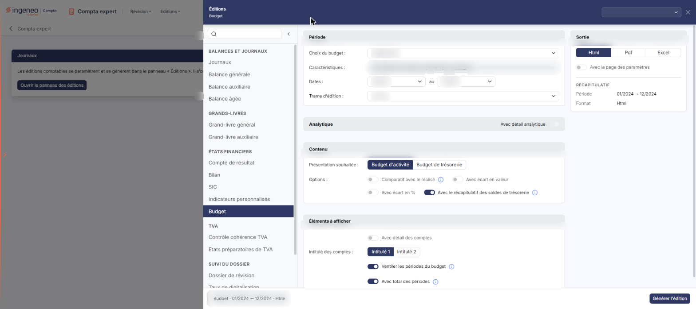
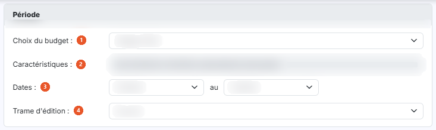
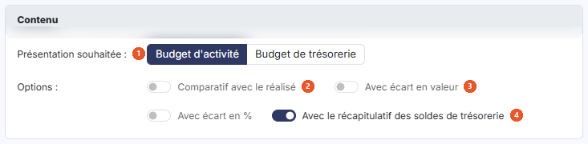
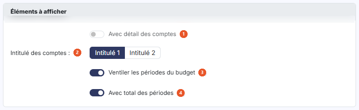
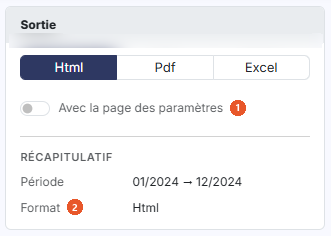

# Budget


**Où le trouver :** Menu **Editions › Budget**



**En bref** — Cette édition produit un budget du dossier, seul ou comparé au réalisé, en présentation d'activité ou de trésorerie, à partir du panneau des éditions.

* Pour éditer : choisissez le budget, la présentation souhaitée et le format dans la carte « Sortie », puis bouton \[Générer l'édition].
* Pour voir les comptes : activez « Avec détail des comptes », puis bouton \[Générer l'édition].


Cette page vous permet d'éditer un budget du dossier, seul ou comparé au réalisé. Vous y renseignez les critères de l'édition, puis vous la déclenchez avec le bouton **\[Générer l'édition]**.

<figure><figcaption>
Écran « Budget » de la nouvelle interface
</figcaption></figure>

## Le panneau d'éditions

<figure><figcaption>
Bouton [Ouvrir le panneau des éditions]
</figcaption></figure>

Cette édition ne s'ouvre plus dans une page de paramétrage : elle se paramètre et se génère dans le **panneau d'éditions**, commun à toutes les éditions comptables. Pour l'ouvrir, cliquez sur le menu **Éditions** de la barre du module, puis sur **Budget** ; depuis l'écran Révision, ouvrez le menu ⋮ (Plus d'actions), puis **Éditions**, et choisissez l'édition dans la liste de gauche du panneau. La page qui s'affiche derrière porte le titre de l'édition et le bouton **\[Ouvrir le panneau des éditions]** : le panneau s'ouvre de lui-même ; si vous l'avez fermé, ce bouton le rouvre.

Le panneau est un tiroir intitulé « Éditions », suivi du nom de l'édition. **À gauche**, la liste des quinze éditions (quatorze depuis le module Comptabilité, où « Dossier de révision » n'apparaît pas dans « Suivi du dossier ») en cinq groupes — « Balances et journaux », « Grands-livres », « États financiers », « TVA » et « Suivi du dossier » — avec une zone « Rechercher une édition » et un bouton « Replier la liste » ; cliquer sur une autre édition change de formulaire sans quitter le panneau. **Au centre**, le formulaire, présenté en cartes. **À droite**, la carte « Sortie » et le « Récapitulatif » des critères retenus. **En en-tête**, la liste des paramétrages enregistrés (voir plus bas) et la croix « Fermer ». **Dans le pied**, un résumé de l'édition (nom, dates, format) et, à droite, le bouton **\[Générer l'édition]**. Le pied ne porte pas de bouton \[Annuler] : le panneau se referme par la croix « Fermer » de l'en-tête.

Les critères se présentent en quatre cartes, dans l'ordre suivant : « Période », « Analytique », « Contenu » et « Éléments à afficher » ; la carte « Sortie » est à droite.

## Carte « Période »

<figure><figcaption>
Rubrique « Carte « Période » »
</figcaption></figure>

| Champ                   | Ce qu'il faut savoir                                                                                                                                                                                                                                                                                                                               |
| ----------------------- | -------------------------------------------------------------------------------------------------------------------------------------------------------------------------------------------------------------------------------------------------------------------------------------------------------------------------------------------------- |
| 1. **Choix du budget**  | La liste reprend les budgets saisis dans le dossier — elle vous est donc propre — et comporte une première entrée vide. À l'ouverture de l'écran, le logiciel présélectionne le budget déclaré « Budget de référence » sur sa fiche ; si aucun budget ne l'est, la liste reste sur son entrée vide. Ce champ ne porte plus d'astérisque à l'écran. |
| 2. **Caractéristiques** | Ce champ n'est pas saisissable : le logiciel y récapitule la plage et la périodicité du budget que vous venez de choisir, par exemple « De 01/2024 à 12/2024, périodicité mensuelle. » Il se réaffiche à chaque changement de budget.                                                                                                              |
| 3. **Dates**            | Du … au … : vous délimitez la partie du budget à éditer. Ce ne sont pas des champs date mais deux listes de périodes, alimentées par les périodes du budget choisi : elles changent donc lorsque vous changez de budget. Le logiciel les positionne sur la première et la dernière période du budget.                                              |
| 4. **Trame d'édition**  | Positionné sur « Aucune » par défaut. La liste reprend les modèles d'états financiers paramétrés pour le dossier, avec leur libellé tel qu'il a été enregistré.                                                                                                                                                                                    |

## Carte « Analytique »

<figure><figcaption>
Rubrique « Carte « Analytique » »
</figcaption></figure>

**Avec détail analytique** : cet interrupteur, placé dans l'en-tête de la carte, vous permet de détailler l'édition par section analytique. Il est grisé, donc non actionnable, tant que « Avec détail des comptes » (carte « Éléments à afficher ») est désactivé. Activez d'abord « Avec détail des comptes » pour pouvoir l'utiliser ; il n'est plus nécessaire de retenir une trame d'édition. Désactiver de nouveau « Avec détail des comptes » replie la carte et grise de nouveau l'interrupteur.

Lorsque vous l'activez, la carte se déplie et propose deux champs, et une ligne « Analytique » s'ajoute au « Récapitulatif » :

* **Axe analytique** : l'édition analytique ne porte que sur un axe à la fois ; le logiciel présélectionne un axe, que vous pouvez changer dans la liste.
* **Inclure les écritures non ventilées** : interrupteur désactivé par défaut.

## Carte « Contenu »

<figure><figcaption>
Rubrique « Carte « Contenu » »
</figcaption></figure>

| Champ                                                 | Ce qu'il faut savoir                                                                                                                                                                                                                                                       |
| ----------------------------------------------------- | -------------------------------------------------------------------------------------------------------------------------------------------------------------------------------------------------------------------------------------------------------------------------- |
| 1. **Présentation souhaitée**                         | Vous retenez « Budget d'activité » (choix par défaut) ou « Budget de trésorerie ».                                                                                                                                                                                         |
| 2. **Comparatif avec le réalisé**                     | Interrupteur désactivé par défaut. Infobulle du champ : « Si vous indiquez "Oui", une colonne affichant le montant du réalisé sera insérée pour chaque période du budget. »                                                                                                |
| 3. **Avec écart en valeur**                           | **Avec écart en % :** interrupteurs désactivés par défaut. Ils sont affichés en permanence, que « Comparatif avec le réalisé » soit activé ou non.                                                                                                                         |
| 4. **Avec le récapitulatif des soldes de trésorerie** | Interrupteur activé par défaut, affiché quelle que soit la présentation retenue. Le logiciel explique son effet dans l'infobulle : « Si vous indiquez "Oui", un tableau récapitulatif du total des mouvements et des soldes de trésorerie sera affiché en fin d'édition. » |

## Carte « Éléments à afficher »

<figure><figcaption>
Rubrique « Carte « Éléments à afficher » »
</figcaption></figure>

| Champ                                  | Ce qu'il faut savoir                                                                                                                                                                                                                                        |
| -------------------------------------- | ----------------------------------------------------------------------------------------------------------------------------------------------------------------------------------------------------------------------------------------------------------- |
| 1. **Avec détail des comptes**         | Interrupteur désactivé par défaut, affiché que vous ayez retenu une trame d'édition ou non.                                                                                                                                                                 |
| 2. **Intitulé des comptes**            | Vous retenez « Intitulé 1 » (choix par défaut) ou « Intitulé 2 ».                                                                                                                                                                                           |
| 3. **Ventiler les périodes du budget** | Interrupteur activé par défaut. Le logiciel explique le choix dans l'infobulle du champ : « Si vous indiquez "Oui", une colonne par période de votre budget figurera dans l'édition. Si vous indiquez "Non", l'édition portera sur le cumul des périodes. » |
| 4. **Avec total des périodes**         | Interrupteur activé par défaut. Infobulle du champ : « Si vous indiquez "Oui", une colonne totalisera l'ensemble des périodes éditées. »                                                                                                                    |

## Carte « Sortie » (à droite du formulaire)

<figure><figcaption>
Rubrique « Carte « Sortie » (à droite du formulaire) »
</figcaption></figure>

| Champ                              | Ce qu'il faut savoir                                                                                                                                                                                                                                                                                                                                                                                                                                                                           |
| ---------------------------------- | ---------------------------------------------------------------------------------------------------------------------------------------------------------------------------------------------------------------------------------------------------------------------------------------------------------------------------------------------------------------------------------------------------------------------------------------------------------------------------------------------- |
| 1. **Avec la page des paramètres** | Interrupteur désactivé par défaut.                                                                                                                                                                                                                                                                                                                                                                                                                                                             |
| 2. **Format**                      | 
Vous avez le choix entre trois formats, présentés en boutons : • « Html » : c'est le format retenu par défaut. • « Pdf » : le logiciel fait alors apparaître deux champs supplémentaires. <strong>Orientation :</strong> « Portrait » par défaut, ou « Paysage ». <strong>Largeur :</strong> « Ajustée » par défaut, ou « Fixe » ; le logiciel précise dans l'infobulle du champ : « Ajuste la taille si la largeur des colonnes dépasse la largeur de la page ». • « Excel ».
 |

Sous ces choix, le « Récapitulatif » rappelle la période et le format retenus (avec l'orientation pour le Pdf).

## Paramétrages enregistrés et génération

**Les paramétrages enregistrés**

La zone « Nouveau paramétrage… », en haut à droite du panneau, remplace les anciens boutons \[Mémoriser les paramètres] et \[Charger les paramètres]. Son chevron (« Afficher les paramètres enregistrés ») ouvre une liste : l'entrée « Nouveau paramètre — À partir des critères affichés », puis, sous le nom de l'édition et avec leur nombre, les paramétrages déjà enregistrés **pour cette édition** (un paramétrage enregistré pour une autre édition n'y figure pas). Au survol d'un paramétrage, deux icônes permettent de le dupliquer ou de le supprimer.

| Champ                                 | Ce qu'il faut savoir                                                                                                                                                                                                                                                                                                                            |
| ------------------------------------- | ----------------------------------------------------------------------------------------------------------------------------------------------------------------------------------------------------------------------------------------------------------------------------------------------------------------------------------------------- |
| **Enregistrer les critères affichés** | Saisissez un nom dans la zone « Nouveau paramétrage… », puis validez par la touche Entrée ou par le bouton d'enregistrement placé à droite de la zone (info-bulle « Enregistrer comme nouveau paramètre (Entrée) »).                                                                                                                            |
| **Reprendre un paramétrage**          | Cliquez sur son nom dans la liste. Le formulaire se remplit avec ses critères, y compris le format de sortie, et le nom s'affiche dans la zone d'en-tête. Une icône d'enregistrement placée à côté du nom (info-bulle « Modifié – mettre à jour « nom » (Entrée) ») permet de remettre à jour le paramétrage chargé avec les critères affichés. |

bouton **\[Générer l'édition]**

Il se trouve dans le pied du panneau et lance la génération du document dans le format que vous avez retenu. bouton **\[Retour au paramétrage]**, bouton **\[Ouvrir dans un onglet]**, bouton **\[Excel]** et bouton **\[Pdf]** ne sont pas affichés à l'ouverture : le panneau les prévoit après la génération.
