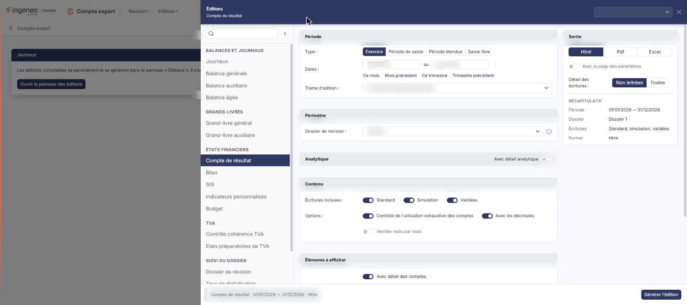
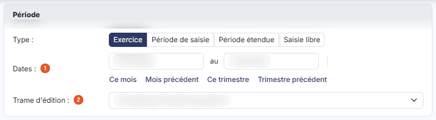
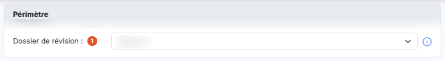
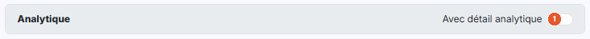
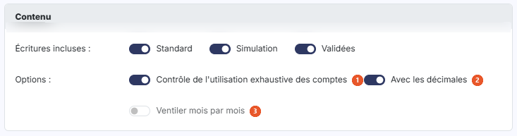
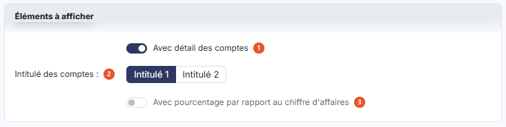
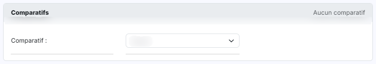
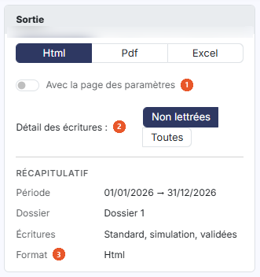

# Compte de résultat


**Où le trouver :** Menu **Editions › Compte de résultat**



**En bref** — Cette édition produit le compte de résultat du dossier, avec en option le détail analytique, le détail des comptes et des comparatifs, à partir du panneau des éditions.

* Pour éditer : choisissez la période, puis le format (« Html », « Pdf » ou « Excel ») dans la carte « Sortie », puis bouton \[Générer l'édition].
* Pour voir les comptes de chaque ligne : activez « Avec détail des comptes », puis bouton \[Générer l'édition].


Cette option permet d'éditer le compte de résultat du dossier.

<figure><figcaption>
Écran « Compte de résultat » de la nouvelle interface
</figcaption></figure>

## Le panneau d'éditions

<figure><figcaption>
Bouton [Ouvrir le panneau des éditions]
</figcaption></figure>

Cette édition ne s'ouvre plus dans une page de paramétrage : elle se paramètre et se génère dans le **panneau d'éditions**, commun à toutes les éditions comptables. Pour l'ouvrir, cliquez sur le menu **Éditions** de la barre du module, puis sur **Compte de résultat** ; depuis l'écran Révision, ouvrez le menu ⋮ (Plus d'actions), puis **Éditions**, et choisissez l'édition dans la liste de gauche du panneau. La page qui s'affiche derrière porte le titre de l'édition et le bouton **\[Ouvrir le panneau des éditions]** : le panneau s'ouvre de lui-même ; si vous l'avez fermé, ce bouton le rouvre.

Le panneau est un tiroir intitulé « Éditions », suivi du nom de l'édition. **À gauche**, la liste des quinze éditions en cinq groupes — « Balances et journaux », « Grands-livres », « États financiers », « TVA » et « Suivi du dossier » — avec une zone « Rechercher une édition » et un bouton « Replier la liste » ; cliquer sur une autre édition change de formulaire sans quitter le panneau. **Au centre**, le formulaire, présenté en cartes. **À droite**, la carte « Sortie » et le « Récapitulatif » des critères retenus. **En en-tête**, la liste des paramétrages enregistrés (voir plus bas) et la croix « Fermer ». **Dans le pied**, un résumé de l'édition (nom, dates, format) et, à droite, le bouton **\[Générer l'édition]**. Le pied ne porte pas de bouton \[Annuler] : le panneau se referme par la croix « Fermer » de l'en-tête.

L'écran est un formulaire de paramétrage : vous y choisissez la période, la trame d'édition, les éléments à faire figurer, les comparatifs et le format du document, puis vous lancez l'édition avec le bouton **\[Générer l'édition]**. Les critères se présentent en cartes, dans l'ordre décrit ci-dessous : « Période », « Périmètre », « Analytique », « Contenu », « Éléments à afficher » et « Comparatifs ».

Certains champs n'apparaissent que selon les choix que vous faites : ils sont signalés à leur place.

## Carte « Période »

<figure><figcaption>
Rubrique « Carte « Période » »
</figcaption></figure>

| Champ                  | Ce qu'il faut savoir                                                                                                                                                                                                                                                                                                                                                                                                                                       |
| ---------------------- | ---------------------------------------------------------------------------------------------------------------------------------------------------------------------------------------------------------------------------------------------------------------------------------------------------------------------------------------------------------------------------------------------------------------------------------------------------------- |
| 1. **Dates**           | Du … au … : les deux dates que le logiciel a déduites de la période choisie. Elles restent saisissables à tout moment, directement ou avec le calendrier, qui s'ouvre au clic dans la zone de date : modifier une date fait passer le type sur « Saisie libre ».                                                                                                                                                                                           |
| 2. **Trame d'édition** | Choisissez dans la liste la trame d'états financiers avec laquelle présenter le compte de résultat. La liste dépend du dossier : elle est alimentée par les modèles de type compte de résultat paramétrés dans le panneau Paramètres, rubrique « Modèles », « Documents », « États financiers ». Le logiciel retient la première entrée de la liste à l'ouverture de l'écran. Il n'y a pas d'entrée Aucune sur cet écran : une trame est toujours retenue. |
| **Type**               | Choisissez la période à éditer avec les boutons « Exercice », « Période de saisie », « Période étendue » et « Saisie libre ». Le logiciel propose Exercice à l'ouverture de l'écran. Sous les dates, les raccourcis « Ce mois », « Mois précédent », « Ce trimestre » et « Trimestre précédent » renseignent les deux dates et passent le type sur « Saisie libre ».                                                                                       |

## Carte « Périmètre »

<figure><figcaption>
Rubrique « Carte « Périmètre » »
</figcaption></figure>

**Dossier de révision** : choisissez le dossier de révision dont les écritures de simulation doivent être retenues. La liste propose Aucun, puis un choix par dossier de révision existant sur le dossier annuel. Le logiciel retient d'office un dossier de révision à l'ouverture de l'écran, et non Aucun. Le pictogramme d'information placé à droite du champ précise : « Sélectionnez le dossier de révision pris en compte par l'édition : ses commentaires de révision si l'option « Avec les commentaires de révision » est active, et les écritures de simulation de son journal si l'option « Avec les écritures de simulation » est active. « Aucun » : seules les écritures de simulation des journaux non rattachés à un dossier de révision sont retenues. »

## Carte « Analytique »

<figure><figcaption>
Rubrique « Carte « Analytique » »
</figcaption></figure>

**Avec détail analytique** : cet interrupteur, placé dans l'en-tête de la carte, est désactivé par défaut.

Tant qu'il est désactivé, la carte ne comporte que lui. Dès que vous l'activez, la carte se déplie et fait apparaître cinq champs supplémentaires, et une ligne « Analytique » s'ajoute au « Récapitulatif » :

* **Axes** : liste déroulante qui retient par défaut tous les axes analytiques du dossier.
* **Sections** : liste déroulante qui retient par défaut toutes les sections.
* **Présentation de l'édition** : choisissez la manière d'ordonner le document, « Détail des sections par compte » ou « Détail des comptes par section ». Le logiciel propose « Détail des sections par compte ».
* **Inclure les écritures non ventilées** : le logiciel le propose désactivé.
* **Edition unitaire par section** : le logiciel le propose désactivé.

## Carte « Contenu »

<figure><figcaption>
Rubrique « Carte « Contenu » »
</figcaption></figure>

| Champ                                                   | Ce qu'il faut savoir                                                                                                                                                                                                                                                                                                                           |
| ------------------------------------------------------- | ---------------------------------------------------------------------------------------------------------------------------------------------------------------------------------------------------------------------------------------------------------------------------------------------------------------------------------------------- |
| 1. **Contrôle de l'utilisation exhaustive des comptes** | Le logiciel le propose activé.                                                                                                                                                                                                                                                                                                                 |
| 2. **Avec les décimales**                               | Le logiciel le propose activé.                                                                                                                                                                                                                                                                                                                 |
| 3. **Ventiler mois par mois**                           | 
Le logiciel le propose désactivé. La ventilation mensuelle et les comparatifs s'excluent : dès que vous activez « Ventiler mois par mois », le logiciel retire la carte « Comparatifs » et fait apparaître à la place le champ « Position du total ». Le champ « Avec pourcentage par rapport au chiffre d'affaires » reste proposé.
 |
| **Écritures incluses**                                  | Trois interrupteurs, « Standard », « Simulation » et « Validées », tous activés par défaut.                                                                                                                                                                                                                                                    |
| **Position du total**                                   | Indiquez si la colonne de total doit figurer en première ou en dernière colonne, « Total à gauche » ou « Total à droite ». Le logiciel propose « Total à droite ». Ce champ n'est proposé que lorsque « Ventiler mois par mois » est activé.                                                                                                   |

## Carte « Éléments à afficher »

<figure><figcaption>
Rubrique « Carte « Éléments à afficher » »
</figcaption></figure>

| Champ                                                     | Ce qu'il faut savoir                                                                                                                                                                                                                                           |
| --------------------------------------------------------- | -------------------------------------------------------------------------------------------------------------------------------------------------------------------------------------------------------------------------------------------------------------- |
| 1. **Avec détail des comptes**                            | Le logiciel le propose activé.                                                                                                                                                                                                                                 |
| 2. **Intitulé des comptes**                               | Choisissez lequel des deux intitulés du plan comptable faire figurer en regard de chaque compte détaillé, « Intitulé 1 » ou « Intitulé 2 ». Le logiciel propose « Intitulé 1 ». Ce choix reste affiché même lorsque « Avec détail des comptes » est désactivé. |
| 3. **Avec pourcentage par rapport au chiffre d'affaires** | Le logiciel le propose désactivé.                                                                                                                                                                                                                              |

## Carte « Comparatifs »

<figure><figcaption>
Rubrique « Carte « Comparatifs » »
</figcaption></figure>

La carte indique « Aucun comparatif » à l'ouverture, puis « 1 comparatif actif » ou « 2 comparatifs actifs » selon vos choix. Vous pouvez confronter, dans la même édition, les montants de la période à ceux de deux autres exercices, présentés côte à côte en deux colonnes, « Comparatif 1 » et « Comparatif 2 ».

**Comparatif** : la liste de chaque colonne propose Aucun, les deux valeurs génériques n-1 et n-2, puis un choix par dossier annuel de la société. Le logiciel propose Aucun pour les deux. Les valeurs génériques désignent l'exercice qui précède, et celui qui précède l'exercice précédent, ce qui vous évite de reprendre le paramétrage d'une année sur l'autre. Tant que la liste reste sur Aucun, la colonne indique « Aucun comparatif ».

Dès que vous retenez une valeur autre que Aucun, le logiciel fait apparaître, dans la colonne du comparatif concerné, six champs qui précisent ce que la comparaison doit produire, ainsi qu'un lien « Retirer » qui retire le comparatif :

* **Période** : indiquez l'étendue à retenir dans l'exercice comparé : « Tout l'exercice », ou « Saisie libre » pour l'arrêter à une date. Le logiciel propose « Tout l'exercice ».
* **Dossier de révision** : « Aucun » par défaut.
* **Jusqu'au** : la date à laquelle arrêter l'exercice comparé. Le logiciel propose la date de fin de l'exercice comparé ; elle n'est saisissable que si « Saisie libre » est retenu.
* **Avec solde** : le logiciel le propose activé.
* **Avec variation en valeur** : le logiciel le propose désactivé.
* **Avec variation en %** : le logiciel le propose désactivé.

## Carte « Sortie » (à droite du formulaire)

<figure><figcaption>
Rubrique « Carte « Sortie » (à droite du formulaire) »
</figcaption></figure>

| Champ                              | Ce qu'il faut savoir                                                                                                                                                                                                                                                                                  |
| ---------------------------------- | ----------------------------------------------------------------------------------------------------------------------------------------------------------------------------------------------------------------------------------------------------------------------------------------------------- |
| 1. **Avec la page des paramètres** | Le logiciel le propose désactivé.                                                                                                                                                                                                                                                                     |
| 2. **Détail des écritures**        | 
Indiquez si le détail doit porter sur les seules écritures « Non lettrées » ou sur « Toutes » les écritures. Le logiciel propose « Non lettrées ». Ce champ est proposé quel que soit le format retenu. Lorsque vous retenez Pdf, le logiciel fait apparaître deux champs supplémentaires :
 |
| 3. **Format**                      | Choisissez le format du document avec les boutons « Html », « Pdf » ou « Excel ». Le logiciel propose Html.                                                                                                                                                                                           |
| **Orientation**                    | « Portrait » ou « Paysage ». Le logiciel propose « Portrait ».                                                                                                                                                                                                                                        |
| **Largeur**                        | « Fixe » ou « Ajustée ». Le logiciel propose « Ajustée ». Son infobulle précise : « Ajuste la taille si la largeur des colonnes dépasse la largeur de la page ».                                                                                                                                      |

Au format Excel, le logiciel ne propose ni Orientation, ni Largeur : la carte se réduit alors à « Avec la page des paramètres » et « Détail des écritures ». Le « Récapitulatif » placé sous ces choix rappelle la période, le dossier de révision, les écritures incluses et le format retenus.

## Paramétrages enregistrés et génération

**Les paramétrages enregistrés**

La zone « Nouveau paramétrage… », en haut à droite du panneau, remplace les anciens boutons \[Mémoriser les paramètres] et \[Charger les paramètres]. Son chevron (« Afficher les paramètres enregistrés ») ouvre une liste : l'entrée « Nouveau paramètre — À partir des critères affichés », puis, sous le nom de l'édition et avec leur nombre, les paramétrages déjà enregistrés **pour cette édition** (un paramétrage enregistré pour une autre édition n'y figure pas). Au survol d'un paramétrage, deux icônes permettent de le dupliquer ou de le supprimer.

| Champ                                 | Ce qu'il faut savoir                                                                                                                                                                                                                                                                                                                            |
| ------------------------------------- | ----------------------------------------------------------------------------------------------------------------------------------------------------------------------------------------------------------------------------------------------------------------------------------------------------------------------------------------------- |
| **Enregistrer les critères affichés** | Saisissez un nom dans la zone « Nouveau paramétrage… », puis validez par la touche Entrée ou par le bouton d'enregistrement placé à droite de la zone (info-bulle « Enregistrer comme nouveau paramètre (Entrée) »).                                                                                                                            |
| **Reprendre un paramétrage**          | Cliquez sur son nom dans la liste. Le formulaire se remplit avec ses critères, y compris le format de sortie, et le nom s'affiche dans la zone d'en-tête. Une icône d'enregistrement placée à côté du nom (info-bulle « Modifié – mettre à jour « nom » (Entrée) ») permet de remettre à jour le paramétrage chargé avec les critères affichés. |

bouton **\[Générer l'édition]**

Il se trouve dans le pied du panneau et lance la génération du document dans le format que vous avez retenu. bouton **\[Retour au paramétrage]**, bouton **\[Ouvrir dans un onglet]**, bouton **\[Excel]** et bouton **\[Pdf]** ne sont pas affichés à l'ouverture : le panneau les prévoit après la génération.
